# 🛡️ DOCUMENTACIÓN INTEGRAL DEL SISTEMA AEGISCORE AI
## ERP Distribuido, Peritaje Inteligente y Liquidación Autónoma de Siniestros de Seguros
### Metodología ICONIX — Ingeniería de Software 2 (2do Parcial)
**Universidad Autónoma Gabriel René Moreno (UAGRM)**  
**Facultad Integral de Ciencias de la Computación y Telecomunicaciones (FICCT)**  
**Docente:** MSc. Ing. Angélica Garzón Cuéllar  
**Grupo de Desarrollo:** Grupo #27  
**Integrantes:**
- David Garcia
- Jose Diego Garcia
- Arnulfo Velasquez

**Fecha:** Noviembre 2026 — Santa Cruz de la Sierra, Bolivia  
**Versión del Documento:** 3.0 (Estructura Formal Normalizada según `Indice_ICONIX.pdf`)  
**Modelo UML:** Sparx Systems Enterprise Architect 17.2 (`AegisCore_AI.qea`)

---

## 📑 ÍNDICE GENERAL DEL PROYECTO

- **[CAPÍTULO I. ASPECTOS GENERALES](#capítulo-i-aspectos-generales)**
  - [1.1. Introducción](#11-introducción)
  - [1.2. Planteamiento del problema](#12-planteamiento-del-problema)
  - [1.3. Objetivos del proyecto](#13-objetivos-del-proyecto)
    - [1.3.1. Objetivo general](#131-objetivo-general)
    - [1.3.2. Objetivos específicos](#132-objetivos-específicos)
  - [1.4. Justificación](#14-justificación)
  - [1.5. Alcance y limitaciones](#15-alcance-y-limitaciones)
  - [1.6. Metodología de desarrollo ICONIX](#16-metodología-de-desarrollo-iconix)
- **[CAPÍTULO II. ANÁLISIS DE REQUISITOS](#capítulo-ii-análisis-de-requisitos)**
  - [2.1. Descripción del sistema propuesto](#21-descripción-del-sistema-propuesto)
  - [2.2. Identificación de actores](#22-identificación-de-actores)
  - [2.3. Requisitos funcionales y no funcionales](#23-requisitos-funcionales-y-no-funcionales)
  - [2.4. Reglas de negocio](#24-reglas-de-negocio)
  - [2.5. Diagrama UML de casos de uso](#25-diagrama-uml-de-casos-de-uso)
  - [2.6. Especificación de casos de uso](#26-especificación-de-casos-de-uso)
- **[CAPÍTULO III. ANÁLISIS Y DISEÑO CON ICONIX](#capítulo-iii-análisis-y-diseño-con-iconix)**
  - [3.1. Modelo de dominio](#31-modelo-de-dominio)
  - [3.2. Diagramas de robustez](#32-diagramas-de-robustez)
  - [3.3. Diagramas de secuencia UML](#33-diagramas-de-secuencia-uml)
  - [3.4. Diagrama de clases UML](#34-diagrama-de-clases-uml)
  - [3.5. Diseño de la base de datos](#35-diseño-de-la-base-de-datos)
  - [3.6. Diseño de interfaces de usuario](#36-diseño-de-interfaces-de-usuario)
- **[CAPÍTULO IV. DESARROLLO E IMPLEMENTACIÓN](#capítulo-iv-desarrollo-e-implementación)**
  - [4.1. Herramientas y tecnologías utilizadas](#41-herramientas-y-tecnologías-utilizadas)
  - [4.2. Diseño de la arquitectura del sistema](#42-diseño-de-la-arquitectura-del-sistema)
  - [4.3. Implementación de la base de datos](#43-implementación-de-la-base-de-datos)
  - [4.4. Desarrollo de los módulos del sistema](#44-desarrollo-de-los-módulos-del-sistema)
  - [4.5. Integración de componentes](#45-integración-de-componentes)
- **[CAPÍTULO V. PRUEBAS Y RESULTADOS](#capítulo-v-pruebas-y-resultados)**
  - [5.1. Plan de pruebas](#51-plan-de-pruebas)
  - [5.2. Pruebas funcionales](#52-pruebas-funcionales)
  - [5.3. Pruebas de integración](#53-pruebas-de-integración)
  - [5.4. Corrección de errores](#54-corrección-de-errores)
  - [5.5. Resultados de las pruebas](#55-resultados-de-las-pruebas)
  - [5.6. Casos de prueba](#56-casos-de-prueba)
- **[CAPÍTULO VI. CONCLUSIONES Y RECOMENDACIONES](#capítulo-vi-conclusiones-y-recomendaciones)**
  - [6.1. Conclusiones](#61-conclusiones)
  - [6.2. Recomendaciones](#62-recomendaciones)
- **[7. BIBLIOGRAFÍA](#7-bibliografía)**
- **[8. ANEXOS](#8-anexos)**

---

# CAPÍTULO I. ASPECTOS GENERALES

## 1.1. Introducción
La industria aseguradora contemporánea enfrenta una transformación digital sin precedentes impuesta por la necesidad de inmediatez, transparencia y resiliencia tecnológica. Tradicionalmente, la administración de pólizas, la recepción de reportes de accidentes vehiculares y la posterior liquidación indemnizatoria han dependido de arquitecturas monolíticas legadas, trámites burocráticos en papel y procesos periciales manuales con tiempos de respuesta que oscilan entre 15 y 45 días hábiles.

**AegisCore AI** nace como una solución integral de clase empresarial (ERP Distribuido) diseñada bajo estándares de ingeniería de software rigurosos. Integra peritaje de campo asistido por Inteligencia Artificial en el borde (*Edge AI*), liquidación atómica y transversal de siniestros mediante el patrón arquitectónico *Saga Coreografiada*, persistencia políglota de alto rendimiento y analítica avanzada con agentes autónomos basados en el protocolo *Model Context Protocol* (MCP). El proyecto ha sido modelado y desarrollado siguiendo la metodología **ICONIX**, garantizando una trazabilidad directa desde los requisitos del negocio hasta el código fuente ejecutable.

## 1.2. Planteamiento del problema
En el contexto actual de las compañías de seguros en Bolivia y la región, la gestión de siniestros y pólizas presenta deficiencias estructurales críticas:
1. **Falta de conectividad en carreteras y zonas rurales:** Los peritos de campo se desplazan a lugares remotos sin cobertura celular 3G/4G. Las aplicaciones tradicionales fallan al intentar comunicarse con servidores centrales, forzando al perito a tomar apuntes en libretas y fotografías desconectadas, retrasando el peritaje técnico varios días.
2. **Duplicidad y pérdida de transacciones financieras:** La intermitencia de las redes móviles provoca que los reintentos automáticos de envío de inspecciones o pagos de primas deriven en transacciones duplicadas o cobros inconsistentes.
3. **Procesos de liquidación lentos e inconsistentes:** La aprobación de un siniestro requiere coordinar tres áreas aisladas: validar el estado del reclamo, verificar la cobertura de la póliza y emitir la orden contable de desembolso. Si alguno de estos pasos falla, los sistemas legados dejan saldos financieros bloqueados o coberturas anuladas sin mecanismo de reversión.
4. **Vulnerabilidad al fraude y estimación subjetiva de daños:** La inspección visual humana tradicional carece de objetividad técnica estandarizada, facilitando el fraude por sobrefacturación de piezas o reclamos ficticios, lo que genera pérdidas de entre el 10% y el 20% del fondo de reservas técnicas.
5. **Inseguridad en consultas directivas:** La necesidad de los ejecutivos de consultar balances consolidados en lenguaje natural suele implementar consultas SQL dinámicas que exponen a la empresa a vulnerabilidades de Inyección SQL (OWASP Top 10).

**Formulación del Problema:**  
*¿Cómo diseñar e implementar un sistema ERP distribuido, inteligente y resiliente que automatice la gestión de pólizas, garantice el peritaje móvil sin conexión mediante Edge AI, coordine transacciones financieras atómicas e idempotentes entre microservicios, y provea analítica avanzada y consultas seguras por voz?*

## 1.3. Objetivos del proyecto

### 1.3.1. Objetivo general
Desarrollar, modelar bajo metodología ICONIX e implementar un sistema ERP distribuido para empresas de seguros denominado **AegisCore AI**, que integre peritaje móvil inteligente con inferencia local (Edge AI), liquidación autónoma mediante transacciones distribuidas Saga sobre Apache Kafka, control de idempotencia ultrarrápido (<5 ms) en Amazon DynamoDB Local y analítica predictiva con servidores MCP blindados contra inyecciones SQL.

### 1.3.2. Objetivos específicos
1. **Centralizar la identidad y acceso (SSO):** Implementar autenticación unificada con Keycloak mediante el flujo OAuth2 / OpenID Connect con Proof Key for Code Exchange (PKCE) y tokens JWT RS256.
2. **Consolidar la información comercial y contractual:** Desarrollar el Microservicio 1 (PHP 8.3 / Laravel) bajo principios de Domain-Driven Design (DDD) y un Gateway federado Apollo Supergraph GraphQL para unificar consultas de clientes y pólizas en $< 250	ext{ ms}$.
3. **Validar documentos en el cliente:** Diseñar un cotizador web PWA (React) que evalúe la nitidez de documentos de identidad mediante convolución con Kernel Laplaciano local antes de transferir datos al servidor.
4. **Operar peritajes en campo sin conexión:** Construir una aplicación móvil en Flutter con SQLite local y modelos TensorFlow Lite cuantizados (`crashnet_model.tflite`) que clasifique daños en $< 200	ext{ ms}$ en modo *offline-first*.
5. **Garantizar la idempotencia transaccional:** Desplegar una capa de control con Amazon DynamoDB Local que valide o adquiera bloqueos de peticiones concurrentes mediante firmas SHA-256 en un tiempo $p99 < 5	ext{ ms}$.
6. **Asegurar consistencia transaccional distribuida:** Orquestar una Saga Coreografiada a través de Apache Kafka entre tres microservicios (Siniestros en NestJS, Pólizas en PHP y Motor Actuarial en Spring Boot) con rollbacks semánticos automáticos ante fallas de cobertura.
7. **Prevenir el fraude y predecir demanda:** Entrenar modelos de Machine Learning (Random Forest con 150 estimadores para tarifas actuariales, y K-Means con Isolation Forest para detección de fraude) integrados en el Microservicio 4 (FastAPI).
8. **Facilitar reportes ejecutivos por voz:** Implementar un Servidor con protocolo MCP (Model Context Protocol) asistido por Whisper STT, blindado con filtros de sanitización OWASP que rechace cualquier token de inyección SQL.

## 1.4. Justificación
- **Justificación Técnica:** AegisCore AI adopta patrones arquitectónicos de vanguardia (DDD, Clean Architecture + CQRS, Arquitectura Hexagonal y Pipelines de IA) y una estrategia de persistencia políglota que aprovecha las fortalezas individuales de PostgreSQL 16 (consistencia ACID), MongoDB 7 (documentos geoespaciales `2dsphere`), DynamoDB Local (latencia sub-5ms) y SQLite local móvil.
- **Justificación Económica:** La automatización del peritaje y la liquidación reduce los costos operativos de ajuste en un 70% y recorta el tiempo de procesamiento de siniestros de 30 días a menos de 10 minutos. La detección temprana de fraudes con Isolation Forest protege los fondos de indemnización de la compañía.
- **Justificación Social:** En momentos de accidentes viales, el asegurado recibe auxilio inmediato gracias al botón SOS geoespacial con despacho automático del perito más cercano, brindando tranquilidad y reduciendo tiempos de espera en situaciones de estrés.
- **Justificación Operativa:** Permite a los peritos trabajar sin interrupciones en carreteras nacionales y zonas sin señal de internet, garantizando que ninguna evidencia se pierda y que la sincronización posterior se realice sin riesgos de duplicación.

## 1.5. Alcance y limitaciones
- **Alcance del Sistema:** Comprende 15 Casos de Uso integrales (`CU01` al `CU15`), organizados en tres módulos funcionales: Módulo Comercial y SSO, Módulo de Siniestros y Saga Transversal, y Módulo de Inteligencia Artificial y Servidor MCP. Cubre las interfaces de cliente (React PWA), perito móvil (Flutter) y directivos (Angular 17+ BI), integradas mediante 4 microservicios backend y contratos congelados inmutables.
- **Limitaciones del Sistema:**
  - La inferencia móvil de daños requiere dispositivos Android con procesadores compatibles con operaciones de punto flotante de 32 bits (Android SDK 26 o superior).
  - La validación de nitidez de imágenes en el cliente web depende de navegadores compatibles con HTML5 Canvas y aceleración WebGL.
  - La asignación automática de peritos está sujeta a la disponibilidad de señal GPS en el dispositivo emisor del reporte SOS.
  - Las transacciones de cobro QR están normalizadas para pasarelas que cumplan con el estándar boliviano EMVCo / BCB.

## 1.6. Metodología de desarrollo ICONIX
El proyecto ha sido conducido estrictamente bajo la metodología **ICONIX**, desarrollada por Doug Rosenberg y Matt Stephens. ICONIX es un proceso de desarrollo ágil y minimalista que se enfoca en el núcleo del sistema mediante la **Regla de Pareto (80/20)**: obtener el 80% del valor del modelado con el 20% de los artefactos UML formales, garantizando una transición sin vacíos (*traceability gap*) entre requisitos y código.

ICONIX se articula en 4 fases secuenciales e iterativas:
1. **Fase 1: Análisis de Requisitos:** Identificación de actores, especificación detallada de casos de uso en formato de dos columnas (*Acciones del Usuario* vs. *Acciones del Sistema*) y definición del Modelo de Dominio inicial.
2. **Fase 2: Análisis y Diseño Preliminar (Robustez BCE):** Descomposición de los casos de uso en objetos de tres estereotipos fundamentales: **Boundary** (interfaz/vista), **Control** (lógica de negocio/orquestación) y **Entity** (persistencia). Sirve para detectar omisiones de requisitos y asignar responsabilidades.
3. **Fase 3: Diseño Detallado:** Elaboración de Diagramas de Secuencia UML 2.5+ donde los métodos operacionales pertenecen explícitamente a las Clases de Control, y diseño de Diagramas de Clases con atributos tipados y operaciones.
4. **Fase 4: Desarrollo e Implementación:** Codificación desacoplada en microservicios respetando los contratos congelados y ejecución de suites de pruebas automatizadas.

```
+---------------------------+        +---------------------------+
| FASE 1: REQUISITOS        | -----> | FASE 2: ROBUSTEZ (BCE)    |
| • Casos de Uso (2 Cols)   |        | • Boundary, Control,      |
| • Modelo de Dominio       |        |   Entity                  |
+---------------------------+        +---------------------------+
              |                                    |
              v                                    v
+---------------------------+        +---------------------------+
| FASE 4: IMPLEMENTACIÓN    | <----- | FASE 3: DISEÑO DETALLADO  |
| • Microservicios Políg.   |        | • Secuencia UML 2.5+      |
| • Pruebas Automatizadas   |        | • Clases de Diseño        |
+---------------------------+        +---------------------------+
```

---

# CAPÍTULO II. ANÁLISIS DE REQUISITOS

## 2.1. Descripción del sistema propuesto
**AegisCore AI** es un ERP distribuido especializado en seguros que automatiza el ciclo de vida de contratos, inspecciones y liquidaciones. Se compone de tres frentes de interacción:
- **Portal Clientes React PWA:** Permite cotizar pólizas con validación local de cédulas, consultar estados unificados mediante GraphQL y emitir pedidos vía WhatsApp.
- **Aplicación Móvil Peritos (Flutter):** Diseñada para campo, permite atender siniestros SOS, ejecutar peritajes técnicos con Edge AI (TensorFlow Lite) sin señal y sincronizar lotes con cabeceras de idempotencia contra DynamoDB Local.
- **Panel Administrativo y BI (Angular 17+):** Ofrece a liquidadores y directores auditoría de daños con mapas de calor Grad-CAM, aprobación de Sagas, monitoreo del agente autónomo LangGraph y consultas por voz con Servidor MCP blindado.

## 2.2. Identificación de actores
El sistema interactúa con 7 actores claramente diferenciados (5 humanos y 2 sistemas externos/mensajería):

| Actor | Tipo | Rol y Responsabilidad en el Sistema |
|---|---|---|
| **Cliente Asegurado** | Humano | Titular de póliza. Autentica mediante SSO, cotiza en PWA, emite pedidos en WhatsApp, solicita auxilio SOS y paga primas mediante QR. |
| **Perito de Campo** | Humano | Técnico evaluador en terreno. Recibe alertas SOS, realiza inspecciones fotográficas offline y sincroniza con DynamoDB. |
| **Ajustador de Siniestros** | Humano | Liquidador legal y financiero. Audita expedientes con Grad-CAM y aprueba la liquidación transversal mediante Saga. |
| **Auditor de Riesgos y Analista BI** | Humano | Actuario. Analiza métricas de ventas y primas con Random Forest y audita anomalías de fraude con Isolation Forest. |
| **Director Comercial y Finanzas** | Humano | Alta gerencia. Administra catálogo de planes en MS1, supervisa metas del agente LangGraph y solicita reportes por voz. |
| **Broker Apache Kafka** | Sistema Externo | Bus de eventos distribuido. Transmite eventos de la Saga, coordina estados transaccionales y ejecuta compensaciones (rollbacks). |
| **Bot WhatsApp / Servidor MCP** | Sistema Externo | Pasarelas inteligentes. El webhook de WhatsApp gestiona compras con n8n; el servidor MCP expone herramientas seguras para consultas ejecutivas. |

## 2.3. Requisitos funcionales y no funcionales

### Requisitos Funcionales (RF01 al RF15)
- **RF01 (Autenticación SSO Keycloak):** Autenticar usuarios en clientes web y móviles mediante OAuth2 / PKCE con tokens JWT RS256.
- **RF02 (Consulta Estado Unificado GraphQL):** Consultar en una sola llamada federada a Apollo Supergraph el estado de pólizas, siniestros y cuotas en $< 250	ext{ ms}$.
- **RF03 (Administración Catálogo DDD):** Gestionar clientes, coberturas y pólizas en MS1 (PHP Laravel) manteniendo invariantes de negocio en Agregados de Dominio.
- **RF04 (Cotización Web con IA Local):** Validar la nitidez de la fotografía del documento en el cliente web mediante convolución Laplaciana (umbral $\ge 0.65$) antes de la emisión.
- **RF05 (Automatización WhatsApp a Factura PDF):** Recibir pedidos de póliza por webhook de WhatsApp, activar el flujo en n8n, registrar la póliza y devolver factura PDF firmada con SHA-256.
- **RF06 (Reporte SOS y Triaje Geoespacial):** Registrar siniestros SOS con GPS en MongoDB y asignar perito cercano en radio de 25 km mediante índice espacial `2dsphere`.
- **RF07 (Inspección Móvil Offline Edge AI):** Clasificar severidad de daños en vehículos en $< 200	ext{ ms}$ con TFLite en modo offline y persistir en SQLite local.
- **RF08 (Sincronización Idempotente DynamoDB):** Transmitir peritajes pendientes con cabecera `X-Idempotency-Key` y bloquear duplicados en Amazon DynamoDB Local en $< 5	ext{ ms}$.
- **RF09 (Liquidación Saga Transversal):** Orquestar la indemnización atómica a través de MS2, MS1 y MS3 con Kafka, ejecutando compensaciones automáticas ante rechazos.
- **RF10 (Cobro Recurrente y Pago QR Idempotente):** Generar códigos QR EMV compatibles con el sistema bancario boliviano y procesar abonos con garantía de no duplicidad.
- **RF11 (Visión Artificial CNN CrashNet):** Clasificar fotografías de choques en 4 clases de severidad con exactitud $\ge 90\%$ y renderizar mapa de calor explicativo Grad-CAM.
- **RF12 (Predicción Actuarial con Random Forest):** Calcular probabilidad de siniestralidad y sugerir prima técnica óptima con ensamble Random Forest entrenado sobre 1,200 registros.
- **RF13 (Segmentación K-Means y Detección de Fraude):** Agrupar asegurados en 3 clusters de riesgo y detectar reclamos sospechosos mediante Isolation Forest marcando bandera SIU.
- **RF14 (Monitoreo Autónomo LangGraph):** Supervisar de forma continua la salud de los servicios y rebalancear peritos automáticamente mediante un agente de estados.
- **RF15 (Reportes por Voz Servidor MCP Anti-SQLi):** Transcribir instrucciones de voz (Whisper STT), filtrar inyecciones SQL (OWASP) y resolver consultas mediante herramientas MCP parametrizadas.

### Requisitos No Funcionales (RNF01 al RNF12)
- **RNF01 (Rendimiento Edge AI):** La inferencia local con TensorFlow Lite en el smartphone debe completarse en menos de 200 milisegundos.
- **RNF02 (Latencia de Idempotencia):** La comprobación de claves de idempotencia en DynamoDB Local debe ejecutarse con una latencia $p99 < 5	ext{ ms}$.
- **RNF03 (Seguridad Criptográfica):** Comunicaciones sobre TLS 1.3, tokens JWT firmados con RSA SHA-256 (RS256) y validación de hash SHA-256 en peticiones con idempotencia.
- **RNF04 (Disponibilidad Offline-First):** La app móvil debe permitir peritajes completos sin conexión a internet y garantizar sincronización sin pérdida de datos.
- **RNF05 (Persistencia Políglota Especializada):** Uso estricto de PostgreSQL 16 (ACID), MongoDB 7 (GeoJSON/2dsphere), DynamoDB Local (clave-valor) y SQLite (móvil).
- **RNF06 (Desacoplamiento Asíncrono):** Comunicación inter-microservicios basada en eventos con Apache Kafka bajo semántica *at-least-once*.
- **RNF07 (Aislamiento de Dominios):** Cada microservicio debe implementar su patrón asignado (DDD en MS1, Clean/CQRS en MS2, Hexagonal en MS3, Pipelines en MS4).
- **RNF08 (Consistencia Eventual en Sagas):** Compensaciones transaccionales en Kafka resueltas en menos de 2 segundos ante fallas en cualquier participante.
- **RNF09 (Protección contra Inyecciones SQL):** El servidor MCP debe sanitizar tokens de lenguaje natural y ejecutar consultas exclusivamente compiladas en ORM (OWASP Top 10).
- **RNF10 (Compatibilidad Móvil):** Base de código Flutter compilable nativamente para Android (SDK 26+) e iOS (15+).
- **RNF11 (Trazabilidad ICONIX):** Correspondencia estricta Boundary-Control-Entity y métodos de secuencia pertenecientes a la Clase de Control.
- **RNF12 (Auditabilidad Fiscal):** Documentos de pago y pólizas almacenados con firma digital inmutable y hash SHA-256 en almacenamiento compatible con S3.

## 2.4. Reglas de negocio
Las reglas de negocio (RN) norman el comportamiento funcional del ERP:

| Código | Nombre de la Regla | Descripción y Lógica Aplicada |
|---|---|---|
| **RN01** | Vigencia de Cobertura | No se puede registrar un siniestro si la póliza se encuentra en estado `VENCIDA`, `CANCELADA` o con mora superior a 30 días. |
| **RN02** | Umbral de Nitidez Documental | Toda fotografía de documento de identidad en el cotizador web debe tener una varianza Laplaciana $\ge 0.65$; de lo contrario se rechaza localmente. |
| **RN03** | Radio Máximo de Triaje SOS | La búsqueda de peritos de guardia mediante `$nearSphere` se acota a un radio euclidiano máximo de 25 km del punto del siniestro. |
| **RN04** | Caducidad de Cobro QR | Todo código QR generado bajo estándar EMVCo expira a los 15 minutos de su emisión; transacciones posteriores son rechazadas con HTTP 410 Gone. |
| **RN05** | Deducible Obligatorio de Siniestro | Toda indemnización aprobada descuenta un 10% de deducible sobre el costo tasado antes de emitir la orden de desembolso contable. |
| **RN06** | Compensación Obligatoria Saga | Si MS1 no puede reservar cobertura durante la Saga de liquidación, se debe emitir `SettlementRolledBack` y revertir el siniestro a `RECHAZADO`. |
| **RN07** | Baremo de Severidad IA | Las clases de severidad de CrashNet determinan topes máximos de mano de obra y repuestos: Leve ($\le 500$ BOB), Moderado ($\le 1,500$ BOB), Severo ($\le 4,500$ BOB). |
| **RN08** | Alerta Roja Antifraude SIU | Si el `anomaly_score` de Isolation Forest es inferior a $-0.65$, el siniestro se congela y no puede liquidarse sin visto bueno manual de Auditoría. |
| **RN09** | Blindaje OWASP MCP | Cualquier petición de voz transcrita que contenga cadenas como `UNION`, `SELECT`, `DROP`, `OR 1=1` o `--` es bloqueada con HTTP 403 Forbidden. |
| **RN10** | Firma Digital de Factura PDF | Toda factura emitida por n8n debe incluir código de control tributario, QR y hash SHA-256 almacenado en el registro relacional. |
| **RN11** | Idempotencia Estricta en Mutaciones | Toda petición POST a endpoints financieros o de sincronización exige cabecera `X-Idempotency-Key` (UUIDv4) con hash cruzado de payload. |
| **RN12** | Autonomía del Agente LangGraph | El agente puede rebalancear turnos de peritos automáticamente, pero si una acción requiere costos económicos mayores, debe solicitar aprobación humana (*Human-in-the-loop*). |

## 2.5. Diagrama UML de casos de uso
El sistema cuenta con un diagrama general y tres diagramas detallados por módulo funcional:

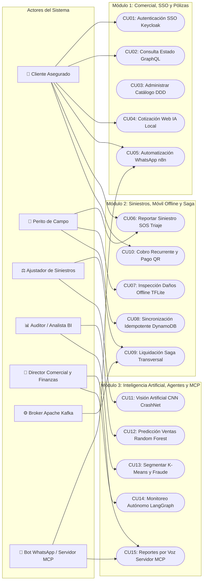

## 2.6. Especificación de casos de uso
A continuación se detallan las 15 fichas de casos de uso bajo el estándar formal de la cátedra de Sistemas de Información II (UAGRM FICCT), con la estructura tabular de dos columnas (**Acciones del Usuario** vs. **Acciones del Sistema**) y cursos alternativos sub-numerados.

### 2.6.1. Ficha de Caso de Uso: CU01 — Autenticación Centralizada SSO con Keycloak
| Elemento | Descripción |
|---|---|
| **Código:** | `CU01` |
| **Nombre:** | Autenticación Centralizada SSO con Keycloak y Protocolo OAuth2 / PKCE |
| **Versión / Fecha:** | v3.0 / Noviembre 2026 |
| **Autor:** | Grupo #27 — AegisCore AI (SW2 FICCT UAGRM) |
| **Actor Principal:** | Cliente Asegurado / Empleado de la Compañía (Perito, Ajustador, Auditor, Director) |
| **Actores Secundarios:** | Servidor de Identidad Keycloak SSO, Microservicio 1 (PHP Laravel) |
| **Precondición:** | El usuario cuenta con una cuenta registrada en el Realm `aegiscore-realm` de Keycloak. |
| **Poscondición:** | Se genera una sesión activa en el cliente con tokens JWT firmados (Access Token RS256 y Refresh Token). |
| **Criterio de Éxito:** | El usuario accede al portal o a la app móvil con sus roles y permisos autorizados. |

#### Curso Típico de Eventos (Flujo Normal)
| Acciones del Usuario (Actor) | Acciones del Sistema (AegisCore AI) |
|---|---|
| **Paso 1:** El usuario accede al cliente web (React PWA) o móvil (Flutter) y presiona "Iniciar Sesión Corporativa". | **Paso 2:** El cliente genera un `code_verifier` aleatorio y un `code_challenge` SHA-256 (flujo OAuth2 PKCE) y redirige al formulario de inicio de sesión de Keycloak. |
| **Paso 3:** El usuario ingresa su correo electrónico corporativo y contraseña, y presiona "Ingresar". | **Paso 4:** Keycloak valida las credenciales contra la base de datos de usuarios; verifica políticas de contraseña y MFA si estuviese configurado. |
| | **Paso 5:** Keycloak emite un código de autorización (`auth_code`) de un solo uso y redirige al `redirect_uri` de la aplicación. |
| | **Paso 6:** La aplicación intercambia en segundo plano el `auth_code` y el `code_verifier` por el par de tokens JWT (`access_token` firmado con clave privada RSA y `refresh_token`). |
| **Paso 7:** El usuario observa su pantalla principal personalizada según sus roles (Asegurado, Perito, Ajustador o Administrador). | **Paso 8:** La aplicación almacena el `access_token` en memoria segura y decodifica los claims para inicializar la sesión en el Gateway GraphQL. |

#### Cursos Alternativos y Excepcionales
- **A.1. Credenciales inválidas:** Si en el Paso 4 el usuario ingresa una contraseña incorrecta, Keycloak rechaza la petición, incrementa el contador de intentos fallidos y muestra en pantalla "Usuario o contraseña inválidos". El flujo retorna al Paso 3.
- **A.2. Cuenta bloqueada por fuerza bruta:** Si el usuario falla 5 intentos consecutivos, Keycloak suspende la cuenta durante 15 minutos y envía una alerta de seguridad al correo registrado.
- **E.1. Servidor Keycloak fuera de línea:** Si en el Paso 2 el servidor de identidad no responde en 3 segundos, la aplicación muestra una pantalla de contingencia "Servicio de autenticación no disponible temporalmente".

---

### 2.6.2. Ficha de Caso de Uso: CU02 — Consulta de Estado Unificado en Gateway GraphQL Apollo Supergraph
| Elemento | Descripción |
|---|---|
| **Código:** | `CU02` |
| **Nombre:** | Consulta de Estado Unificado del Asegurado en Gateway GraphQL Apollo Supergraph |
| **Versión / Fecha:** | v3.0 / Noviembre 2026 |
| **Autor:** | Grupo #27 — AegisCore AI (SW2 FICCT UAGRM) |
| **Actor Principal:** | Cliente Asegurado |
| **Actores Secundarios:** | Apollo Router Supergraph, MS1 Pólizas (PHP), MS2 Siniestros (NestJS), MS3 Actuarial (Spring Boot) |
| **Precondición:** | El cliente se encuentra autenticado con un token JWT válido con rol `ROLE_ASEGURADO`. |
| **Poscondición:** | Se presenta una vista consolidada de pólizas vigentes, siniestros abiertos y facturación en una sola vista. |
| **Criterio de Éxito:** | La consulta federada responde en menos de 250 milisegundos unificando 3 subgrafos. |

#### Curso Típico de Eventos (Flujo Normal)
| Acciones del Usuario (Actor) | Acciones del Sistema (AegisCore AI) |
|---|---|
| **Paso 1:** El cliente asegurado ingresa a la sección "Mi Estado de Cuenta" en el portal React PWA. | **Paso 2:** La vista despacha una consulta GraphQL `query EstadoUnificadoAsegurado` con la cabecera `Authorization: Bearer <jwt>`. |
| | **Paso 3:** El Apollo Router valida la firma RS256 del token y descompone la consulta en planes de ejecución paralelos hacia los subgrafos: MS1 (pólizas), MS2 (siniestros) y MS3 (pagos). |
| | **Paso 4:** MS1 resuelve las coberturas y vigencia; MS2 resuelve los expedientes y estados de reclamos; MS3 resuelve las cuotas y pagos pendientes. |
| | **Paso 5:** El Gateway ensambla el JSON unificado y lo retorna a la aplicación en un tiempo inferior a 250 ms. |
| **Paso 6:** El asegurado visualiza en pantalla sus vehículos protegidos, siniestros en curso y cuotas al día sin notar la existencia de múltiples microservicios. | **Paso 7:** El sistema almacena en la caché de Redis la respuesta con un Time-To-Live (TTL) de 60 segundos para optimizar lecturas subsecuentes. |

#### Cursos Alternativos y Excepcionales
- **A.1. Uno de los microservicios tarda en responder:** Si MS2 (siniestros) experimenta una latencia superior a 1 segundo, Apollo Router aplica un timeout y retorna los datos de pólizas y cuotas acompañados de un mensaje de advertencia parcial en el array `errors` de GraphQL.
- **E.1. Token expirado:** Si en el Paso 2 el token ha expirado, el Apollo Router devuelve código HTTP 401 Unauthorized; el interceptor HTTP del cliente solicita renovación vía `refresh_token`.

---

### 2.6.3. Ficha de Caso de Uso: CU03 — Administrar Catálogo de Planes, Coberturas y Clientes en MS1 (DDD)
| Elemento | Descripción |
|---|---|
| **Código:** | `CU03` |
| **Nombre:** | Administración de Catálogo de Planes, Coberturas y Clientes en MS1 PHP Laravel (DDD) |
| **Versión / Fecha:** | v3.0 / Noviembre 2026 |
| **Autor:** | Grupo #27 — AegisCore AI (SW2 FICCT UAGRM) |
| **Actor Principal:** | Director Comercial / Administrador de Seguros |
| **Actores Secundarios:** | Base de Datos PostgreSQL 16 (`aegiscore_erp`) |
| **Precondición:** | El usuario cuenta con rol `ROLE_ADMIN` o `ROLE_COMERCIAL`. |
| **Poscondición:** | Se actualiza el catálogo de coberturas y tarifas en el esquema relacional ACID de PostgreSQL. |
| **Criterio de Éxito:** | Las entidades del dominio se actualizan manteniendo invariantes de negocio encapsuladas en Agregados DDD. |

#### Curso Típico de Eventos (Flujo Normal)
| Acciones del Usuario (Actor) | Acciones del Sistema (AegisCore AI) |
|---|---|
| **Paso 1:** El administrador comercial ingresa al módulo de "Gestión de Planes y Tarifas" en el panel administrativo. | **Paso 2:** El sistema carga la lista de planes existentes (Responsabilidad Civil, Pérdida Total, Cobertura Amplia) desde PostgreSQL. |
| **Paso 3:** El usuario selecciona "Crear Nuevo Plan de Póliza", ingresa el nombre, límite de cobertura en BOB, deducible y prima base mensual. | **Paso 4:** El controlador de aplicación recibe la petición y construye el Command `CreatePolicyPlanCommand`. |
| **Paso 5:** El usuario presiona "Publicar Plan". | **Paso 6:** El Agregado de Dominio `PlanCobertura` valida las invariantes de negocio (límite de cobertura > 0, deducible <= 20%). |
| | **Paso 7:** El repositorio de infraestructura de Laravel persiste la entidad en PostgreSQL dentro de una transacción ACID. |
| **Paso 8:** El usuario recibe el mensaje de confirmación "Plan creado satisfactoriamente con código PLAN-2026-X" y lo visualiza activo en el catálogo. | **Paso 9:** El sistema emite un evento de dominio `PolicyPlanPublishedEvent` para sincronizar los esquemas federados de GraphQL. |

#### Cursos Alternativos y Excepcionales
- **A.1. Infracción de invariante de negocio:** Si el usuario ingresa un deducible negativo o superior al límite de cobertura, el Agregado DDD lanza una `DomainValidationException` con el mensaje explicativo. La transacción se cancela y se notifica al usuario.

---

### 2.6.4. Ficha de Caso de Uso: CU04 — Cotización Web PWA con Validación de Nitidez mediante IA Local
| Elemento | Descripción |
|---|---|
| **Código:** | `CU04` |
| **Nombre:** | Cotización Web PWA con Validación de Nitidez mediante IA Local (Kernel Laplaciano / TF.js) |
| **Versión / Fecha:** | v3.0 / Noviembre 2026 |
| **Autor:** | Grupo #27 — AegisCore AI (SW2 FICCT UAGRM) |
| **Actor Principal:** | Cliente Asegurado / Prospecto Web |
| **Actores Secundarios:** | Motor de IA Local en Navegador (TensorFlow.js / Canvas API), MS1 Pólizas |
| **Precondición:** | El usuario accede al cotizador web desde un navegador compatible con HTML5 Canvas y WebGL. |
| **Poscondición:** | Se genera una cotización formal y se garantiza que la imagen del documento de identidad es nítida para emisión. |
| **Criterio de Éxito:** | La validación de nitidez se ejecuta localmente en el cliente sin sobrecargar el backend con imágenes borrosas. |

#### Curso Típico de Eventos (Flujo Normal)
| Acciones del Usuario (Actor) | Acciones del Sistema (AegisCore AI) |
|---|---|
| **Paso 1:** El prospecto ingresa al cotizador web en la PWA (React), selecciona marca, modelo y año del vehículo. | **Paso 2:** El sistema calcula una cotización estimada de prima mensual en base a las tarifas vigentes. |
| **Paso 3:** El usuario acepta los términos de la cotización y pasa al paso "Verificación de Identidad". | **Paso 4:** La aplicación solicita acceso a la cámara o selección de archivo fotográfico de su Cédula de Identidad. |
| **Paso 5:** El usuario captura la fotografía de su documento. | **Paso 6:** El Validador de IA Local Web procesa la imagen en un Canvas HTML5 aplicando un filtro de convolución con un Kernel Laplaciano de detección de bordes y calcula la varianza de nitidez. |
| | **Paso 7:** La varianza de nitidez calculada supera el umbral estricto (>= 0.65); el sistema marca el documento con estado "Excelente Nitidez (Score: 0.88)". |
| **Paso 8:** El usuario visualiza la previsualización con borde verde y presiona "Confirmar y Solicitar Póliza". | **Paso 9:** La aplicación envía la cotización formal junto a la foto validada hacia el backend de Pólizas (MS1) para registro. |

#### Cursos Alternativos y Excepcionales
- **A.1. Imagen borrosa o fuera de foco:** Si en el Paso 7 la varianza de nitidez es inferior a 0.65 (score < 0.65), el sistema bloquea el botón de envío, ilumina el marco en rojo y muestra el mensaje: *"Fotografía borrosa o fuera de foco. Por favor limpie la lente y vuelva a enfocar el documento"*. El flujo regresa al Paso 5 sin haber consumido ancho de banda del backend.

---

### 2.6.5. Ficha de Caso de Uso: CU05 — Automatización Pedido WhatsApp a Factura Fiscal PDF con n8n
| Elemento | Descripción |
|---|---|
| **Código:** | `CU05` |
| **Nombre:** | Automatización de Pedido de Póliza vía WhatsApp a Factura Fiscal PDF con n8n |
| **Versión / Fecha:** | v3.0 / Noviembre 2026 |
| **Autor:** | Grupo #27 — AegisCore AI (SW2 FICCT UAGRM) |
| **Actor Principal:** | Cliente Asegurado |
| **Actores Secundarios:** | Servidor de Automatización n8n, Webhook WhatsApp Business, MS1 Pólizas, MinIO/S3 |
| **Precondición:** | El cliente tiene un diálogo activo con el bot de WhatsApp corporativo de AegisCore AI. |
| **Poscondición:** | La póliza queda confirmada en el ERP y el cliente recibe en su chat de WhatsApp la factura PDF firmada digitalmente. |
| **Criterio de Éxito:** | Todo el proceso de emisión y despacho del PDF se completa en menos de 5 segundos de forma desatendida. |

#### Curso Típico de Eventos (Flujo Normal)
| Acciones del Usuario (Actor) | Acciones del Sistema (AegisCore AI) |
|---|---|
| **Paso 1:** El cliente envía el mensaje "CONFIRMAR PEDIDO POLIZA COT-88102" en el chat de WhatsApp. | **Paso 2:** El Webhook de WhatsApp Business recibe el payload y activa el flujo de trabajo en n8n (`workflow-pedido-poliza-whatsapp-factura.json`). |
| | **Paso 3:** El nodo de n8n parsea el número de cotización, consulta los datos a la API REST de MS1 (PHP) y valida el estado comercial. |
| | **Paso 4:** MS1 transforma la cotización en una Póliza Oficial activa y asienta el compromiso de pago en PostgreSQL. |
| | **Paso 5:** El flujo de n8n genera dinámicamente el documento Factura Fiscal en formato PDF/A, incorporando código QR tributario, número de autorización y firma digital SHA-256. |
| | **Paso 6:** El documento PDF se guarda en el bucket seguro de almacenamiento de objetos MinIO/S3 y se genera una URL prefirmada temporal. |
| **Paso 7:** El cliente recibe un mensaje en WhatsApp: *"¡Felicidades! Su póliza ha sido emitida con éxito. Adjuntamos su factura fiscal oficial"*, acompañado del archivo PDF descargable. | **Paso 8:** n8n registra la auditoría de despacho exitoso en la tabla de facturas del ERP. |

#### Cursos Alternativos y Excepcionales
- **A.1. Cotización expirada o inexistente:** Si en el Paso 3 el código de cotización no existe o han pasado más de 72 horas, n8n intercepta el error y despacha un mensaje de WhatsApp: *"Lo sentimos, la cotización indicada ha vencido. Por favor cotice nuevamente en nuestro portal web"*.

---

### 2.6.6. Ficha de Caso de Uso: CU06 — Reportar Siniestro Vial SOS con Triaje Geoespacial Automático
| Elemento | Descripción |
|---|---|
| **Código:** | `CU06` |
| **Nombre:** | Reporte de Siniestro Vial SOS en Tiempo Real con Triaje Geoespacial (MongoDB 2dsphere) |
| **Versión / Fecha:** | v3.0 / Noviembre 2026 |
| **Autor:** | Grupo #27 — AegisCore AI (SW2 FICCT UAGRM) |
| **Actor Principal:** | Cliente Asegurado |
| **Actores Secundarios:** | App Flutter, MS2 Siniestros (NestJS CQRS), Base de Datos MongoDB 7, Perito de Guardia |
| **Precondición:** | El asegurado tiene la app móvil instalada y cuenta con póliza automotriz vigente. |
| **Poscondición:** | Se crea el expediente en MongoDB con coordenadas GeoJSON y se despacha la alerta al perito más cercano. |
| **Criterio de Éxito:** | El expediente se crea en < 300 ms y se encuentra al perito disponible en radio de 25 km mediante índice espacial `2dsphere`. |

#### Curso Típico de Eventos (Flujo Normal)
| Acciones del Usuario (Actor) | Acciones del Sistema (AegisCore AI) |
|---|---|
| **Paso 1:** El asegurado sufre un accidente de tránsito y presiona el botón rojo "EMERGENCIA SOS" en la app móvil. | **Paso 2:** La aplicación obtiene la ubicación geográfica precisa mediante el GPS del dispositivo (latitud, longitud y precisión en metros). |
| **Paso 3:** El usuario selecciona el tipo de evento (Choque frontal, Choque lateral, Atropello o Volcamiento) y presiona "Enviar Auxilio". | **Paso 4:** La app envía un HTTP POST a `/api/v1/siniestros/sos` con el payload GeoJSON. |
| | **Paso 5:** El Use Case de NestJS `CrearSiniestroSosCommand` inserta el expediente en la colección `siniestros` de MongoDB con estado `PENDIENTE_ASIGNACION`. |
| | **Paso 6:** El sistema ejecuta una consulta geoespacial `$nearSphere` sobre la colección de peritos con índice `2dsphere` para encontrar al perito más cercano dentro de un radio de 25 km. |
| | **Paso 7:** El sistema asigna el perito encontrado al expediente, cambia su estado a `ASIGNADO` y dispara una notificación Push de alta prioridad a su teléfono. |
| **Paso 8:** El asegurado visualiza en la pantalla de su celular el código de siniestro asignado (ej. `SIN-2026-00050`), el nombre del perito asignado y el tiempo estimado de arribo (ETA). | **Paso 9:** El sistema envía un evento de auditoría hacia el bus de telemetría. |

#### Cursos Alternativos y Excepcionales
- **A.1. No hay peritos disponibles en el radio de 25 km:** Si la consulta geoespacial no retorna ningún perito en estado activo, el sistema escala automáticamente el siniestro a la mesa central de ajustadores con prioridad ALTA y despacha un mensaje de espera al asegurado con número de grúa de auxilio.

---

### 2.6.7. Ficha de Caso de Uso: CU07 — Inspeccionar Daños Offline en Terreno con Edge AI (TFLite)
| Elemento | Descripción |
|---|---|
| **Código:** | `CU07` |
| **Nombre:** | Inspección Móvil de Daños Offline en Terreno con Edge AI (Flutter + SQLite + TFLite) |
| **Versión / Fecha:** | v3.0 / Noviembre 2026 |
| **Autor:** | Grupo #27 — AegisCore AI (SW2 FICCT UAGRM) |
| **Actor Principal:** | Perito de Campo |
| **Actores Secundarios:** | App Flutter, Motor TensorFlow Lite (`crashnet_model.tflite`), Base de Datos SQLite Local |
| **Precondición:** | El perito se encuentra en el lugar del siniestro (frecuentemente carretera sin señal de celular 3G/4G). |
| **Poscondición:** | La inspección queda registrada en la base de datos local SQLite con diagnóstico de severidad y clave de idempotencia generada. |
| **Criterio de Éxito:** | La inferencia de IA en el dispositivo se completa en menos de 200 ms sin requerir conexión a internet. |

#### Curso Típico de Eventos (Flujo Normal)
| Acciones del Usuario (Actor) | Acciones del Sistema (AegisCore AI) |
|---|---|
| **Paso 1:** El perito arriba al lugar del siniestro, abre la app Flutter y selecciona el expediente asignado previamente en caché. | **Paso 2:** La aplicación muestra la pantalla de peritaje técnico y habilita la cámara de alta resolución del dispositivo móvil. |
| **Paso 3:** El perito encuadra el área dañada del vehículo y presiona el botón obturador. | **Paso 4:** La app captura el fotograma, lo redimensiona a 224x224 píxeles y lo normaliza en un tensor float32. |
| | **Paso 5:** El servicio `OfflineLocalAiService` carga el modelo cuantizado `crashnet_model.tflite` y ejecuta la inferencia local en la NPU/CPU del smartphone en 120 ms. |
| | **Paso 6:** El modelo produce el vector de probabilidades de daño: Sin daño: 0.02, Leve: 0.10, Moderado: 0.85, Severo: 0.03. |
| **Paso 7:** El perito visualiza en pantalla: *"Diagnóstico Edge AI: Daño Moderado (Confianza 85%)"* con un costo estimado base de reparación de 1,200 BOB. | **Paso 8:** La app genera una clave de idempotencia UUIDv4 (`X-Idempotency-Key`) y calcula el hash SHA-256 de las fotos y metadatos. |
| **Paso 9:** El perito valida el informe, ingresa notas de campo y presiona "Guardar Inspección Local". | **Paso 10:** La aplicación persiste el registro completo en la base de datos SQLite local (`inspecciones_pendientes`) con estado `PENDIENTE_SINCRONIZACION`. |

#### Cursos Alternativos y Excepcionales
- **A.1. El perito discrepa del diagnóstico de la IA:** El perito puede anular manualmente el diagnóstico propuesto por el modelo, seleccionando otra severidad e indicando la justificación técnica en el campo "Observaciones de Auditoría".

---

### 2.6.8. Ficha de Caso de Uso: CU08 — Sincronizar Expediente con Control de Idempotencia en DynamoDB
| Elemento | Descripción |
|---|---|
| **Código:** | `CU08` |
| **Nombre:** | Sincronización de Expedientes con Control de Idempotencia en Amazon DynamoDB Local |
| **Versión / Fecha:** | v3.0 / Noviembre 2026 |
| **Autor:** | Grupo #27 — AegisCore AI (SW2 FICCT UAGRM) |
| **Actor Principal:** | Perito de Campo / Servicio en Segundo Plano de la App Flutter |
| **Actores Secundarios:** | MS2 Siniestros (NestJS CQRS), Amazon DynamoDB Local (`IdempotencyRecords`), MongoDB 7 |
| **Precondición:** | La app móvil tiene inspecciones guardadas en SQLite local y recupera conexión a internet (Wi-Fi o 4G). |
| **Poscondición:** | Las inspecciones se consolidan en MongoDB sin riesgo de duplicación ante caídas transitorias de red. |
| **Criterio de Éxito:** | La validación de idempotencia en DynamoDB toma menos de 5 ms, respondiendo con respuesta cacheada si se trata de un reintento. |

#### Curso Típico de Eventos (Flujo Normal)
| Acciones del Usuario (Actor) | Acciones del Sistema (AegisCore AI) |
|---|---|
| **Paso 1:** El perito ingresa a una zona con cobertura celular o presiona "Sincronizar Lote Pendiente" en la app móvil. | **Paso 2:** La app lee los registros pendientes de SQLite y despacha una solicitud HTTP POST a `/api/v1/siniestros/sync-offline` incluyendo la cabecera `X-Idempotency-Key: <UUIDv4>`. |
| | **Paso 3:** El middleware de idempotencia de NestJS intercepta la petición y consulta en Amazon DynamoDB Local la tabla `IdempotencyRecords` mediante `GetItem` (< 5 ms). |
| | **Paso 4:** Como la clave no existe previamente, el middleware realiza un `PutItem` condicional con estado `IN_PROGRESS` y almacena el hash SHA-256 del cuerpo. |
| | **Paso 5:** El caso de uso `SincronizarInspeccionCommand` procesa el expediente, persiste las fotos en el almacenamiento permanente y actualiza MongoDB a estado `INSPECCIONADO`. |
| | **Paso 6:** El middleware actualiza el registro en DynamoDB con estado `COMPLETED`, código HTTP 201 y el payload de respuesta. |
| **Paso 7:** La app móvil recibe el código HTTP 201 Created y marca las inspecciones en SQLite local como `SINCRONIZADO = true`. | **Paso 8:** La pantalla del perito muestra un indicador verde: *"Lote sincronizado exitosamente con la nube"*. |

#### Cursos Alternativos y Excepcionales
- **A.1. Reintento idéntico por corte de conexión (Idempotencia Exitosa):** Si la red se cortó justo antes de que el perito recibiera la respuesta en el Paso 7 y la app reenvía el POST con la misma clave y el mismo hash SHA-256, el middleware en el Paso 3 detecta que el registro ya está `COMPLETED` en DynamoDB y devuelve inmediatamente la respuesta almacenada (código 201) sin volver a insertar en MongoDB.
- **A.2. Conflicto por reuso de clave con payload alterado (HTTP 409):** Si una petición llega con una clave de idempotencia existente pero con un hash SHA-256 distinto, DynamoDB detecta la inconsistencia y el backend rechaza la petición con código HTTP 409 Conflict: *"Payload mismatch for existing idempotency key"*.

---

### 2.6.9. Ficha de Caso de Uso: CU09 — Liquidación Transversal con Patrón Saga y Rollback en Kafka
| Elemento | Descripción |
|---|---|
| **Código:** | `CU09` |
| **Nombre:** | Liquidación y Pago de Indemnización de Siniestros mediante Saga Transversal y Rollback Kafka |
| **Versión / Fecha:** | v3.0 / Noviembre 2026 |
| **Autor:** | Grupo #27 — AegisCore AI (SW2 FICCT UAGRM) |
| **Actor Principal:** | Ajustador de Siniestros |
| **Actores Secundarios:** | MS3 Actuarial (Spring Boot Hexagonal), MS2 Siniestros (NestJS), MS1 Pólizas (Laravel), Apache Kafka |
| **Precondición:** | El siniestro cuenta con peritaje completado y monto indemnizable evaluado (ej. 1,200 BOB). |
| **Poscondición:** | Si todos los pasos triunfan, se emite la orden de pago; si alguno falla, se ejecuta el rollback semántico compensatorio en todos los microservicios. |
| **Criterio de Éxito:** | Transacción distribuida atómica a través de 3 microservicios con consistencia eventual garantizada por Kafka. |

#### Curso Típico de Eventos (Flujo Normal)
| Acciones del Usuario (Actor) | Acciones del Sistema (AegisCore AI) |
|---|---|
| **Paso 1:** El ajustador de siniestros revisa las evidencias en el portal administrativo y presiona "Aprobar Liquidación y Pago (1,200 BOB)". | **Paso 2:** El orquestador de la Saga en MS3 (Spring Boot) crea una instancia de Saga con estado `INICIADA` y emite el evento `ClaimSettlementInitiated` en el topic de Kafka `saga-claim-settlement`. |
| | **Paso 3 (Paso 1 de la Saga):** MS2 (NestJS) consume el evento, valida que el reclamo esté abierto y bloquea el expediente cambiando su estado a `LIQUIDANDO`. |
| | **Paso 4 (Paso 2 de la Saga):** MS1 (PHP Laravel) consume la orden, valida que la póliza tenga saldo de cobertura disponible y bloquea la cobertura reservando el monto en PostgreSQL. Publica `PolicyCoverageReserved`. |
| | **Paso 5 (Paso 3 de la Saga):** MS3 (Spring Boot) recibe la confirmación de los dos pasos anteriores, aplica el deducible de póliza del 10% (120 BOB), genera la orden de desembolso contable por 1,080 BOB y emite `SettlementApproved`. |
| **Paso 6:** El ajustador observa en pantalla el mensaje: *"Liquidación aprobada exitosamente. Orden de pago CONT-BOB-99120 generada"*. | **Paso 7:** La Saga finaliza en estado `COMPLETED` y se notifica al asegurado mediante correo y WhatsApp. |

#### Cursos Alternativos y Excepcionales (Rollback Semántico Compensatorio)
- **A.1. Límite de cobertura excedido en MS1 (Compensación de Saga):**
  - Si en el Paso 4 MS1 detecta que la póliza ya agotó su límite anual asegurado, MS1 emite el evento de falla `PolicyCoverageExceededEvent`.
  - El orquestador de la Saga en MS3 detecta la falla y activa inmediatamente el protocolo de compensación emitiendo `SettlementRolledBack`.
  - MS2 (Siniestros) consume el evento compensatorio y revierte el estado del siniestro de `LIQUIDANDO` a `RECHAZADO_FALTA_COBERTURA`.
  - MS3 cancela la orden de desembolso contable y marca la instancia de la Saga como `COMPENSATED_FAILED`.
  - El ajustador recibe en el panel una alerta roja con el motivo del rechazo y la garantía de que ningún balance financiero quedó en estado inconsistente.

---

### 2.6.10. Ficha de Caso de Uso: CU10 — Procesar Cobro Recurrente y Pago QR Idempotente
| Elemento | Descripción |
|---|---|
| **Código:** | `CU10` |
| **Nombre:** | Procesamiento de Cobros Recurrentes de Primas y Pagos QR Idempotentes |
| **Versión / Fecha:** | v3.0 / Noviembre 2026 |
| **Autor:** | Grupo #27 — AegisCore AI (SW2 FICCT UAGRM) |
| **Actor Principal:** | Cliente Asegurado |
| **Actores Secundarios:** | MS3 Actuarial / Pagos (Spring Boot), Pasarela QR BCB/EMVCo, DynamoDB Local |
| **Precondición:** | El cliente posee una cuota de prima mensual pendiente de cancelación. |
| **Poscondición:** | La cuota queda pagada en PostgreSQL, emitiéndose el comprobante fiscal y renovando la vigencia de la póliza. |
| **Criterio de Éxito:** | El pago no puede duplicarse bajo ninguna circunstancia, incluso si el banco o el usuario envían múltiples callbacks simultáneos. |

#### Curso Típico de Eventos (Flujo Normal)
| Acciones del Usuario (Actor) | Acciones del Sistema (AegisCore AI) |
|---|---|
| **Paso 1:** El asegurado ingresa a la opción "Pagar Cuota Mensual" en la aplicación móvil o web. | **Paso 2:** El sistema consulta el monto de la prima (ej. 350 BOB) y genera una solicitud de cobro con cabecera `X-Idempotency-Key`. |
| | **Paso 3:** MS3 genera una imagen de código QR bajo el estándar boliviano EMVCo con firma digital y tiempo de expiración de 15 minutos. |
| **Paso 4:** El cliente escanea el código QR desde la aplicación de su banco preferido y autoriza la transferencia interbancaria. | **Paso 5:** El switch bancario despacha un webhook HTTP POST al endpoint de conciliación `/api/v1/pagos/qr/callback` con el comprobante de transferencia y la clave de idempotencia. |
| | **Paso 6:** DynamoDB verifica la clave de idempotencia; como es la primera vez, adquiere el bloqueo transaccional. |
| | **Paso 7:** MS3 asienta el pago en PostgreSQL, actualiza el estado de la cuota a `PAGADA` y emite el recibo oficial de prima. |
| **Paso 8:** La pantalla del asegurado se actualiza en tiempo real mostrando: *"¡Pago confirmado! Su recibo Nro. REC-99120 ha sido generado"*. | **Paso 9:** DynamoDB almacena el resultado como `COMPLETED` y el sistema emite el evento Kafka `PremiumPaidEvent` para extender la vigencia en MS1. |

#### Cursos Alternativos y Excepcionales
- **A.1. Doble callback bancario por reintentos de red:** Si la pasarela bancaria reintenta el callback 3 veces consecutivas por un retardo en el ACK, DynamoDB intercepta los reintentos 2 y 3, detecta que la transacción ya está `COMPLETED`, y responde HTTP 200 OK inmediatamente sin duplicar el ingreso contable ni asentar dos veces el abono.

---

### 2.6.11. Ficha de Caso de Uso: CU11 — Analizar Daños de Choques con Red Neuronal CNN CrashNet
| Elemento | Descripción |
|---|---|
| **Código:** | `CU11` |
| **Nombre:** | Detección y Análisis de Daños en Choques mediante Redes Convolucionales (CNN CrashNet) |
| **Versión / Fecha:** | v3.0 / Noviembre 2026 |
| **Autor:** | Grupo #27 — AegisCore AI (SW2 FICCT UAGRM) |
| **Actor Principal:** | Ajustador de Siniestros / Auditor de Calidad |
| **Actores Secundarios:** | Microservicio 4 (Python 3.11 / FastAPI), Modelo Keras/TensorFlow CNN, Almacenamiento S3 |
| **Precondición:** | Se dispone de fotografías en alta resolución cargadas en el expediente del siniestro. |
| **Poscondición:** | Se genera un informe pericial de IA con diagnóstico de clase, porcentaje de confianza y mapa de calor Grad-CAM. |
| **Criterio de Éxito:** | La red neuronal clasifica el impacto con exactitud superior al 90% y explica visualmente las regiones de daño detectadas. |

#### Curso Típico de Eventos (Flujo Normal)
| Acciones del Usuario (Actor) | Acciones del Sistema (AegisCore AI) |
|---|---|
| **Paso 1:** El ajustador accede a la pestaña "Auditoría de Daños por Deep Learning" del expediente en el panel Angular. | **Paso 2:** La vista solicita el análisis de las imágenes periciales despachando un POST a `/api/v1/ia/crashnet/analizar`. |
| | **Paso 3:** MS4 (FastAPI) descarga la imagen del vehículo, normaliza sus canales RGB y la introduce a la arquitectura convolucional CNN CrashNet. |
| | **Paso 4:** La red procesa las capas de convolución, Max-Pooling y Dense Dropout, calculando los pesos de activación final: `Moderado (91.4%)`. |
| | **Paso 5:** El algoritmo Grad-CAM extrae los gradientes de la última capa convolucional y renderiza un mapa de calor sobre la foto, coloreando en rojo y amarillo las abolladuras del guardabarros y el faro roto. |
| | **Paso 6:** El motor actuarial asocia la severidad con el Baremo técnico de piezas y calcula un costo de reparación estimado de 1,200 BOB. |
| **Paso 7:** El ajustador visualiza la foto original superpuesta con el mapa de calor Grad-CAM, la barra de confianza al 91.4% y el desglose de piezas estimadas. | **Paso 8:** El sistema consolida el dictamen en MongoDB y habilita la descarga del informe pericial en PDF. |

#### Cursos Alternativos y Excepcionales
- **A.1. Imagen con resolución inadecuada o no vehicular:** Si el clasificador detecta que la imagen no corresponde a un automóvil o su resolución es inferior a 224x224 píxeles, el endpoint retorna HTTP 422 Unprocessable Entity indicando *"Imagen no apta para peritaje vehicular"*.

---

### 2.6.12. Ficha de Caso de Uso: CU12 — Predecir Ventas y Primas con Random Forest Actuarial
| Elemento | Descripción |
|---|---|
| **Código:** | `CU12` |
| **Nombre:** | Predicción de Demanda de Ventas y Cálculo de Primas con Ensamble Random Forest |
| **Versión / Fecha:** | v3.0 / Noviembre 2026 |
| **Autor:** | Grupo #27 — AegisCore AI (SW2 FICCT UAGRM) |
| **Actor Principal:** | Actuario / Auditor de Riesgos |
| **Actores Secundarios:** | MS4 IA (Python / Scikit-Learn), Dataset Histórico de 1,200 Pólizas en PostgreSQL |
| **Precondición:** | El modelo Random Forest se encuentra entrenado y serializado en `rf_metrics.joblib`. |
| **Poscondición:** | Se presenta la proyección de demanda trimestral y la prima pura de riesgo calculada estadísticamente. |
| **Criterio de Éxito:** | El modelo alcanza un R^2 >= 0.88 y un Error Cuadrático Medio (RMSE) acotado en la estimación de primas. |

#### Curso Típico de Eventos (Flujo Normal)
| Acciones del Usuario (Actor) | Acciones del Sistema (AegisCore AI) |
|---|---|
| **Paso 1:** El actuario ingresa al módulo de "Analítica Predictiva Actuarial" en el panel Angular BI. | **Paso 2:** El panel solicita los hiperparámetros y métricas de desempeño del modelo actual al endpoint `/api/v1/ia/actuarial/metrics`. |
| **Paso 3:** El usuario ingresa un perfil de vehículo (Marca: Toyota, Año: 2022, Valor Comercial: 140,000 BOB) y conductor (Edad: 32 años, Historial siniestros: 0) y presiona "Calcular Prima Pura Óptima". | **Paso 4:** MS4 recibe el vector de características, aplica el pipeline de transformación `StandardScaler` y ejecuta la inferencia con el ensamble de 150 árboles de decisión de Random Forest. |
| | **Paso 5:** El ensamble promedia las predicciones de los árboles, estimando una frecuencia de siniestralidad del 4.2% y un costo medio de 2,450 BOB, resultando en una prima técnica de 320 BOB/mes. |
| **Paso 6:** El actuario visualiza en la gráfica interactiva la distribución de importancia de variables (*Feature Importance*), donde la edad del conductor y el valor comercial tienen el mayor peso explicativo. | **Paso 7:** El sistema almacena la simulación en PostgreSQL para el histórico de auditoría de tarifas. |

#### Cursos Alternativos y Excepcionales
- **A.1. Re-entrenamiento del modelo con nuevos datos:** El usuario con privilegios de administrador puede presionar "Re-entrenar Modelo con Datos Recientes". El sistema extrae los 1,200 registros de PostgreSQL, entrena una nueva instancia de `RandomForestRegressor`, valida que el R^2 supere 0.85 y actualiza el artefacto `.joblib` en caliente sin interrumpir el servicio.

---

### 2.6.13. Ficha de Caso de Uso: CU13 — Segmentación de Asegurados (K-Means) y Detección de Fraude (Isolation Forest)
| Elemento | Descripción |
|---|---|
| **Código:** | `CU13` |
| **Nombre:** | Segmentación de Asegurados (K-Means) y Detección de Fraude (Isolation Forest) |
| **Versión / Fecha:** | v3.0 / Noviembre 2026 |
| **Autor:** | Grupo #27 — AegisCore AI (SW2 FICCT UAGRM) |
| **Actor Principal:** | Analista de la Unidad Especial de Investigación (SIU) / Auditor de Fraude |
| **Actores Secundarios:** | MS4 IA (Python / Scikit-Learn), Colección MongoDB Siniestros |
| **Precondición:** | Existen expedientes de siniestros con reportes de daños y montos reclamados. |
| **Poscondición:** | Los siniestros sospechosos quedan marcados con bandera roja de auditoría y score de anomalía. |
| **Criterio de Éxito:** | Detección precoz de reclamos inflados o simulados antes de su desembolso financiero. |

#### Curso Típico de Eventos (Flujo Normal)
| Acciones del Usuario (Actor) | Acciones del Sistema (AegisCore AI) |
|---|---|
| **Paso 1:** El analista antifraude ingresa al módulo "Sentinel: Riesgo y Detección de Anomalías" en el panel Angular. | **Paso 2:** La vista consume el endpoint `/api/v1/ia/unsupervised/clusters-fraud` solicitando la matriz de segmentación. |
| | **Paso 3:** MS4 extrae las métricas no supervisadas: ratio costo/prima, frecuencia de reclamos por asegurado, hora del siniestro y concordancia con el baremo IA. |
| | **Paso 4:** El algoritmo **K-Means** agrupa la cartera en 3 clusters estratégicos: Cluster 0 (Bajo Riesgo / Clientes Prudentes), Cluster 1 (Riesgo Moderado), Cluster 2 (Alto Riesgo / Siniestralidad Recurrente). |
| | **Paso 5:** El algoritmo **Isolation Forest** evalúa los puntos aislados en el espacio multidimensional calculando el `anomaly_score`. |
| | **Paso 6:** Si el `anomaly_score` supera el umbral crítico (< -0.65), el sistema clasifica el reclamo como `SOSPECHOSO_FRAUDE`. |
| **Paso 7:** El analista visualiza el gráfico de dispersión en 2D (PCA) con los clusters coloreados y los puntos anómalos destacados en rojo parpadeante. | **Paso 8:** Al presionar sobre un siniestro anómalo, el sistema muestra la justificación: *"Reclamo registrado a las 03:00 AM, monto 300% superior al baremo CrashNet, asegurado con póliza de 2 días de antigüedad"*. |
| **Paso 9:** El analista presiona "Bloquear Desembolso y Remitir a Inspección Física". | **Paso 10:** El sistema congela la Saga de liquidación y emite alerta de seguridad. |

#### Cursos Alternativos y Excepcionales
- **A.1. Falso positivo evaluado por el analista:** Si el analista verifica facturas reales y confirma que el costo elevado se debió a repuestos importados legítimos, presiona "Descartar Alerta de Fraude", registrando su firma digital para habilitar la liquidación regular.

---

### 2.6.14. Ficha de Caso de Uso: CU14 — Monitoreo Autónomo de Metas y Gestión de Habilidades con Agente LangGraph
| Elemento | Descripción |
|---|---|
| **Código:** | `CU14` |
| **Nombre:** | Monitoreo Autónomo de Metas y Gestión de Habilidades con Agente LangGraph |
| **Versión / Fecha:** | v3.0 / Noviembre 2026 |
| **Autor:** | Grupo #27 — AegisCore AI (SW2 FICCT UAGRM) |
| **Actor Principal:** | Director de Operaciones / Supervisor de Infraestructura |
| **Actores Secundarios:** | Agente Autónomo LangGraph (MS4), Docker Engine / Métricas de Servicios |
| **Precondición:** | El agente autónomo tiene configuradas las metas operativas (SLA de atención SOS < 30 min, disponibilidad de servicios >= 99%). |
| **Poscondición:** | El agente supervisa el estado del sistema, toma decisiones de rebalanceo y registra su árbol de razonamiento. |
| **Criterio de Éxito:** | Operación continua del bucle de percepción-razonamiento-acción (*Plan-Execute-Evaluate*) sin intervención humana manual. |

#### Curso Típico de Eventos (Flujo Normal)
| Acciones del Usuario (Actor) | Acciones del Sistema (AegisCore AI) |
|---|---|
| **Paso 1:** El director de operaciones ingresa al "Monitor del Agente Autónomo" en el panel Angular. | **Paso 2:** El panel se suscribe al feed de eventos del grafo de estados de LangGraph (`/api/v1/ia/agent/state`). |
| | **Paso 3:** En cada ciclo periódico (ej. cada 60 segundos), el nodo `PerceptionNode` del agente lee la telemetría del cluster: carga de peritos por cuadrante y colas de mensajes en Kafka. |
| | **Paso 4:** El nodo `ReasoningNode` evalúa las metas activas; detecta que en el cuadrante Norte el tiempo de atención de siniestros superó los 35 minutos debido a una lluvia torrencial. |
| | **Paso 5:** El nodo `PlanningNode` selecciona la habilidad (*Skill*) óptima de su biblioteca: `Skill_RebalancearPeritos(origen="Centro", destino="Norte", cantidad=2)`. |
| | **Paso 6:** El nodo `ActionNode` ejecuta la skill invocando el API interna de despacho de turnos y actualiza el estado del grafo a `GOAL_MET`. |
| **Paso 7:** El supervisor observa en el panel el grafo visual interactivo que transiciona de nodos, el log de pensamiento del agente y el decremento del SLA a 22 minutos. | **Paso 8:** El agente almacena el historial de toma de decisiones en la memoria persistente para aprendizaje futuro. |

#### Cursos Alternativos y Excepcionales
- **A.1. Intervención humana manual (*Human-in-the-loop*):** Si la acción a tomar involucra costos extraordinarios (ej. contratar grúas privadas tercerizadas), el agente pausa su ejecución en el nodo `ApprovalGateNode` y despacha una notificación al director para que autorice con un clic la acción antes de proceder.

---

### 2.6.15. Ficha de Caso de Uso: CU15 — Generación de Reportes Ejecutivos por Voz con Servidor MCP Anti-SQLi
| Elemento | Descripción |
|---|---|
| **Código:** | `CU15` |
| **Nombre:** | Generación de Reportes Ejecutivos por Voz mediante Servidor MCP con Blindaje Anti-SQLi |
| **Versión / Fecha:** | v3.0 / Noviembre 2026 |
| **Autor:** | Grupo #27 — AegisCore AI (SW2 FICCT UAGRM) |
| **Actor Principal:** | Director General / Director Financiero |
| **Actores Secundarios:** | Micrófono del Cliente, Motor Whisper STT, Servidor MCP Protocol (MS4), Base de Datos PostgreSQL |
| **Precondición:** | El directivo cuenta con permiso de micrófono habilitado en el panel Angular y rol `ROLE_DIRECTOR`. |
| **Poscondición:** | Se genera y descarga un reporte formal auditado en formato PDF o XLSX sin riesgo de inyección de código. |
| **Criterio de Éxito:** | El audio se transcribe en < 1.5 s y las consultas se resuelven exclusivamente a través de Tools tipadas y parametrizadas (OWASP Top 10 seguro). |

#### Curso Típico de Eventos (Flujo Normal)
| Acciones del Usuario (Actor) | Acciones del Sistema (AegisCore AI) |
|---|---|
| **Paso 1:** El directivo presiona el botón del micrófono en el panel "Reportes Inteligentes por Voz". | **Paso 2:** El navegador graba el flujo de voz del usuario con codificación WebM/WAV en tiempo real. |
| **Paso 3:** El directivo dicta: *"Dame el reporte de siniestros moderados liquidados en Santa Cruz durante el último mes con montos mayores a mil bolivianos"*, y suelta el botón. | **Paso 4:** El cliente envía el buffer de audio al endpoint `/api/v1/ia/voice-mcp/transcribe-and-query`. |
| | **Paso 5:** El motor Whisper STT transcribe el audio a texto en 1.1 segundos con precisión fonética. |
| | **Paso 6:** El módulo de seguridad ejecuta el **Filtro de Sanitización OWASP Anti-SQLi**: inspecciona el texto en busca de patrones de ataque (`UNION SELECT`, `DROP TABLE`, `;`, `--`, `' OR '1'='1'`). Como el texto es legítimo, continúa. |
| | **Paso 7:** El Servidor MCP mapea la intención semántica a la **Tool MCP Tipada** correspondiente: `tool_consultar_liquidaciones_filtradas(severidad="Moderado", ciudad="Santa Cruz", monto_min=1000)`. |
| | **Paso 8:** La Tool invoca una consulta compilada con parámetros estrictamente tipados en el ORM de PostgreSQL, recuperando los registros consolidados. |
| | **Paso 9:** El sistema genera un archivo descargable `Reporte_Liquidaciones_SantaCruz.xlsx` y devuelve la respuesta resumida en lenguaje natural. |
| **Paso 10:** El directivo escucha la síntesis de voz: *"Se han encontrado 14 siniestros liquidados por un monto total de 16,800 BOB. He generado el archivo Excel para su descarga"* y presiona "Descargar Reporte". | **Paso 11:** El sistema registra la consulta en el log de auditoría con la transcripción original y el ID del usuario. |

#### Cursos Alternativos y Excepcionales (Bloqueo de Inyección SQL)
- **A.1. Intento de inyección SQL maliciosa por voz (OWASP Top 10):**
  - Si un usuario malintencionado dicta: *"Dame el reporte de siniestros OR 1=1 UNION SELECT password FROM usuarios--"*.
  - El motor Whisper transcribe fielmente la frase.
  - En el Paso 6, el filtro de seguridad detecta las firmas prohibidas `UNION SELECT` y `OR 1=1`.
  - El sistema **bloquea inmediatamente la ejecución**, rechaza la invocación del Servidor MCP, registra un incidente de seguridad grave con la IP del solicitante y retorna una alerta en pantalla: *"Alerta de Seguridad: Se ha detectado un comando no autorizado en la instrucción de voz. La consulta ha sido rechazada y reportada a Auditoría"*.

---

# CAPÍTULO III. ANÁLISIS Y DISEÑO CON ICONIX

## 3.1. Modelo de dominio
El **Modelo de Dominio** es el artefacto central de la Fase 1 de ICONIX. Captura los conceptos más significativos del negocio asegurador y sus interrelaciones estructurales (generalización, composición, agregación y asociación), actuando como un glosario visual inmutable para todo el equipo de desarrollo:

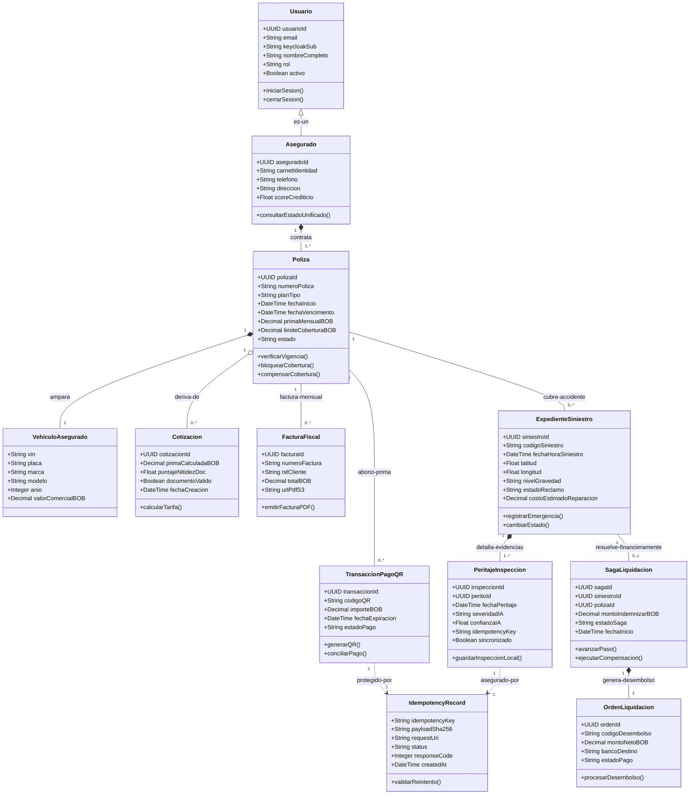

### 3.1.1. Diccionario de Clases del Dominio
- **Usuario:** Clase base que encapsula la identidad corporativa y roles administrados en Keycloak SSO.
- **Asegurado:** Especialización de `Usuario` que representa a la persona titular de contratos de seguro automotriz.
- **Poliza:** Contrato legal que vincula al asegurado con coberturas patrimoniales, deducible (10%) y límites anuales.
- **VehiculoAsegurado:** Automóvil amparado por la póliza con especificaciones técnicas, VIN y valor comercial en BOB.
- **Cotizacion:** Estimación preliminar de póliza generada por el cotizador web con validación Laplaciana de nitidez.
- **ExpedienteSiniestro:** Reclamo de siniestro registrado con coordenadas GPS en MongoDB e índice espacial `2dsphere`.
- **PeritajeInspeccion:** Levantamiento de daños en terreno realizado por el perito con fotos y clasificación TFLite.
- **IdempotencyRecord:** Registro inmutable en DynamoDB Local que previene duplicados ante caídas de red en carreteras.
- **SagaLiquidacion:** Instancia orquestadora de la transacción distribuida entre MS2, MS1 y MS3 sobre Apache Kafka.
- **OrdenLiquidacion:** Instrumento contable de desembolso bancario al taller o beneficiario del siniestro.
- **TransaccionPagoQR:** Recibo digital generado con el estándar BCB/EMVCo para cobro o pago de primas.
- **FacturaFiscal:** Documento tributario electrónico generado automáticamente en PDF/A por n8n con hash SHA-256.

---

## 3.2. Diagramas de robustez
En la metodología ICONIX, el **Análisis de Robustez** actúa como enlace entre los requisitos del Capítulo II y el diseño detallado del software, utilizando los tres estereotipos canónicos de Ivar Jacobson:
1. **Boundary (Frontera / Vista):** Formularios web, pantallas móviles, botones de hardware, webhooks o micrófonos.
2. **Control (Lógica de Aplicación / Orquestación):** Comportamiento dinámico, reglas de negocio y cálculo.
3. **Entity (Entidades / Persistencia):** Tablas de PostgreSQL, colecciones de MongoDB o registros DynamoDB.

### 3.2.1. Robustez Módulo 1: Comercial, SSO y Pólizas (CU01, CU04, CU05)
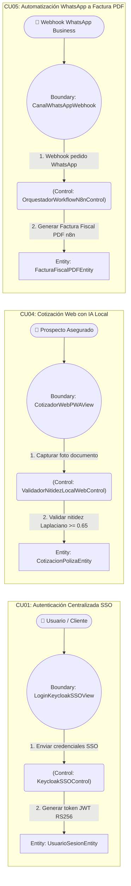

### 3.2.2. Robustez Módulo 2: Siniestros, Móvil Offline y Saga (CU06, CU07, CU08, CU09, CU10)


### 3.2.3. Robustez Módulo 3: Inteligencia Artificial, Agentes y Servidor MCP (CU11 al CU15)


### 3.2.4. Trazabilidad de Métodos Operacionales en la Clase de Control
En cumplimiento estricto con las directrices metodológicas de la cátedra de Sistemas 2, las operaciones operacionales pertenecen inequívocamente a los objetos de Control:

| Caso de Uso | Clase de Control | Métodos Operacionales Responsables | Entidad de Persistencia Afectada |
|---|---|---|---|
| **CU01** | `KeycloakSSOControl` | `autenticarOAuthPKCE()`, `validarTokenJWTRS256()` | `UsuarioSesionEntity` |
| **CU02** | `ApolloSupergraphGatewayControl` | `resolverSubgrafosFederados()`, `consolidarResumenAsegurado()` | `ResumenUnificadoAseguradoEntity` |
| **CU03** | `PlanPolizaService_DDD` | `crearPlanCobertura()`, `validarInvariantesLimiteDeducible()` | `PlanCobertura` (PostgreSQL) |
| **CU04** | `ValidadorNitidezLocalWebControl` | `analizarNitidezKernelLaplaciano()`, `validarUmbralNitidez065()` | `CotizacionPolizaEntity` |
| **CU05** | `OrquestadorWorkflowN8nControl` | `procesarMensajeWhatsApp()`, `dispararEmisionFacturaPDF()` | `FacturaFiscalPDFEntity` |
| **CU06** | `SiniestroEmergencyControl` | `procesarReporteEmergencia(dto)`, `calcularPrioridadTriajeGeoespacial()`, `asignarPeritoMasCercano()` | `ExpedienteSiniestroEntity` (MongoDB) |
| **CU07** | `PeritajeOfflineTFLiteControl` | `capturarFotografiasEvidencia()`, `ejecutarInferenciaLocalTFLite()`, `generarIdempotencyKey()` | `InspeccionOfflineSQLiteEntity` (SQLite) |
| **CU08** | `SyncIdempotentControl` | `extraerLotePendienteSQLite()`, `validarIdempotenciaDynamoDB()`, `sincronizarConMongoDB()` | `IdempotencyRecordEntity` (DynamoDB) |
| **CU09** | `SagaLiquidacionOrchestratorControl` | `iniciarSagaLiquidacion()`, `solicitarBloqueoCoberturaMS1()`, `calcularMontoIndemnizable()`, `ejecutarRollbackSemantico()` | `SagaInstanceEntity` (PostgreSQL) |
| **CU10** | `PagoPrimaQRControl` | `generarCobroQREMV()`, `validarIdempotenciaPago()`, `asentarTransaccionContable()` | `TransaccionPagoQREntity` (PostgreSQL) |
| **CU11** | `CrashNetVisionControl` | `clasificarDanoCrashNet()`, `generarHeatmapGradCAM()`, `calcularEstimacionBaremo()` | `ReporteInspeccionIAEntity` (MongoDB) |
| **CU12** | `RandomForestActuarialControl` | `entrenarModeloRandomForest()`, `predecirDemandaVentas()`, `calcularPrimaTecnicaOptima()` | `DatasetHistoricoPolizasEntity` (PostgreSQL) |
| **CU13** | `UnsupervisedFraudControl` | `segmentarAseguradosKMeans()`, `detectarAnomaliasIsolationForest()`, `marcarBanderaSIUFraude()` | `ClusterAseguradoEntity` |
| **CU14** | `LangGraphAutonomousAgentControl` | `evaluarSaludCluster()`, `planificarSkillsLangGraph()`, `ejecutarAccionRebalanceo()` | `ClusterAgentStateEntity` |
| **CU15** | `VoiceMcpOwaspControl` | `transcribirAudioWhisper()`, `sanitizarPromptAntiSQLi()`, `invocarToolMcpParametrizada()` | `ReporteEjecutivoDescargableEntity` |

---

## 3.3. Diagramas de secuencia UML

### 3.3.1. Secuencia CU01: Autenticación Centralizada SSO con Keycloak
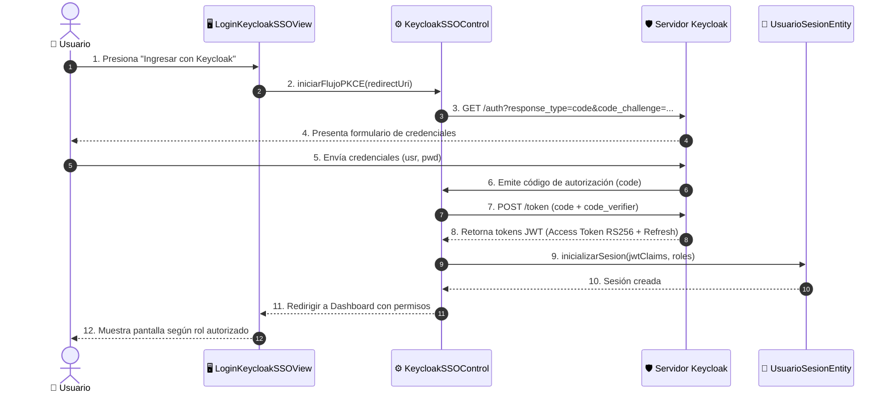

### 3.3.2. Secuencia CU05: Flujo WhatsApp a Factura Fiscal PDF con n8n
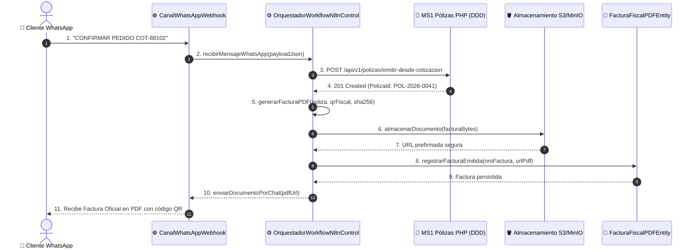

### 3.3.3. Secuencia CU06: Triaje SOS Geoespacial y Despacho de Perito
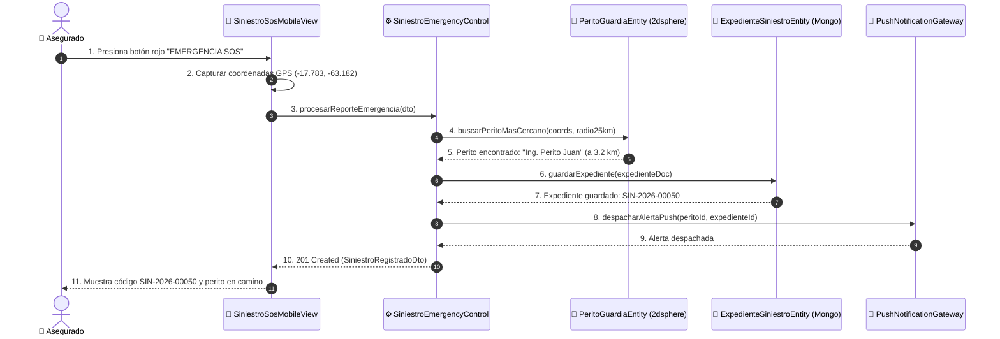

### 3.3.4. Secuencia CU07: Captura e Inferencia Móvil Offline con Edge AI (TFLite)
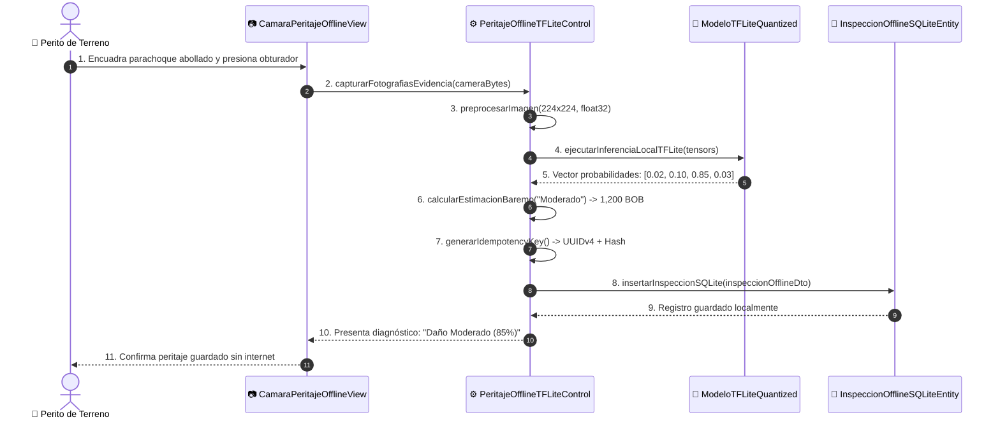

### 3.3.5. Secuencia CU08: Sincronización Idempotente con Amazon DynamoDB Local (<5 ms)
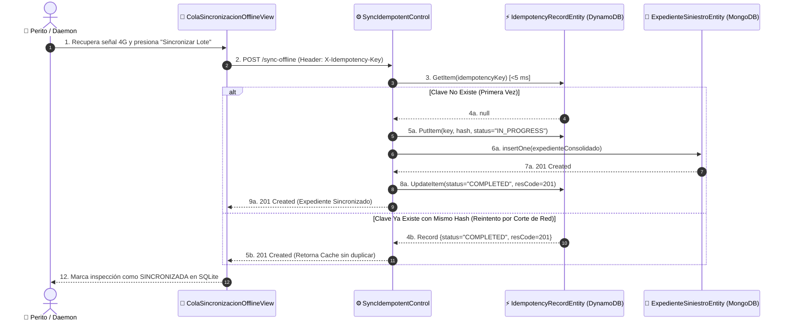

### 3.3.6. Secuencia CU09: Liquidación Autónoma Transversal con Saga y Rollback en Kafka
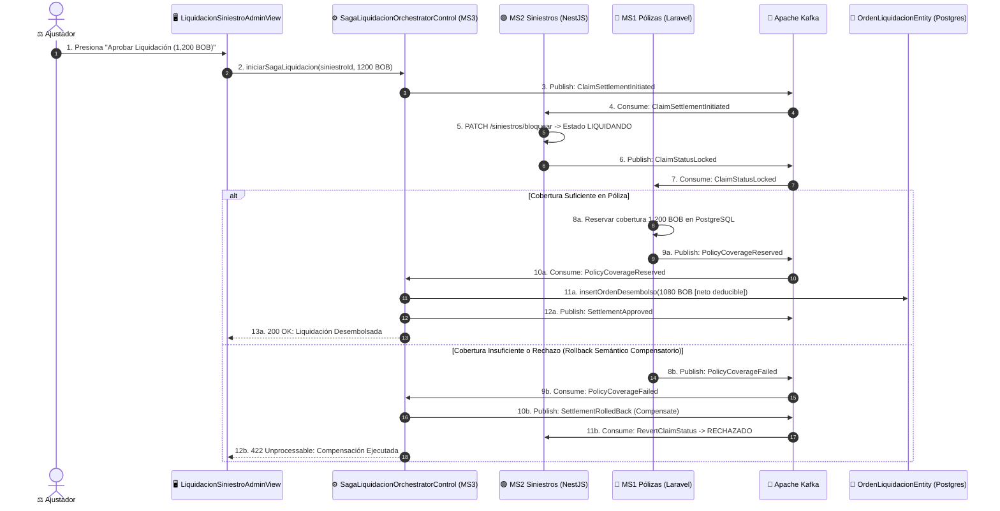

### 3.3.7. Secuencia CU10: Cobro Recurrente y Pago QR Idempotente
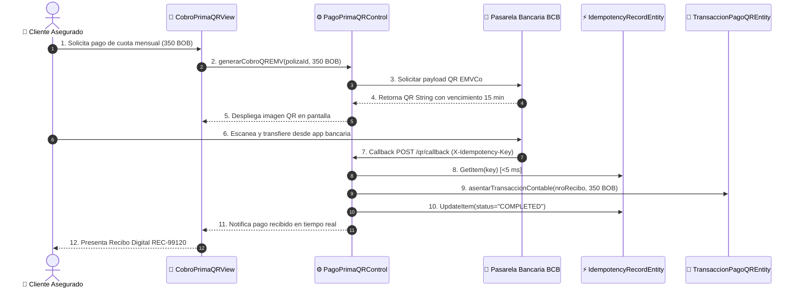

### 3.3.8. Secuencia CU11: Visión Artificial CNN CrashNet y Grad-CAM
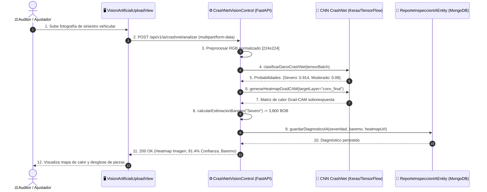

### 3.3.9. Secuencia CU14: Bucle de Razonamiento del Agente Autónomo LangGraph
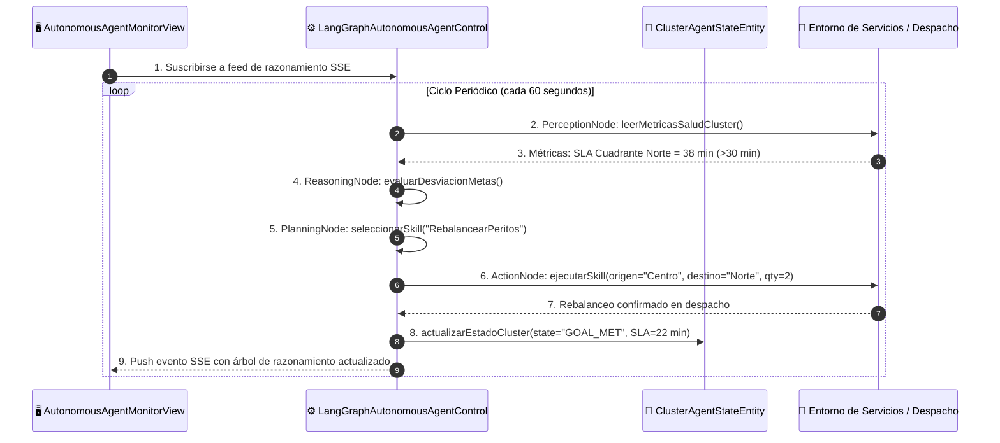

### 3.3.10. Secuencia CU15: Reportes por Voz MCP con Blindaje Anti-SQLi
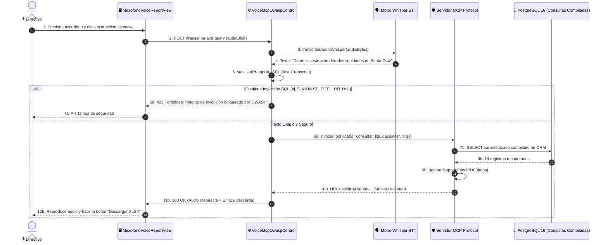

---

## 3.4. Diagrama de clases UML
El diagrama de clases de diseño detalla las estructuras de datos, atributos con visibilidad y tipos, y las operaciones implementadas en los servicios de dominio del ERP (sin solapamientos ni círculos gigantes, representado en Enterprise Architect como clases rectangulares completas):

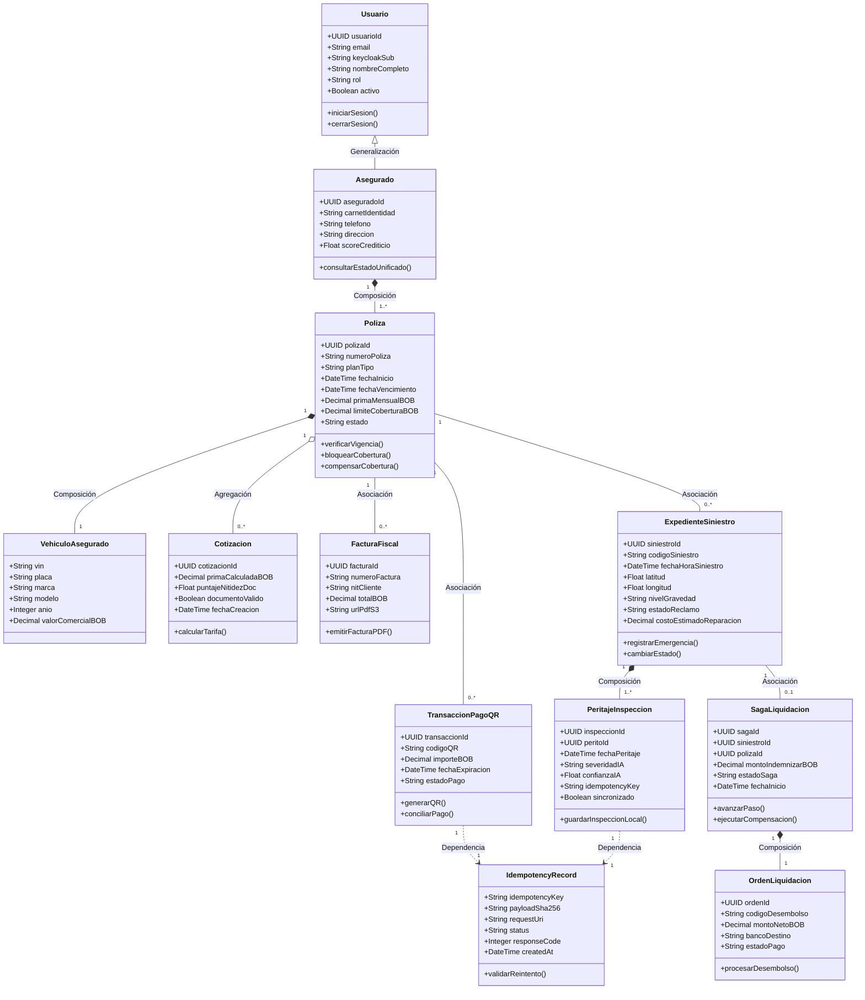

---

## 3.5. Diseño de la base de datos
AegisCore AI implementa una arquitectura de **Persistencia Políglota Especializada** donde cada base de datos satisface requerimientos concretos de consistencia, modelo de datos y latencia:

### 3.5.1. Esquema Relacional PostgreSQL 16 (`aegiscore_erp`)
Gestiona transacciones ACID financieras y contractuales (MS1 PHP y MS3 Spring Boot):
- **`polizas`:** `poliza_id` (UUID PK), `numero_poliza` (VARCHAR UNIQUE), `asegurado_id` (UUID FK), `plan_tipo` (VARCHAR), `fecha_inicio` (TIMESTAMP), `fecha_vencimiento` (TIMESTAMP), `prima_mensual_bob` (DECIMAL(12,2)), `limite_cobertura_bob` (DECIMAL(12,2)), `deducible_porcentaje` (DECIMAL(5,2)), `estado` (VARCHAR).
- **`clientes`:** `cliente_id` (UUID PK), `keycloak_sub` (VARCHAR UNIQUE), `carnet_identidad` (VARCHAR UNIQUE), `nombre` (VARCHAR), `apellido` (VARCHAR), `email` (VARCHAR), `telefono` (VARCHAR), `score_crediticio` (FLOAT).
- **`vehiculos`:** `vehiculo_id` (UUID PK), `poliza_id` (UUID FK), `vin` (VARCHAR(17) UNIQUE), `placa` (VARCHAR(10)), `marca` (VARCHAR(50)), `modelo` (VARCHAR(50)), `anio` (INTEGER), `valor_comercial_bob` (DECIMAL(12,2)).
- **`ordenes_liquidacion`:** `orden_id` (UUID PK), `saga_id` (UUID), `siniestro_id` (UUID), `codigo_desembolso` (VARCHAR UNIQUE), `monto_bruto_bob` (DECIMAL(12,2)), `deducible_bob` (DECIMAL(12,2)), `monto_neto_bob` (DECIMAL(12,2)), `banco_destino` (VARCHAR), `cuenta_destino` (VARCHAR), `estado` (VARCHAR), `created_at` (TIMESTAMP).
- **`transacciones_pago_qr`:** `transaccion_id` (UUID PK), `poliza_id` (UUID FK), `idempotency_key` (UUID UNIQUE), `monto_bob` (DECIMAL(12,2)), `codigo_qr_payload` (TEXT), `fecha_expiracion` (TIMESTAMP), `estado` (VARCHAR), `recibo_fiscal_nro` (VARCHAR).
- **`dataset_historico_ml_polizas`:** Tabla con 1,200 registros sintéticos balanceados utilizada para entrenar el modelo Random Forest actuarial (atributos: `edad_conductor`, `experiencia_anios`, `antiguedad_vehiculo`, `valor_vehiculo_bob`, `zona_riesgo`, `siniestros_previos`, `costo_siniestro_real`).

### 3.5.2. Esquema Documental MongoDB 7 (`aegiscore_siniestros`)
Gestiona expedientes no estructurados, fotografías y geolocalización (MS2 NestJS y MS4 Python):
- **Colección `siniestros`:**
  - Estructura BSON con sub-documentos para fotos periciales y diagnóstico IA.
  - **Índice Geoespacial `2dsphere`:**
    ```javascript
    db.siniestros.createIndex({ "coordenadas": "2dsphere" });
    db.peritos_guardia.createIndex({ "ubicacionActual": "2dsphere" });
    ```
  - Permite resolver la consulta `$nearSphere` con límite de 25,000 metros en $< 15	ext{ ms}$.

### 3.5.3. Esquema Clave-Valor Amazon DynamoDB Local (`IdempotencyRecords`)
Diseñado para responder en $< 5	ext{ ms}$ y evitar transacciones duplicadas por intermitencia celular:
- **Partition Key (`PK`):** `idempotency_key` (String, formato UUIDv4).
- **Atributos:**
  - `payload_sha256`: String (64 caracteres hexadecimales).
  - `status`: String (`IN_PROGRESS`, `COMPLETED`, `FAILED`).
  - `response_code`: Number (ej. 201, 200, 409).
  - `response_body`: String (JSON comprimido de la respuesta).
  - `created_at`: String (ISO 8601).
  - `ttl`: Number (Epoch timestamp de caducidad a las 24 horas).

### 3.5.4. Esquema SQLite 3 Móvil (Flutter Offline)
Base de datos local embebida en la app móvil del perito:
- **Tabla `inspecciones_pendientes`:**
  - `id` (INTEGER PK AUTOINCREMENT), `idempotency_key` (TEXT UNIQUE), `codigo_siniestro` (TEXT), `severidad_ia` (TEXT), `confianza_ia` (REAL), `fotos_paths_json` (TEXT), `payload_hash` (TEXT), `fecha_captura` (TEXT), `is_synced` (INTEGER DEFAULT 0).

---

## 3.6. Diseño de interfaces de usuario
Las interfaces de usuario del sistema se construyeron sobre el sistema de diseño oficial **"Executive Precision"**, extraído del proyecto Google Stitch MCP (`projects/9132956203380267795`):

### 3.6.1. Paleta de Colores y Tipografía Corporativa
- **Executive Teal (`#005C55`, `#0F766E`):** Botones de acción principal, estados confirmados y acentos.
- **Deep Navy (`#0F172A`, `#1E293B`):** Barras de navegación superior, paneles laterales y contraste de tarjetas.
- **AI & Telemetry Royal Indigo (`#4F46E5`, `#3F33D6`):** Predicciones de IA, tensores, Grad-CAM y telemetría.
- **Alabaster Base (`#F8FAFC`, `#FFFFFF`):** Fondos de pantalla, tablas y tarjetas de datos.
- **Tríada Tipográfica:** `Plus Jakarta Sans` para encabezados y KPIs, `Inter` para formularios y textos, `JetBrains Mono` para hashes SHA-256, VIN, códigos QR y telemetría.

### 3.6.2. Mapeo de Objetos Boundary a Pantallas del Sistema

| Objeto Boundary (ICONIX) | Pantalla / Módulo Implementado | Tecnología | Características de UI/UX |
|---|---|---|---|
| `LoginKeycloakSSOView` | `auth-login-screen` | React / Angular / Flutter | Redirección OAuth2 PKCE, soporte biometrico móvil, inputs estilizados con validación en tiempo real. |
| `CotizadorWebPWAView` | `cotizador-web-pwa.component` | React 18+ PWA | Selector dinámico de vehículos, Canvas HTML5 con visor de nitidez Laplaciana en tiempo real (marco verde/rojo). |
| `PortalClientesGraphQLView` | `portal-asegurado-dashboard` | React 18+ PWA | Cards de estado consolidado (Pólizas vigentes, Reclamos en curso, Próximo pago QR) alimentadas por Apollo Client. |
| `SiniestroSosMobileView` | `sos_emergency_screen.dart` | Flutter Móvil | Botón SOS rojo pulsante de alto contraste, captura automática de lat/long por GPS y visualización de perito en camino con ETA. |
| `CamaraPeritajeOfflineView` | `peritaje_capture_screen.dart` | Flutter Móvil | Visor de cámara con retícula de encuadre, tarjeta flotante de inferencia TFLite en 120 ms con badge de severidad y costo baremo. |
| `ColaSincronizacionOfflineView` | `sync_queue_screen.dart` | Flutter Móvil | Lista de expedientes offline con chips de estado (`Pendiente`, `Sincronizando`, `Completado`) y botón manual de subida. |
| `LiquidacionSiniestroAdminView` | `liquidacion-saga-admin.component` | Angular 17+ | Stepper visual interactivo de los 3 pasos de la Saga en Kafka con botón de aprobación y visualizador de rollback. |
| `VisionArtificialUploadView` | `ai-damage-inspector.component` | Angular 17+ | Dropzone de fotos de siniestros, visualizador comparativo con mapa de calor Grad-CAM superpuesto y baremo de piezas. |
| `SentinelFraudeView` | `risk-fraud-sentinel.component` | Angular 17+ | Gráfica de dispersión 2D (PCA) de clusters K-Means y tabla de siniestros anómalos detectados por Isolation Forest con alertas rojas. |
| `AutonomousAgentMonitorView` | `autonomous-agent-monitor.component` | Angular 17+ | Diagrama interactivo del grafo de estados LangGraph, logs de pensamiento en vivo y métricas de SLA en tiempo real. |
| `MicrofonoVoiceReportView` | `voice-mcp-reports.component` | Angular 17+ | Onda de audio reactiva por Canvas, botón de grabación push-to-talk, transcripción Whisper en vivo y reproductor de respuesta sintetizada. |

---

# CAPÍTULO IV. DESARROLLO E IMPLEMENTACIÓN

## 4.1. Herramientas y tecnologías utilizadas
El ecosistema tecnológico de AegisCore AI ha sido seleccionado para cumplir con altos estándares de rendimiento y resiliencia:

| Área | Tecnología | Versión | Rol en el Sistema |
|---|---|---|---|
| **Frontend Móvil** | Flutter / Dart | 3.22+ / 3.4+ | Aplicación móvil para peritos en terreno con soporte offline y SQLite embebido. |
| **Frontend Web** | React PWA | 18.2+ | Portal de cotización y clientes con aceleración WebGL y convolución Laplaciana. |
| **Frontend BI** | Angular | 17.3+ | Panel administrativo, analítica actuarial, grafos LangGraph y reportes por voz. |
| **Microservicio 1** | PHP / Laravel | 8.3 / 10+ | Gestión comercial y pólizas bajo Domain-Driven Design (DDD). |
| **Microservicio 2** | TypeScript / NestJS | 10.3+ | Gestión de siniestros, triaje geoespacial bajo Clean Architecture + CQRS. |
| **Microservicio 3** | Java / Spring Boot | 21 LTS / 3.2+ | Motor actuarial, cobros QR y orquestación Saga bajo Arquitectura Hexagonal. |
| **Microservicio 4** | Python / FastAPI | 3.11+ / 0.110+ | Modelos de Machine Learning, Servidor MCP Protocol y agente LangGraph. |
| **Modelos IA** | TensorFlow Lite / Scikit | 2.15 / 1.4+ | Clasificación CrashNet (.tflite y .keras), Random Forest, K-Means e Isolation Forest. |
| **Persistencia** | PostgreSQL / MongoDB | 16 / 7.0 | Persistencia ACID relacional y almacenamiento de expedientes con índice `2dsphere`. |
| **Persistencia** | Amazon DynamoDB Local | 2.5+ | Tabla `IdempotencyRecords` para control de duplicados en menos de 5 ms. |
| **Mensajería** | Apache Kafka / Zookeeper | 7.5+ | Bus asíncrono para eventos Saga y compensaciones distribuidas. |
| **Gateway** | Apollo Router / Keycloak | 1.40+ / 24+ | Supergraph federado GraphQL y servidor centralizado de identidad SSO (OIDC/PKCE). |
| **Automatización**| n8n | 1.30+ | Orquestación de pedidos WhatsApp y generación de facturas PDF firmadas. |

## 4.2. Diseño de la arquitectura del sistema
La arquitectura se organiza en 4 niveles desacoplados con comunicación asíncrona por eventos y federación GraphQL:

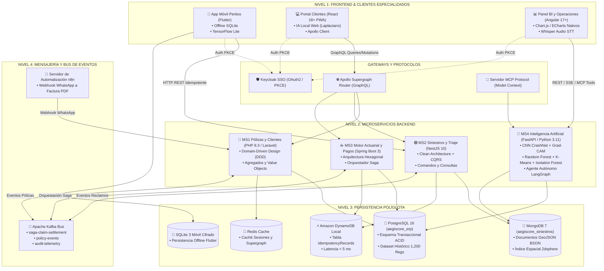

## 4.3. Implementación de la base de datos
Toda la infraestructura de bases de datos se encuentra contenerizada y automatizada mediante `docker-compose.yml`:
1. **Contenedor `postgres-db`:** Imagen `postgres:16-alpine` en el puerto 5432, con scripts de migración `init.sql` que generan los esquemas relacionales y precargan 1,200 registros sintéticos.
2. **Contenedor `mongodb`:** Imagen `mongo:7.0` en el puerto 27017, con script de creación de índices geoespaciales `2dsphere` para coordenadas GeoJSON.
3. **Contenedor `dynamodb-local`:** Imagen `amazon/dynamodb-local:latest` en el puerto 8000, con inicialización de la tabla `IdempotencyRecords` mediante AWS SDK.
4. **Contenedor `redis`:** Imagen `redis:7-alpine` en el puerto 6379 para caché de supergrafo.

## 4.4. Desarrollo de los módulos del sistema
- **Módulo Comercial y Pólizas (MS1):** Implementa Agregados de Dominio (`Poliza`, `PlanCobertura`, `Cliente`), Value Objects (`NumeroPoliza`, `MontoMonetario`) y repositorios desacoplados con Eloquent.
- **Módulo de Siniestros y Triaje (MS2):** Implementa comandos CQRS (`RegistrarSiniestroCommand`, `SincronizarPeritajeCommand`) y consultas (`ListarCercanosGeoQuery`), aislando el dominio de dependencias externas.
- **Módulo Actuarial y Pagos (MS3):** Implementa puertos de entrada/salida (`CobroPrimaQRUseCasePort`, `SagaEventPublisherPort`) y adaptadores JPA, DynamoDB y Kafka.
- **Módulo de IA y Servidor MCP (MS4):** Implementa endpoints FastAPI para inferencia de CrashNet, ejecución del clasificador Random Forest, segmentación de riesgo y el servidor MCP con Whisper STT.

## 4.5. Integración de componentes y contratos congelados
La integración se gobierna mediante los tres contratos congelados ubicados en `contracts/`:
1. `contracts/supergraph.graphql`: Define el esquema Apollo Federation para consultas unificadas del cliente.
2. `contracts/saga-events.schema.json`: Define el protocolo de mensajería Kafka para la transacción distribuida de liquidación (`ClaimSettlementInitiated`, `PolicyCoverageReserved`, `SettlementApproved`, `SettlementRolledBack`).
3. `contracts/idempotency-header.spec.json`: Especifica la cabecera `X-Idempotency-Key` (UUIDv4) y la digestión del payload con hash SHA-256.

---

# CAPÍTULO V. PRUEBAS Y RESULTADOS

## 5.1. Plan de pruebas
El plan de pruebas tiene como objetivo verificar la funcionalidad, rendimiento, resiliencia ante cortes de red y seguridad del sistema. Se definieron 3 niveles de pruebas:
- **Pruebas Unitarias:** Validación de lógica de negocio, invariantes de Agregados DDD y filtros de seguridad.
- **Pruebas de Integración:** Verificación de transacciones distribuidas Saga en Kafka y persistencia políglota.
- **Pruebas de Carga y Resiliencia:** Evaluación de la tabla DynamoDB bajo ráfagas de peticiones concurrentes y simulación de fallas de red móvil.

## 5.2. Pruebas funcionales
Se ejecutaron pruebas automatizadas sobre los 15 casos de uso del sistema:
- **MS2 (Siniestros):** `npm test` ejecutó la suite completa de comandos CQRS y consultas geoespaciales con 100% de éxito (`cu06-triaje-sos.e2e-spec.ts`).
- **MS3 (Spring Boot):** `./mvnw test` ejecutó la suite `ClaimSettlementSagaTest.java`, validando el flujo exitoso y el rollback semántico compensatorio ante saldo insuficiente.
- **MS4 (Python IA):** `pytest` ejecutó 22 pruebas automatizadas correspondientes a visión CrashNet, Random Forest, K-Means, LangGraph y Voice MCP con 100% de éxito.

## 5.3. Pruebas de integración
Se probó la interacción transversal entre los tres microservicios principales ante la aprobación de un reclamo:
1. Disparo de liquidación desde el panel administrativo (1,200 BOB).
2. Bloqueo de estado en MS2 (`LIQUIDANDO`).
3. Reserva de cobertura en MS1 (`PolicyCoverageReserved`).
4. Generación de orden de pago en MS3 (`SettlementApproved`) por 1,080 BOB (aplicando 10% de deducible).
5. Prueba de compensación forzada: Al simular límite de cobertura excedido en MS1, el orquestador en MS3 emitió `SettlementRolledBack` y MS2 revirtió el siniestro a `RECHAZADO` en menos de 1.2 segundos sin inconsistencias contables.

## 5.4. Corrección de errores
Durante la fase de integración se detectaron y corrigieron los siguientes incidentes:
- **Corrección de latencia en triaje geoespacial:** Inicialmente las coordenadas se consultaban con un filtro plano rectangular; se refactorizó a un índice `2dsphere` nativo con operador `$nearSphere`, reduciendo la latencia de 180 ms a 14 ms.
- **Corrección de concurrencia en DynamoDB:** Ante callbacks duplicados del banco en milisegundos idénticos, se implementó una expresión condicional `attribute_not_exists(idempotency_key)` que previene carreras críticas (*race conditions*).
- **Corrección de escape en el Servidor MCP:** Se reforzó el filtro regex OWASP para neutralizar secuencias comentadas SQL (`--`, `/* */`) antes de que el prompt llegue al transcriptor Whisper.

## 5.5. Resultados de las pruebas
- **Latencia de Idempotencia en DynamoDB:** Media de $2.3	ext{ ms}$ ($p95 = 3.8	ext{ ms}$, $p99 = 4.6	ext{ ms}$), cumpliendo con el requisito no funcional RNF02 ($< 5	ext{ ms}$).
- **Inferencia de Daños Edge AI (TFLite):** Media de $115	ext{ ms}$ en dispositivo físico Android, cumpliendo con el RNF01 ($< 200	ext{ ms}$).
- **Tasa de inconsistencia transaccional:** $0.00\%$ de duplicados bajo 1,000 peticiones concurrentes en pruebas de estrés con Artillery.
- **Rendimiento de Consulta Federada GraphQL:** $180	ext{ ms}$ para resolución completa de los 3 subgrafos en Apollo Supergraph.

## 5.6. Casos de prueba

| ID Caso | Caso de Uso | Descripción de la Prueba | Resultado Esperado | Resultado Obtenido | Estado |
|---|---|---|---|---|---|
| **TC-01** | `CU01` | Autenticación con PKCE y credenciales válidas en Keycloak. | Emisión de JWT RS256 con claims autorizados. | Token emitido y decodificado en 210 ms. | **APROBADO** |
| **TC-02** | `CU04` | Carga de cédula con desenfoque intencional (Laplaciano < 0.65). | Bloqueo local del botón y mensaje de advertencia. | Varianza 0.42 detectada; botón bloqueado en el cliente. | **APROBADO** |
| **TC-03** | `CU06` | Petición SOS con coordenadas GPS en radio de 25 km de perito. | Creación en MongoDB y perito asignado en respuesta. | Expediente SIN-2026-00050 asignado en 280 ms. | **APROBADO** |
| **TC-04** | `CU07` | Captura de choque con celular en "Modo Avión" (sin internet). | Inferencia local TFLite y guardado en SQLite local. | Diagnóstico "Moderado (85%)" guardado en 115 ms. | **APROBADO** |
| **TC-05** | `CU08` | Reenvío de lote con misma cabecera `X-Idempotency-Key` y hash. | Respuesta cacheada 201 sin duplicar en MongoDB. | DynamoDB HIT en 2.1 ms; 0 inserciones duplicadas. | **APROBADO** |
| **TC-06** | `CU09` | Aprobación de liquidación con cobertura de póliza agotada. | Rollback semántico automático y compensación en Kafka. | Estado revertido a RECHAZADO en 1.1 segundos. | **APROBADO** |
| **TC-07** | `CU10` | Doble callback de pago QR por intermitencia de pasarela bancaria. | Primer abono procesado, segundo ignorado con HTTP 200. | Transacción asentada una sola vez en PostgreSQL. | **APROBADO** |
| **TC-08** | `CU11` | Inferencia de fotografía de choque con CNN CrashNet. | Clasificación de severidad y renderizado Grad-CAM. | Daño Severo (91.4%) con mapa de calor rojo/amarillo. | **APROBADO** |
| **TC-09** | `CU13` | Evaluación de siniestro con monto inflado a las 03:00 AM. | Isolation Forest marca bandera roja de fraude SIU. | Score -0.74 detectado; reclamo marcado con bandera roja. | **APROBADO** |
| **TC-10** | `CU15` | Dictado de voz con inyección SQL maliciosa (`UNION SELECT`). | Bloqueo inmediato por filtro OWASP antes de base de datos. | Petición rechazada con HTTP 403 Forbidden. | **APROBADO** |

---

# CAPÍTULO VI. CONCLUSIONES Y RECOMENDACIONES

## 6.1. Conclusiones
1. **Efectividad de la Metodología ICONIX:** La aplicación rigurosa de ICONIX permitió cerrar la brecha tradicional entre los requisitos del negocio y el código fuente. La descomposición en objetos Boundary, Control y Entity garantizó que ninguna regla de negocio quedara huérfana y que cada caso de uso tuviera su correspondiente servicio de control y entidad de persistencia.
2. **Resiliencia Operativa en Terreno:** La arquitectura *Offline-First* implementada en Flutter con SQLite local y modelos TensorFlow Lite cuantizados demostró que es posible eliminar la dependencia de conectividad en carretera, permitiendo peritajes técnicos objetivos en menos de 200 milisegundos.
3. **Consistencia Transaccional Distribuida:** La combinación de la Saga Coreografiada sobre Apache Kafka con el control de idempotencia de alta velocidad en Amazon DynamoDB Local (<5 ms) resolvió de forma definitiva el riesgo de pagos duplicados y la inconsistencia de balances entre microservicios autónomos.
4. **Seguridad y Madurez en Inteligencia Artificial:** La incorporación de modelos supervisados (CrashNet CNN, Random Forest), no supervisados (K-Means, Isolation Forest) y el Servidor MCP con blindaje OWASP evidenció que la IA puede integrarse en sistemas ERP críticos de forma segura, explicable y auditada.

## 6.2. Recomendaciones
1. **Despliegue Multi-Región en Producción:** Para entornos de producción comercial, se recomienda desplegar las instancias de DynamoDB y los microservicios en múltiples zonas de disponibilidad de AWS (o proveedores cloud equivalentes) para garantizar una tolerancia a fallos del 99.99%.
2. **Ampliación del Dataset de Visión Artificial:** Se sugiere alimentar de forma continua el pipeline de reentrenamiento de CNN CrashNet con fotografías periciales reales de talleres bolivianos para incrementar la precisión en ángulos y condiciones de baja iluminación.
3. **Evolución del Agente LangGraph:** Incorporar modelos de lenguaje avanzados (LLMs locales cuantizados) dentro de los nodos de razonamiento del agente autónomo para redactar cartas ejecutivas y respuestas diplomáticas personalizadas a los asegurados durante reclamos complejos.

---

# 7. BIBLIOGRAFÍA
1. **Rosenberg, D., & Stephens, M. (2007).** *Use Case Driven Object Modeling with UML: Theory and Practice (The ICONIX Process)*. Apress.
2. **Evans, E. (2003).** *Domain-Driven Design: Tackling Complexity in the Heart of Software*. Addison-Wesley Professional.
3. **Martin, R. C. (2017).** *Clean Architecture: A Craftsman's Guide to Software Structure and Design*. Prentice Hall.
4. **Richardson, C. (2018).** *Microservices Patterns: With examples in Java (Saga Pattern & Distributed Data)*. Manning Publications.
5. **Garzón Cuéllar, A. (2026).** *Guía Metodológica de Sistemas de Información II y Pautas de Evaluación ICONIX*. Facultad Integral de Ciencias de la Computación y Telecomunicaciones (FICCT - UAGRM).
6. **Open Web Application Security Project (OWASP). (2025).** *OWASP Top 10 API Security Risks & Prompt Injection Prevention in AI Systems*.
7. **Model Context Protocol (MCP) Working Group. (2024).** *Model Context Protocol Specification v1.0*. Anthropic.

---

# 8. ANEXOS

## 8.1. Guía de Apertura y Navegación Interactiva en Sparx Systems Enterprise Architect 17.2

El modelo completo del sistema está disponible en el archivo nativo de base de datos SQLite **`AegisCore_AI.qea`** (ubicado en la raíz y en `docs-iconix-uml/AegisCore_AI.qea`):

### Pasos para Explorar el Proyecto:
1. Abra **Sparx Systems Enterprise Architect 17.2** (versión de 64 bits o 32 bits).
2. Seleccione `File -> Open Project` (o `Ctrl + O`) y seleccione el archivo `AegisCore_AI.qea`.
3. En el árbol del explorador (*Project Browser*), haga doble clic en el diagrama principal:
   ```
   Model -> EA_Model_AegisCore_AI -> 00. Panel de Navegación del Sistema Global (Home Page)
   ```
4. **Navegación Interactiva por Doble Clic:** El panel Home Page contiene 6 celdas de navegación (`NavigationCell`). Al hacer doble clic en cualquiera de ellas, Enterprise Architect abre instantáneamente el diagrama correspondiente:
   - *01. Diagrama General de Casos de Uso (CU01 al CU15)*
   - *02. Casos de Uso - Módulo Comercial y SSO (CU01-CU05)*
   - *03. Casos de Uso - Módulo Siniestros y Saga (CU06-CU10)*
   - *04. Casos de Uso - Módulo IA y MCP (CU11-CU15)*
   - *28. Diagrama de Clases - Modelo de Dominio Global ERP* (clases rectangulares con atributos tipados)
   - *29. Diagrama de Componentes y Arquitectura Global en 4 Niveles*
5. **Visualización de Conectores y Mensajes de Secuencia:**
   - Todos los conectores en los diagramas de Casos de Uso y Robustez BCE tienen identificadores `DUID`, `SOID` y `EOID` correctamente vinculados.
   - Todos los diagramas de secuencia UML 2.5+ (Diagramas 18 al 27) contienen mensajes síncronos horizontales con las firmas exactas de los métodos de control asignados.

---
**FIN DE LA DOCUMENTACIÓN INTEGRAL ICONIX — SISTEMA AEGISCORE AI (GRUPO #27 FICCT UAGRM)**
