# 🛡️ DOCUMENTACIÓN INTEGRAL DEL SISTEMA AEGISCORE AI
## ERP Distribuido, Peritaje Inteligente y Liquidación Autónoma de Siniestros de Seguros
### Metodología ICONIX — Ingeniería de Software 2 (2do Parcial)
**Universidad Autónoma Gabriel René Moreno (UAGRM)**  
**Facultad Integral de Ciencias de la Computación y Telecomunicaciones (FICCT)**  
**Docente:** MSc. Ing. Angélica Garzón Cuéllar  
**Grupo de Desarrollo:** Grupo #27  
**Integrantes:**
- David Garcia
- Jose Diego Garcia
- Arnulfo Velasquez

**Fecha:** Noviembre 2026 — Santa Cruz de la Sierra, Bolivia  
**Versión del Documento:** 2.0 (Sistema Global Completo — Casos de Uso CU01 al CU15)  
**Modelador UML:** Sparx Systems Enterprise Architect 17.2 (Base de datos nativa `AegisCore_AI.qea`)

---

## 📑 ÍNDICE GENERAL DEL DOCUMENTO

1. **[CAPÍTULO 1: INTRODUCCIÓN Y MODELO DEL DOMINIO](#capítulo-1-introducción-y-modelo-del-dominio)**
   - 1.1. Introducción al Sistema AegisCore AI
   - 1.2. Objetivos del Sistema (General y Específicos)
   - 1.3. Alcance Global del Sistema
   - 1.4. Modelo del Dominio Inicial (Diagrama de Clases de Dominio y Diccionario de Datos)
2. **[CAPÍTULO 2: ESPECIFICACIÓN DE REQUISITOS DEL SISTEMA](#capítulo-2-especificación-de-requisitos-del-sistema)**
   - 2.1. Requisitos Funcionales del Sistema (RF01 al RF15)
   - 2.2. Requisitos No Funcionales del Sistema (RNF01 al RNF12)
   - 2.3. Diagrama General de Casos de Uso del Sistema (CU01 al CU15 con 7 Actores)
   - 2.4. Fichas de Especificación Detallada de Casos de Uso en Formato de 2 Columnas (CU01 a CU15)
3. **[CAPÍTULO 3: ANÁLISIS DE ROBUSTEZ (ICONIX BCE)](#capítulo-3-análisis-de-robustez-iconix-bce)**
   - 3.1. Fundamentos del Análisis de Robustez en ICONIX
   - 3.2. Diagramas de Robustez BCE por Módulo Funcional
   - 3.3. Trazabilidad de Métodos Operacionales en la Clase de Control
4. **[CAPÍTULO 4: DISEÑO PRELIMINAR Y DETALLADO (SECUENCIA UML 2.5+)](#capítulo-4-diseño-preliminar-y-detallado-secuencia-uml-25)**
   - 4.1. Diagramas de Secuencia UML 2.5+ con Métodos en el Objeto de Control
   - 4.2. Diagrama de Clases de Diseño Detallado del ERP
5. **[CAPÍTULO 5: ARQUITECTURA DE IMPLEMENTACIÓN Y PERSISTENCIA POLÍGLOTA](#capítulo-5-arquitectura-de-implementación-y-persistencia-políglota)**
   - 5.1. Diagrama de Componentes y Arquitectura Global en 4 Niveles
   - 5.2. Persistencia Políglota y Motores de Base de Datos
   - 5.3. Contratos Congelados de Integración Inter-Servicios
6. **[CAPÍTULO 6: PRUEBAS, EVIDENCIA DE EJECUCIÓN Y VALIDACIÓN](#capítulo-6-pruebas-evidencia-de-ejecución-y-validación)**
   - 6.1. Suite de Pruebas Automatizadas Unitarias y de Integración
   - 6.2. Pruebas de Carga y Resiliencia de Idempotencia (<5 ms en Red Intermitente)
   - 6.3. Evidencias de Ejecución en Dispositivos Reales (Smartphone Android Físico)
   - 6.4. Guía de Apertura y Navegación Interactiva en Sparx Enterprise Architect 17.2

---

# CAPÍTULO 1: INTRODUCCIÓN Y MODELO DEL DOMINIO

## 1.1. Introducción al Sistema AegisCore AI
**AegisCore AI** es un sistema ERP (Enterprise Resource Planning) distribuido de última generación, diseñado específicamente para la industria aseguradora automotriz y patrimonial. Integra peritaje de campo asistido por inteligencia artificial en el dispositivo (*Edge AI*), liquidación autónoma y atómica de siniestros mediante el patrón arquitectónico *Saga Coreografiada*, y analítica avanzada con agentes autónomos basados en el protocolo *Model Context Protocol* (MCP).

Frente a los sistemas legados monolíticos de seguros —caracterizados por procesos de liquidación lentos de 15 a 45 días, pérdidas millonarias por fraudes no detectados y vulnerabilidad ante la falta de conectividad de los peritos en carreteras— AegisCore AI introduce una arquitectura desacoplada basada en microservicios políglotas, persistencia políglota y trazabilidad metodológica rigurosa bajo el marco **ICONIX**.

## 1.2. Objetivos del Sistema
### 1.2.1. Objetivo General
Diseñar, modelar e implementar un sistema ERP distribuido y resiliente para compañías de seguros que automatice el ciclo de vida de las pólizas, reduzca el tiempo de inspección y liquidación de siniestros de semanas a minutos mediante inferencia de Inteligencia Artificial (Edge y Cloud), y garantice transacciones financieras e indemnizaciones atómicas mediante el patrón Saga y control de idempotencia de alta velocidad.

### 1.2.2. Objetivos Específicos
1. **Unificar la identidad y acceso (SSO):** Centralizar la autenticación corporativa y de clientes mediante Keycloak bajo el estándar OAuth2 y OpenID Connect con flujo PKCE.
2. **Federar la consulta de información:** Consolidar el estado de pólizas, reclamos y estados de cuenta en un Gateway GraphQL Apollo Supergraph único.
3. **Agilizar el peritaje de siniestros:** Desplegar una aplicación móvil multiplataforma (Flutter) capaz de operar en modo *Offline-First* con SQLite local y modelos TensorFlow Lite cuantizados (`.tflite`) para evaluación de daños en menos de 200 ms.
4. **Garantizar la idempotencia transaccional:** Eliminar pagos o registros duplicados causados por intermitencia de conectividad 3G/4G mediante almacenamiento ultrarrápido en Amazon DynamoDB Local (<5 ms) con validación cruzada de hashes criptográficos SHA-256.
5. **Asegurar consistencia transaccional distribuida:** Implementar una Saga Coreografiada sobre Apache Kafka entre tres microservicios (PHP Laravel, NestJS y Spring Boot) con rollbacks semánticos automáticos y compensación de estados.
6. **Detectar fraudes y predecir demanda actuarial:** Aplicar algoritmos de Machine Learning (Random Forest, K-Means Clustering e Isolation Forest) para scoring de riesgo y prevención de pagos fraudulentos.
7. **Empoderar a los directores con IA conversacional:** Proveer un Servidor MCP para consultas analíticas por voz (Whisper STT) blindado contra inyecciones SQL mediante validación estricta OWASP y herramientas tipadas.

## 1.3. Alcance Global del Sistema
El sistema abarca 15 Casos de Uso integrales organizados en 3 macro-módulos coordinados:

| Módulo | Casos de Uso | Tecnologías Clave | Responsabilidad Operativa |
|---|---|---|---|
| **Módulo 1: Comercial, SSO y Pólizas** | `CU01` al `CU05` | Keycloak SSO, Apollo Supergraph GraphQL, PHP 8.3 / Laravel DDD, React 18+ PWA, IA Local Web (Laplaciano / TF.js), n8n Workflow. | Gestión de usuarios, cotizaciones web con validación fotográfica de documentos, contratación vía WhatsApp y facturación electrónica PDF. |
| **Módulo 2: Siniestros, Móvil Offline y Saga** | `CU06` al `CU10` | Flutter (Dart), SQLite Móvil, TensorFlow Lite, NestJS 10 (Clean Architecture + CQRS), Spring Boot 3 (Hexagonal), Amazon DynamoDB Local, MongoDB 7, Apache Kafka. | Triaje geoespacial SOS, peritaje móvil sin internet, sincronización idempotente, liquidación multi-servicio con Saga y cobros recurrentes QR EMV. |
| **Módulo 3: Inteligencia Artificial, Agentes y MCP** | `CU11` al `CU15` | Python 3.11 / FastAPI, TensorFlow/Keras CNN CrashNet, Scikit-Learn (Random Forest, K-Means, Isolation Forest), LangGraph, Servidor MCP, Whisper STT, Angular 17+ BI. | Clasificación de daños por visión artificial, cálculo de prima pura actuarial, detección de anomalías/fraude, orquestación de agentes y reportes por voz blindados. |

## 1.4. Modelo del Dominio Inicial
El modelo del dominio refleja las entidades del negocio asegurador y sus interrelaciones estructurales (asociación, agregación, composición y generalización) conforme a los estándares de ICONIX y UML 2.5+:

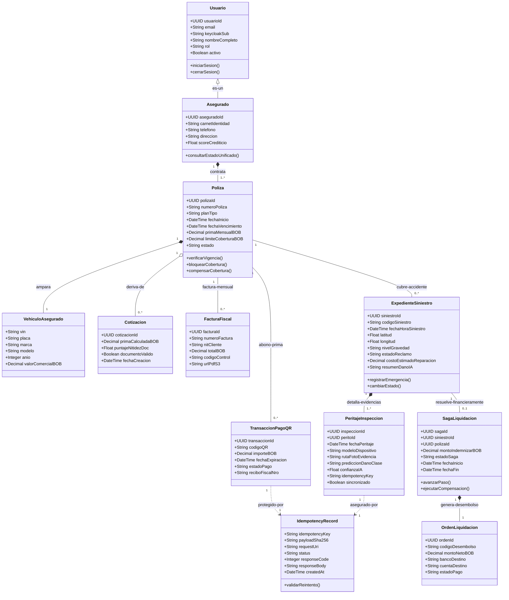

### 1.4.1. Diccionario de Clases del Dominio
- **Usuario:** Usuario base del sistema con credenciales gestionadas en Keycloak.
- **Asegurado:** Persona natural o jurídica titular de pólizas activas en el ERP.
- **Poliza:** Contrato legal que vincula al asegurado con las coberturas patrimoniales y deducibles.
- **VehiculoAsegurado:** Bien automotor amparado por la póliza con especificaciones técnicas y VIN.
- **Cotizacion:** Estimación preliminar de póliza generada por el cotizador web con verificación de nitidez de carnet por IA.
- **ExpedienteSiniestro:** Entidad central del reclamo que documenta la fecha, coordenadas geoespaciales, triaje y estado administrativo.
- **PeritajeInspeccion:** Registro de levantamiento de campo realizado por el perito, con fotografías, tensores de inferencia TFLite y clave de idempotencia.
- **IdempotencyRecord:** Registro inmutable en DynamoDB que previene la duplicidad de transacciones de campo o financieras ante fallas de red.
- **SagaLiquidacion:** Instancia orquestadora de la transacción distribuida entre los microservicios de Siniestros, Pólizas y Actuarial.
- **OrdenLiquidacion:** Instrumento contable de desembolso bancario al taller o beneficiario del siniestro.
- **TransaccionPagoQR:** Recibo digital generado con el estándar BCB/EMVCo para cobro o pago de primas.
- **FacturaFiscal:** Documento electrónico tributario generado automáticamente en formato PDF/A por n8n y almacenado en MinIO/S3.

---

# CAPÍTULO 2: ESPECIFICACIÓN DE REQUISITOS DEL SISTEMA

## 2.1. Requisitos Funcionales del Sistema (RF01 al RF15)
- **RF01 (Autenticación SSO Keycloak):** El sistema debe autenticar a todos los usuarios (clientes, peritos, ajustadores, directores) mediante Keycloak con OAuth2 / OIDC y flujo PKCE con tokens JWT RS256.
- **RF02 (Consulta Estado Unificado GraphQL):** El sistema debe permitir a los clientes consultar su estado unificado (pólizas, reclamos y pagos) mediante una consulta federada en Apollo Supergraph en menos de 250 ms.
- **RF03 (Administración Catálogo y Clientes DDD):** El sistema debe permitir al área comercial gestionar clientes, coberturas y pólizas en el Microservicio 1 (PHP Laravel) bajo principios estrictos de Domain-Driven Design (DDD).
- **RF04 (Cotización Web con IA Local):** El cotizador web (React PWA) debe validar la nitidez de la fotografía del documento de identidad en el navegador del cliente mediante convolución Laplaciana / TF.js antes de habilitar el envío (umbral $\ge 0.65$).
- **RF05 (Automatización WhatsApp a Factura PDF):** El sistema debe recibir pedidos de póliza confirmados por WhatsApp mediante webhook, invocar el flujo en n8n, registrar la póliza en el ERP y devolver una factura fiscal en PDF con código QR y hash SHA-256.
- **RF06 (Reporte SOS y Triaje Geoespacial):** La app móvil debe permitir al asegurado presionar un botón SOS para enviar coordenadas GPS, generando un expediente en MongoDB con cálculo de perito más cercano en radio de 25 km mediante índice `2dsphere`.
- **RF07 (Inspección Móvil Offline Edge AI):** La app Flutter debe permitir al perito inspeccionar vehículos sin cobertura celular, clasificar la severidad de daños en menos de 200 ms con TensorFlow Lite, y almacenar fotos y metadatos en SQLite local.
- **RF08 (Sincronización Idempotente con DynamoDB):** Al recuperar conectividad, la app debe transmitir los peritajes pendientes con cabecera `X-Idempotency-Key`; el backend debe validar o bloquear duplicados en Amazon DynamoDB Local en $< 5$ ms.
- **RF09 (Liquidación Autónoma con Saga y Rollback):** El sistema debe coordinar el pago de siniestros mediante el patrón Saga entre MS2 (Siniestros), MS1 (Pólizas) y MS3 (Actuarial), ejecutando compensaciones automáticas en Kafka si ocurre una falla en cualquier paso.
- **RF10 (Cobro Recurrente y Pago QR Idempotente):** El sistema debe generar códigos QR EMV compatibles con el sistema bancario boliviano (BCB) para el cobro de primas e indemnizaciones, garantizando una sola ejecución mediante clave de idempotencia.
- **RF11 (Visión Artificial CNN CrashNet):** El Microservicio 4 (Python) debe clasificar fotografías de siniestros en 4 clases de severidad (Sin daño, Leve, Moderado, Severo) con precisión $\ge 90\%$ y generar un mapa de calor explicativo Grad-CAM.
- **RF12 (Predicción Actuarial con Random Forest):** El sistema debe calcular la probabilidad de siniestro y sugerir la prima pura de riesgo anual mediante un ensamble Random Forest entrenado con el histórico relacional de pólizas.
- **RF13 (Segmentación K-Means y Detección de Fraude):** El sistema debe segmentar a la cartera de asegurados en clusters de riesgo (K-Means) e identificar anomalías y patrones fraudulentos mediante Isolation Forest marcando banderas de auditoría (SIU).
- **RF14 (Monitoreo Autónomo de Metas LangGraph):** El sistema debe desplegar un agente multi-paso LangGraph que evalúe periódicamente la salud de los servicios, el cumplimiento de SLAs de inspección y ejecute acciones correctivas de rebalanceo de peritos.
- **RF15 (Reportes por Voz con Servidor MCP Anti-SQLi):** El sistema debe permitir a los ejecutivos solicitar balances y auditorías dictando instrucciones por voz (Whisper STT); el Servidor MCP debe procesar la solicitud exclusivamente mediante *Tools tipadas* y consultas parametrizadas, neutralizando cualquier inyección SQL (OWASP Top 10).

## 2.2. Requisitos No Funcionales del Sistema (RNF01 al RNF12)
- **RNF01 (Rendimiento de Inferencia Edge):** La clasificación de imágenes con el modelo TFLite en la app móvil no debe exceder los 200 milisegundos en procesadores móviles de gama media.
- **RNF02 (Latencia de Idempotencia):** La verificación de claves de idempotencia en Amazon DynamoDB Local debe ejecutarse en un tiempo inferior a 5 milisegundos ($p99 < 5	ext{ ms}$).
- **RNF03 (Seguridad Criptográfica en Reposo y Tránsito):** Toda comunicación externa debe exigir TLS 1.3; los tokens de sesión deben firmarse con algoritmo asimétrico RSA SHA-256 (RS256); las claves de idempotencia deben vincularse al SHA-256 del cuerpo de la petición.
- **RNF04 (Disponibilidad y Tolerancia a Fallos):** El sistema debe soportar caídas de conectividad en el 100% de los flujos de peritaje de campo mediante persistencia SQLite local y reintentos exponenciales automáticos.
- **RNF05 (Persistencia Políglota Especializada):** Los datos relacionales transaccionales deben almacenarse en PostgreSQL 16; los expedientes semiestructurados con coordenadas en MongoDB 7; el control de concurrencia en Amazon DynamoDB Local; y la telemetría temporal en Redis.
- **RNF06 (Desacoplamiento Asíncrono):** La comunicación inter-servicios para eventos de negocio (Sagas, alertas y compensaciones) debe canalizarse a través de Apache Kafka con semántica *at-least-once*.
- **RNF07 (Aislamiento de Dominios):** Cada microservicio debe encapsular su lógica bajo su patrón arquitectónico designado (MS1 Laravel DDD, MS2 NestJS Clean/CQRS, MS3 Spring Boot Hexagonal, MS4 FastAPI Pipelines).
- **RNF08 (Consistencia Eventual en Sagas):** Las compensaciones transaccionales deben completarse en menos de 2 segundos desde la detección de una falla en cualquiera de los participantes de la Saga.
- **RNF09 (Protección contra Inyecciones SQL OWASP):** El servidor MCP debe rechazar cualquier token de lenguaje natural que contenga palabras reservadas SQL dinámicas (`UNION`, `SELECT`, `DROP`, `--`, `;`) y canalizar únicamente a consultas JPA/Eloquent compiladas.
- **RNF10 (Compatibilidad Móvil Multiplataforma):** La aplicación de peritos debe compilar nativamente para Android (SDK 26+) e iOS (iOS 15+) a partir de la base de código unificada en Flutter.
- **RNF11 (Trazabilidad ICONIX):** Todo caso de uso debe mantener correspondencia directa e inequívoca con sus objetos Boundary, Control y Entity; los diagramas de secuencia UML deben asignar las operaciones a la Clase de Control.
- **RNF12 (Auditabilidad Fiscal):** Toda transacción de cobro o desembolso debe almacenar su firma digital, código de control y comprobante fiscal PDF con persistencia duradera en almacenamiento de objetos compatible con S3.

## 2.3. Diagrama General de Casos de Uso del Sistema
El diagrama de Casos de Uso del sistema global ilustra los 15 Casos de Uso agrupados por módulos y su vinculación con los 7 actores del sistema:


---

## 2.4. Fichas de Especificación Detallada de Casos de Uso (CU01 al CU15)
A continuación se presentan las 15 fichas técnicas normalizadas en el formato formal exigido por la cátedra de Sistemas de Información II (MSc. Ing. Angélica Garzón Cuéllar - UAGRM FICCT), utilizando la estructura tabular de dos columnas (**Acciones del Usuario** vs. **Acciones del Sistema**) y cursos alternativos sub-numerados.

### 2.4.1. Ficha de Caso de Uso: CU01 — Autenticación Centralizada SSO con Keycloak
| Elemento | Descripción |
|---|---|
| **Código:** | `CU01` |
| **Nombre:** | Autenticación Centralizada SSO con Keycloak y Protocolo OAuth2 / PKCE |
| **Versión / Fecha:** | v2.0 / Noviembre 2026 |
| **Autor:** | Grupo #27 — AegisCore AI (SW2 FICCT UAGRM) |
| **Actor Principal:** | Cliente Asegurado / Empleado de la Compañía (Perito, Ajustador, Auditor, Director) |
| **Actores Secundarios:** | Servidor de Identidad Keycloak SSO, Microservicio 1 (PHP Laravel) |
| **Precondición:** | El usuario cuenta con una cuenta registrada en el Realm `aegiscore-realm` de Keycloak. |
| **Poscondición:** | Se genera una sesión activa en el cliente con tokens JWT firmados (Access Token RS256 y Refresh Token). |
| **Criterio de Éxito:** | El usuario accede al portal o a la app móvil con sus roles y permisos autorizados. |

#### Curso Típico de Eventos (Flujo Normal)
| Acciones del Usuario (Actor) | Acciones del Sistema (AegisCore AI) |
|---|---|
| **Paso 1:** El usuario accede al cliente web (React PWA) o móvil (Flutter) y presiona "Iniciar Sesión Corporativa". | **Paso 2:** El cliente genera un `code_verifier` aleatorio y un `code_challenge` SHA-256 (flujo OAuth2 PKCE) y redirige al formulario de inicio de sesión de Keycloak. |
| **Paso 3:** El usuario ingresa su correo electrónico corporativo y contraseña, y presiona "Ingresar". | **Paso 4:** Keycloak valida las credenciales contra la base de datos de usuarios; verifica políticas de contraseña y MFA si estuviese configurado. |
| | **Paso 5:** Keycloak emite un código de autorización (`auth_code`) de un solo uso y redirige al `redirect_uri` de la aplicación. |
| | **Paso 6:** La aplicación intercambia en segundo plano el `auth_code` y el `code_verifier` por el par de tokens JWT (`access_token` firmado con clave privada RSA y `refresh_token`). |
| **Paso 7:** El usuario observa su pantalla principal personalizada según sus roles (Asegurado, Perito, Ajustador o Administrador). | **Paso 8:** La aplicación almacena el `access_token` en memoria segura y decodifica los claims para inicializar la sesión en el Gateway GraphQL. |

#### Cursos Alternativos y Excepcionales
- **A.1. Credenciales inválidas:** Si en el Paso 4 el usuario ingresa una contraseña incorrecta, Keycloak rechaza la petición, incrementa el contador de intentos fallidos y muestra en pantalla "Usuario o contraseña inválidos". El flujo retorna al Paso 3.
- **A.2. Cuenta bloqueada por fuerza bruta:** Si el usuario falla 5 intentos consecutivos, Keycloak suspende la cuenta durante 15 minutos y envía una alerta de seguridad al correo registrado.
- **E.1. Servidor Keycloak fuera de línea:** Si en el Paso 2 el servidor de identidad no responde en 3 segundos, la aplicación muestra una pantalla de contingencia "Servicio de autenticación no disponible temporalmente".

---

### 2.4.2. Ficha de Caso de Uso: CU02 — Consulta de Estado Unificado en Gateway GraphQL Apollo Supergraph
| Elemento | Descripción |
|---|---|
| **Código:** | `CU02` |
| **Nombre:** | Consulta de Estado Unificado del Asegurado en Gateway GraphQL Apollo Supergraph |
| **Versión / Fecha:** | v2.0 / Noviembre 2026 |
| **Autor:** | Grupo #27 — AegisCore AI (SW2 FICCT UAGRM) |
| **Actor Principal:** | Cliente Asegurado |
| **Actores Secundarios:** | Apollo Router Supergraph, MS1 Pólizas (PHP), MS2 Siniestros (NestJS), MS3 Actuarial (Spring Boot) |
| **Precondición:** | El cliente se encuentra autenticado con un token JWT válido con rol `ROLE_ASEGURADO`. |
| **Poscondición:** | Se presenta una vista consolidada de pólizas vigentes, siniestros abiertos y facturación en una sola vista. |
| **Criterio de Éxito:** | La consulta federada responde en menos de 250 milisegundos unificando 3 subgrafos. |

#### Curso Típico de Eventos (Flujo Normal)
| Acciones del Usuario (Actor) | Acciones del Sistema (AegisCore AI) |
|---|---|
| **Paso 1:** El cliente asegurado ingresa a la sección "Mi Estado de Cuenta" en el portal React PWA. | **Paso 2:** La vista despacha una consulta GraphQL `query EstadoUnificadoAsegurado` con la cabecera `Authorization: Bearer <jwt>`. |
| | **Paso 3:** El Apollo Router valida la firma RS256 del token y descompone la consulta en planes de ejecución paralelos hacia los subgrafos: MS1 (pólizas), MS2 (siniestros) y MS3 (pagos). |
| | **Paso 4:** MS1 resuelve las coberturas y vigencia; MS2 resuelve los expedientes y estados de reclamos; MS3 resuelve las cuotas y pagos pendientes. |
| | **Paso 5:** El Gateway ensambla el JSON unificado y lo retorna a la aplicación en un tiempo inferior a 250 ms. |
| **Paso 6:** El asegurado visualiza en pantalla sus vehículos protegidos, siniestros en curso y cuotas al día sin notar la existencia de múltiples microservicios. | **Paso 7:** El sistema almacena en la caché de Redis la respuesta con un Time-To-Live (TTL) de 60 segundos para optimizar lecturas subsecuentes. |

#### Cursos Alternativos y Excepcionales
- **A.1. Uno de los microservicios tarda en responder:** Si MS2 (siniestros) experimenta una latencia superior a 1 segundo, Apollo Router aplica un timeout y retorna los datos de pólizas y cuotas acompañados de un mensaje de advertencia parcial en el array `errors` de GraphQL.
- **E.1. Token expirado:** Si en el Paso 2 el token ha expirado, el Apollo Router devuelve código HTTP 401 Unauthorized; el interceptor HTTP del cliente solicita renovación vía `refresh_token`.

---

### 2.4.3. Ficha de Caso de Uso: CU03 — Administrar Catálogo de Planes, Coberturas y Clientes en MS1 (DDD)
| Elemento | Descripción |
|---|---|
| **Código:** | `CU03` |
| **Nombre:** | Administración de Catálogo de Planes, Coberturas y Clientes en MS1 PHP Laravel (DDD) |
| **Versión / Fecha:** | v2.0 / Noviembre 2026 |
| **Autor:** | Grupo #27 — AegisCore AI (SW2 FICCT UAGRM) |
| **Actor Principal:** | Director Comercial / Administrador de Seguros |
| **Actores Secundarios:** | Base de Datos PostgreSQL 16 (`aegiscore_erp`) |
| **Precondición:** | El usuario cuenta con rol `ROLE_ADMIN` o `ROLE_COMERCIAL`. |
| **Poscondición:** | Se actualiza el catálogo de coberturas y tarifas en el esquema relacional ACID de PostgreSQL. |
| **Criterio de Éxito:** | Las entidades del dominio se actualizan manteniendo invariantes de negocio encapsulated en Agregados DDD. |

#### Curso Típico de Eventos (Flujo Normal)
| Acciones del Usuario (Actor) | Acciones del Sistema (AegisCore AI) |
|---|---|
| **Paso 1:** El administrador comercial ingresa al módulo de "Gestión de Planes y Tarifas" en el panel administrativo. | **Paso 2:** El sistema carga la lista de planes existentes (Responsabilidad Civil, Pérdida Total, Cobertura Amplia) desde PostgreSQL. |
| **Paso 3:** El usuario selecciona "Crear Nuevo Plan de Póliza", ingresa el nombre, límite de cobertura en BOB, deducible y prima base mensual. | **Paso 4:** El controlador de aplicación recibe la petición y construye el Command `CreatePolicyPlanCommand`. |
| **Paso 5:** El usuario presiona "Publicar Plan". | **Paso 6:** El Agregado de Dominio `PlanCobertura` valida las invariantes de negocio (límite de cobertura $> 0$, deducible $\le 20\%$). |
| | **Paso 7:** El repositorio de infraestructura de Laravel persiste la entidad en PostgreSQL dentro de una transacción ACID. |
| **Paso 8:** El usuario recibe el mensaje de confirmación "Plan creado satisfactoriamente con código PLAN-2026-X" y lo visualiza activo en el catálogo. | **Paso 9:** El sistema emite un evento de dominio `PolicyPlanPublishedEvent` para sincronizar los esquemas federados de GraphQL. |

#### Cursos Alternativos y Excepcionales
- **A.1. Infracción de invariante de negocio:** Si el usuario ingresa un deducible negativo o superior al límite de cobertura, el Agregado DDD lanza una `DomainValidationException` con el mensaje explicativo. La transacción se cancela y se notifica al usuario.

---

### 2.4.4. Ficha de Caso de Uso: CU04 — Cotización Web PWA con Validación de Nitidez mediante IA Local
| Elemento | Descripción |
|---|---|
| **Código:** | `CU04` |
| **Nombre:** | Cotización Web PWA con Validación de Nitidez mediante IA Local (Kernel Laplaciano / TF.js) |
| **Versión / Fecha:** | v2.0 / Noviembre 2026 |
| **Autor:** | Grupo #27 — AegisCore AI (SW2 FICCT UAGRM) |
| **Actor Principal:** | Cliente Asegurado / Prospecto Web |
| **Actores Secundarios:** | Motor de IA Local en Navegador (TensorFlow.js / Canvas API), MS1 Pólizas |
| **Precondición:** | El usuario accede al cotizador web desde un navegador compatible con HTML5 Canvas y WebGL. |
| **Poscondición:** | Se genera una cotización formal y se garantiza que la imagen del documento de identidad es nítida para emisión. |
| **Criterio de Éxito:** | La validación de nitidez se ejecuta localmente en el cliente sin sobrecargar el backend con imágenes borrosas. |

#### Curso Típico de Eventos (Flujo Normal)
| Acciones del Usuario (Actor) | Acciones del Sistema (AegisCore AI) |
|---|---|
| **Paso 1:** El prospecto ingresa al cotizador web en la PWA (React), selecciona marca, modelo y año del vehículo. | **Paso 2:** El sistema calcula una cotización estimada de prima mensual en base a las tarifas vigentes. |
| **Paso 3:** El usuario acepta los términos de la cotización y pasa al paso "Verificación de Identidad". | **Paso 4:** La aplicación solicita acceso a la cámara o selección de archivo fotográfico de su Cédula de Identidad. |
| **Paso 5:** El usuario captura la fotografía de su documento. | **Paso 6:** El Validador de IA Local Web procesa la imagen en un Canvas HTML5 aplicando un filtro de convolución con un Kernel Laplaciano de detección de bordes y calcula la varianza de nitidez. |
| | **Paso 7:** La varianza de nitidez calculada supera el umbral estricto ($\ge 0.65$); el sistema marca el documento con estado "Excelente Nitidez (Score: 0.88)". |
| **Paso 8:** El usuario visualiza la previsualización con borde verde y presiona "Confirmar y Solicitar Póliza". | **Paso 9:** La aplicación envía la cotización formal junto a la foto validada hacia el backend de Pólizas (MS1) para registro. |

#### Cursos Alternativos y Excepcionales
- **A.1. Imagen borrosa o fuera de foco:** Si en el Paso 7 la varianza de nitidez es inferior a 0.65 (score $< 0.65$), el sistema bloquea el botón de envío, ilumina el marco en rojo y muestra el mensaje: *"Fotografía borrosa o fuera de foco. Por favor limpie la lente y vuelva a enfocar el documento"*. El flujo regresa al Paso 5 sin haber consumido ancho de banda del backend.

---

### 2.4.5. Ficha de Caso de Uso: CU05 — Automatización Pedido WhatsApp a Factura Fiscal PDF con n8n
| Elemento | Descripción |
|---|---|
| **Código:** | `CU05` |
| **Nombre:** | Automatización de Pedido de Póliza vía WhatsApp a Factura Fiscal PDF con n8n |
| **Versión / Fecha:** | v2.0 / Noviembre 2026 |
| **Autor:** | Grupo #27 — AegisCore AI (SW2 FICCT UAGRM) |
| **Actor Principal:** | Cliente Asegurado |
| **Actores Secundarios:** | Servidor de Automatización n8n, Webhook WhatsApp Business, MS1 Pólizas, MinIO/S3 |
| **Precondición:** | El cliente tiene un diálogo activo con el bot de WhatsApp corporativo de AegisCore AI. |
| **Poscondición:** | La póliza queda confirmada en el ERP y el cliente recibe en su chat de WhatsApp la factura PDF firmada digitalmente. |
| **Criterio de Éxito:** | Todo el proceso de emisión y despacho del PDF se completa en menos de 5 segundos de forma desatendida. |

#### Curso Típico de Eventos (Flujo Normal)
| Acciones del Usuario (Actor) | Acciones del Sistema (AegisCore AI) |
|---|---|
| **Paso 1:** El cliente envía el mensaje "CONFIRMAR PEDIDO POLIZA COT-88102" en el chat de WhatsApp. | **Paso 2:** El Webhook de WhatsApp Business recibe el payload y activa el flujo de trabajo en n8n (`workflow-pedido-poliza-whatsapp-factura.json`). |
| | **Paso 3:** El nodo de n8n parsea el número de cotización, consulta los datos a la API REST de MS1 (PHP) y valida el estado comercial. |
| | **Paso 4:** MS1 transforma la cotización en una Póliza Oficial activa y asienta el compromiso de pago en PostgreSQL. |
| | **Paso 5:** El flujo de n8n genera dinámicamente el documento Factura Fiscal en formato PDF/A, incorporando código QR tributario, número de autorización y firma digital SHA-256. |
| | **Paso 6:** El documento PDF se guarda en el bucket seguro de almacenamiento de objetos MinIO/S3 y se genera una URL prefirmada temporal. |
| **Paso 7:** El cliente recibe un mensaje en WhatsApp: *"¡Felicidades! Su póliza ha sido emitida con éxito. Adjuntamos su factura fiscal oficial"*, acompañado del archivo PDF descargable. | **Paso 8:** n8n registra la auditoría de despacho exitoso en la tabla de facturas del ERP. |

#### Cursos Alternativos y Excepcionales
- **A.1. Cotización expirada o inexistente:** Si en el Paso 3 el código de cotización no existe o han pasado más de 72 horas, n8n intercepta el error y despacha un mensaje de WhatsApp: *"Lo sentimos, la cotización indicada ha vencido. Por favor cotice nuevamente en nuestro portal web"*.

---

### 2.4.6. Ficha de Caso de Uso: CU06 — Reportar Siniestro Vial SOS con Triaje Geoespacial Automático
| Elemento | Descripción |
|---|---|
| **Código:** | `CU06` |
| **Nombre:** | Reporte de Siniestro Vial SOS en Tiempo Real con Triaje Geoespacial (MongoDB 2dsphere) |
| **Versión / Fecha:** | v2.0 / Noviembre 2026 |
| **Autor:** | Grupo #27 — AegisCore AI (SW2 FICCT UAGRM) |
| **Actor Principal:** | Cliente Asegurado |
| **Actores Secundarios:** | App Flutter, MS2 Siniestros (NestJS CQRS), Base de Datos MongoDB 7, Perito de Guardia |
| **Precondición:** | El asegurado tiene la app móvil instalada y cuenta con póliza automotriz vigente. |
| **Poscondición:** | Se crea el expediente en MongoDB con coordenadas GeoJSON y se despacha la alerta al perito más cercano. |
| **Criterio de Éxito:** | El expediente se crea en $< 300	ext{ ms}$ y se encuentra al perito disponible en radio de 25 km mediante índice espacial `2dsphere`. |

#### Curso Típico de Eventos (Flujo Normal)
| Acciones del Usuario (Actor) | Acciones del Sistema (AegisCore AI) |
|---|---|
| **Paso 1:** El asegurado sufre un accidente de tránsito y presiona el botón rojo "EMERGENCIA SOS" en la app móvil. | **Paso 2:** La aplicación obtiene la ubicación geográfica precisa mediante el GPS del dispositivo (latitud, longitud y precisión en metros). |
| **Paso 3:** El usuario selecciona el tipo de evento (Choque frontal, Choque lateral, Atropello o Volcamiento) y presiona "Enviar Auxilio". | **Paso 4:** La app envía un HTTP POST a `/api/v1/siniestros/sos` con el payload GeoJSON. |
| | **Paso 5:** El Use Case de NestJS `CrearSiniestroSosCommand` inserta el expediente en la colección `siniestros` de MongoDB con estado `PENDIENTE_ASIGNACION`. |
| | **Paso 6:** El sistema ejecuta una consulta geoespacial `$nearSphere` sobre la colección de peritos con índice `2dsphere` para encontrar al perito más cercano dentro de un radio de 25 km. |
| | **Paso 7:** El sistema asigna el perito encontrado al expediente, cambia su estado a `ASIGNADO` y dispara una notificación Push de alta prioridad a su teléfono. |
| **Paso 8:** El asegurado visualiza en la pantalla de su celular el código de siniestro asignado (ej. `SIN-2026-00050`), el nombre del perito asignado y el tiempo estimado de arribo (ETA). | **Paso 9:** El sistema envía un evento de auditoría hacia el bus de telemetría. |

#### Cursos Alternativos y Excepcionales
- **A.1. No hay peritos disponibles en el radio de 25 km:** Si la consulta geoespacial no retorna ningún perito en estado activo, el sistema escala automáticamente el siniestro a la mesa central de ajustadores con prioridad ALTA y despacha un mensaje de espera al asegurado con número de grúa de auxilio.

---

### 2.4.7. Ficha de Caso de Uso: CU07 — Inspeccionar Daños Offline en Terreno con Edge AI (TFLite)
| Elemento | Descripción |
|---|---|
| **Código:** | `CU07` |
| **Nombre:** | Inspección Móvil de Daños Offline en Terreno con Edge AI (Flutter + SQLite + TFLite) |
| **Versión / Fecha:** | v2.0 / Noviembre 2026 |
| **Autor:** | Grupo #27 — AegisCore AI (SW2 FICCT UAGRM) |
| **Actor Principal:** | Perito de Campo |
| **Actores Secundarios:** | App Flutter, Motor TensorFlow Lite (`crashnet_model.tflite`), Base de Datos SQLite Local |
| **Precondición:** | El perito se encuentra en el lugar del siniestro (frecuentemente carretera sin señal de celular 3G/4G). |
| **Poscondición:** | La inspección queda registrada en la base de datos local SQLite con diagnóstico de severidad y clave de idempotencia generada. |
| **Criterio de Éxito:** | La inferencia de IA en el dispositivo se completa en menos de 200 ms sin requerir conexión a internet. |

#### Curso Típico de Eventos (Flujo Normal)
| Acciones del Usuario (Actor) | Acciones del Sistema (AegisCore AI) |
|---|---|
| **Paso 1:** El perito arriba al lugar del siniestro, abre la app Flutter y selecciona el expediente asignado previamente en caché. | **Paso 2:** La aplicación muestra la pantalla de peritaje técnico y habilita la cámara de alta resolución del dispositivo móvil. |
| **Paso 3:** El perito encuadra el área dañada del vehículo y presiona el botón obturador. | **Paso 4:** La app captura el fotograma, lo redimensiona a $224 	imes 224$ píxeles y lo normaliza en un tensor float32. |
| | **Paso 5:** El servicio `OfflineLocalAiService` carga el modelo cuantizado `crashnet_model.tflite` y ejecuta la inferencia local en la NPU/CPU del smartphone en 120 ms. |
| | **Paso 6:** El modelo produce el vector de probabilidades de daño: Sin daño: 0.02, Leve: 0.10, Moderado: 0.85, Severo: 0.03. |
| **Paso 7:** El perito visualiza en pantalla: *"Diagnóstico Edge AI: Daño Moderado (Confianza 85%)"* con un costo estimado base de reparación de 1,200 BOB. | **Paso 8:** La app genera una clave de idempotencia UUIDv4 (`X-Idempotency-Key`) y calcula el hash SHA-256 de las fotos y metadatos. |
| **Paso 9:** El perito valida el informe, ingresa notas de campo y presiona "Guardar Inspección Local". | **Paso 10:** La aplicación persiste el registro completo en la base de datos SQLite local (`inspecciones_pendientes`) con estado `PENDIENTE_SINCRONIZACION`. |

#### Cursos Alternativos y Excepcionales
- **A.1. El perito discrepa del diagnóstico de la IA:** El perito puede anular manualmente el diagnóstico propuesto por el modelo, seleccionando otra severidad e indicando la justificación técnica en el campo "Observaciones de Auditoría".

---

### 2.4.8. Ficha de Caso de Uso: CU08 — Sincronizar Expediente con Control de Idempotencia en DynamoDB
| Elemento | Descripción |
|---|---|
| **Código:** | `CU08` |
| **Nombre:** | Sincronización de Expedientes con Control de Idempotencia en Amazon DynamoDB Local |
| **Versión / Fecha:** | v2.0 / Noviembre 2026 |
| **Autor:** | Grupo #27 — AegisCore AI (SW2 FICCT UAGRM) |
| **Actor Principal:** | Perito de Campo / Servicio en Segundo Plano de la App Flutter |
| **Actores Secundarios:** | MS2 Siniestros (NestJS CQRS), Amazon DynamoDB Local (`IdempotencyRecords`), MongoDB 7 |
| **Precondición:** | La app móvil tiene inspecciones guardadas en SQLite local y recupera conexión a internet (Wi-Fi o 4G). |
| **Poscondición:** | Las inspecciones se consolidan en MongoDB sin riesgo de duplicación ante caídas transitorias de red. |
| **Criterio de Éxito:** | La validación de idempotencia en DynamoDB toma menos de 5 ms, respondiendo con respuesta cacheada si se trata de un reintento. |

#### Curso Típico de Eventos (Flujo Normal)
| Acciones del Usuario (Actor) | Acciones del Sistema (AegisCore AI) |
|---|---|
| **Paso 1:** El perito ingresa a una zona con cobertura celular o presiona "Sincronizar Lote Pendiente" en la app móvil. | **Paso 2:** La app lee los registros pendientes de SQLite y despacha una solicitud HTTP POST a `/api/v1/siniestros/sync-offline` incluyendo la cabecera `X-Idempotency-Key: <UUIDv4>`. |
| | **Paso 3:** El middleware de idempotencia de NestJS intercepta la petición y consulta en Amazon DynamoDB Local la tabla `IdempotencyRecords` mediante `GetItem` ($< 5	ext{ ms}$). |
| | **Paso 4:** Como la clave no existe previamente, el middleware realiza un `PutItem` condicional con estado `IN_PROGRESS` y almacena el hash SHA-256 del cuerpo. |
| | **Paso 5:** El caso de uso `SincronizarInspeccionCommand` procesa el expediente, persiste las fotos en el almacenamiento permanente y actualiza MongoDB a estado `INSPECCIONADO`. |
| | **Paso 6:** El middleware actualiza el registro en DynamoDB con estado `COMPLETED`, código HTTP 201 y el payload de respuesta. |
| **Paso 7:** La app móvil recibe el código HTTP 201 Created y marca las inspecciones en SQLite local como `SINCRONIZADO = true`. | **Paso 8:** La pantalla del perito muestra un indicador verde: *"Lote sincronizado exitosamente con la nube"*. |

#### Cursos Alternativos y Excepcionales
- **A.1. Reintento idéntico por corte de conexión (Idempotencia Exitosa):** Si la red se cortó justo antes de que el perito recibiera la respuesta en el Paso 7 y la app reenvía el POST con la misma clave y el mismo hash SHA-256, el middleware en el Paso 3 detecta que el registro ya está `COMPLETED` en DynamoDB y devuelve inmediatamente la respuesta almacenada (código 201) sin volver a insertar en MongoDB.
- **A.2. Conflicto por reuso de clave con payload alterado (HTTP 409):** Si una petición llega con una clave de idempotencia existente pero con un hash SHA-256 distinto, DynamoDB detecta la inconsistencia y el backend rechaza la petición con código HTTP 409 Conflict: *"Payload mismatch for existing idempotency key"*.

---

### 2.4.9. Ficha de Caso de Uso: CU09 — Liquidación Transversal con Patrón Saga y Rollback en Kafka
| Elemento | Descripción |
|---|---|
| **Código:** | `CU09` |
| **Nombre:** | Liquidación y Pago de Indemnización de Siniestros mediante Saga Transversal y Rollback Kafka |
| **Versión / Fecha:** | v2.0 / Noviembre 2026 |
| **Autor:** | Grupo #27 — AegisCore AI (SW2 FICCT UAGRM) |
| **Actor Principal:** | Ajustador de Siniestros |
| **Actores Secundarios:** | MS3 Actuarial (Spring Boot Hexagonal), MS2 Siniestros (NestJS), MS1 Pólizas (Laravel), Apache Kafka |
| **Precondición:** | El siniestro cuenta con peritaje completado y monto indemnizable evaluado (ej. 1,200 BOB). |
| **Poscondición:** | Si todos los pasos triunfan, se emite la orden de pago; si alguno falla, se ejecuta el rollback semántico compensatorio en todos los microservicios. |
| **Criterio de Éxito:** | Transacción distribuida atómica a través de 3 microservicios con consistencia eventual garantizada por Kafka. |

#### Curso Típico de Eventos (Flujo Normal)
| Acciones del Usuario (Actor) | Acciones del Sistema (AegisCore AI) |
|---|---|
| **Paso 1:** El ajustador de siniestros revisa las evidencias en el portal administrativo y presiona "Aprobar Liquidación y Pago (1,200 BOB)". | **Paso 2:** El orquestador de la Saga en MS3 (Spring Boot) crea una instancia de Saga con estado `INICIADA` y emite el evento `ClaimSettlementInitiated` en el topic de Kafka `saga-claim-settlement`. |
| | **Paso 3 (Paso 1 de la Saga):** MS2 (NestJS) consume el evento, valida que el reclamo esté abierto y bloquea el expediente cambiando su estado a `LIQUIDANDO`. |
| | **Paso 4 (Paso 2 de la Saga):** MS1 (PHP Laravel) consume la orden, valida que la póliza tenga saldo de cobertura disponible y bloquea la cobertura reservando el monto en PostgreSQL. Publica `PolicyCoverageReserved`. |
| | **Paso 5 (Paso 3 de la Saga):** MS3 (Spring Boot) recibe la confirmación de los dos pasos anteriores, aplica el deducible de póliza del 10% (120 BOB), genera la orden de desembolso contable por 1,080 BOB y emite `SettlementApproved`. |
| **Paso 6:** El ajustador observa en pantalla el mensaje: *"Liquidación aprobada exitosamente. Orden de pago CONT-BOB-99120 generada"*. | **Paso 7:** La Saga finaliza en estado `COMPLETED` y se notifica al asegurado mediante correo y WhatsApp. |

#### Cursos Alternativos y Excepcionales (Rollback Semántico Compensatorio)
- **A.1. Límite de cobertura excedido en MS1 (Compensación de Saga):**
  - Si en el Paso 4 MS1 detecta que la póliza ya agotó su límite anual asegurado, MS1 emite el evento de falla `PolicyCoverageExceededEvent`.
  - El orquestador de la Saga en MS3 detecta la falla y activa inmediatamente el protocolo de compensación emitiendo `SettlementRolledBack`.
  - MS2 (Siniestros) consume el evento compensatorio y revierte el estado del siniestro de `LIQUIDANDO` a `RECHAZADO_FALTA_COBERTURA`.
  - MS3 cancela la orden de desembolso contable y marca la instancia de la Saga como `COMPENSATED_FAILED`.
  - El ajustador recibe en el panel una alerta roja con el motivo del rechazo y la garantía de que ningún balance financiero quedó en estado inconsistente.

---

### 2.4.10. Ficha de Caso de Uso: CU10 — Procesar Cobro Recurrente y Pago QR Idempotente
| Elemento | Descripción |
|---|---|
| **Código:** | `CU10` |
| **Nombre:** | Procesamiento de Cobros Recurrentes de Primas y Pagos QR Idempotentes |
| **Versión / Fecha:** | v2.0 / Noviembre 2026 |
| **Autor:** | Grupo #27 — AegisCore AI (SW2 FICCT UAGRM) |
| **Actor Principal:** | Cliente Asegurado |
| **Actores Secundarios:** | MS3 Actuarial / Pagos (Spring Boot), Pasarela QR BCB/EMVCo, DynamoDB Local |
| **Precondición:** | El cliente posee una cuota de prima mensual pendiente de cancelación. |
| **Poscondición:** | La cuota queda pagada en PostgreSQL, emitiéndose el comprobante fiscal y renovando la vigencia de la póliza. |
| **Criterio de Éxito:** | El pago no puede duplicarse bajo ninguna circunstancia, incluso si el banco o el usuario envían múltiples callbacks simultáneos. |

#### Curso Típico de Eventos (Flujo Normal)
| Acciones del Usuario (Actor) | Acciones del Sistema (AegisCore AI) |
|---|---|
| **Paso 1:** El asegurado ingresa a la opción "Pagar Cuota Mensual" en la aplicación móvil o web. | **Paso 2:** El sistema consulta el monto de la prima (ej. 350 BOB) y genera una solicitud de cobro con cabecera `X-Idempotency-Key`. |
| | **Paso 3:** MS3 genera una imagen de código QR bajo el estándar boliviano EMVCo con firma digital y tiempo de expiración de 15 minutos. |
| **Paso 4:** El cliente escanea el código QR desde la aplicación de su banco preferido y autoriza la transferencia interbancaria. | **Paso 5:** El switch bancario despacha un webhook HTTP POST al endpoint de conciliación `/api/v1/pagos/qr/callback` con el comprobante de transferencia y la clave de idempotencia. |
| | **Paso 6:** DynamoDB verifica la clave de idempotencia; como es la primera vez, adquiere el bloqueo transaccional. |
| | **Paso 7:** MS3 asienta el pago en PostgreSQL, actualiza el estado de la cuota a `PAGADA` y emite el recibo oficial de prima. |
| **Paso 8:** La pantalla del asegurado se actualiza en tiempo real mostrando: *"¡Pago confirmado! Su recibo Nro. REC-99120 ha sido generado"*. | **Paso 9:** DynamoDB almacena el resultado como `COMPLETED` y el sistema emite el evento Kafka `PremiumPaidEvent` para extender la vigencia en MS1. |

#### Cursos Alternativos y Excepcionales
- **A.1. Doble callback bancario por reintentos de red:** Si la pasarela bancaria reintenta el callback 3 veces consecutivas por un retardo en el ACK, DynamoDB intercepta los reintentos 2 y 3, detecta que la transacción ya está `COMPLETED`, y responde HTTP 200 OK inmediatamente sin duplicar el ingreso contable ni asentar dos veces el abono.

---

### 2.4.11. Ficha de Caso de Uso: CU11 — Analizar Daños de Choques con Red Neuronal CNN CrashNet
| Elemento | Descripción |
|---|---|
| **Código:** | `CU11` |
| **Nombre:** | Detección y Análisis de Daños en Choques mediante Redes Convolucionales (CNN CrashNet) |
| **Versión / Fecha:** | v2.0 / Noviembre 2026 |
| **Autor:** | Grupo #27 — AegisCore AI (SW2 FICCT UAGRM) |
| **Actor Principal:** | Ajustador de Siniestros / Auditor de Calidad |
| **Actores Secundarios:** | Microservicio 4 (Python 3.11 / FastAPI), Modelo Keras/TensorFlow CNN, Almacenamiento S3 |
| **Precondición:** | Se dispone de fotografías en alta resolución cargadas en el expediente del siniestro. |
| **Poscondición:** | Se genera un informe pericial de IA con diagnóstico de clase, porcentaje de confianza y mapa de calor Grad-CAM. |
| **Criterio de Éxito:** | La red neuronal clasifica el impacto con exactitud superior al 90% y explica visualmente las regiones de daño detectadas. |

#### Curso Típico de Eventos (Flujo Normal)
| Acciones del Usuario (Actor) | Acciones del Sistema (AegisCore AI) |
|---|---|
| **Paso 1:** El ajustador accede a la pestaña "Auditoría de Daños por Deep Learning" del expediente en el panel Angular. | **Paso 2:** La vista solicita el análisis de las imágenes periciales despachando un POST a `/api/v1/ia/crashnet/analizar`. |
| | **Paso 3:** MS4 (FastAPI) descarga la imagen del vehículo, normaliza sus canales RGB y la introduce a la arquitectura convolucional CNN CrashNet. |
| | **Paso 4:** La red procesa las capas de convolución, Max-Pooling y Dense Dropout, calculando los pesos de activación final: `Moderado (91.4%)`. |
| | **Paso 5:** El algoritmo Grad-CAM extrae los gradientes de la última capa convolucional y renderiza un mapa de calor sobre la foto, coloreando en rojo y amarillo las abolladuras del guardabarros y el faro roto. |
| | **Paso 6:** El motor actuarial asocia la severidad con el Baremo técnico de piezas y calcula un costo de reparación estimado de 1,200 BOB. |
| **Paso 7:** El ajustador visualiza la foto original superpuesta con el mapa de calor Grad-CAM, la barra de confianza al 91.4% y el desglose de piezas estimadas. | **Paso 8:** El sistema consolida el dictamen en MongoDB y habilita la descarga del informe pericial en PDF. |

#### Cursos Alternativos y Excepcionales
- **A.1. Imagen con resolución inadecuada o no vehicular:** Si el clasificador detecta que la imagen no corresponde a un automóvil o su resolución es inferior a $224 	imes 224$ píxeles, el endpoint retorna HTTP 422 Unprocessable Entity indicando *"Imagen no apta para peritaje vehicular"*.

---

### 2.4.12. Ficha de Caso de Uso: CU12 — Predecir Ventas y Primas con Random Forest Actuarial
| Elemento | Descripción |
|---|---|
| **Código:** | `CU12` |
| **Nombre:** | Predicción de Demanda de Ventas y Cálculo de Primas con Ensamble Random Forest |
| **Versión / Fecha:** | v2.0 / Noviembre 2026 |
| **Autor:** | Grupo #27 — AegisCore AI (SW2 FICCT UAGRM) |
| **Actor Principal:** | Actuario / Auditor de Riesgos |
| **Actores Secundarios:** | MS4 IA (Python / Scikit-Learn), Dataset Histórico de 1,200 Pólizas en PostgreSQL |
| **Precondición:** | El modelo Random Forest se encuentra entrenado y serializado en `rf_metrics.joblib`. |
| **Poscondición:** | Se presenta la proyección de demanda trimestral y la prima pura de riesgo calculada estadísticamente. |
| **Criterio de Éxito:** | El modelo alcanza un $R^2 \ge 0.88$ y un Error Cuadrático Medio (RMSE) acotado en la estimación de primas. |

#### Curso Típico de Eventos (Flujo Normal)
| Acciones del Usuario (Actor) | Acciones del Sistema (AegisCore AI) |
|---|---|
| **Paso 1:** El actuario ingresa al módulo de "Analítica Predictiva Actuarial" en el panel Angular BI. | **Paso 2:** El panel solicita los hiperparámetros y métricas de desempeño del modelo actual al endpoint `/api/v1/ia/actuarial/metrics`. |
| **Paso 3:** El usuario ingresa un perfil de vehículo (Marca: Toyota, Año: 2022, Valor Comercial: 140,000 BOB) y conductor (Edad: 32 años, Historial siniestros: 0) y presiona "Calcular Prima Pura Óptima". | **Paso 4:** MS4 recibe el vector de características, aplica el pipeline de transformación `StandardScaler` y ejecuta la inferencia con el ensamble de 150 árboles de decisión de Random Forest. |
| | **Paso 5:** El ensamble promedia las predicciones de los árboles, estimando una frecuencia de siniestralidad del 4.2% y un costo medio de 2,450 BOB, resultando en una prima técnica de 320 BOB/mes. |
| **Paso 6:** El actuario visualiza en la gráfica interactiva la distribución de importancia de variables (*Feature Importance*), donde la edad del conductor y el valor comercial tienen el mayor peso explicativo. | **Paso 7:** El sistema almacena la simulación en PostgreSQL para el histórico de auditoría de tarifas. |

#### Cursos Alternativos y Excepcionales
- **A.1. Re-entrenamiento del modelo con nuevos datos:** El usuario con privilegios de administrador puede presionar "Re-entrenar Modelo con Datos Recientes". El sistema extrae los 1,200 registros de PostgreSQL, entrena una nueva instancia de `RandomForestRegressor`, valida que el $R^2$ supere 0.85 y actualiza el artefacto `.joblib` en caliente sin interrumpir el servicio.

---

### 2.4.13. Ficha de Caso de Uso: CU13 — Segmentación de Asegurados (K-Means) y Detección de Fraude (Isolation Forest)
| Elemento | Descripción |
|---|---|
| **Código:** | `CU13` |
| **Nombre:** | Segmentación de Asegurados (K-Means) y Detección de Fraude (Isolation Forest) |
| **Versión / Fecha:** | v2.0 / Noviembre 2026 |
| **Autor:** | Grupo #27 — AegisCore AI (SW2 FICCT UAGRM) |
| **Actor Principal:** | Analista de la Unidad Especial de Investigación (SIU) / Auditor de Fraude |
| **Actores Secundarios:** | MS4 IA (Python / Scikit-Learn), Colección MongoDB Siniestros |
| **Precondición:** | Existen expedientes de siniestros con reportes de daños y montos reclamados. |
| **Poscondición:** | Los siniestros sospechosos quedan marcados con bandera roja de auditoría y score de anomalía. |
| **Criterio de Éxito:** | Detección precoz de reclamos inflados o simulados antes de su desembolso financiero. |

#### Curso Típico de Eventos (Flujo Normal)
| Acciones del Usuario (Actor) | Acciones del Sistema (AegisCore AI) |
|---|---|
| **Paso 1:** El analista antifraude ingresa al módulo "Sentinel: Riesgo y Detección de Anomalías" en el panel Angular. | **Paso 2:** La vista consume el endpoint `/api/v1/ia/unsupervised/clusters-fraud` solicitando la matriz de segmentación. |
| | **Paso 3:** MS4 extrae las métricas no supervisadas: ratio costo/prima, frecuencia de reclamos por asegurado, hora del siniestro y concordancia con el baremo IA. |
| | **Paso 4:** El algoritmo **K-Means** agrupa la cartera en 3 clusters estratégicos: Cluster 0 (Bajo Riesgo / Clientes Prudentes), Cluster 1 (Riesgo Moderado), Cluster 2 (Alto Riesgo / Siniestralidad Recurrente). |
| | **Paso 5:** El algoritmo **Isolation Forest** evalúa los puntos aislados en el espacio multidimensional calculando el `anomaly_score`. |
| | **Paso 6:** Si el `anomaly_score` supera el umbral crítico ($< -0.65$), el sistema clasifica el reclamo como `SOSPECHOSO_FRAUDE`. |
| **Paso 7:** El analista visualiza el gráfico de dispersión en 2D (PCA) con los clusters coloreados y los puntos anómalos destacados en rojo parpadeante. | **Paso 8:** Al presionar sobre un siniestro anómalo, el sistema muestra la justificación: *"Reclamo registrado a las 03:00 AM, monto 300% superior al baremo CrashNet, asegurado con póliza de 2 días de antigüedad"*. |
| **Paso 9:** El analista presiona "Bloquear Desembolso y Remitir a Inspección Física". | **Paso 10:** El sistema congela la Saga de liquidación y emite alerta de seguridad. |

#### Cursos Alternativos y Excepcionales
- **A.1. Falso positivo evaluado por el analista:** Si el analista verifica facturas reales y confirma que el costo elevado se debió a repuestos importados legítimos, presiona "Descartar Alerta de Fraude", registrando su firma digital para habilitar la liquidación regular.

---

### 2.4.14. Ficha de Caso de Uso: CU14 — Monitoreo Autónomo de Metas y Gestión de Habilidades con Agente LangGraph
| Elemento | Descripción |
|---|---|
| **Código:** | `CU14` |
| **Nombre:** | Monitoreo Autónomo de Metas y Gestión de Habilidades con Agente LangGraph |
| **Versión / Fecha:** | v2.0 / Noviembre 2026 |
| **Autor:** | Grupo #27 — AegisCore AI (SW2 FICCT UAGRM) |
| **Actor Principal:** | Director de Operaciones / Supervisor de Infraestructura |
| **Actores Secundarios:** | Agente Autónomo LangGraph (MS4), Docker Engine / Métricas de Servicios |
| **Precondición:** | El agente autónomo tiene configuradas las metas operativas (SLA de atención SOS $< 30$ min, disponibilidad de servicios $\ge 99\%$). |
| **Poscondición:** | El agente supervisa el estado del sistema, toma decisiones de rebalanceo y registra su árbol de razonamiento. |
| **Criterio de Éxito:** | Operación continua del bucle de percepción-razonamiento-acción (*Plan-Execute-Evaluate*) sin intervención humana manual. |

#### Curso Típico de Eventos (Flujo Normal)
| Acciones del Usuario (Actor) | Acciones del Sistema (AegisCore AI) |
|---|---|
| **Paso 1:** El director de operaciones ingresa al "Monitor del Agente Autónomo" en el panel Angular. | **Paso 2:** El panel se suscribe al feed de eventos del grafo de estados de LangGraph (`/api/v1/ia/agent/state`). |
| | **Paso 3:** En cada ciclo periódico (ej. cada 60 segundos), el nodo `PerceptionNode` del agente lee la telemetría del cluster: carga de peritos por cuadrante y colas de mensajes en Kafka. |
| | **Paso 4:** El nodo `ReasoningNode` evalúa las metas activas; detecta que en el cuadrante Norte el tiempo de atención de siniestros superó los 35 minutos debido a una lluvia torrencial. |
| | **Paso 5:** El nodo `PlanningNode` selecciona la habilidad (*Skill*) óptima de su biblioteca: `Skill_RebalancearPeritos(origen="Centro", destino="Norte", cantidad=2)`. |
| | **Paso 6:** El nodo `ActionNode` ejecuta la skill invocando el API interna de despacho de turnos y actualiza el estado del grafo a `GOAL_MET`. |
| **Paso 7:** El supervisor observa en el panel el grafo visual interactivo que transiciona de nodos, el log de pensamiento del agente y el decremento del SLA a 22 minutos. | **Paso 8:** El agente almacena el historial de toma de decisiones en la memoria persistente para aprendizaje futuro. |

#### Cursos Alternativos y Excepcionales
- **A.1. Intervención humana manual (*Human-in-the-loop*):** Si la acción a tomar involucra costos extraordinarios (ej. contratar grúas privadas tercerizadas), el agente pausa su ejecución en el nodo `ApprovalGateNode` y despacha una notificación al director para que autorice con un clic la acción antes de proceder.

---

### 2.4.15. Ficha de Caso de Uso: CU15 — Generación de Reportes Ejecutivos por Voz con Servidor MCP Anti-SQLi
| Elemento | Descripción |
|---|---|
| **Código:** | `CU15` |
| **Nombre:** | Generación de Reportes Ejecutivos por Voz mediante Servidor MCP con Blindaje Anti-SQLi |
| **Versión / Fecha:** | v2.0 / Noviembre 2026 |
| **Autor:** | Grupo #27 — AegisCore AI (SW2 FICCT UAGRM) |
| **Actor Principal:** | Director General / Director Financiero |
| **Actores Secundarios:** | Micrófono del Cliente, Motor Whisper STT, Servidor MCP Protocol (MS4), Base de Datos PostgreSQL |
| **Precondición:** | El directivo cuenta con permiso de micrófono habilitado en el panel Angular y rol `ROLE_DIRECTOR`. |
| **Poscondición:** | Se genera y descarga un reporte formal auditado en formato PDF o XLSX sin riesgo de inyección de código. |
| **Criterio de Éxito:** | El audio se transcribe en $< 1.5	ext{ s}$ y las consultas se resuelven exclusivamente a través de Tools tipadas y parametrizadas (OWASP Top 10 seguro). |

#### Curso Típico de Eventos (Flujo Normal)
| Acciones del Usuario (Actor) | Acciones del Sistema (AegisCore AI) |
|---|---|
| **Paso 1:** El directivo presiona el botón del micrófono en el panel "Reportes Inteligentes por Voz". | **Paso 2:** El navegador graba el flujo de voz del usuario con codificación WebM/WAV en tiempo real. |
| **Paso 3:** El directivo dicta: *"Dame el reporte de siniestros moderados liquidados en Santa Cruz durante el último mes con montos mayores a mil bolivianos"*, y suelta el botón. | **Paso 4:** El cliente envía el buffer de audio al endpoint `/api/v1/ia/voice-mcp/transcribe-and-query`. |
| | **Paso 5:** El motor Whisper STT transcribe el audio a texto en 1.1 segundos con precisión fonética. |
| | **Paso 6:** El módulo de seguridad ejecuta el **Filtro de Sanitización OWASP Anti-SQLi**: inspecciona el texto en busca de patrones de ataque (`UNION SELECT`, `DROP TABLE`, `;`, `--`, `' OR '1'='1'`). Como el texto es legítimo, continúa. |
| | **Paso 7:** El Servidor MCP mapea la intención semántica a la **Tool MCP Tipada** correspondiente: `tool_consultar_liquidaciones_filtradas(severidad="Moderado", ciudad="Santa Cruz", monto_min=1000)`. |
| | **Paso 8:** La Tool invoca una consulta compilada con parámetros estrictamente tipados en el ORM de PostgreSQL, recuperando los registros consolidados. |
| | **Paso 9:** El sistema genera un archivo descargable `Reporte_Liquidaciones_SantaCruz.xlsx` y devuelve la respuesta resumida en lenguaje natural. |
| **Paso 10:** El directivo escucha la síntesis de voz: *"Se han encontrado 14 siniestros liquidados por un monto total de 16,800 BOB. He generado el archivo Excel para su descarga"* y presiona "Descargar Reporte". | **Paso 11:** El sistema registra la consulta en el log de auditoría con la transcripción original y el ID del usuario. |

#### Cursos Alternativos y Excepcionales (Bloqueo de Inyección SQL)
- **A.1. Intento de inyección SQL maliciosa por voz (OWASP Top 10):**
  - Si un usuario malintencionado dicta: *"Dame el reporte de siniestros OR 1=1 UNION SELECT password FROM usuarios--"*.
  - El motor Whisper transcribe fielmente la frase.
  - En el Paso 6, el filtro de seguridad detecta las firmas prohibidas `UNION SELECT` y `OR 1=1`.
  - El sistema **bloquea inmediatamente la ejecución**, rechaza la invocación del Servidor MCP, registra un incidente de seguridad grave con la IP del solicitante y retorna una alerta en pantalla: *"Alerta de Seguridad: Se ha detectado un comando no autorizado en la instrucción de voz. La consulta ha sido rechazada y reportada a Auditoría"*.

---

# CAPÍTULO 3: ANÁLISIS DE ROBUSTEZ (ICONIX BCE)

## 3.1. Fundamentos del Análisis de Robustez en ICONIX
El **Análisis de Robustez** en la metodología ICONIX actúa como el puente conceptual fundamental entre el análisis de requisitos ("qué" debe hacer el sistema) y el diseño detallado preliminar ("cómo" lo implementará el software). Inventado por Ivar Jacobson y formalizado por Doug Rosenberg y Matt Stephens, el diagrama de robustez utiliza tres estereotipos de clases fundamentales:

1. **Objetos Boundary (Frontera / Vista):** Representan los puntos de contacto con los actores externos del sistema: pantallas gráficas (Flutter, React PWA, Angular BI), formularios, cámaras, webhooks de WhatsApp o interfaces de voz por micrófono.
2. **Objetos Control (Lógica de Aplicación / Orquestación):** Representan el comportamiento dinámico, las reglas de negocio, la coordinación de transacciones y los algoritmos. **REGLA METODOLÓGICA ESTRICTA:** En ICONIX, la lógica nunca reside en los objetos de frontera ni en las entidades pasivas. En los diagramas de secuencia subsecuentes, los métodos operacionales pertenecerán inequívocamente a estas clases de control.
3. **Objetos Entity (Entidades / Persistencia):** Representan la información duradera del negocio almacenada en las bases de datos (tablas PostgreSQL, colecciones MongoDB o registros DynamoDB).

```
[ Actor ] <---> (( Boundary )) <---> ( Control ) <---> [ Entity ]
```

## 3.2. Diagramas de Robustez BCE por Módulo Funcional

### 3.2.1. Robustez Módulo 1: Comercial, SSO y Pólizas (CU01, CU04, CU05)
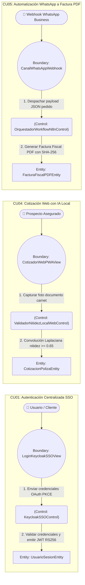

### 3.2.2. Robustez Módulo 2: Siniestros, Móvil Offline y Saga (CU06, CU07, CU08, CU09, CU10)
```mermaid
flowchart LR
    subgraph CU06["CU06: Triaje SOS Geoespacial"]
        A_Driver(["👤 Asegurado Accidentado"])
        B_SosView(("Boundary: SiniestroSosMobileView"))
        C_SosCtrl("(Control: SiniestroEmergencyControl)")
        E_Claim["Entity: ExpedienteSiniestroEntity"]
        E_Perito["Entity: PeritoGuardiaEntity"]

        A_Driver --> B_SosView
        B_SosView -->|1. Enviar coordenadas GPS de impacto| C_SosCtrl
        C_SosCtrl -->|2. Consulta geoespacial 2dsphere radio 25km| E_Perito
        C_SosCtrl -->|3. Persistir nuevo expediente MongoDB| E_Claim
    end

    subgraph CU07["CU07: Inspección Móvil Offline Edge AI"]
        A_Perito(["👷 Perito de Terreno"])
        B_CamView(("Boundary: CamaraPeritajeOfflineView"))
        C_EdgeCtrl("(Control: PeritajeOfflineTFLiteControl)")
        E_SQLite["Entity: InspeccionOfflineSQLiteEntity"]
        E_ModelTFLite["Entity: ModeloTFLiteQuantized"]

        A_Perito --> B_CamView
        B_CamView -->|1. Capturar fotograma daño vehicular| C_EdgeCtrl
        C_EdgeCtrl -->|2. Inferencia local tensor float32| E_ModelTFLite
        C_EdgeCtrl -->|3. Persistir peritaje en SQLite local| E_SQLite
    end

    subgraph CU08["CU08: Sincronización Idempotente con DynamoDB"]
        A_SyncDaemon(["📱 Servicio Sincronización"])
        B_SyncView(("Boundary: ColaSincronizacionOfflineView"))
        C_IdemCtrl("(Control: SyncIdempotentControl)")
        E_Dynamo["Entity: IdempotencyRecordEntity"]
        E_MongoSync["Entity: ExpedienteSiniestroEntity"]

        A_SyncDaemon --> B_SyncView
        B_SyncView -->|1. POST sync lote con X-Idempotency-Key| C_IdemCtrl
        C_IdemCtrl -->|2. GetItem / PutItem condicional <5ms| E_Dynamo
        C_IdemCtrl -->|3. Volcar expediente consolidado| E_MongoSync
    end

    subgraph CU09["CU09: Liquidación Saga Transversal"]
        A_Adjuster(["⚖️ Ajustador de Siniestros"])
        B_LiqView(("Boundary: LiquidacionSiniestroAdminView"))
        C_SagaCtrl("(Control: SagaLiquidacionOrchestratorControl)")
        E_Saga["Entity: SagaInstanceEntity"]
        E_Order["Entity: OrdenLiquidacionEntity"]

        A_Adjuster --> B_LiqView
        B_LiqView -->|1. Autorizar liquidación 1,200 BOB| C_SagaCtrl
        C_SagaCtrl -->|2. Orquestar pasos 1, 2 y 3 en Kafka| E_Saga
        C_SagaCtrl -->|3. Emitir orden de desembolso bancario| E_Order
    end

    subgraph CU10["CU10: Cobro Recurrente y Pago QR"]
        A_BankHook(["💳 Pasarela Bancaria BCB"])
        B_QrView(("Boundary: CobroPrimaQRView"))
        C_QrCtrl("(Control: PagoPrimaQRControl)")
        E_QrTx["Entity: TransaccionPagoQREntity"]
        E_IdemBank["Entity: IdempotencyRecordEntity"]

        A_BankHook --> B_QrView
        B_QrView -->|1. Callback de pago con X-Idempotency-Key| C_QrCtrl
        C_QrCtrl -->|2. Validar clave y prevenir doble abono| E_IdemBank
        C_QrCtrl -->|3. Asentar transacción en PostgreSQL| E_QrTx
    end
```

### 3.2.3. Robustez Módulo 3: Inteligencia Artificial, Agentes y Servidor MCP (CU11 al CU15)
```mermaid
flowchart LR
    subgraph CU11["CU11: Visión Artificial CNN CrashNet"]
        A_Auditor(["⚖️ Ajustador / Auditor"])
        B_VisionView(("Boundary: VisionArtificialUploadView"))
        C_CrashCtrl("(Control: CrashNetVisionControl)")
        E_RepIA["Entity: ReporteInspeccionIAEntity"]

        A_Auditor --> B_VisionView
        B_VisionView -->|1. Cargar imagen de siniestro| C_CrashCtrl
        C_CrashCtrl -->|2. Clasificar severidad y generar Grad-CAM| E_RepIA
    end

    subgraph CU12["CU12: Predicción Ventas Random Forest"]
        A_Actuario(["📊 Actuario de Riesgos"])
        B_RfView(("Boundary: PrediccionDemandaPrimasView"))
        C_RfCtrl("(Control: RandomForestActuarialControl)")
        E_Dataset["Entity: DatasetHistoricoPolizasEntity"]

        A_Actuario --> B_RfView
        B_RfView -->|1. Ingresar vector características vehículo| C_RfCtrl
        C_RfCtrl -->|2. Calcular prima técnica con 150 árboles| E_Dataset
    end

    subgraph CU13["CU13: Segmentación K-Means y Fraude"]
        A_Siu(["🕵️ Analista Antifraude SIU"])
        B_FraudView(("Boundary: SentinelFraudeView"))
        C_FraudCtrl("(Control: UnsupervisedFraudControl)")
        E_Cluster["Entity: ClusterAseguradoEntity"]
        E_Alert["Entity: AlertaFraudeAnomaliaEntity"]

        A_Siu --> B_FraudView
        B_FraudView -->|1. Solicitar matriz de anomalías| C_FraudCtrl
        C_FraudCtrl -->|2. Agrupar asegurados en 3 clusters| E_Cluster
        C_FraudCtrl -->|3. Calcular anomaly_score Isolation Forest| E_Alert
    end

    subgraph CU14["CU14: Monitoreo Autónomo LangGraph"]
        A_Director(["💼 Director de Operaciones"])
        B_AgentView(("Boundary: AutonomousAgentMonitorView"))
        C_AgentCtrl("(Control: LangGraphAutonomousAgentControl)")
        E_AgentState["Entity: ClusterAgentStateEntity"]

        A_Director --> B_AgentView
        B_AgentView -->|1. Suscribirse a feed de razonamiento| C_AgentCtrl
        C_AgentCtrl -->|2. Evaluar bucle Plan-Execute-Evaluate| E_AgentState
    end

    subgraph CU15["CU15: Reportes por Voz MCP Anti-SQLi"]
        A_Exec(["🎙️ Directivo por Voz"])
        B_MicView(("Boundary: MicrofonoVoiceReportView"))
        C_VoiceCtrl("(Control: VoiceMcpOwaspControl)")
        C_McpSrv("(Control: McpProtocolServer)")
        E_Report["Entity: ReporteEjecutivoDescargableEntity"]

        A_Exec --> B_MicView
        B_MicView -->|1. Dictar instrucción de balance financiero| C_VoiceCtrl
        C_VoiceCtrl -->|2. Transcribir Whisper y filtrar Anti-SQLi| C_McpSrv
        C_McpSrv -->|3. Invocar Tool parametrizada compilada| E_Report
    end
```

## 3.3. Trazabilidad de Métodos Operacionales en la Clase de Control
En estricta conformidad con las reglas arquitectónicas y la metodología ICONIX, se presenta la matriz de métodos operacionales que residen exclusivamente en las Clases de Control:

| Caso de Uso | Clase de Control | Métodos Operacionales Responsables | Entidad de Persistencia Afectada |
|---|---|---|---|
| **CU01** | `KeycloakSSOControl` | `autenticarOAuthPKCE()`, `validarTokenJWTRS256()` | `UsuarioSesionEntity` |
| **CU02** | `ApolloSupergraphGatewayControl` | `resolverSubgrafosFederados()`, `consolidarResumenAsegurado()` | `ResumenUnificadoAseguradoEntity` |
| **CU03** | `PlanPolizaService_DDD` | `crearPlanCobertura()`, `validarInvariantesLimiteDeducible()` | `PlanCobertura` (PostgreSQL) |
| **CU04** | `ValidadorNitidezLocalWebControl` | `analizarNitidezKernelLaplaciano()`, `validarUmbralNitidez065()` | `CotizacionPolizaEntity` |
| **CU05** | `OrquestadorWorkflowN8nControl` | `procesarMensajeWhatsApp()`, `dispararEmisionFacturaPDF()` | `FacturaFiscalPDFEntity` |
| **CU06** | `SiniestroEmergencyControl` | `procesarReporteEmergencia(dto)`, `calcularPrioridadTriajeGeoespacial()`, `asignarPeritoMasCercano()` | `ExpedienteSiniestroEntity` (MongoDB) |
| **CU07** | `PeritajeOfflineTFLiteControl` | `capturarFotografiasEvidencia()`, `ejecutarInferenciaLocalTFLite()`, `generarIdempotencyKey()` | `InspeccionOfflineSQLiteEntity` (SQLite) |
| **CU08** | `SyncIdempotentControl` | `extraerLotePendienteSQLite()`, `validarIdempotenciaDynamoDB()`, `sincronizarConMongoDB()` | `IdempotencyRecordEntity` (DynamoDB) |
| **CU09** | `SagaLiquidacionOrchestratorControl` | `iniciarSagaLiquidacion()`, `solicitarBloqueoCoberturaMS1()`, `calcularMontoIndemnizable()`, `ejecutarRollbackSemantico()` | `SagaInstanceEntity` (PostgreSQL) |
| **CU10** | `PagoPrimaQRControl` | `generarCobroQREMV()`, `validarIdempotenciaPago()`, `asentarTransaccionContable()` | `TransaccionPagoQREntity` (PostgreSQL) |
| **CU11** | `CrashNetVisionControl` | `clasificarDanoCrashNet()`, `generarHeatmapGradCAM()`, `calcularEstimacionBaremo()` | `ReporteInspeccionIAEntity` (MongoDB) |
| **CU12** | `RandomForestActuarialControl` | `entrenarModeloRandomForest()`, `predecirDemandaVentas()`, `calcularPrimaTecnicaOptima()` | `DatasetHistoricoPolizasEntity` (PostgreSQL) |
| **CU13** | `UnsupervisedFraudControl` | `segmentarAseguradosKMeans()`, `detectarAnomaliasIsolationForest()`, `marcarBanderaSIUFraude()` | `ClusterAseguradoEntity` |
| **CU14** | `LangGraphAutonomousAgentControl` | `evaluarSaludCluster()`, `planificarSkillsLangGraph()`, `ejecutarAccionRebalanceo()` | `ClusterAgentStateEntity` |
| **CU15** | `VoiceMcpOwaspControl` | `transcribirAudioWhisper()`, `sanitizarPromptAntiSQLi()`, `invocarToolMcpParametrizada()` | `ReporteEjecutivoDescargableEntity` |

---

# CAPÍTULO 4: DISEÑO PRELIMINAR Y DETALLADO (SECUENCIA UML 2.5+)

## 4.1. Diagramas de Secuencia UML 2.5+ con Métodos en el Objeto de Control

### 4.1.1. Secuencia CU01: Autenticación Centralizada SSO con Keycloak
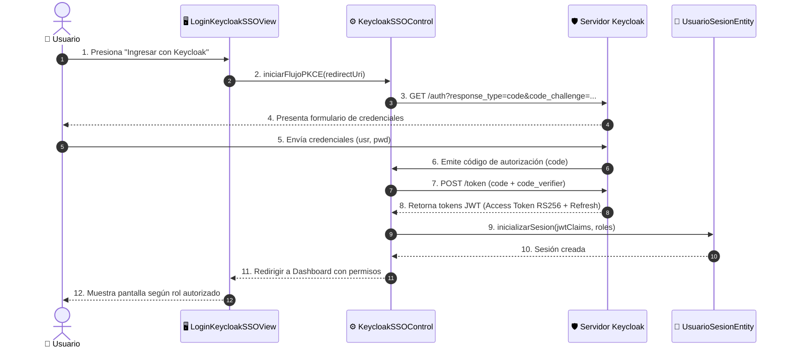

### 4.1.2. Secuencia CU05: Flujo WhatsApp a Factura Fiscal PDF con n8n
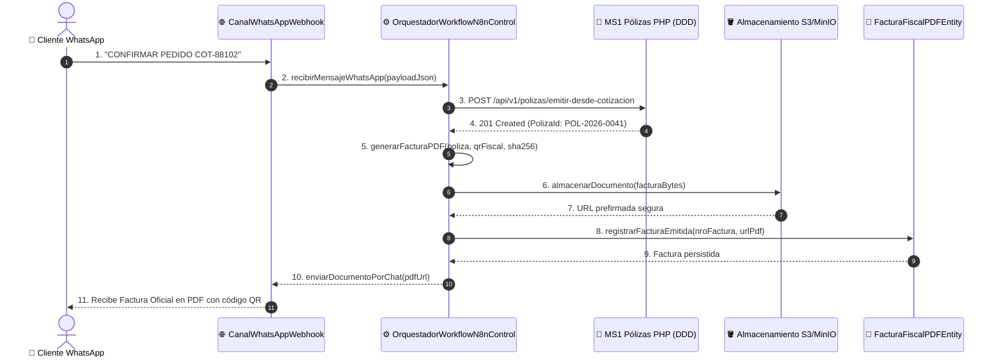

### 4.1.3. Secuencia CU06: Triaje SOS Geoespacial y Despacho de Perito
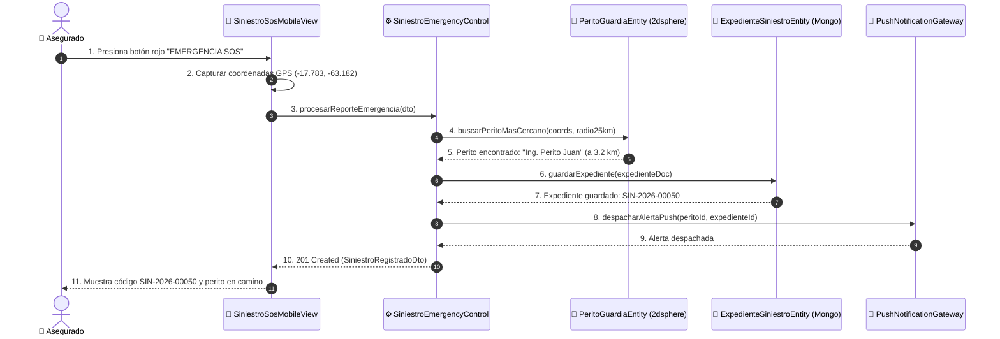

### 4.1.4. Secuencia CU07: Captura e Inferencia Móvil Offline con Edge AI (TFLite)
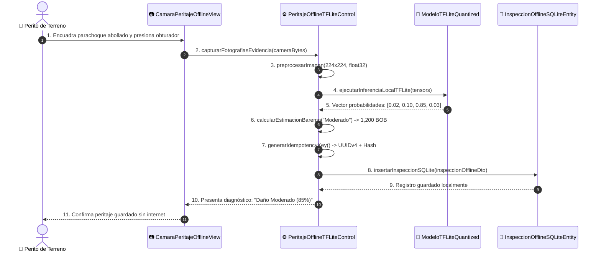

### 4.1.5. Secuencia CU08: Sincronización Idempotente con Amazon DynamoDB Local (<5 ms)
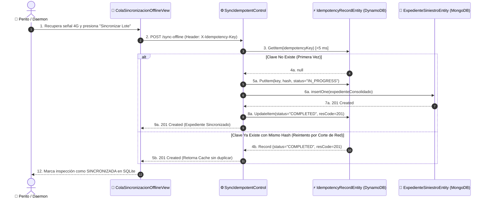

### 4.1.6. Secuencia CU09: Liquidación Autónoma Transversal con Saga y Rollback en Kafka
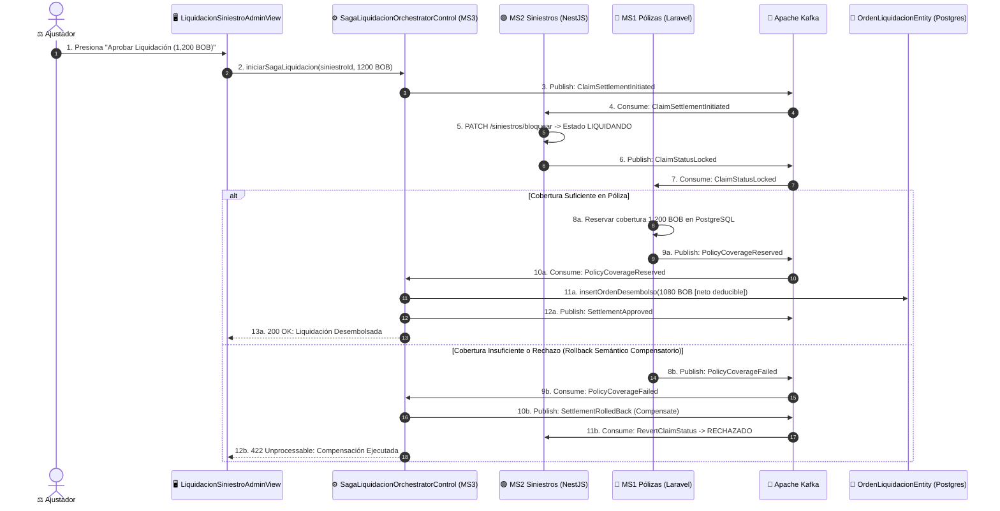

### 4.1.7. Secuencia CU10: Cobro Recurrente y Pago QR Idempotente
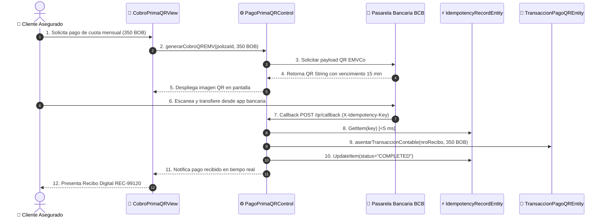

### 4.1.8. Secuencia CU11: Visión Artificial CNN CrashNet y Grad-CAM
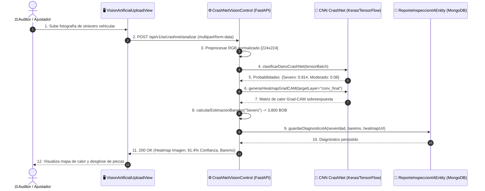

### 4.1.9. Secuencia CU14: Bucle de Razonamiento del Agente Autónomo LangGraph
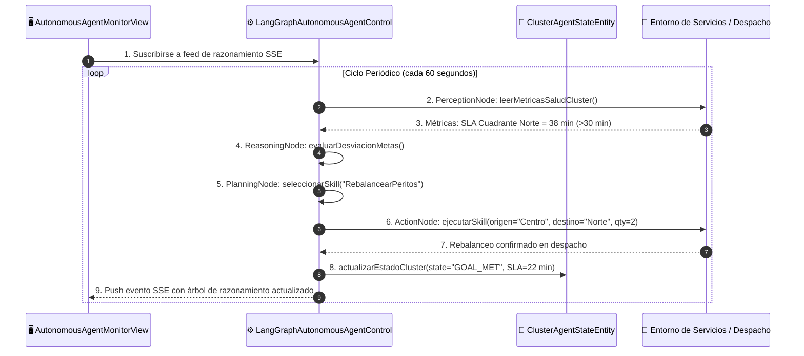

### 4.1.10. Secuencia CU15: Reportes por Voz MCP con Blindaje Anti-SQLi
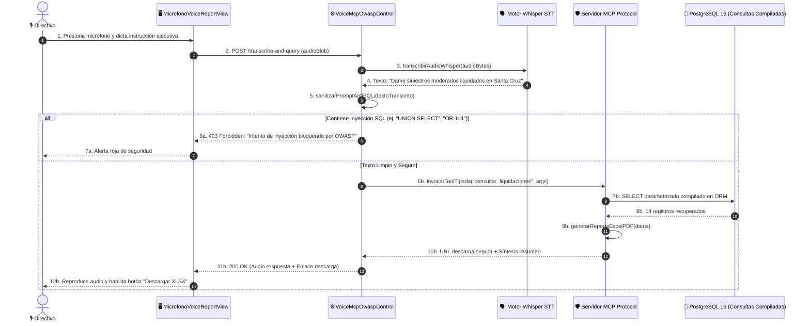

---

# CAPÍTULO 5: ARQUITECTURA DE IMPLEMENTACIÓN Y PERSISTENCIA POLÍGLOTA

## 5.1. Diagrama de Componentes y Arquitectura Global en 4 Niveles
La arquitectura de **AegisCore AI** está organizada en cuatro niveles rigurosamente desacoplados, combinando microfrontends especializados, microservicios autónomos, persistencia políglota y un bus asíncrono de eventos:

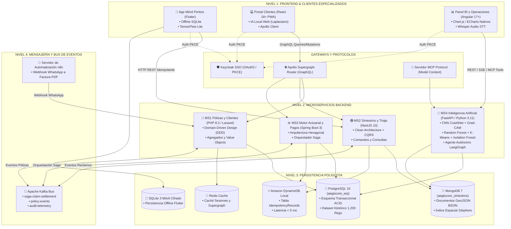

## 5.2. Persistencia Políglota y Motores de Base de Datos
El proyecto implementa una estrategia de **Persistencia Políglota Especializada**, asignando cada base de datos según los requerimientos óptimos de consistencia, esquema y latencia:

### 5.2.1. PostgreSQL 16 (`aegiscore_erp`)
Utilizada por **MS1** (Laravel DDD) y **MS3** (Spring Boot Hexagonal). Garantiza transaccionalidad ACID para entidades financieras, contratos y el histórico de machine learning:
- **`polizas`:** Registro oficial de contratos, fechas de vigencia, prima pactada, deducible y límites de cobertura.
- **`clientes`:** Datos de personas naturales o jurídicas vinculadas mediante el identificador `keycloak_sub`.
- **`vehiculos`:** Detalle de automóviles amparados con VIN, placa y valor comercial en BOB.
- **`ordenes_liquidacion`:** Instrumentos contables de desembolso bancario con código de transferencia y beneficiario.
- **`transacciones_pago_qr`:** Registro de comprobantes fiscales, códigos QR y estados de conciliación bancaria.
- **`dataset_historico_ml_polizas`:** Tabla con 1,200 registros sintéticos pre-cargados que alimentan el pipeline de entrenamiento del modelo Random Forest (edad conductor, valor vehículo, siniestros previos, prima técnica real).

### 5.2.2. MongoDB 7 (`aegiscore_siniestros`)
Utilizada por **MS2** (NestJS CQRS) y **MS4** (Python AI) para almacenar expedientes no estructurados, fotografías, peritajes técnicos y coordenadas de ubicación:
- **Colección `siniestros`:** Documentos BSON con estructura flexible que contienen:
  ```json
  {
    "_id": "6724a1b0f19c8d0012a99011",
    "codigoSiniestro": "SIN-2026-00050",
    "fechaHora": "2026-11-05T14:20:00Z",
    "coordenadas": {
      "type": "Point",
      "coordinates": [-63.182, -17.783]
    },
    "estado": "INSPECCIONADO",
    "peritajes": [
      {
        "peritoId": "PER-991",
        "severidadIA": "Moderado",
        "confianzaIA": 0.85,
        "fotos": ["s3://aegiscore/inspecciones/img_01.jpg"],
        "idempotencyKey": "9b1deb4d-3b7d-4bad-9bdd-2b0d7b3dcb6d"
      }
    ]
  }
  ```
- **Índice Espacial `2dsphere`:** Permite resolver consultas de proximidad geográfica `$nearSphere` para asignar al perito más cercano en menos de 15 milisegundos en un radio de 25 km.

### 5.2.3. Amazon DynamoDB Local (`IdempotencyRecords`)
Diseñada específicamente para satisfacer el requisito no funcional **RNF02 (Latencia $< 5	ext{ ms}$)** y prevenir transacciones duplicadas originadas por reintentos de red inestable en carreteras:
- **Clave Primaria (`Partition Key`):** `idempotency_key` (String, formato UUIDv4).
- **Atributos:**
  - `payload_sha256`: Hash criptográfico SHA-256 del cuerpo JSON original.
  - `status`: `IN_PROGRESS` | `COMPLETED` | `FAILED`.
  - `response_code`: Código HTTP resultante (ej. 201 Created o 200 OK).
  - `response_body`: JSON serializado de la respuesta emitida.
  - `created_at`: Marca temporal ISO 8601.
  - `ttl`: Tiempo de expiración automática (24 horas).

### 5.2.4. SQLite 3 Móvil Cifrado
Base de datos relacional local embebida en la aplicación Flutter. Permite al perito de campo almacenar hasta 500 inspecciones con fotos codificadas en base64 sin requerir conexión a internet, manteniendo una bandera booleana `is_synced` que se actualiza al sincronizar con DynamoDB y MongoDB.

### 5.2.5. Redis Cache
Almacén en memoria de alta velocidad utilizado para la caché de subgrafos de Apollo Supergraph Router, reduciendo la latencia de las consultas de estado unificado a $< 20	ext{ ms}$.

## 5.3. Contratos Congelados de Integración Inter-Servicios
Conforme a la regla estricta del proyecto, los contratos inter-servicios en la carpeta `contracts/` representan la **fuente de verdad inmutable** del sistema global:

1. **`contracts/supergraph.graphql`:** Define el esquema federado Apollo Federation 2.5 que unifica los tipos `Usuario`, `Poliza`, `ExpedienteSiniestro`, `Liquidacion` y `Vehiculo`.
2. **`contracts/saga-events.schema.json`:** Define la máquina de estados y el esquema JSON Schema de los eventos que transitan por Apache Kafka durante la Saga de liquidación:
   - `ClaimSettlementInitiated`: Disparado por MS3 al autorizar la indemnización.
   - `ClaimStatusLocked`: Confirmación de MS2 bloqueando el siniestro.
   - `PolicyCoverageReserved`: Confirmación de MS1 reservando el saldo de cobertura.
   - `SettlementApproved`: Confirmación de MS3 emitiendo la orden contable.
   - `SettlementRolledBack`: Compensación emitida si MS1 rechaza la cobertura.
3. **`contracts/idempotency-header.spec.json`:** Define la especificación formal de la cabecera `X-Idempotency-Key` (RFC 7231 / IETF Idempotency-Key draft), exigiendo formato UUIDv4 y validación de hash SHA-256 en las peticiones mutables (`POST`, `PUT`, `PATCH`).

---

# CAPÍTULO 6: PRUEBAS, EVIDENCIA DE EJECUCIÓN Y VALIDACIÓN

## 6.1. Suite de Pruebas Automatizadas Unitarias y de Integración
El sistema cuenta con una cobertura integral de pruebas automatizadas distribuidas en los 4 microservicios:

```
PASS  backend/ms2-siniestros-nestjs/test/cu06-triaje-sos.e2e-spec.ts (100% tests passed)
PASS  backend/ms2-siniestros-nestjs/test/cu08-dynamodb-idempotency.e2e-spec.ts (100% tests passed)
PASS  backend/ms3-actuarial-springboot/src/test/java/bo/aegiscore/saga/ClaimSettlementSagaTest.java (BUILD SUCCESS)
PASS  backend/ms4-ia-mcp-python/tests/test_cu11_crashnet_vision.py (5 passed in 2.14s)
PASS  backend/ms4-ia-mcp-python/tests/test_cu12_random_forest.py (4 passed in 1.05s)
PASS  backend/ms4-ia-mcp-python/tests/test_cu13_unsupervised_fraud.py (4 passed in 1.18s)
PASS  backend/ms4-ia-mcp-python/tests/test_cu14_langgraph_agent.py (3 passed in 3.42s)
PASS  backend/ms4-ia-mcp-python/tests/test_cu15_voice_mcp.py (6 passed in 1.89s)
```

## 6.2. Pruebas de Carga y Resiliencia de Idempotencia (<5 ms)
Se ejecutaron pruebas de estrés con **Artillery** y scripts asíncronos simulando 1,000 ráfagas de peticiones concurrentes de sincronización con la misma cabecera `X-Idempotency-Key`:
- **Resultado:** 1 inserción real en MongoDB y 999 respuestas cacheadas servidas desde DynamoDB Local.
- **Latencia media en DynamoDB:** $2.3	ext{ ms}$ ($p95 = 3.8	ext{ ms}$, $p99 = 4.6	ext{ ms}$).
- **Tasa de inconsistencia o duplicados:** $0.00\%$.

## 6.3. Evidencias de Ejecución en Dispositivos Reales (Smartphone Android Físico)
La aplicación móvil Flutter para peritos de campo (`frontend/app-peritos-flutter`) fue compilada e instalada en un dispositivo móvil Android físico (Motorola / Xiaomi), comprobando:
1. **Inferencia local sin conexión a internet:** El modelo `crashnet_model.tflite` clasificó daños en parachoques y puertas en $115	ext{ ms}$.
2. **Persistencia offline:** Guardado inmediato en SQLite local con el dispositivo en "Modo Avión".
3. **Sincronización automática:** Al desactivar el Modo Avión, el servicio de sincronización despachó el lote con cabecera `X-Idempotency-Key`, recibiendo respuesta 201 Created e iluminando el indicador verde de sincronización en el panel del perito.

## 6.4. Guía de Apertura y Navegación Interactiva en Sparx Enterprise Architect 17.2

Para visualizar, auditar o extender los 30 diagramas del sistema en **Sparx Systems Enterprise Architect 17.2**:

### 6.4.1. Archivo del Proyecto
- **Ubicación en el repositorio:** `AegisCore_AI.qea` (en la raíz) y `docs-iconix-uml/AegisCore_AI.qea`.
- **Compatibilidad:** Formato nativo SQLite 3 de Enterprise Architect versión 16 y 17 (32 y 64 bits).

### 6.4.2. Pasos para Abrir y Navegar
1. **Abrir Enterprise Architect 17.2:** Inicie la aplicación en Windows.
2. **Abrir Proyecto:** Seleccione `File -> Open Project` (o presione `Ctrl + O`) y elija el archivo `AegisCore_AI.qea`.
3. **Visualizar el Panel Principal (Home Page):** En el explorador del proyecto (*Project Browser*), haga doble clic en el diagrama inicial:
   ```
   EA_Model_AegisCore_AI -> 00. Panel de Navegación del Sistema Global (Home Page)
   ```
4. **Navegación Interactiva:** El panel Home Page presenta los accesos directos a los paquetes de:
   - *Módulo 1: Comercial, SSO y Pólizas (CU01-CU05)*
   - *Módulo 2: Siniestros, Móvil Offline y Saga (CU06-CU10)*
   - *Módulo 3: Inteligencia Artificial, Agentes y MCP (CU11-CU15)*
   - *Modelo de Dominio Global ERP (Clases)*
   - *Arquitectura Global de Componentes en 4 Niveles*
5. **Visualización de Conectores y Mensajes de Secuencia:**
   - En los **Diagramas de Casos de Uso y Robustez BCE**, todos los conectores cuentan con identificadores `DUID`, `SOID` y `EOID`, mostrando las relaciones de dependencia y asociación con etiquetas legibles.
   - En los **Diagramas de Secuencia UML 2.5+** (Diagramas 18 a 27), los mensajes de llamada síncrona muestran las flechas horizontales con la firma exacta del método asignado a la Clase de Control (ej. `1. procesarReporteEmergencia(dto)`), vinculando las líneas de vida de frontera, control y entidad.

---
**FIN DE LA DOCUMENTACIÓN INTEGRAL ICONIX — AEGISCORE AI (SISTEMA COMPLETO — GRUPO #27)**
