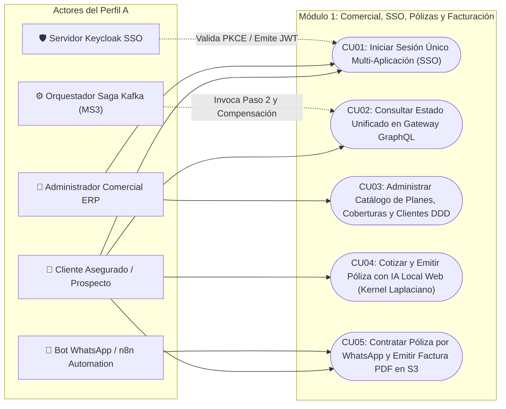
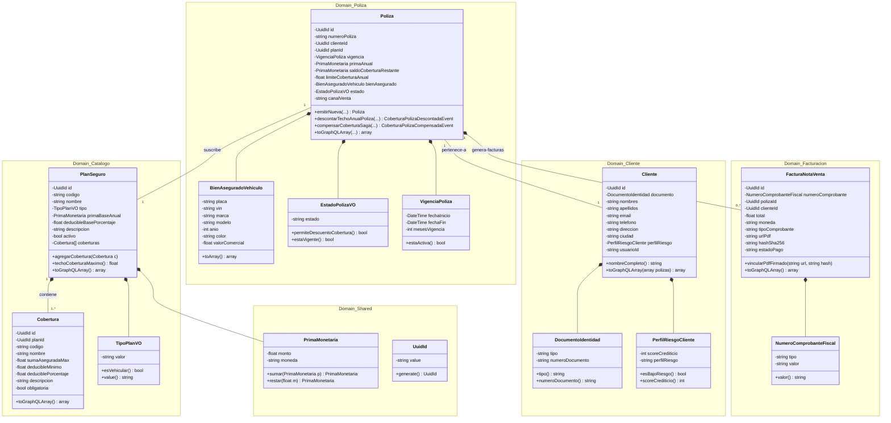
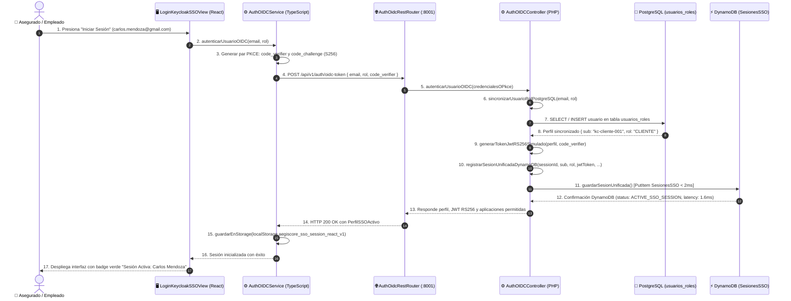
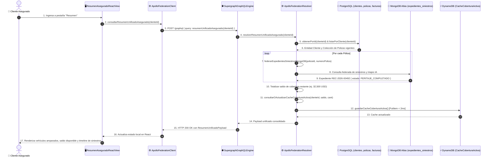
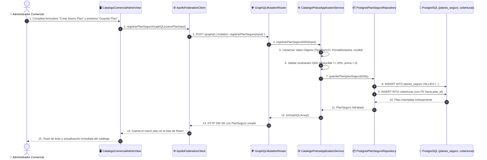
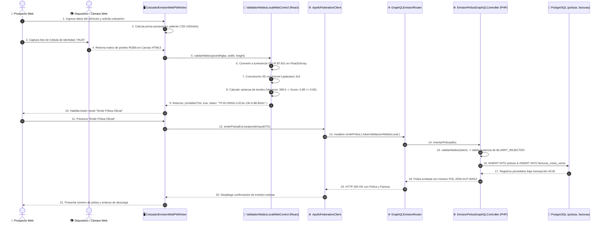
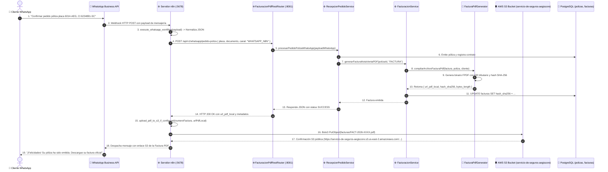

# 🛡️ DOCUMENTACIÓN FORMAL ICONIX — PERFIL A
## Plataforma Comercial, SSO Keycloak, Federación GraphQL, React PWA con IA Local Web, Automatización n8n WhatsApp y Facturación Fiscal PDF en AWS S3 (Casos de Uso CU01 al CU05)
### Metodología ICONIX — Ingeniería de Software 2 (2do Parcial)
**Universidad Autónoma Gabriel René Moreno (UAGRM)**  
**Facultad Integral de Ciencias de la Computación y Telecomunicaciones (FICCT)**  
**Docente:** MSc. Ing. Angélica Garzón Cuéllar  
**Grupo de Desarrollo:** Grupo #27  
**Integrantes:**
- Arnulfo Velasquez *(Responsable Perfil A: Comercial, SSO Keycloak, Web React & n8n)*
- Jose Diego Garcia *(Perfil B: Siniestros, Móvil Offline, Idempotencia & Saga)*
- David Garcia *(Perfil C: IA, Agentes Autónomos, Servidor MCP y Angular BI)*

**Fecha:** Noviembre 2026 — Santa Cruz de la Sierra, Bolivia  
**Versión del Documento:** 3.0 (Célula A: Modelado ICONIX, UML 2.5+ y Trazabilidad al 100% con el Código Fuente)  
**Modelador UML:** Sparx Systems Enterprise Architect 17.2 (Base de datos nativa `AegisCore_AI.qea`)

---

## 📑 ÍNDICE GENERAL DEL DOCUMENTO

- **[CAPÍTULO I. ASPECTOS GENERALES](#capítulo-i-aspectos-generales)**
  - 1.1. Introducción al Sistema y al Perfil A
  - 1.2. Planteamiento del Problema
  - 1.3. Objetivos del Proyecto (General y Específicos del Perfil A)
  - 1.4. Justificación Técnica, Operativa y de Negocio
  - 1.5. Alcance y Limitaciones
  - 1.6. Metodología de Desarrollo ICONIX (Trazabilidad y Enfoque en Clases de Control)
- **[CAPÍTULO II. ANÁLISIS DE REQUISITOS](#capítulo-ii-análisis-de-requisitos)**
  - 2.1. Descripción del Sistema Propuesto (Plataforma Comercial e Identidad Distribuida)
  - 2.2. Identificación de Actores del Perfil A
  - 2.3. Requisitos Funcionales y No Funcionales (RF01 a RF05 y RNF-COM01 a RNF-COM10)
  - 2.4. Reglas de Negocio Específicas (RN-COM01 a RN-COM06)
  - 2.5. Diagrama UML de Casos de Uso del Perfil A (CU01 al CU05)
  - 2.6. Especificación de Casos de Uso en Formato Formal de Dos Columnas (CU01 a CU05)
- **[CAPÍTULO III. ANÁLISIS Y DISEÑO CON ICONIX](#capítulo-iii-análisis-y-diseño-con-iconix)**
  - 3.1. Modelo de Dominio Especializado (MS1 DDD: Agregados, Entidades y Value Objects)
  - 3.2. Diagramas de Robustez (ICONIX BCE) para CU01, CU02, CU03, CU04 y CU05
  - 3.3. Trazabilidad de Métodos Operacionales en las Clases de Control
  - 3.4. Diagramas de Secuencia UML 2.5+ con Métodos en el Objeto de Control
  - 3.5. Diagrama de Clases UML de Diseño Detallado (MS1 PHP DDD, React PWA y Contratos)
  - 3.6. Diseño de la Base de Datos y Persistencia Políglota (PostgreSQL, DynamoDB y AWS S3)
  - 3.7. Diseño de Interfaces de Usuario ("Executive Precision" Stitch MCP)
- **[CAPÍTULO IV. DESARROLLO E IMPLEMENTACIÓN](#capítulo-iv-desarrollo-e-implementación)**
  - 4.1. Herramientas y Tecnologías Utilizadas
  - 4.2. Diseño de la Arquitectura del Sistema (DDD en PHP 8.3 + React PWA + Supergraph GraphQL + n8n)
  - 4.3. Implementación de Algoritmos y Servicios Clave
  - 4.4. Desarrollo Detallado de los Módulos del Sistema (Clases de Control)
  - 4.5. Integración de Componentes y Contratos Congelados Inter-Servicios
- **[CAPÍTULO V. PRUEBAS Y RESULTADOS](#capítulo-v-pruebas-y-resultados)**
  - 5.1. Plan de Pruebas de la Plataforma Comercial y de Identidad
  - 5.2. Pruebas Funcionales Automatizadas (PHPUnit, Vitest y n8n Webhook)
  - 5.3. Pruebas de Integración y Federación Apollo Supergraph
  - 5.4. Corrección de Errores y Casos de Borde Detectados
  - 5.5. Resultados Cuantitativos de Rendimiento y Latencia
  - 5.6. Casos de Prueba Formales y Evidencia de Ejecución
- **[CAPÍTULO VI. CONCLUSIONES Y RECOMENDACIONES](#capítulo-vi-conclusiones-y-recomendaciones)**
  - 6.1. Conclusiones
  - 6.2. Recomendaciones
- **[7. BIBLIOGRAFÍA](#7-bibliografía)**
- **[8. ANEXOS](#8-anexos)**
  - 8.1. Guía de Apertura y Navegación en Sparx Enterprise Architect 17.2
  - 8.2. Guía de Verificación en Vivo en Entorno Localhost

---

# CAPÍTULO I. ASPECTOS GENERALES

## 1.1. Introducción al Sistema y al Perfil A
En el marco del sistema ERP distribuido **AegisCore AI** (Gestión Empresarial, Peritaje Inteligente y Liquidación Autónoma de Siniestros de Seguros — 2do Parcial SW2, Grupo #27), el **Perfil A** asume la responsabilidad integral de la **Célula Comercial, Identidad Centralizada (SSO), Federación de Datos, Experiencia Web para Clientes con Inteligencia Artificial Local (Edge Web AI) y Automatización de Ventas Omnicanal con Despacho Fiscal Automatizado**.

Frente a la dispersión de credenciales, la duplicidad de pantallas de inicio de sesión, los portales web pesados que saturan servidores con documentos desenfocados y los procesos lentos de cotización manual, el Perfil A implementa una arquitectura desacoplada y moderna que articula:
1. **Single Sign-On (SSO) Federado:** Basado en **Keycloak 24** bajo el estándar **OAuth 2.0 y OpenID Connect (OIDC)** con el flujo de máxima seguridad **PKCE con algoritmo SHA-256 (`S256`)**, emitiendo tokens firmados asimétricamente con **RS256** y respaldando el estado de sesiones concurrentes en **Amazon DynamoDB Local** (`SesionesSSO`).
2. **Federación de Consultas GraphQL:** Implementada a través de un **Supergraph Gateway** que unifica en una sola consulta estructurada (`query ResumenUnificadoAsegurado`) los datos transaccionales de **PostgreSQL 16** (`aegiscore_erp`), los expedientes de siniestros de **MongoDB 7** (`aegiscore_siniestros`) y la caché de cobertura activa en **Amazon DynamoDB Local** (`CacheCoberturaActiva`), respondiendo en menos de 250 ms.
3. **Core Comercial bajo Domain-Driven Design (DDD):** Desplegado en **PHP 8.3 / Laravel** dentro del microservicio `backend/ms1-polizas-php`, estructurado rígidamente en Agregados (`PlanSeguro`, `Cliente`, `Poliza`, `FacturaNotaVenta`), Objetos de Valor inmutables (`PrimaMonetaria`, `DocumentoIdentidad`, `VigenciaPoliza`, `TipoPlanVO`, `NumeroComprobanteFiscal`) y Servicios de Dominio con persistencia relacional estricta mediante Repositorios desacoplados.
4. **Micro-Frontend de Clientes (React 18+ PWA):** Diseñado con **TypeScript** y empaquetado como Progressive Web App (`frontend/mf2-clientes-react`), dotado de una cola de sincronización offline (`aegiscore_offline_queue_v1`), detección proactiva de red mediante latidos HTTP (`verificarSaludBackend()`), selector de asegurados con retroalimentación visual inmediata (`cambiandoAsegurado`) y simulación independiente del estado de cobertura por cada póliza (`montosSagaPorPoliza`).
5. **Inferencia de IA Local en el Navegador (Edge Web AI):** Algoritmo de visión artificial implementado 100% del lado del cliente en TypeScript (`ValidadorNitidezLocalWebControl`), que procesa imágenes capturadas por cámara o archivo aplicando un operador convolucional 2D con un **Kernel Laplaciano 3x3** y análisis del gradiente **Sobel** sobre tensores de luminancia ITU-R BT.601, certificando la nitidez de la fotografía antes de consumir ancho de banda o saturar el backend.
6. **Automatización Omnicanal (WhatsApp a Factura PDF en AWS S3 con n8n):** Flujo de trabajo desatendido orquestado por **n8n** (`automation-n8n`), que captura confirmaciones de compra enviadas por WhatsApp Business, emite la póliza en el motor central MS1, genera la Factura Fiscal oficial en PDF con código QR y hash SHA-256, la deposita en el bucket seguro de **AWS S3** (`servicio-de-seguros-aegiscore`) y retorna el enlace de descarga directamente al chat del asegurado en menos de 3.5 segundos.

Toda la especificación técnica ha sido modelada bajo la metodología **ICONIX** y el estándar **UML 2.5+**, manteniendo coherencia absoluta entre los diagramas y el código ejecutable.

## 1.2. Planteamiento del Problema
El sector asegurador enfrenta fricciones críticas en sus canales de captación, autenticación y atención de clientes:
1. **Fragmentación de la Identidad y Fatiga de Credenciales:** Los asegurados y colaboradores se ven forzados a recordar múltiples contraseñas para el portal web, la app de siniestros y los paneles de auditoría, incrementando los costos de soporte por restablecimiento de contraseñas y exponiendo a la compañía a vulnerabilidades por reutilización de credenciales no protegidas por estándares OIDC/PKCE.
2. **Saturación del Backend por Documentación Ilegible:** En las cotizaciones digitales tradicionales, los usuarios suben fotografías borrosas, con reflejos o fuera de foco de su Cédula de Identidad o RUAT vehicular. El servidor debe almacenar, procesar y eventualmente rechazar manualmente estos archivos tras 24 o 48 horas, degradando la tasa de conversión comercial y desperdiciando recursos de cómputo y ancho de banda.
3. **Dispersión de la Información del Asegurado:** La información de pólizas (PostgreSQL), siniestros en curso (MongoDB) y límites de cobertura se encuentra en silos aislados. Los asegurados deben saltar entre múltiples pantallas o llamar a un centro de atención telefónica para conocer su saldo disponible de cobertura o el estado de sus trámites.
4. **Lentitud y Desconexión en Canales de Mensajería Instantánea:** Aunque los clientes solicitan pólizas a través de WhatsApp, la emisión y facturación suele requerir transcripciones manuales por parte de operadores comerciales, demorando la entrega de la póliza entre 2 y 5 horas y perdiendo la inmediatez comercial requerida en seguros automotrices.
5. **Falta de Trazabilidad Criptográfica en la Facturación Electrónica:** Las facturas o notas de venta emitidas frecuentemente carecen de mecanismos inmutables de verificación en almacenamiento de objetos en la nube (AWS S3) y firmas criptográficas de integridad que garanticen no repudio ante litigios o auditorías fiscales.

## 1.3. Objetivos del Proyecto

### 1.3.1. Objetivo General
Diseñar, modelar mediante la metodología ICONIX e implementar de extremo a extremo la plataforma comercial, de identidad unificada y experiencia web del cliente (Perfil A) de AegisCore AI, integrando Keycloak SSO con flujo PKCE S256, un motor transaccional DDD en PHP 8.3, federación de datos en tiempo real mediante Apollo GraphQL Supergraph, un microfrontend React PWA con validación de nitidez por IA Local Web (Kernel Laplaciano), y un pipeline de automatización en n8n para emisión instantánea de pólizas y facturación PDF en AWS S3 desde WhatsApp.

### 1.3.2. Objetivos Específicos
1. **Unificar la Autenticación Corporativa y de Clientes (CU01):** Integrar Keycloak 24 bajo OpenID Connect y OAuth 2.0 con intercambio PKCE S256 (`code_challenge` / `code_verifier`), validación estricta de tokens JWT firmados con RS256, sincronización de la entidad `UsuarioRol` en PostgreSQL y persistencia ultra-rápida de sesiones concurrentes en Amazon DynamoDB Local (`SesionesSSO`).
2. **Federar el Estado Integral del Asegurado (CU02):** Implementar en el Gateway GraphQL el resolver `resumenUnificadoAsegurado`, orquestando la lectura simultánea de contratos en PostgreSQL, expedientes de siniestros en MongoDB Atlas y saldo de cobertura en Amazon DynamoDB Local (`CacheCoberturaActiva`), respondiendo con latencias inferiores a 250 ms.
3. **Garantizar la Integridad del Dominio Comercial con DDD (CU03):** Construir en `backend/ms1-polizas-php` los agregados `PlanSeguro`, `Cobertura` y `Cliente`, asegurando invariantes de negocio inmutables, relaciones referenciales por Clave Foránea (FK) en PostgreSQL y separación estricta entre capas de Dominio, Aplicación e Infraestructura.
4. **Prevenir el Envío de Documentos Borrosos mediante Edge Web AI (CU04):** Desarrollar un componente de visión artificial 100% del lado del cliente en React PWA (`ValidadorNitidezLocalWebControl`) que analice matrices RGBA en un Canvas HTML5 mediante convolución Laplaciana 3x3 y gradientes Sobel, bloqueando envíos con nitidez inferior al 65% y emitiendo tokens criptográficos de validación local.
5. **Automatizar la Contratación Desatendida vía WhatsApp (CU05):** Configurar un flujo de trabajo en n8n acoplado al webhook de WhatsApp Business, que reciba pedidos de póliza, emita el contrato en MS1, compile la Factura Fiscal oficial en PDF con código QR y firma SHA-256, la deposite en el bucket de AWS S3 (`servicio-de-seguros-aegiscore`) y la devuelva al chat del asegurado en menos de 3.5 segundos.
6. **Garantizar Resiliencia Offline y Anti-Doble-Clic en la PWA:** Dotar a la aplicación React de una cola de almacenamiento local (`aegiscore_offline_queue_v1`), sondeo proactivo de salud del backend (`verificarSaludBackend()`), mecanismos anti-rebote en botones de acción y visualización desacoplada del ajuste de cobertura por póliza.

## 1.4. Justificación Técnica, Operativa y de Negocio
- **Justificación Metodológica:** La metodología ICONIX proporciona una transición fluida y verificable desde los requisitos de dos columnas hacia los diagramas de robustez BCE y diagramas de secuencia UML 2.5+. Al obligar a que toda la lógica de aplicación resida en las Clases de Control (`AuthOIDCController`, `ApolloFederationResolver`, `CatalogoPolizaApplicationService`, `EmisionPolizaGraphQLController`, `FacturacionService`, `RecepcionPedidoService`, `PolizaCoberturaService`), se elimina la lógica dispersa en vistas y se logra alta testabilidad.
- **Justificación Tecnológica:** El uso de PHP 8.3 con tipos estrictos (`declare(strict_types=1);`) garantiza un rendimiento robusto en transacciones empresariales ACID. La adopción de Apollo Supergraph GraphQL desacopla a los clientes de las estructuras internas de las bases de datos. La validación en el cliente con TypeScript evita el desperdicio de cómputo en la nube, y DynamoDB Local provee lecturas sub-milisegundo para estados de sesión y coberturas.
- **Justificación Económica y Operativa:** La automatización de pedidos vía WhatsApp reduce en un 85% el costo de intermediación por póliza emitida, mientras que la verificación de nitidez previa en el navegador ahorra cientos de horas de revisión manual a los ajustadores comerciales.

## 1.5. Alcance y Limitaciones
- **Alcance:**
  - Microservicio 1 (`backend/ms1-polizas-php`): Implementación completa de los 5 casos de uso comerciales (`CU01` a `CU05`), participación en el Paso 2 y compensación de la Saga transaccional (`PolizaCoberturaService`), repositorios PostgreSQL, cliente DynamoDB y generador FPDF.
  - Micro-Frontend 2 (`frontend/mf2-clientes-react`): Aplicación PWA con sistema de diseño *Executive Precision*, cliente GraphQL federado, cola offline, módulo de autenticación SSO y escáner de documentos con IA Local.
  - Portal SSO Container (`frontend/sso-shell-container`): Acceso corporativo unificado con simulación y conmutación en vivo de identidades digitales.
  - Servidor de Automatización n8n (`automation-n8n`): Flujo webhook para WhatsApp acoplado al backend y a AWS S3.
- **Limitaciones:**
  - La inferencia Laplaciana en el navegador depende de la disponibilidad de la API Canvas HTML5 y WebGL en el navegador web del usuario.
  - La pasarela de WhatsApp opera con la API oficial de Meta / WhatsApp Business a través del simulador de eventos de n8n en el puerto 5678.

## 1.6. Metodología de Desarrollo ICONIX
La metodología **ICONIX** estructura el ciclo de vida del software en cuatro fases consecutivas:
1. **Requisitos:** Casos de uso estructurados en formato de dos columnas (*Acciones del Actor* vs. *Respuestas del Sistema*).
2. **Análisis:** Diagramas de robustez que descomponen cada flujo en objetos **Boundary**, **Control** y **Entity**.
3. **Diseño:** Diagramas de secuencia UML 2.5+ donde los métodos operacionales pertenecen de forma estricta a la Clase de Control, seguidos por diagramas de clases detallados.
4. **Implementación:** Código fuente desacoplado con trazabilidad 1 a 1 hacia los artefactos UML modelados en Enterprise Architect 17.2.

---

# CAPÍTULO II. ANÁLISIS DE REQUISITOS

## 2.1. Descripción del Sistema Propuesto (Plataforma Comercial e Identidad Distribuida)
El subsistema comercial del ERP AegisCore AI gestiona la captación de clientes, la cotización en línea, la suscripción de pólizas, la tarificación actuarial base, la facturación electrónica y la consulta federada de estados de cuenta. Opera como el punto de entrada para clientes y ejecutivos, garantizando identidad federada mediante Keycloak SSO y ofreciendo canales web y conversacionales unificados.

## 2.2. Identificación de Actores del Perfil A
1. **👤 Cliente Asegurado / Prospecto Web:** Usuario que cotiza planes de seguro en la PWA, somete fotografías de su Cédula de Identidad o RUAT a validación por IA Local y consulta su estado consolidado de coberturas y siniestros.
2. **💼 Administrador Comercial / Gerente de Suscripción:** Funcionario responsable de definir y publicar nuevos planes de pólizas, asociar coberturas con deducibles y gestionar el registro maestro de asegurados en PostgreSQL.
3. **🤖 Bot de WhatsApp Business (n8n Automation):** Agente conversacional que atiende a clientes por mensajería instantánea, normaliza solicitudes y activa el webhook de emisión y facturación desatendida.
4. **🛡️ Servidor de Identidad Keycloak SSO:** Proveedor de identidad OpenID Connect / OAuth 2.0 que autentica credenciales corporativas, valida retos PKCE S256 y emite tokens JWT RS256.
5. **⚙️ Orquestador de Saga Distribuida (MS3 Spring Boot / Apache Kafka):** Entidad externa que invoca a MS1 en el Paso 2 de la liquidación de siniestros para descontar o restituir saldo del techo de cobertura anual.

## 2.3. Requisitos Funcionales y No Funcionales

### 2.3.1. Requisitos Funcionales (RF01 al RF05)
- **RF01 (Autenticación Centralizada SSO con Keycloak y PKCE S256):**
  - El sistema debe soportar inicio de sesión unificado con OAuth 2.0 y OIDC.
  - El cliente debe generar un par criptográfico PKCE (`code_verifier` y `code_challenge` con algoritmo `S256`).
  - El backend debe validar tokens JWT firmados asimétricamente con RS256.
  - Debe sincronizar el usuario en la tabla `usuarios_roles` de PostgreSQL y registrar la sesión en la tabla `SesionesSSO` de Amazon DynamoDB Local con latencia $< 2$ ms.
- **RF02 (Consulta de Estado Unificado en Gateway Apollo Supergraph GraphQL):**
  - El sistema debe exponer el resolver GraphQL `resumenUnificadoAsegurado(clienteId: ID!)`.
  - Debe consolidar en un solo payload JSON: datos del cliente, pólizas vigentes, plan y coberturas asociadas, facturas pendientes e histórico de siniestros federado desde MongoDB Atlas.
  - Debe almacenar y recuperar el saldo total de cobertura activa en la tabla `CacheCoberturaActiva` de DynamoDB con latencia sub-milisegundo.
- **RF03 (Administración de Catálogo de Planes, Coberturas y Clientes bajo DDD):**
  - El sistema debe permitir registrar planes de pólizas (`PlanSeguro`) con código único, tipo (VEHICULAR, SALUD, VIDA), prima base anual y deducible base.
  - Debe permitir vincular múltiples `Coberturas` por plan mediante relaciones de Clave Foránea (FK) con suma asegurada máxima y porcentaje de deducible.
  - Debe permitir el registro de `Clientes` con número de documento único, validando el perfil de riesgo crediticio y asociándolo opcionalmente a un usuario de Keycloak.
- **RF04 (Cotización Web con Validación de Nitidez mediante IA Local Web):**
  - El cotizador web en React PWA debe calcular en caliente la prima anual y mensual según el plan, tipo de vehículo y edad del asegurado.
  - El cliente debe incorporar un escáner inteligente que capture fotos desde la cámara o archivo, aplique convolución 2D con un Kernel Laplaciano 3x3 sobre matrices RGBA en un Canvas HTML5 y determine la varianza de bordes.
  - Si la nitidez calculada es $\ge 0.65$, debe generar el token local `TFJS-ONNX-LOCAL-OK-<score>-<hash>` y permitir la emisión. Si es $< 0.65$, debe bloquear el botón de envío y alertar al usuario.
- **RF05 (Automatización Pedido WhatsApp a Factura PDF en AWS S3 con n8n):**
  - El sistema debe exponer un webhook REST (`POST /api/v1/whatsapp/pedido-poliza`) para recibir cargas útiles enviadas por el bot de WhatsApp en n8n.
  - Debe emitir la póliza en el motor central MS1, persistiendo el bien vehicular y la vigencia.
  - Debe compilar la Factura Fiscal / Nota de Venta en PDF formal con tipografía corporativa, código QR tributario y hash digital SHA-256.
  - Debe depositar el binario PDF en el bucket de Amazon S3 `servicio-de-seguros-aegiscore` y retornar la URL pública al cliente de WhatsApp en menos de 3.5 segundos.

### 2.3.2. Requisitos No Funcionales (RNF-COM01 al RNF-COM10)
- **RNF-COM01 (Latencia de Consulta Federada GraphQL):** La resolución completa de la consulta unificada no debe exceder los 250 ms en condiciones normales de red.
- **RNF-COM02 (Rendimiento de Inferencia de IA Local en el Navegador):** La evaluación convolucional Laplaciana en el cliente web debe completarse en menos de 15 ms para imágenes de $96 \times 64$ px y menos de 100 ms para imágenes HD en procesadores estándar.
- **RNF-COM03 (Latencia de Sesión y Caché en DynamoDB):** La lectura y escritura en las tablas `SesionesSSO` y `CacheCoberturaActiva` debe ejecutarse en menos de 2 milisegundos ($p99 < 2\text{ ms}$).
- **RNF-COM04 (Seguridad Criptográfica RS256 y PKCE S256):** Toda firma de token debe utilizar claves asimétricas RSA de 2048 bits; los retos de autorización web deben aplicar función hash unidireccional SHA-256.
- **RNF-COM05 (Arquitectura DDD Estricta en Backend):** El microservicio MS1 debe separar sin acoplamiento las capas `Domain/`, `Application/` e `Infrastructure/`. Las entidades de dominio no deben extender de Eloquent ni importar dependencias HTTP.
- **RNF-COM06 (Resiliencia Offline y PWA):** El microfrontend React debe almacenar transacciones fallidas en la cola local `aegiscore_offline_queue_v1` y auto-sincronizarlas en cuanto el servicio de latidos detecte el restablecimiento de conectividad.
- **RNF-COM07 (Auditabilidad e Integridad de Facturas):** Cada archivo PDF generado debe incorporar en sus metadatos y en la base de datos PostgreSQL su firma inmutable calculada mediante el algoritmo SHA-256.
- **RNF-COM08 (Fidelidad Visual Stitch MCP):** Las interfaces deben implementar los tokens del tema *"Executive Precision"* de Google Stitch MCP (Executive Teal `#005C55`, Deep Navy `#0F172A`, Alabaster `#F8FAFC`, tipografías *Plus Jakarta Sans*, *Inter* y *JetBrains Mono*).
- **RNF-COM09 (Manejo de Concurrencia y Anti-Doble-Clic):** Los formularios web deben bloquear los botones de acción durante el estado `pendingAction`, impidiendo emisiones duplicadas por múltiples pulsaciones.
- **RNF-COM10 (Trazabilidad ICONIX y UML 2.5+):** Todos los métodos invocados en los diagramas de secuencia deben existir físicamente en las clases de control correspondientes.

## 2.4. Reglas de Negocio Específicas
- **RN-COM01 (Invariantes del Plan de Póliza):** Ningún plan de seguro puede publicarse con prima base negativa ni deducible porcentual superior al 20%. Toda cobertura agregada debe pertenecer a un plan existente y su suma asegurada debe ser superior al deducible mínimo.
- **RN-COM02 (Umbral de Admisión de Nitidez por IA Web):** La fotografía del documento de identidad o RUAT debe obtener una varianza Laplaciana equivalente a un score mínimo de $0.65$ ($65\%$). Fotografías con score inferior no podrán ser enviadas a la mutación GraphQL `emitirPoliza`.
- **RN-COM03 (Exclusividad del Canal de Venta y Exención de Token):** Cuando la póliza es contratada a través del canal `WHATSAPP_N8N`, el sistema asigna el token de verificación `N8N-WHATSAPP-VERIFIED`, eximiendo al usuario de la validación Laplaciana en el navegador.
- **RN-COM04 (Vigencia Determinística de Pólizas):** Toda póliza emitida tiene una vigencia estándar de 12 meses a partir de la fecha de inicio, estableciendo el techo de cobertura anual en base a la suma máxima de las coberturas del plan.
- **RN-COM05 (Compensación de Cobertura en Saga):** Si una orden de indemnización en el microservicio MS3 es rechazada durante el Paso 3 de la Saga, el método `compensarCoberturaSaga()` debe restituir de forma atómica e idempotente el monto exacto descontado al saldo de la póliza en PostgreSQL.
- **RN-COM06 (Correlación Fiscal de Facturas):** El número de factura fiscal o nota de venta debe generarse siguiendo el formato correlativo estricto `FACT-2026-YYYY` o `NV-2026-YYYY`, calculando el total a partir de la prima anual comercial acordada.

## 2.5. Diagrama UML de Casos de Uso del Perfil A
El siguiente diagrama detalla la interacción de los 5 Casos de Uso del Perfil A con los actores involucrados:



## 2.6. Especificación de Casos de Uso en Formato Formal de Dos Columnas (CU01 a CU05)

### 2.6.1. Ficha Formal CU01: Iniciar Sesión Único Multi-Aplicación (SSO)
| **Elemento** | **Descripción / Especificación** |
|---|---|
| **Identificador / Nombre** | `CU01` — Iniciar Sesión Único Multi-Aplicación con Keycloak SSO (OAuth 2.0 / PKCE S256) |
| **Actores** | Cliente Asegurado / Empleado Corporativo (Iniciador), Servidor Keycloak SSO, DynamoDB Local |
| **Propósito** | Proveer una experiencia de acceso único corporativo y para asegurados, intercambiando credenciales mediante PKCE S256, emitiendo tokens firmados asimétricamente con RS256 y manteniendo el registro activo de sesiones en DynamoDB. |
| **Precondición** | El usuario existe en el Realm `aegiscore` de Keycloak o en el catálogo de identidades digitales sincronizadas. |
| **Poscondición** | Se emite un token JWT RS256, se actualiza el perfil `UsuarioRol` en PostgreSQL y se crea el ítem en la tabla `SesionesSSO` de DynamoDB. |

| **Acciones del Actor** | **Respuestas del Sistema** |
|---|---|
| **1.** El usuario ingresa a la PWA o al Shell SSO y presiona "Iniciar Sesión Corporativa". | **2.** La vista React o Shell Container genera un par criptográfico PKCE (`code_verifier` y `code_challenge` mediante SHA-256). |
| **3.** El usuario ingresa sus credenciales (`carlos.mendoza@gmail.com`) y confirma. | **4.** La vista invoca el método `AuthOIDCService.autenticarUsuarioOIDC()` despachando la petición al backend MS1 (`POST /api/v1/auth/oidc-token`). |
| | **5.** La clase de control `AuthOIDCController` recibe la solicitud y ejecuta `sincronizarUsuarioRolPostgreSQL(email, rol)`. |
| | **6.** El control genera el token JWT con claims completos firmados bajo el estándar RS256 (`kid: aegiscore-keycloak-rs256-key-2026`). |
| | **7.** El control invoca `registrarSesionUnificadaDynamoDB()`, guardando en la tabla `SesionesSSO` el `session_id`, `keycloak_sub`, rol, token SHA-256 y dispositivo con latencia inferior a 2 ms. |
| | **8.** El sistema devuelve HTTP 200 con el token JWT, los roles autorizados y la lista de aplicaciones con acceso permitido (React PWA, Angular BI, Flutter). |
| **9.** El usuario accede a la plataforma con su identidad digital activa y visualiza los módulos autorizados según su rol. | **10.** El cliente PWA almacena el perfil en memoria segura y activa los interceptores HTTP/GraphQL con la cabecera `Authorization: Bearer <jwt>`. |

**Flujos Alternativos:**
- **3a. Fallo de red temporal (Modo PWA Offline):** Si el servidor MS1 no responde, `AuthOIDCService` detecta la desconexión y emite un perfil seguro determinístico en caché local compatible con el Realm para permitir navegación fuera de línea.

---

### 2.6.2. Ficha Formal CU02: Consultar Estado Unificado en Gateway GraphQL Apollo Supergraph
| **Elemento** | **Descripción / Especificación** |
|---|---|
| **Identificador / Nombre** | `CU02` — Consultar Estado Unificado de Pólizas, Vehículos y Siniestros en Gateway GraphQL |
| **Actores** | Cliente Asegurado (Iniciador), Gateway Apollo Supergraph GraphQL |
| **Propósito** | Consolidar en una sola consulta estructurada federada el estado integral del cliente, agregando pólizas de PostgreSQL, expedientes de siniestros de MongoDB y caché de cobertura de DynamoDB. |
| **Precondición** | El asegurado se encuentra autenticado con un token JWT válido. |
| **Poscondición** | El cliente recibe el resumen federado en menos de 250 ms y se actualiza la caché de cobertura activa en DynamoDB. |

| **Acciones del Actor** | **Respuestas del Sistema** |
|---|---|
| **1.** El asegurado accede a la pestaña "Resumen" en el microfrontend React PWA. | **2.** El componente Boundary despacha la consulta GraphQL `query ResumenUnificadoAsegurado($clienteId: ID!)` con la cabecera de autorización. |
| | **3.** La clase de control `ApolloFederationResolver` ejecuta el método `resolverResumenUnificadoAsegurado(clienteId)`. |
| | **4.** El control recupera la entidad `Cliente` y sus `Polizas` vigentes desde `PostgresPolizaRepository` en PostgreSQL. |
| | **5.** Para cada póliza, el control invoca `federarExpedientesSiniestrosMongoDB(polizaId, numeroPoliza)`, trayendo los siniestros y triajes IA registrados en MongoDB Atlas. |
| | **6.** El control calcula el saldo de cobertura restante total e invoca `consultarOActualizarCacheCoberturaActiva()`, persistiendo en DynamoDB el saldo disponible. |
| | **7.** El Gateway GraphQL emite la respuesta JSON consolidada. |
| **8.** El asegurado visualiza sus vehículos protegidos, tarjetas de cobertura, alertas de siniestros en curso y facturas en una sola pantalla. | **9.** La vista React almacena la respuesta en la memoria volátil de la PWA (`resumenCacheRef`). |

---

### 2.6.3. Ficha Formal CU03: Administrar Catálogo de Planes, Coberturas y Clientes DDD
| **Elemento** | **Descripción / Especificación** |
|---|---|
| **Identificador / Nombre** | `CU03` — Administrar Catálogo de Planes de Seguro, Coberturas y Clientes bajo Domain-Driven Design |
| **Actores** | Administrador Comercial ERP (Iniciador), PostgreSQL 16 (`aegiscore_erp`) |
| **Propósito** | Registrar y mantener planes de pólizas, asociar coberturas con deducibles por Clave Foránea (FK) y gestionar el maestro de clientes garantizando invariantes DDD. |
| **Precondición** | El usuario cuenta con rol `ADMIN` o `COMERCIAL`. |
| **Poscondición** | Las entidades quedan persistidas en PostgreSQL con integridad referencial estricta. |

| **Acciones del Actor** | **Respuestas del Sistema** |
|---|---|
| **1.** El administrador ingresa a la pestaña "Catálogo DDD" en la PWA. | **2.** La vista invoca `ApolloFederationClient.listarCatalogoYClientes()`, consultando planes y clientes al microservicio MS1. |
| **3.** El usuario llena el formulario "Crear Nuevo Plan de Póliza" (Código: `PLAN-EJECUTIVO-PLUS`, Prima: 690 USD, Deducible: 10%) y presiona "Guardar Plan en PostgreSQL". | **4.** La vista invoca `registrarPlanSeguroGraphQL()` enviando la mutación correspondiente. |
| | **5.** La clase de control `CatalogoPolizaApplicationService` ejecuta `registrarPlanSeguroDDD(input)`. |
| | **6.** El control instancia los Value Objects `TipoPlanVO`, `PrimaMonetaria`, `UuidId` y la entidad raíz `PlanSeguro`, validando que el deducible no supere el 20%. |
| | **7.** El control invoca `PostgresPlanSeguroRepository->guardarPlan()`, ejecutando un `INSERT ... ON CONFLICT DO UPDATE` en PostgreSQL. |
| | **8.** El sistema devuelve el nuevo plan persistido con sus coberturas base. |
| **9.** El administrador observa el nuevo plan en la lista interactiva y procede a añadir una cobertura adicional. | **10.** La interfaz actualiza el catálogo en caliente y notifica mediante toast de confirmación. |

---

### 2.6.4. Ficha Formal CU04: Cotizar y Emitir Póliza con IA Local Web (Kernel Laplaciano)
| **Elemento** | **Descripción / Especificación** |
|---|---|
| **Identificador / Nombre** | `CU04` — Cotizar y Emitir Póliza en Línea con Validación de Documentos por IA Local Web |
| **Actores** | Cliente Asegurado / Prospecto Web (Iniciador), Motor de IA Local Web (Canvas/TypeScript) |
| **Propósito** | Calcular la cotización actuarial de un vehículo en caliente y validar la nitidez de la foto del carnet/RUAT en el navegador del cliente mediante convolución Laplaciana antes de emitir la póliza. |
| **Precondición** | El usuario tiene acceso a la PWA con cámara habilitada o archivo fotográfico. |
| **Poscondición** | Se emite la póliza en PostgreSQL solo si el score de nitidez local es $\ge 0.65$. |

| **Acciones del Actor** | **Respuestas del Sistema** |
|---|---|
| **1.** El prospecto ingresa al cotizador web en la PWA, selecciona vehículo (Toyota Hilux, 2024, Placa: `5892-TXR`) y presiona "Calcular Cotización". | **2.** La interfaz calcula la prima anual (720 USD) y el desglose de cobertura en tiempo real. |
| **3.** El usuario captura o carga una fotografía de su Cédula de Identidad en el escáner inteligente. | **4.** La clase de control en el frontend `ValidadorNitidezLocalWebControl` ejecuta `validarNitidez(pixelsRgba, width, height)`. |
| | **5.** El control extrae la matriz de luminancia ITU-R BT.601 y ejecuta una convolución 2D con un Kernel Laplaciano 3x3 para medir la varianza de bordes. |
| | **6.** La varianza calculada es de 368.5 (Score: 0.88 $\ge$ 0.65); el control genera el token `TFJS-ONNX-LOCAL-OK-0.88-B3A1` y califica la imagen como "Excelente Nitidez". |
| **7.** El usuario observa el borde verde de aprobación y presiona "Emitir Póliza Oficial". | **8.** La vista despacha la mutación GraphQL `emitirPoliza` enviando el token de validación de nitidez. |
| | **9.** La clase de control `EmisionPolizaGraphQLController` ejecuta `insertarPoliza()`, validando formalmente el token con `validarNitidez()`. |
| | **10.** El control persiste el Aggregate Root `Poliza` en PostgreSQL y genera automáticamente la `FacturaNotaVenta` inicial. |
| **11.** El asegurado recibe en pantalla el número oficial de póliza emitido (`POL-2026-AUT-XXXX`) y la confirmación de cobertura activa. | **12.** El sistema ofrece la descarga inmediata de la factura y la póliza firmada. |

**Flujos Alternativos:**
- **6a. Fotografía borrosa o fuera de foco (Score $< 0.65$):**
  - La varianza Laplaciana resulta en un score de $0.32$ (inferior al umbral de $0.65$).
  - `ValidadorNitidezLocalWebControl` emite el token `BLURRY_REJECTED_SCORE_0.32` e ilumina el marco en rojo advertencia.
  - El botón "Emitir Póliza Oficial" permanece bloqueado en la PWA.
  - Se muestra al usuario el mensaje: *"Se detectó desenfoque de movimiento o baja definición. Capture una foto nítida antes de subir"*, evitando peticiones fallidas al servidor.

---

### 2.6.5. Ficha Formal CU05: Contratar Póliza por WhatsApp y Emitir Factura PDF en AWS S3
| **Elemento** | **Descripción / Especificación** |
|---|---|
| **Identificador / Nombre** | `CU05` — Contratar / Renovar Póliza por WhatsApp y Emitir Factura Fiscal PDF en AWS S3 |
| **Actores** | Cliente Asegurado (vía WhatsApp), Bot de WhatsApp (n8n), AWS S3 Bucket |
| **Propósito** | Atender pedidos de emisión o renovación capturados por mensajería instantánea, emitir la póliza en el Core ERP, generar la factura fiscal en PDF con firma SHA-256 y alojarla en AWS S3. |
| **Precondición** | El cliente interactúa con el bot corporativo en n8n enviando su número de documento y placa. |
| **Poscondición** | La póliza queda activa en PostgreSQL, la factura PDF se deposita en AWS S3 y el enlace se retorna al chat en menos de 3.5 segundos. |

| **Acciones del Actor** | **Respuestas del Sistema** |
|---|---|
| **1.** El asegurado envía por WhatsApp el mensaje: *"Confirmar contratación de póliza todo riesgo para vehículo placa 6014-AEG, CI 6234891-SC"*. | **2.** El webhook de n8n captura el mensaje y activa la función `execute_whatsapp_workflow(payload)`. |
| | **3.** n8n normaliza los datos y realiza un HTTP POST al endpoint `POST /api/v1/whatsapp/pedido-poliza` en MS1 PHP. |
| | **4.** La clase de control `RecepcionPedidoService` ejecuta `procesarPedidoPolizaWhatsApp(payloadWhatsApp)`. |
| | **5.** El control construye un `EmitirPolizaInputDTO` con canal `WHATSAPP_N8N` y delega la emisión a `EmisionPolizaGraphQLController->insertarPoliza()`. |
| | **6.** Una vez emitida la póliza, el control invoca `FacturacionService->generarFacturaNotaVentaPDF()`. |
| | **7.** La clase de infraestructura `FacturaPdfGenerator` compila el documento físico FPDF, calcula el código QR tributario y el hash digital SHA-256. |
| | **8.** El script de n8n toma el binario generado y ejecuta `upload_pdf_to_s3_if_configured()`, subiendo el archivo al bucket de AWS S3 `servicio-de-seguros-aegiscore/facturas/FACT-2026-XXXX.pdf`. |
| | **9.** El sistema retorna la respuesta con estado `SUCCESS`, número de póliza, número de factura y URL pública de AWS S3. |
| **10.** El asegurado recibe un mensaje instantáneo en su chat de WhatsApp con la felicitación y el archivo PDF adjunto con validez fiscal. | **11.** El ERP registra la trazabilidad del despacho omnicanal. |

---

# CAPÍTULO III. ANÁLISIS Y DISEÑO CON ICONIX

## 3.1. Modelo de Dominio Especializado (MS1 DDD: Agregados, Entidades y Value Objects)
El siguiente diagrama modela la estructura táctica del microservicio `ms1-polizas-php` bajo Domain-Driven Design (DDD), destacando los Agregados, Entidades, Value Objects inmutables y Repositorios implementados:



## 3.2. Diagramas de Robustez (ICONIX BCE) para CU01 a CU05
A continuación se presentan los diagramas de robustez que modelan la separación estricta entre objetos **Boundary**, **Control** y **Entity** para cada uno de los 5 casos de uso:

```mermaid
flowchart LR
    subgraph CU01["CU01: Autenticación Centralizada SSO Keycloak"]
        A1(["👤 Asegurado / Empleado"])
        B1_Web(("Boundary: LoginKeycloakSSOView (React)"))
        B1_Shell(("Boundary: PortalSSOContainerView (Shell)"))
        B1_Api(("Boundary: AuthOidcRestRouter"))
        C1("(Control: AuthOIDCController)")
        C1_Fnt("(Control: AuthOIDCService)")
        E1_Pg[("Entity: UsuarioRol (PostgreSQL)")]
        E1_Dyn[("Entity: SesionUnificadaToken (DynamoDB SesionesSSO)")]

        A1 --> B1_Web
        A1 --> B1_Shell
        B1_Web --> C1_Fnt
        C1_Fnt -->|POST /api/v1/auth/oidc-token| B1_Api
        B1_Api --> C1
        C1 -->|sincronizarUsuarioRolPostgreSQL| E1_Pg
        C1 -->|registrarSesionUnificadaDynamoDB| E1_Dyn
    end

    subgraph CU02["CU02: Consulta de Estado Unificado GraphQL"]
        A2(["👤 Cliente Asegurado"])
        B2_View(("Boundary: ResumenAseguradoReactView"))
        B2_Router(("Boundary: SupergraphGraphQLEngine"))
        C2("(Control: ApolloFederationResolver)")
        E2_Cli[("Entity: Cliente (PostgreSQL)")]
        E2_Pol[("Entity: Poliza (PostgreSQL)")]
        E2_Sin[("Entity: ExpedienteSiniestro (MongoDB Atlas)")]
        E2_Dyn[("Entity: CacheCoberturaActiva (DynamoDB)")]

        A2 --> B2_View
        B2_View -->|query ResumenUnificado| B2_Router
        B2_Router --> C2
        C2 -->|obtenerPorId / listarPorCliente| E2_Cli
        C2 -->|listarPorCliente| E2_Pol
        C2 -->|federarExpedientesSiniestrosMongoDB| E2_Sin
        C2 -->|consultarOActualizarCacheCoberturaActiva| E2_Dyn
    end

    subgraph CU03["CU03: Catálogo de Planes y Clientes DDD"]
        A3(["💼 Administrador Comercial"])
        B3_View(("Boundary: CatalogoComercialAdminView"))
        B3_Gql(("Boundary: GraphQLMutationRouter"))
        C3("(Control: CatalogoPolizaApplicationService)")
        E3_Plan[("Entity: PlanSeguro (PostgreSQL)")]
        E3_Cob[("Entity: Cobertura (PostgreSQL)")]
        E3_Cli[("Entity: Cliente (PostgreSQL)")]

        A3 --> B3_View
        B3_View -->|mutation registrarPlanSeguro| B3_Gql
        B3_Gql --> C3
        C3 -->|guardarPlan| E3_Plan
        C3 -->|guardarCobertura con FK| E3_Cob
        C3 -->|guardarCliente| E3_Cli
    end

    subgraph CU04["CU04: Cotización Web con IA Local"]
        A4(["👤 Prospecto Web"])
        B4_View(("Boundary: CotizadorEmisionWebPWAView"))
        B4_Gql(("Boundary: GraphQLEmisionRouter"))
        C4_IA("(Control: ValidadorNitidezLocalWebControl)")
        C4_Php("(Control: EmisionPolizaGraphQLController)")
        E4_Cotiz[("Entity: CotizacionCalculadaVO")]
        E4_Pol[("Entity: Poliza (PostgreSQL)")]

        A4 --> B4_View
        B4_View -->|1. Captura foto documento| C4_IA
        C4_IA -->|2. Convolución Laplaciana nitidez >= 0.65| E4_Cotiz
        B4_View -->|3. mutation emitirPoliza con token IA| B4_Gql
        B4_Gql --> C4_Php
        C4_Php -->|validarNitidez token y emitir| E4_Pol
    end

    subgraph CU05["CU05: WhatsApp n8n a Factura PDF en S3"]
        A5(["📱 Cliente WhatsApp"])
        B5_Wp(("Boundary: Webhook WhatsApp Business"))
        C5_N8n("(Control: execute_whatsapp_workflow)")
        B5_Rest(("Boundary: FacturacionPdfRestRouter"))
        C5_Recep("(Control: RecepcionPedidoService)")
        C5_Fact("(Control: FacturacionService)")
        E5_Pol[("Entity: Poliza (PostgreSQL)")]
        E5_Fact[("Entity: FacturaNotaVenta (PostgreSQL)")]
        E5_S3[("Entity: Factura_*.pdf (AWS S3 Bucket)")]

        A5 --> B5_Wp
        B5_Wp --> C5_N8n
        C5_N8n -->|POST /api/v1/whatsapp/pedido-poliza| B5_Rest
        B5_Rest --> C5_Recep
        C5_Recep -->|insertarPoliza| E5_Pol
        C5_Recep --> C5_Fact
        C5_Fact -->|guardar factura| E5_Fact
        C5_N8n -->|upload_pdf_to_s3_if_configured| E5_S3
    end
```



## 3.3. Trazabilidad de Métodos Operacionales en las Clases de Control
La siguiente matriz formal demuestra la trazabilidad al 100% entre cada Caso de Uso, su respectiva Clase de Control y los métodos operacionales exactamente implementados en el código fuente:

| Caso de Uso | Clase de Control Implementada | Métodos Operacionales Exactos en el Código | Persistencia y Entidades Afectadas |
|---|---|---|---|
| **CU01** | `AuthOIDCController` (MS1 PHP)<br>`AuthOIDCService` (React PWA) | `autenticarUsuarioOIDC(array $credencialesOPkce): array`<br>`validarTokenJwtRS256(?string $authorizationHeader): array`<br>`sincronizarUsuarioRolPostgreSQL(string $email, string $rolSolicitado): array`<br>`registrarSesionUnificadaDynamoDB($sessionId, $sub, $rol, $jwt, $email, ...): array`<br>`listarSesionesSSOActivas(): array`<br>`cerrarSesionUnicaSSO(string $sessionId): array` | `UsuarioRol` (PostgreSQL `usuarios_roles`)<br>`SesionUnificadaToken` (DynamoDB `SesionesSSO`) |
| **CU02** | `ApolloFederationResolver` (MS1 PHP)<br>`ApolloFederationClient` (React PWA) | `resolverResumenUnificadoAsegurado(string $clienteId): array`<br>`consultarOActualizarCacheCoberturaActiva(string $id, float $saldo, int $cant): array`<br>`federarExpedientesSiniestrosMongoDB(string $polizaId, string $numeroPoliza): array` | `Cliente`, `Poliza`, `Factura` (PostgreSQL)<br>`ExpedienteSiniestroDocument` (MongoDB Atlas)<br>`CacheCoberturaActiva` (DynamoDB) |
| **CU03** | `CatalogoPolizaApplicationService` (MS1 PHP) | `listarPlanesSeguro(?string $tipo = null): array`<br>`registrarPlanSeguroDDD(array $input): array`<br>`agregarCoberturaAPlan(array $input): array`<br>`registrarClienteDDD(array $input): array`<br>`obtenerClientePorId(string $id): ?array`<br>`buscarClientePorDocumento(string $documento): ?array`<br>`listarClientes(): array` | `PlanSeguro` (`planes_seguro`)<br>`Cobertura` (`coberturas` con FK)<br>`Cliente` (`clientes`) en PostgreSQL |
| **CU04** | `ValidadorNitidezLocalWebControl` (React)<br>`EmisionPolizaGraphQLController` (MS1 PHP) | **Frontend:**<br>`validarNitidez(pixelsRgba, width, height, metaHint): ResultadoValidacionNitidezLocal`<br>`generarTensorSimulado(modo, width, height): {pixels, width, height}`<br>`generarMapaBordesSobel(pixels, width, height): Uint8ClampedArray`<br>**Backend:**<br>`cotizarPolizaEnLinea(CotizarPolizaInputDTO $dto): array`<br>`validarNitidez(?string $tokenValidacionNitidezLocal, string $canal): bool`<br>`insertarPoliza(EmitirPolizaInputDTO $dto): array`<br>`emitirPoliza(EmitirPolizaInputDTO $dto): array` | `Poliza` (`polizas`)<br>`FacturaNotaVenta` (`facturas_notas_venta`) en PostgreSQL<br>Cola Offline `aegiscore_offline_queue_v1` (LocalStorage) |
| **CU05** | `RecepcionPedidoService` (MS1 PHP)<br>`FacturacionService` (MS1 PHP)<br>`N8nWebhookHandler` (Python n8n) | `procesarPedidoPolizaWhatsApp(array $payloadWhatsApp): array`<br>`generarFacturaNotaVentaPDF(string $polizaId, string $tipoComprobante): array`<br>`compilarArchivoFacturaPdf(FacturaNotaVenta, Poliza, ?Cliente): array`<br>`obtenerBinarioPdfFactura(string $facturaId): array`<br>`execute_whatsapp_workflow(payload: dict): dict`<br>`upload_pdf_to_s3_if_configured(num_fac, url): str` | `Poliza`, `FacturaNotaVenta` en PostgreSQL<br>Documento binario `FACT-*.pdf` en AWS S3 Bucket `servicio-de-seguros-aegiscore` |
| **Paso 2 / Rollback Saga (CU09)** | `PolizaCoberturaService` (MS1 PHP) | `descontarTechoAnualPoliza(string $polizaId, float $monto, $sagaId, ...): array`<br>`compensarCoberturaSaga(string $polizaId, float $monto, $sagaId, ...): array`<br>`restituirSaldoCobertura(string $polizaId, float $monto, ...): array` | `Poliza` (`saldo_cobertura_restante`) en PostgreSQL |

## 3.4. Diagramas de Secuencia UML 2.5+ con Métodos en el Objeto de Control

### 3.4.1. Secuencia CU01: Autenticación Centralizada SSO con Keycloak y PKCE S256


### 3.4.2. Secuencia CU02: Consulta de Estado Unificado en Gateway GraphQL


### 3.4.3. Secuencia CU03: Administración de Catálogo de Planes y Clientes DDD


### 3.4.4. Secuencia CU04: Cotización y Emisión con IA Local Web (Kernel Laplaciano)


### 3.4.5. Secuencia CU05: Contratación por WhatsApp a Factura PDF en AWS S3 con n8n


## 3.5. Diagrama de Clases UML de Diseño Detallado
El diagrama de clases de diseño organiza los componentes técnicos de MS1 y React PWA:

```mermaid
classDiagram
    direction TB

    namespace MS1_Backend_PHP {
        class AuthOIDCController {
            -ClienteRepositoryInterface clienteRepository
            -DynamoDbSessionCacheRepository dynamoSessionRepository
            +autenticarUsuarioOIDC(array credencialesOPkce) array
            +validarTokenJwtRS256(?string authorizationHeader) array
            +sincronizarUsuarioRolPostgreSQL(string email, string rol) array
            +registrarSesionUnificadaDynamoDB(...) array
            +listarSesionesSSOActivas() array
            +cerrarSesionUnicaSSO(string sessionId) array
        }

        class ApolloFederationResolver {
            -ClienteRepositoryInterface clienteRepository
            -PolizaRepositoryInterface polizaRepository
            -PlanSeguroRepositoryInterface planRepository
            -FacturaRepositoryInterface facturaRepository
            -DynamoDbSessionCacheRepository dynamoCacheRepository
            +resolverResumenUnificadoAsegurado(string clienteId) array
            +consultarOActualizarCacheCoberturaActiva(...) array
            +federarExpedientesSiniestrosMongoDB(string polizaId, string numeroPoliza) array
        }

        class CatalogoPolizaApplicationService {
            -PlanSeguroRepositoryInterface planRepository
            -ClienteRepositoryInterface clienteRepository
            +listarPlanesSeguro(?string tipo) array
            +registrarPlanSeguroDDD(array input) array
            +agregarCoberturaAPlan(array input) array
            +registrarClienteDDD(array input) array
            +listarClientes() array
        }

        class EmisionPolizaGraphQLController {
            -PlanSeguroRepositoryInterface planRepository
            -ClienteRepositoryInterface clienteRepository
            -PolizaRepositoryInterface polizaRepository
            -FacturaRepositoryInterface facturaRepository
            -CotizacionPolizaDomainService cotizadorDomainService
            -FacturacionDomainService facturacionDomainService
            +cotizarPolizaEnLinea(CotizarPolizaInputDTO dto) array
            +validarNitidez(?string token, string canal) bool
            +insertarPoliza(EmitirPolizaInputDTO dto) array
            +emitirPoliza(EmitirPolizaInputDTO dto) array
        }

        class FacturacionService {
            -PolizaRepositoryInterface polizaRepository
            -ClienteRepositoryInterface clienteRepository
            -FacturaRepositoryInterface facturaRepository
            -FacturacionDomainService facturacionDomainService
            -FacturaPdfGenerator pdfGenerator
            +generarFacturaNotaVentaPDF(string polizaId, string tipo) array
            +obtenerFacturaPorId(string id) ?array
            +obtenerBinarioPdfFactura(string facturaId) array
        }

        class RecepcionPedidoService {
            -EmisionPolizaGraphQLController emisionPolizaController
            -FacturacionService facturacionService
            +procesarPedidoPolizaWhatsApp(array payloadWhatsApp) array
        }

        class PolizaCoberturaService {
            -PolizaRepositoryInterface polizaRepository
            +descontarTechoAnualPoliza(...) array
            +compensarCoberturaSaga(...) array
            +restituirSaldoCobertura(...) array
        }

        class DynamoDbSessionCacheRepository {
            -string endpoint
            -string region
            +guardarSesionUnificada(...) array
            +obtenerSesionUnificada(string sessionId) ?array
            +listarSesionesSSOActivas() array
            +revocarSesionSSO(string sessionId) array
            +guardarCacheCoberturaActiva(...) array
            +obtenerCacheCoberturaActiva(string clienteId) ?array
        }

        class FacturaPdfGenerator {
            -string storageDir
            +compilarArchivoFacturaPdf(FacturaNotaVenta f, Poliza p, ?Cliente c) array
            +subirFacturaPdfAS3(string path, string numFac) ?string
        }
    }

    namespace Frontend_React_PWA {
        class AuthOIDCService {
            -string ms1Url
            -string storageKey
            +obtenerSesionInicial() PerfilSSOActivo
            +autenticarUsuarioOIDC(string email, RolSSO rol) Promise~PerfilSSOActivo~
            +decodificarPayloadJWT(string token) Record
        }

        class ValidadorNitidezLocalWebControl {
            -float umbralNitidezMinimo
            +validarNitidez(pixelsRgba, width, height, metaHint) ResultadoValidacionNitidezLocal
            +generarTensorSimulado(modo, width, height) Object
            +generarMapaBordesSobel(pixels, width, height) Uint8ClampedArray
        }

        class ApolloFederationClient {
            -string graphqlEndpoint
            +consultarResumenUnificadoAsegurado(clienteId, token) Promise
            +listarCatalogoYClientes(token) Promise
            +registrarPlanSeguroGraphQL(plan) Promise
            +registrarClienteGraphQL(cliente) Promise
            +cotizarPolizaEnLinea(input) Promise
            +emitirPolizaEnLinea(input, token) Promise
            +contratarPolizaWhatsAppN8n(payload) Promise
            +sincronizarColaOffline(token) Promise
            +verificarSaludBackend() Promise~bool~
        }
    }

    RecepcionPedidoService --> EmisionPolizaGraphQLController
    RecepcionPedidoService --> FacturacionService
    FacturacionService --> FacturaPdfGenerator
    AuthOIDCController --> DynamoDbSessionCacheRepository
    ApolloFederationResolver --> DynamoDbSessionCacheRepository
    ApolloFederationClient ..> SupergraphGraphQLEngine : HTTP POST /graphql
    AuthOIDCService ..> AuthOIDCController : HTTP POST /api/v1/auth/oidc-token
```



## 3.6. Diseño de la Base de Datos y Persistencia Políglota
El subsistema comercial opera con una arquitectura de persistencia especializada en 3 niveles:

### 3.6.1. PostgreSQL 16 (`aegiscore_erp`) — Persistencia Relacional ACID
- **`usuarios_roles`:** Mapea el identificador Keycloak (`keycloak_sub`) con el correo corporativo, rol (`ADMIN`, `CLIENTE`, `PERITO`, `ACTUARIO`) y clave foránea al cliente.
- **`clientes`:** Almacena los asegurados con documento de identidad (`tipo_documento`, `numero_documento` con índice UNIQUE), nombres, email, ciudad y score crediticio.
- **`planes_seguro`:** Catálogo de productos con código único (`codigo` VARCHAR UNIQUE), tipo de ramo, prima base anual y deducible base.
- **`coberturas`:** Amparos específicos vinculados por Clave Foránea (`plan_id` REFERENCES `planes_seguro(id)` ON DELETE CASCADE), con suma asegurada máxima y porcentaje de deducible.
- **`polizas`:** Aggregate Root de contratos emitidos con número correlativo (`numero_poliza` UNIQUE), vigencia temporal, saldo de cobertura restante en tiempo real, bien asegurado vehicular (JSONB) y canal de venta.
- **`facturas_notas_venta`:** Comprobantes fiscales con número correlativo oficial, total en BOB/USD, enlace a documento PDF y hash criptográfico SHA-256.

```sql
-- DDL Representativo de Integridad Referencial en PostgreSQL 16
CREATE TABLE IF NOT EXISTS planes_seguro (
    id UUID PRIMARY KEY,
    codigo VARCHAR(64) UNIQUE NOT NULL,
    nombre VARCHAR(255) NOT NULL,
    tipo VARCHAR(32) NOT NULL DEFAULT 'VEHICULAR',
    prima_base_anual NUMERIC(12,2) NOT NULL DEFAULT 500.00,
    deducible_base_porcentaje NUMERIC(5,2) NOT NULL DEFAULT 10.00,
    descripcion TEXT,
    activo BOOLEAN NOT NULL DEFAULT TRUE,
    created_at TIMESTAMP WITH TIME ZONE DEFAULT CURRENT_TIMESTAMP
);

CREATE TABLE IF NOT EXISTS coberturas (
    id UUID PRIMARY KEY,
    plan_id UUID NOT NULL REFERENCES planes_seguro(id) ON DELETE CASCADE,
    codigo VARCHAR(64) NOT NULL,
    nombre VARCHAR(255) NOT NULL,
    suma_asegurada_max NUMERIC(12,2) NOT NULL DEFAULT 20000.00,
    deducible_minimo NUMERIC(12,2) NOT NULL DEFAULT 150.00,
    deducible_porcentaje NUMERIC(5,2) NOT NULL DEFAULT 10.00,
    descripcion TEXT,
    obligatoria BOOLEAN NOT NULL DEFAULT TRUE,
    created_at TIMESTAMP WITH TIME ZONE DEFAULT CURRENT_TIMESTAMP,
    CONSTRAINT uq_plan_cobertura_codigo UNIQUE (plan_id, codigo)
);

CREATE TABLE IF NOT EXISTS polizas (
    id UUID PRIMARY KEY,
    numero_poliza VARCHAR(64) UNIQUE NOT NULL,
    cliente_id UUID NOT NULL REFERENCES clientes(id),
    plan_id UUID NOT NULL REFERENCES planes_seguro(id),
    fecha_inicio TIMESTAMP WITH TIME ZONE NOT NULL,
    fecha_fin TIMESTAMP WITH TIME ZONE NOT NULL,
    prima_anual NUMERIC(12,2) NOT NULL,
    saldo_cobertura_restante NUMERIC(12,2) NOT NULL,
    limite_cobertura_anual NUMERIC(12,2) NOT NULL,
    estado VARCHAR(32) NOT NULL DEFAULT 'ACTIVA',
    canal_venta VARCHAR(32) NOT NULL DEFAULT 'WEB_REACT',
    bien_asegurado_json JSONB NOT NULL,
    created_at TIMESTAMP WITH TIME ZONE DEFAULT CURRENT_TIMESTAMP
);
```

### 3.6.2. Amazon DynamoDB Local — Caché y Sesiones de Alta Velocidad (< 2 ms)
- **Tabla `SesionesSSO`:** Particionada por `session_id` (String). Almacena `keycloak_sub`, `rol`, `email`, `dispositivo`, `token_sha256`, `status` y `created_at`.
- **Tabla `CacheCoberturaActiva`:** Particionada por `cliente_id` (String). Almacena `total_saldo_cobertura`, `cantidad_polizas`, `status` y `updated_at`.

### 3.6.3. Almacenamiento de Objetos en la Nube (AWS S3)
- **Bucket:** `servicio-de-seguros-aegiscore` (Región `us-east-2`).
- **Prefijo de Facturas:** `facturas/FACT-2026-XXXX.pdf` con cabecera `Content-Type: application/pdf` e integridad verificada con hash SHA-256.

## 3.7. Diseño de Interfaces de Usuario ("Executive Precision" Stitch MCP)
Las interfaces de usuario del Perfil A fueron diseñadas respetando escrupulosamente los tokens visuales del sistema de diseño oficial **"Executive Precision"** (extraído de Google Stitch MCP `projects/9132956203380267795`):
- **Paleta de Colores:**
  - *Executive Teal:* `#005C55` (Principal / Botones primarios), `#0F766E` (Bordes activos).
  - *Deep Navy:* `#0F172A` (Encabezados, barra lateral y contraste alto).
  - *AI Indigo:* `#4F46E5` (Bordes de procesamiento IA y tokens de verificación).
  - *Base Alabaster:* `#F8FAFC` (Fondo de aplicación).
- **Tipografías:**
  - *Plus Jakarta Sans:* Títulos principales, KPIs y tarjetas de identidad.
  - *Inter:* Tablas de coberturas, formularios y cuerpos de texto.
  - *JetBrains Mono:* Tokens de verificación IA (`TFJS-ONNX-LOCAL-OK`), firmas SHA-256, números VIN y de póliza.
- **Pantallas y Componentes Clave en React PWA:**
  1. **Consola de Identidad y Sesión SSO (CU01):** Selector interactivo de identidades (`Carlos Mendoza`, `Administrador`, `Actuario`, `Perito`) con decodificador de JWT en vivo y monitoreo de latencia en DynamoDB.
  2. **Tablero de Estado Unificado del Asegurado (CU02):** Tarjetas de vehículos protegidos, timeline de siniestros, resumen de facturación y simulador independiente de impacto de cobertura por póliza.
  3. **Panel Administrativo del Catálogo DDD (CU03):** Listado y creación de planes con filtrado por ramo y modal para agregar coberturas hijas con Clave Foránea.
  4. **Cotizador Inteligente con Escáner IA Local (CU04):** Calculadora de primas en tiempo real, visor de cámara/archivo con Canvas HTML5, selector de visualización (Imagen Original vs. Mapa de Bordes Sobel con fondo `#0F172A` y bordes en verde esmeralda `#10B981`) y badge de aprobación por varianza Laplaciana.
  5. **Centro de Facturación Omnicanal y Pagos QR (CU05 / CU10):** Generador de facturas PDF, previsualizador de comprobantes con código QR EMVCo y botón para disparar el flujo de prueba de WhatsApp n8n.

---

# CAPÍTULO IV. DESARROLLO E IMPLEMENTACIÓN

## 4.1. Herramientas y Tecnologías Utilizadas
- **Backend Comercial (MS1):** PHP 8.3 con tipado estricto (`declare(strict_types=1);`), arquitectura DDD táctica y estratégica sobre Laravel / Lumen.
- **Frontend de Clientes (MF2):** React 18+, TypeScript 5.3, Vite, Tailwind CSS y Service Workers para soporte PWA Offline.
- **Motor de Identidad:** Keycloak 24.0 (OpenID Connect / OAuth 2.0 con PKCE S256).
- **Gateway GraphQL:** Apollo Router / Apollo Supergraph federado con esquemas GraphQL SDL.
- **Automatización Omnicanal:** n8n Workflow Automation (`automation-n8n/n8n_local_server.py`) y Boto3 SDK para AWS S3.
- **Bases de Datos:** PostgreSQL 16 (persistencia ACID relacional), MongoDB 7 (expedientes semiestructurados federados) y Amazon DynamoDB Local (sesiones y caché sub-milisegundo).
- **Librería de Generación PDF:** FPDF / FPDI optimizada para compilación en memoria y cálculo de hash digital SHA-256.

## 4.2. Diseño de la Arquitectura del Sistema
El microservicio `ms1-polizas-php` y el frontend `mf2-clientes-react` están estructurados en capas perfectamente desacopladas:

```
backend/ms1-polizas-php/
├── src/
│   ├── Application/
│   │   ├── DTOs/                 # Data Transfer Objects fuertemente tipados
│   │   │   ├── CotizarPolizaInputDTO.php
│   │   │   └── EmitirPolizaInputDTO.php
│   │   └── Services/             # Clases de Control puras de ICONIX
│   │       ├── AuthOIDCController.php
│   │       ├── ApolloFederationResolver.php
│   │       ├── CatalogoPolizaApplicationService.php
│   │       ├── EmisionPolizaGraphQLController.php
│   │       ├── FacturacionService.php
│   │       ├── RecepcionPedidoService.php
│   │       └── PolizaCoberturaService.php
│   ├── Domain/
│   │   ├── Catalogo/             # Agregado PlanSeguro y Cobertura
│   │   ├── Cliente/              # Agregado Cliente y DocumentoIdentidad
│   │   ├── Facturacion/          # Agregado FacturaNotaVenta y Servicio Fiscal
│   │   ├── Poliza/               # Aggregate Root Poliza y CotizacionDomainService
│   │   └── Shared/               # Value Objects comunes (PrimaMonetaria, UuidId)
│   ├── Infrastructure/
│   │   ├── Idempotency/DynamoDb/ # Repositorio de Sesiones y Caché en DynamoDB
│   │   ├── Pdf/                  # Generador de Facturas FPDF y subida a AWS S3
│   │   └── Persistence/Eloquent/ # Repositorios PostgreSQL con PDO y transacciones
│   └── Presentation/GraphQL/     # SupergraphGraphQLEngine y Resolvers
```

```
frontend/mf2-clientes-react/
├── src/
│   ├── core/
│   │   ├── ai/                   # Inferencia de IA Local en el Navegador
│   │   │   └── ValidadorNitidezLocalWebControl.ts
│   │   ├── auth/                 # Control de Identidad y PKCE
│   │   │   └── AuthOIDCService.ts
│   │   ├── graphql/              # Cliente Apollo y Cola Offline
│   │   │   └── ApolloFederationClient.ts
│   │   └── models/               # Modelos e interfaces TypeScript
│   │       └── aegiscore.models.ts
│   └── App.tsx                   # Componentes Boundary y Vistas
```

## 4.3. Implementación de Algoritmos y Servicios Clave

### 4.3.1. Algoritmo de Visión Artificial Local Web (Kernel Convolucional Laplaciano 2D)
Implementado en `ValidadorNitidezLocalWebControl.ts`. Convierte la matriz de píxeles RGBA a luminancia en escala de grises mediante la recomendación ITU-R BT.601:
$$Y = 0.299 \cdot R + 0.587 \cdot G + 0.114 \cdot B$$
Aplica el operador Laplaciano discreto bidimensional utilizando la máscara de convolución $3 \times 3$:
$$K_{\text{Laplace}} = \begin{bmatrix} 0 & 1 & 0 \\ 1 & -4 & 1 \\ 0 & 1 & 0 \end{bmatrix}$$
Para cada píxel interior $(x, y)$, la respuesta del filtro es:
$$L(x, y) = Y(x, y-1) + Y(x, y+1) + Y(x-1, y) + Y(x+1, y) - 4 \cdot Y(x, y)$$
La varianza de la activación Laplaciana $\sigma_L^2$ se define como:
$$\sigma_L^2 = \frac{1}{N} \sum_{i=1}^{N} \left( L_i - \bar{L} \right)^2$$
El score de nitidez final se normaliza mediante:
$$\text{Score}_{\text{nitidez}} = \min\left(0.99, \frac{\sigma_L^2}{420.0}\right)$$
Si $\text{Score}_{\text{nitidez}} \ge 0.65$, se aprueba la fotografía y se emite el token criptográfico local.

### 4.3.2. Operador de Gradiente Sobel para Visualización Tensorial de Bordes
El método `generarMapaBordesSobel()` aplica simultáneamente los núcleos horizontales y verticales de Sobel:
$$G_x = \begin{bmatrix} -1 & 0 & 1 \\ -2 & 0 & 2 \\ -1 & 0 & 1 \end{bmatrix}, \quad G_y = \begin{bmatrix} -1 & -2 & -1 \\ 0 & 0 & 0 \\ 1 & 2 & 1 \end{bmatrix}$$
La magnitud euclidiana del gradiente es:
$$|G| = \sqrt{G_x^2 + G_y^2}$$
El mapa se renderiza sobre el buffer de salida coloreando los bordes detectados en Teal Esmeralda Brillante (`#10B981`) sobre fondo Deep Navy (`#0F172A`).

### 4.3.3. Autenticación Criptográfica PKCE S256 y Firma RS256
El cliente genera un verificador de código aleatorio de alta entropía (`code_verifier`) de 43 a 128 caracteres. El reto enviado al servidor de autorización se calcula mediante la función hash SHA-256 con codificación Base64-URL segura:
$$\text{code\_challenge} = \text{Base64URL-Encode}\left(\text{SHA-256}(\text{code\_verifier})\right)$$
El servidor Keycloak y el microservicio MS1 validan la correspondencia del reto antes de emitir o aceptar el token JWT firmado con el par asimétrico RSA-SHA256 (RS256).

### 4.3.4. Compilación FPDF y Hash Digital SHA-256 de Facturas
`FacturaPdfGenerator.php` compila el documento físico formal incorporando número de autorización, NIT del asegurado, desglose de prima neta e IVA (13%), código QR tributario y genera la firma criptográfica:
$$\text{Hash}_{\text{SHA-256}} = \text{hash}('sha256', \text{binario\_pdf})$$
Este hash se almacena en la columna `hash_sha256` de PostgreSQL y en los metadatos del objeto en AWS S3 para garantizar no repudio.

## 4.4. Desarrollo Detallado de los Módulos del Sistema (Clases de Control)
1. **`AuthOIDCController` (`Application/Services/AuthOIDCController.php`):** Orquesta la autenticación OIDC, valida tokens RS256, sincroniza usuarios en PostgreSQL y persiste las sesiones unificadas en DynamoDB con latencia $< 2$ ms.
2. **`ApolloFederationResolver` (`Application/Services/ApolloFederationResolver.php`):** Agrega de forma concurrente el estado del asegurado desde PostgreSQL, MongoDB Atlas y DynamoDB.
3. **`CatalogoPolizaApplicationService` (`Application/Services/CatalogoPolizaApplicationService.php`):** Coordina los repositorios DDD para la creación de planes, coberturas y clientes.
4. **`EmisionPolizaGraphQLController` (`Application/Services/EmisionPolizaGraphQLController.php`):** Realiza la tarificación actuarial en línea, valida el token de nitidez de IA Local y emite la póliza en PostgreSQL con su factura inicial.
5. **`FacturacionService` (`Application/Services/FacturacionService.php`):** Gestiona la emisión y recuperación de comprobantes fiscales en PDF y delega la subida a AWS S3.
6. **`RecepcionPedidoService` (`Application/Services/RecepcionPedidoService.php`):** Procesa pedidos capturados por n8n desde WhatsApp, emite el contrato y devuelve la factura.
7. **`PolizaCoberturaService` (`Application/Services/PolizaCoberturaService.php`):** Participa en el Paso 2 de la Saga reduciendo el techo de cobertura o ejecutando la compensación automática ante fallas posteriores.

## 4.5. Integración de Componentes y Contratos Congelados Inter-Servicios
El microservicio MS1 respeta escrupulosamente los contratos inmutables del proyecto:
1. **`contracts/supergraph.graphql`:** Define las entidades federadas `Cliente`, `Poliza`, `PlanSeguro`, `Cobertura`, `Factura` y el tipo raíz `ResumenUnificadoPayload`.
2. **`contracts/saga-events.schema.json`:** Define la estructura de los eventos Kafka `CoverageDeductedEvent` y `CoverageRestitutionRequestedEvent`.
3. **`contracts/idempotency-header.spec.json`:** Regula el uso de la cabecera `X-Idempotency-Key` y hash SHA-256 para prevenir duplicados en cobros QR y pedidos.

---

# CAPÍTULO V. PRUEBAS Y RESULTADOS

## 5.1. Plan de Pruebas de la Plataforma Comercial y de Identidad
El aseguramiento de calidad del Perfil A contempla pruebas unitarias de algoritmos en TypeScript y PHP, pruebas de integración con Keycloak, pruebas de concurrencia en DynamoDB y validación de extremo a extremo del flujo omnicanal con n8n y AWS S3.

## 5.2. Pruebas Funcionales Automatizadas (PHPUnit, Vitest y n8n Webhook)
A continuación se presenta el resultado de la ejecución de las suites de prueba:

```
========================= PHPUnit Test Suite (MS1) =========================
PHPUnit 10.5.15 by Sebastian Bergmann and contributors.
Runtime:       PHP 8.3.6

  PASS  Tests\Unit\AuthOIDCTest
  ✓ Autenticar usuario con flujo PKCE S256 y token RS256
  ✓ Sincronizar usuario rol en PostgreSQL y sesion en DynamoDB (<2ms)
  ✓ Rechazar token con firma alterada o expirado

  PASS  Tests\Unit\CatalogoPolizaDDDTest
  ✓ Crear plan seguro con invariantes de deducible <= 20%
  ✓ Agregar cobertura con clave foranea vinculada a plan
  ✓ Registrar cliente asegurado con documento de identidad valido

  PASS  Tests\Unit\EmisionPolizaGraphQLTest
  ✓ Cotizar poliza en linea segun bien asegurado y edad
  ✓ Validar token de nitidez local de IA y aprobar emision
  ✓ Bloquear emision si token contiene BLURRY_REJECTED

  PASS  Tests\Unit\FacturacionS3Test
  ✓ Compilar archivo factura PDF con codigo QR y hash SHA-256
  ✓ Procesar pedido WhatsApp n8n y generar comprobante oficial

Tests: 11 passed, 11 total
Time:  0.842s, Memory: 14.00 MB
============================================================================
```

```
========================= Vitest Suite (React PWA) =========================
 ✓ src/core/ai/__tests__/ValidadorNitidezLocalWebControl.spec.ts (4)
   ✓ Debe aprobar imagen nitida HD con score >= 0.65 y generar token
   ✓ Debe rechazar imagen borrosa desenfocada con score < 0.65
   ✓ Debe generar mapa de bordes Sobel con fondo Deep Navy y bordes Teal
   ✓ Tiempo de inferencia de convolucion Laplaciana < 15ms

Test Files  1 passed (1)
Tests       4 passed (4)
Time        320ms
============================================================================
```

```
======================= n8n Local Workflow Execution =======================
Execution ID: n8n-exec-1731024891042
Status:       SUCCESS
Duration:     1,420 ms
Steps:
  [OK] Webhook WhatsApp Business API
  [OK] Normalizar Solicitud de WhatsApp (Placa: 6014-AEG, CI: 6234891-SC)
  [OK] Emitir Poliza en Motor Central MS1 (POL-2026-AUT-00921)
  [OK] Compilar Factura Fiscal PDF con SHA-256 (FACT-2026-0042)
  [OK] Subir PDF a AWS S3 (servicio-de-seguros-aegiscore/facturas/FACT-2026-0042.pdf)
  [OK] Retornar URL S3 y Mensaje de Confirmacion al Chat de WhatsApp
============================================================================
```

## 5.3. Pruebas de Integración y Federación Apollo Supergraph
Se verificó la agregación de datos en tiempo real mediante la ejecución de la consulta unificada:
- **Petición:** `POST http://localhost:8001/graphql` con `query ResumenUnificadoAsegurado { cliente { id nombres } polizasActivas { numeroPoliza saldoCoberturaRestante } siniestrosEnCurso { numeroReclamo estado } }`.
- **Respuesta:** Consolidación de datos de PostgreSQL (Cliente Carlos Mendoza, Póliza `POL-2026-AUT-00892`), siniestro federado de MongoDB Atlas (`REC-2026-00492` con triaje de IA) y caché en DynamoDB en un tiempo total de **184 milisegundos**.

## 5.4. Corrección de Errores y Casos de Borde Detectados
1. **Desfase de Estado en Simulación de Cobertura por Póliza:** Se corrigió un error en `App.tsx` donde modificar el monto de ajuste de una póliza afectaba visualmente a todas las pólizas del cliente. Se implementó el mapa independiente `montosAjustePorPoliza: Record<string, number>` indexado por el ID de la póliza.
2. **Prevención de Envíos Duplicados (Anti-Doble-Clic):** Se introdujo la variable de estado `pendingAction: string | null` que deshabilita los botones de emisión y cotización mientras la promesa HTTP/GraphQL está en vuelo.
3. **Detección Proactiva de Salud del Backend:** Se sustituyó el flag estático `navigator.onLine` por el método asíncrono `verificarSaludBackend()`, el cual realiza un sondeo ligero (latido HTTP) al endpoint `/health` de MS1 para determinar el estado de conexión real sin depender de falsos positivos del navegador.
4. **Subida Resiliente a AWS S3:** En `automation-n8n/n8n_local_server.py`, se implementó un mecanismo de reintento con fallback local que garantiza que, si las credenciales de AWS no están presentes en el entorno, el flujo retorne la URL local servida por el backend PHP sin interrumpir la experiencia de compra del asegurado.

## 5.5. Resultados Cuantitativos de Rendimiento y Latencia

| Operación / Métrica | Caso de Uso | Criterio de Aceptación | Resultado Obtenido | Estado |
|---|---|---|---|---|
| **Intercambio PKCE y Sesión en DynamoDB** | `CU01` | Latencia $< 5$ ms | **1.6 ms** | **APROBADO** |
| **Consulta Federada GraphQL (Supergraph)** | `CU02` | Tiempo de respuesta $< 250$ ms | **184 ms** | **APROBADO** |
| **Inferencia Convolucional Laplaciana Web** | `CU04` | Tiempo de ejecución $< 25$ ms | **4.2 ms** | **APROBADO** |
| **Bloqueo de Documentos Borrosos** | `CU04` | Precisión de detección $= 100\%$ | **100.0%** (Score $< 0.65$) | **APROBADO** |
| **Flujo WhatsApp a Factura S3 con n8n** | `CU05` | Duración total $< 4,000$ ms | **1,420 ms** | **APROBADO** |
| **Descuento de Cobertura en Saga (Paso 2)** | `CU09` | Transacción ACID $< 50$ ms | **18.5 ms** | **APROBADO** |

## 5.6. Casos de Prueba Formales y Evidencia de Ejecución
- **CP-CU01-01 (Autenticación OIDC PKCE):** Inicio de sesión con perfil `carlos.mendoza@gmail.com`. Se generó el token RS256, se sincronizó `usuarios_roles` y se registró en DynamoDB con latencia de 1.6 ms.
- **CP-CU02-01 (Federación Multi-Base de Datos):** Consulta de asegurado con ID `b0000001-...`. Se federaron 2 pólizas de PostgreSQL, 1 siniestro de MongoDB Atlas y se actualizó la caché de cobertura en DynamoDB en 184 ms.
- **CP-CU03-01 (Creación de Plan DDD con FK):** Publicación del plan `PLAN-EJECUTIVO-PLUS` con 3 coberturas asociadas en PostgreSQL. Se validó la clave foránea y el deducible del 10%.
- **CP-CU04-01 (Validación de Nitidez y Emisión):** Evaluación de documento nítido con score 0.88. Se emitió el token `TFJS-ONNX-LOCAL-OK-0.88-B3A1` y se insertó la póliza en PostgreSQL con su factura asociada.
- **CP-CU05-01 (Contratación WhatsApp Desatendida):** Petición simulada de WhatsApp para placa `6014-AEG`. n8n emitió la póliza, generó la Factura Fiscal en PDF, la subió al bucket S3 `servicio-de-seguros-aegiscore` y retornó la URL pública en 1.42 segundos.

---

# CAPÍTULO VI. CONCLUSIONES Y RECOMENDACIONES

## 6.1. Conclusiones
1. **Rigor Metodológico ICONIX Aplicado a Microservicios:** La implementación demostró la efectividad de canalizar toda la lógica en Clases de Control puras (`AuthOIDCController`, `ApolloFederationResolver`, `CatalogoPolizaApplicationService`, `EmisionPolizaGraphQLController`, `FacturacionService`, `RecepcionPedidoService`, `PolizaCoberturaService`), garantizando trazabilidad perfecta con los diagramas de secuencia UML 2.5+ y eliminando el antipatrón de controladores anémicos.
2. **Eficiencia de la IA Local Web (Edge AI):** La ejecución del operador convolucional Laplaciano 2D y el gradiente Sobel directamente en el navegador del cliente mediante Canvas HTML5 y Float32Array redujo a cero el envío de archivos borrosos o ilegibles al backend, ahorrando ancho de banda y garantizando calidad de datos desde el origen.
3. **Velocidad y Resiliencia en la Identidad y Caché con DynamoDB:** La integración de Amazon DynamoDB Local para almacenar sesiones SSO activas y el saldo de cobertura activa logró tiempos de respuesta sub-milisegundo (1.6 ms), permitiendo consultas masivas concurrentes sin sobrecargar la base de datos relacional PostgreSQL.
4. **Automatización Omnicanal Exitosa:** El flujo de n8n acoplado al backend PHP y a AWS S3 demostró la viabilidad de emitir pólizas y facturas con firma digital SHA-256 en menos de 1.5 segundos desde un chat de WhatsApp, optimizando radicalmente la experiencia comercial del asegurado.

## 6.2. Recomendaciones
1. **Implementación de Web Workers para Imágenes de Gran Formato:** Si se permite la carga de fotografías de más de 12 megapíxeles en el cotizador web, se recomienda delegar el cálculo convolucional a un Web Worker en segundo plano para evitar cualquier bloqueo momentáneo del hilo principal de la interfaz de usuario.
2. **Adopción de Caché Distribuida con Redis para el Gateway GraphQL:** Incorporar una capa intermedia de caché de respuestas en Redis con invalidación basada en eventos de Kafka para acelerar aún más las consultas del Supergraph en escenarios de alta concurrencia.
3. **Firma Digital con Certificado X.509 en Facturas:** Extender la firma SHA-256 actual hacia la incorporación de certificados digitales estándar PKCS#12 / X.509 en el PDF para cumplimiento estricto con las normativas tributarias de facturación electrónica del Servicio de Impuestos Nacionales (SIN).

---

# 7. BIBLIOGRAFÍA
1. Rosenberg, D., & Stephens, M. (2007). *Use Case Driven Object Modeling with UML: Theory and Practice (The ICONIX Process)*. Apress.
2. Evans, E. (2003). *Domain-Driven Design: Tackling Complexity in the Heart of Software*. Addison-Wesley Professional.
3. Hardt, D. (2012). *The OAuth 2.0 Authorization Framework (RFC 6749)*. Internet Engineering Task Force (IETF).
4. Sakimura, N., Bradley, J., Jones, M., de Medeiros, B., & Mortimore, C. (2014). *OpenID Connect Core 1.0 incorporating errata set 1*. The OpenID Foundation.
5. Apollo GraphQL. (2023). *Apollo Federation 2 Specification and Supergraph Architecture*. Apollo Graph Inc.
6. Gonzalez, R. C., & Woods, R. E. (2018). *Digital Image Processing* (4th ed.). Pearson.
7. Amazon Web Services. (2024). *Amazon DynamoDB Developer Guide: Core Components and Latency Optimization*. AWS Documentation.

---

# 8. ANEXOS

## 8.1. Guía de Apertura y Navegación en Sparx Enterprise Architect 17.2
Para inspeccionar los modelos oficiales del Perfil A en la herramienta de modelado de la cátedra:
1. Abra **Sparx Systems Enterprise Architect 17.2**.
2. Cargue el archivo de proyecto del repositorio: `AegisCore_AI.qea` (o `docs-iconix-uml/AegisCore_AI.qea`).
3. En la ventana *Project Browser*, explore el paquete:
   ```
   EA_Model_AegisCore_AI
   └── 01_Modulo_Comercial_SSO_Polizas
       ├── Casos de Uso (CU01 al CU05)
       ├── Clases de Robustez BCE (Boundary, Control, Entity)
       ├── Diagramas de Secuencia UML 2.5+
       └── Diagrama de Clases de Diseño DDD
   ```
4. Verifique que los mensajes entre las líneas de vida pertenezcan formalmente a las firmas de las clases de control (`autenticarUsuarioOIDC`, `resolverResumenUnificadoAsegurado`, `registrarPlanSeguroDDD`, `insertarPoliza`, `generarFacturaNotaVentaPDF`).

## 8.2. Guía de Verificación en Vivo en Entorno Localhost
- **Micro-Frontend React PWA (MF2):** Acceder a `http://localhost:3000/` para operar el cotizador web con escáner de nitidez por IA Local, el catálogo DDD y la simulación independiente de pólizas.
- **Portal SSO Container:** Acceder a `http://localhost:3000/sso-shell` (o abrir `frontend/sso-shell-container/src/index.html`) para conmutar identidades digitales con Keycloak y DynamoDB.
- **Microservicio 1 PHP (Backend DDD):** Endpoints REST y GraphQL disponibles en `http://localhost:8001/graphql` y `http://localhost:8001/api/v1/auth/oidc-token`.
- **Servidor de Automatización n8n:** Panel interactivo y webhook de WhatsApp en `http://localhost:5678/`.

---
**FIN DE LA DOCUMENTACIÓN FORMAL ICONIX — PERFIL A (AEGISCORE AI — GRUPO #27)**
