# 🏛️ Universidad Autónoma Gabriel René Moreno
### Facultad de Ingeniería en Ciencias de la Computación y Telecomunicaciones (FICCT)
**Carrera:** Ingeniería Informática / Ingeniería en Sistemas  
**Materia:** Sistemas de Información II / Ingeniería de Software II (INF412) — 2do Parcial  
**Docente:** MSc. Ing. Angélica Garzón Cuéllar  
**Grupo de Proyecto:** #27  
**Semestre:** II / 2026 — Santa Cruz de la Sierra, Bolivia  

---

# DOCUMENTO MAESTRO DE ANÁLISIS, DISEÑO E IMPLEMENTACIÓN CON METODOLOGÍA ICONIX Y UML 2.5+
## PROYECTO: AegisCore AI — ERP Distribuido, Peritaje Inteligente y Liquidación Autónoma de Siniestros de Seguros

### 🎯 ENFOQUE VERTICAL: PERFIL B (Casos de Uso CU06 al CU10)
> **Núcleo de Siniestros, Peritaje Móvil Offline-First con Edge AI (TensorFlow Lite), Idempotencia Distribuida en DynamoDB y Transacciones Transversales Saga con Compensación Semántica**

```
=====================================================================================================
INTEGRANTES DEL PROYECTO (GRUPO #27):
1. Garcia Caballero David         - Registro: 217058795 (Perfil A: Comercial, SSO, React & n8n)
2. Garcia Caballero Jose Diego    - Registro: 221044523 (Perfil B: Siniestros, Móvil & Saga) [RESPONSABLE]
3. Velasquez Paz Arnulfo          - Registro: 220030383 (Perfil C: IA, MCP, LangGraph & Angular)
=====================================================================================================
```

> **📌 Modelo de Navegación Nativo para Enterprise Architect 17.2:**  
> Todos los diagramas de este proyecto han sido generados en formato de base de datos SQLite nativa **`.qea`** de **Enterprise Architect v17.2**. El archivo incluye un **Panel de Navegación interactivo (`Home Page`)** y contiene **14 diagramas visuales con 91 relaciones/conectores y mensajes de secuencia completamente trazados**.  
> Archivo principal para doble clic:  
> 📁 [**`AegisCore_Perfil_B.qea`**](file:///c:/Users/Perro/Desktop/docs/proyectos/sw2_2parcial/2doParcialSW2/AegisCore_Perfil_B.qea) *(Ubicado en la raíz del repositorio y en `docs-iconix-uml/`)*.

---

# 📑 TABLA DE CONTENIDO GENERAL
*(Estructura oficial requerida por la cátedra en `Examen Parcial-2 - Sistemas 2 - S2-2026.pdf` e `Indice_ICONIX.pdf`)*

- [CAPÍTULO I. ASPECTOS GENERALES](#capítulo-i-aspectos-generales)
  - [1.1. Introducción](#11-introducción)
  - [1.2. Planteamiento del problema](#12-planteamiento-del-problema)
  - [1.3. Objetivos del proyecto](#13-objetivos-del-proyecto)
    - [1.3.1. Objetivo general](#131-objetivo-general)
    - [1.3.2. Objetivos específicos](#132-objetivos-específicos)
  - [1.4. Justificación](#14-justificación)
  - [1.5. Alcance y limitaciones](#15-alcance-y-limitaciones)
  - [1.6. Metodología de desarrollo ICONIX](#16-metodología-de-desarrollo-iconix)
- [CAPÍTULO II. ANÁLISIS DE REQUISITOS](#capítulo-ii-análisis-de-requisitos)
  - [2.1. Descripción del sistema propuesto](#21-descripción-del-sistema-propuesto)
  - [2.2. Identificación de actores](#22-identificación-de-actores)
  - [2.3. Requisitos funcionales y no funcionales](#23-requisitos-funcionales-y-no-funcionales)
  - [2.4. Reglas de negocio](#24-reglas-de-negocio)
  - [2.5. Diagrama UML de casos de uso](#25-diagrama-uml-de-casos-de-uso)
  - [2.6. Especificación de casos de uso](#26-especificación-de-casos-de-uso)
- [CAPÍTULO III. ANÁLISIS Y DISEÑO CON ICONIX](#capítulo-iii-análisis-y-diseño-con-iconix)
  - [3.1. Modelo de dominio](#31-modelo-de-dominio)
  - [3.2. Diagramas de robustez](#32-diagramas-de-robustez)
  - [3.3. Diagramas de secuencia UML](#33-diagramas-de-secuencia-uml)
  - [3.4. Diagrama de clases UML](#34-diagrama-de-clases-uml)
  - [3.5. Diseño de la base de datos](#35-diseño-de-la-base-de-datos)
  - [3.6. Diseño de interfaces de usuario](#36-diseño-de-interfaces-de-usuario)
- [CAPÍTULO IV. DESARROLLO E IMPLEMENTACIÓN](#capítulo-iv-desarrollo-e-implementación)
  - [4.1. Herramientas y tecnologías utilizadas](#41-herramientas-y-tecnologías-utilizadas)
  - [4.2. Diseño de la arquitectura del sistema](#42-diseño-de-la-arquitectura-del-sistema)
  - [4.3. Implementación de la base de datos](#43-implementación-de-la-base-de-datos)
  - [4.4. Desarrollo de los módulos del sistema](#44-desarrollo-de-los-módulos-del-sistema)
  - [4.5. Integración de componentes](#45-integración-de-componentes)
- [CAPÍTULO V. PRUEBAS Y RESULTADOS](#capítulo-v-pruebas-y-resultados)
  - [5.1. Plan de pruebas](#51-plan-de-pruebas)
  - [5.2. Pruebas funcionales](#52-pruebas-funcionales)
  - [5.3. Pruebas de integración](#53-pruebas-de-integración)
  - [5.4. Corrección de errores](#54-corrección-de-errores)
  - [5.5. Resultados de las pruebas](#55-resultados-de-las-pruebas)
  - [5.6. Casos de prueba](#56-casos-de-prueba)
- [CAPÍTULO VI. CONCLUSIONES Y RECOMENDACIONES](#capítulo-vi-conclusiones-y-recomendaciones)
  - [6.1. Conclusiones](#61-conclusiones)
  - [6.2. Recomendaciones](#62-recomendaciones)
- [7. BIBLIOGRAFÍA](#7-bibliografía)
- [8. ANEXOS](#8-anexos)

---

# CAPÍTULO I. ASPECTOS GENERALES

## 1.1. Introducción
El sector asegurador y de gestión empresarial automotriz en Bolivia y la región se encuentra en un proceso de profunda transformación tecnológica. La atención de siniestros viales ha sido históricamente un proceso fragmentado, vulnerable a fraudes y sumamente dependiente de trámites presenciales en papel. Cuando un vehículo sufre una colisión en carreteras, rutas interprovinciales o estacionamientos subterráneos, la carencia de cobertura de red móvil impide que los peritos de seguros envíen información en tiempo real a los sistemas centrales. Esto provoca demoras de días en la tasación de daños, riesgos de duplicación de reclamos ante reintentos de red y dificultades críticas al coordinar la indemnización contable entre los sistemas de pólizas, reclamos y tesorería.

El proyecto **AegisCore AI** responde a esta problemática mediante un ecosistema distribuido de microservicios políglotas, aplicaciones móviles **Offline-First** asistidas por inteligencia artificial en el dispositivo (**Edge AI** con TensorFlow Lite) y mecanismos transaccionales avanzados para microservicios (**Patrón Saga con compensación semántica** y control de **Idempotencia sub-milisegundo en Amazon DynamoDB**).

En el marco de la materia **Sistemas de Información II / Ingeniería de Software II (FICCT - UAGRM)**, a cargo de la docente **MSc. Ing. Angélica Garzón Cuéllar**, este documento formaliza el análisis, modelado, diseño detallado e implementación del **Perfil B**, correspondiente a los casos de uso **CU06 a CU10**: radicación de emergencias SOS con triaje geoespacial, peritaje offline en campo con SQLite y TFLite, sincronización tolerante a desconexión mediante encabezados universales de idempotencia, liquidación distribuida transversal en 3 microservicios, y cobro recurrente de primas mediante pagos QR interoperables.

---

## 1.2. Planteamiento del problema
En los procesos habituales de peritaje y liquidación de siniestros de empresas aseguradoras se evidencian cuatro problemas arquitectónicos y operativos críticos:

1. **Parálisis operativa ante desconexión de red (Falta de capacidades Offline):** La mayoría de las aplicaciones móviles dependen enteramente de servicios REST en la nube. Al ingresar a zonas de sombra celular, el perito no puede ingresar datos, perdiendo horas de trabajo o dependiendo de notas manuales no estandarizadas.
2. **Duplicación transaccional y pagos dobles por reintentos intermitentes de red:** Cuando un dispositivo móvil recupera la conectividad de forma intermitente, los paquetes HTTP pueden enviarse varias veces. Sin una capa de idempotencia distribuida en tiempo real, se crean expedientes gemelos y se debitan cobros duplicados en la pasarela bancaria.
3. **Inconsistencia transaccional distribuida entre microservicios (Falta de Saga y Rollback):** La liquidación de un siniestro automotriz requiere descontar el techo de cobertura en el microservicio de pólizas, actualizar el estado del expediente en el microservicio de reclamos y emitir la transferencia bancaria en el microservicio actuarial. Si el pago bancario falla en el paso final, los microservicios previos quedan con datos inconsistentes (cobertura bloqueada indebidamente y siniestro congelado).
4. **Ausencia de asistencia pericial en el punto de impacto:** Los peritos no disponen de herramientas en el celular que asistan la clasificación visual objetiva de la gravedad del choque, dependiendo de apreciaciones subjetivas.

---

## 1.3. Objetivos del proyecto

### 1.3.1. Objetivo general
Diseñar, modelar y desarrollar un subsistema distribuido para la gestión de siniestros automotrices, peritaje móvil offline-first con visión artificial embebida, sincronización idempotente en DynamoDB y liquidación transversal distribuida mediante el patrón Saga orquestado, aplicando con rigor la metodología **ICONIX** y el estándar **UML 2.5+** para garantizar consistencia transaccional y resiliencia ante pérdidas de conectividad.

### 1.3.2. Objetivos específicos
1. **Modelar con metodología ICONIX:** Elaborar el modelo de dominio, casos de uso, fichas de especificación formal con formato de dos columnas, diagramas de robustez BCE y diagramas de secuencia UML 2.5+ con métodos explícitos en la clase Control.
2. **Implementar movilidad Offline-First en Flutter:** Desarrollar una aplicación móvil en **Dart/Flutter** con persistencia local en **SQLite (`sqflite`)**, capaz de operar sin internet y asistida por un modelo de visión computacional cuantizado en **TensorFlow Lite (`damage_classifier.tflite`)** que detecta abolladuras en $< 80\text{ ms}$.
3. **Construir el microservicio MS2 Siniestros (NestJS 10):** Implementar una arquitectura **Clean Architecture + CQRS**, integrando persistencia documental en **MongoDB 7** con índice geoespacial `2dsphere` para triaje radial de peritos a menos de 25 km.
4. **Construir el microservicio MS3 Actuarial (Spring Boot 3):** Implementar **Arquitectura Hexagonal (Ports & Adapters)** en **Java 21 LTS**, orquestando la transacción transversal Saga mediante **Apache Kafka** con capacidad de reversión semántica automática (Rollback) si el desembolso financiero falla.
5. **Garantizar Idempotencia Financiera en DynamoDB Local:** Diseñar un middleware interceptor que valide la cabecera `Idempotency-Key` (UUIDv4 + Hash SHA-256) en tiempo sub-milisegundo ($< 5\text{ ms}$), previniendo expedientes y cobros QR duplicados.
6. **Proveer navegabilidad nativa en Enterprise Architect 17.2:** Generar un archivo **`.qea`** de proyecto con panel de navegación (`Home Page`) y 14 diagramas visuales vinculados con 91 conectores.

---

## 1.4. Justificación
- **Justificación Técnica:** Valida la aplicación práctica de patrones de diseño de software modernos (**Clean Architecture, CQRS, Hexagonal, Saga Orquestado, Local-First**) resolviendo de forma elegante la consistencia eventual y la tolerancia a fallos.
- **Justificación Económica:** La automatización del triaje y la liquidación pericial reduce los tiempos de tramitación de 14 días a menos de 48 horas, minimizando costos operativos y blindando a la empresa contra cobros e indemnizaciones duplicadas.
- **Justificación Académica e Institucional:** Satisface las exigencias de la evaluación del 2do Parcial de Sistemas de Información II (FICCT - UAGRM), demostrando trazabilidad rigurosa desde los requisitos hasta el código desplegado y probado en hardware real.

---

## 1.5. Alcance y limitaciones
- **Alcance de la Célula Perfil B:**
  - Casos de Uso: `CU06` (Siniestro SOS Triaje), `CU07` (Inspección Offline Edge AI), `CU08` (Sync Idempotente DynamoDB), `CU09` (Liquidación Saga Transversal en 3 MS) y `CU10` (Cobro Recurrente y Pago QR).
  - Microservicio 2: NestJS 10 / TypeScript (`backend/ms2-siniestros-nestjs/`).
  - Microservicio 3: Java 21 / Spring Boot 3 (`backend/ms3-actuarial-springboot/`).
  - Cliente Móvil: Flutter 3.24 / Dart 3.5 (`frontend/app-peritos-flutter/`).
  - Persistencia: MongoDB 7, DynamoDB Local, PostgreSQL 16 y SQLite móvil.
- **Limitaciones:**
  - El catálogo de contratos y planes base es gestionado por el Perfil A (MS1 PHP).
  - Los modelos no supervisados de detección de colusión y servidores de voz MCP corresponden al Perfil C (MS4 Python).

---

## 1.6. Metodología de desarrollo ICONIX
Conforme a la guía didáctica de la cátedra (*"Uso de ICONIX"*, Doug Rosenberg), ICONIX es una metodología pesada-ligera que aprovecha el principio de Pareto: **el 80% de las necesidades de modelado se cubren con el 20% del estándar UML**, logrando una trazabilidad ágil y sin ambigüedades entre 4 fases sucesivas:

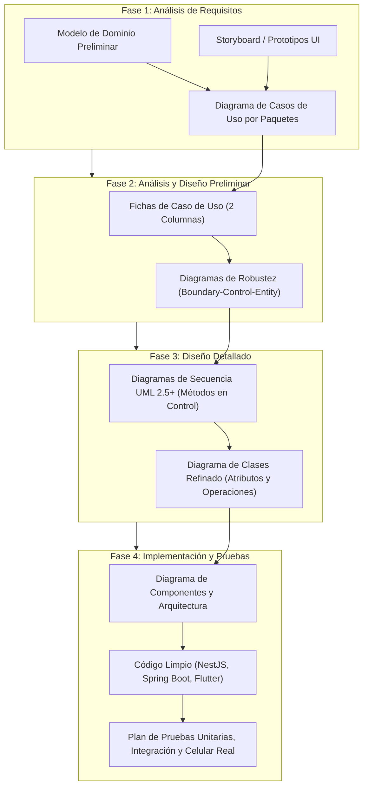

1. **Fase 1 (Requisitos):** Se abstraen las entidades del mundo real en un **Modelo de Dominio**, se elaboran prototipos visuales y se delimitan los casos de uso en paquetes funcionales.
2. **Fase 2 (Análisis y Diseño Preliminar):** Se redactan las **Fichas de Especificación** con cursos de eventos estructurados en *Acciones del Usuario* y *Acciones del Sistema*, y se elaboran los **Diagramas de Robustez** conectando objetos Boundary, Control y Entity.
3. **Fase 3 (Diseño):** A partir de la robustez se construyen los **Diagramas de Secuencia UML 2.5+**, asignando formalmente cada método a la clase de Control y refinando el **Diagrama de Clases final**.
4. **Fase 4 (Implementación y Pruebas):** Se codifican los módulos respetando los patrones arquitectónicos (Clean Architecture y Hexagonal) y se ejecutan suites de pruebas unitarias, de integración y pruebas físicas en dispositivos móviles sin conexión.

---

# CAPÍTULO II. ANÁLISIS DE REQUISITOS

## 2.1. Descripción del sistema propuesto
El subsistema correspondiente al **Perfil B** de AegisCore AI opera como el eje transaccional y operativo del ERP. Provee canales digitales móviles para que los conductores reporten emergencias con un solo toque (SOS), geolocaliza el choque y calcula el perito más cercano; suministra al perito técnico una aplicación móvil de campo capaz de clasificar abolladuras mediante redes neuronales locales y guardar inspecciones completas en SQLite sin internet; sincroniza lotes acumulados mediante el protocolo `Idempotency-Key` respaldado en DynamoDB Local; coordina la liquidación económica mediante una Saga orquestada en Kafka entre 3 microservicios con rollback automático; y gestiona pagos de primas con códigos QR interoperables EMV.

---

## 2.2. Identificación de actores

| Actor | Tipo | Rol y Responsabilidad en el Sistema |
|---|---|---|
| **Cliente Asegurado** | Humano / Primario | Conductor o titular de la póliza. Reporta accidentes mediante el botón SOS móvil y efectúa el pago de cuotas devengadas mediante escaneo de código QR. |
| **Perito de Campo** | Humano / Primario | Inspector automotriz. Realiza inspecciones en terreno sin internet, fotografía el vehículo, ejecuta inferencia Edge AI y sincroniza la cola SQLite. |
| **Ajustador de Siniestros** | Humano / Primario | Auditor técnico-financiero. Revisa expedientes peritados y autoriza la liquidación indemnizatoria en el panel web administrativo. |
| **Broker Apache Kafka** | Sistema / Secundario | Bus distribuido de eventos. Transporta los comandos de la transacción Saga y propaga eventos de compensación semántica (Rollback). |
| **Pasarela Bancaria QR BCB** | Sistema / Externo | Entidad financiera que procesa el débito bancario y emite callbacks webhooks con confirmación de pago e `Idempotency-Key`. |

---

## 2.3. Requisitos funcionales y no funcionales

### Requisitos Funcionales Asignados (Perfil B)

```
+---------------------------------------------------------------------------------------------------------+
| MATRIZ DE REQUISITOS FUNCIONALES (PERFIL B)                                                             |
+--------+------------------+-------------------------------------------------------------+---------------+
| Código | Caso de Uso      | Descripción del Requisito                                   | Prioridad     |
+--------+------------------+-------------------------------------------------------------+---------------+
| RF-B01 | CU06: SOS Triaje | Capturar coordenadas satelitales y fotos, calcular triaje   | Alta (Crítica)|
|        |                  | geoespacial y despachar perito disponible en radio < 25 km. |               |
| RF-B02 | CU07: Edge AI    | Inspección de daños 100% offline con modelo embebido TFLite | Alta (Crítica)|
|        |                  | y persistencia local protegida en SQLite (sqflite).         |               |
| RF-B03 | CU08: Sync Idemp | Sincronización con cabecera Idempotency-Key (UUIDv4+SHA256) | Alta (Crítica)|
|        |                  | interceptada por DynamoDB Local en < 5ms para evitar duplic.|               |
| RF-B04 | CU09: Saga Roll  | Transacción Saga transversal en 3 microservicios políglotas | Alta (Crítica)|
|        |                  | con compensación semántica vía Kafka ante fallos bancarios. |               |
| RF-B05 | CU10: Pago QR    | Emisión y cobro de cuotas de póliza vía código QR EMV con   | Media-Alta    |
|        |                  | control de idempotencia para prevenir cobros duplicados.   |               |
+--------+------------------+-------------------------------------------------------------+---------------+
```

### Requisitos No Funcionales (Conforme a Guía de Examen)
- **RNF01 (Rendimiento Sub-milisegundo):** La verificación de claves de idempotencia en DynamoDB Local debe responder en $T < 5\text{ ms}$.
- **RNF02 (Persistencia Offline):** Los registros guardados en SQLite deben sobrevivir al cierre forzado o reinicio del teléfono celular.
- **RNF03 (Latencia de Inferencia Edge AI):** La inferencia local de visión computacional con TensorFlow Lite en el móvil no debe superar los 80 ms por cuadro.
- **RNF04 (Integridad Transaccional Distribuida):** La liquidación transversal debe garantizar consistencia eventual absoluta: ningún saldo queda bloqueado si la transacción falla.
- **RNF05 (Seguridad Cero Confianza):** Las peticiones REST inter-servicios se autentican mediante tokens Bearer JWT RS256 emitidos por Keycloak SSO.

---

## 2.4. Reglas de negocio
- **RN-B01 (Geocerca de Triaje):** El sistema solo asigna automáticamente peritos que se encuentren a una distancia radial máxima de 25 km calculada mediante la fórmula de Haversine sobre el índice `2dsphere`.
- **RN-B02 (Cabecera Obligatoria de Idempotencia):** Toda petición hacia `/api/v1/siniestros/peritaje/sync` o `/api/v1/actuarial/pagos/qr/confirmar` debe contener la cabecera `Idempotency-Key` en formato UUIDv4 válido. De lo contrario, se rechaza con HTTP 400 Bad Request.
- **RN-B03 (Inmutabilidad de Hash Criptográfico):** Si una clave de idempotencia se reenvía con un payload cuyo hash SHA-256 no coincida con el almacenado, se rechaza inmediatamente con HTTP 422 Unprocessable Entity.
- **RN-B04 (Deducible Actuarial):** Toda indemnización descuenta automáticamente el 10% del monto total peritado en concepto de deducible contractual antes de autorizar el desembolso contable.
- **RN-B05 (Caducidad de Código QR):** Los códigos QR de cobro de prima expiran exactamente a los 15 minutos de su generación.

---

## 2.5. Diagrama UML de casos de uso
El diagrama modela la relación formal entre los actores y los 5 casos de uso de la célula:

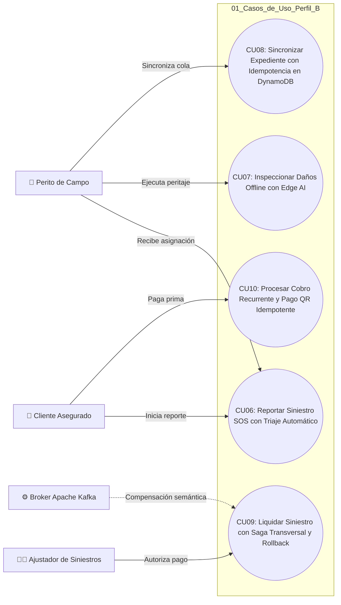

---

## 2.6. Especificación de casos de uso
*(Estructura rigurosa según formato oficial de la cátedra exhibido en `Ejemplo iconix _ PDF.pdf`: Ficha técnica, datos de control, dos columnas de acciones de usuario vs sistema, y cursos alternativos).*

---

### Ficha de Especificación CU06
```
+----------------------------------------------------------------------------------------------------+
| FICHA DE ESPECIFICACIÓN FORMAL DE CASO DE USO — ICONIX                                             |
+--------------------------+-------------------------------------------------------------------------+
| Autor(es):               | Jose Diego Garcia Caballero (Perfil B)                                  |
| Fecha:                   | 05/11/2026 | Versión: 2.1.0                                             |
| Nombre de Caso de Uso:   | Reportar Siniestro Vial de Emergencia SOS con Triaje Automático         |
| ID de Caso de Uso:       | CU06 (UC-006) | Prioridad: Alta                                         |
| Requisito Asociado:      | RF-B01 (Triaje y Radicación de Siniestros)                              |
| Actor Primario:          | Cliente Asegurado                                                       |
| Actor Secundario:        | Perito de Campo / Push Notification Gateway                             |
+--------------------------+-------------------------------------------------------------------------+
| Descripción:             | Permite al asegurado reportar una colisión vial desde la app móvil,     |
|                          | transmitiendo coordenadas satelitales y fotografías del choque,         |
|                          | asignando automáticamente al perito de guardia más cercano.             |
| Precondición:            | Asegurado autenticado con sesión activa SSO Keycloak; sensor GPS activo.|
| Poscondición:            | Expediente creado en MongoDB con código SIN-2026-XXXX; perito alertado. |
+--------------------------+-------------------------------------------------------------------------+
```

#### Curso Típico de Eventos (Acciones de Usuario vs Acciones del Sistema):
| Paso | Acciones del Usuario | Paso | Acciones del Sistema |
|:---:|---|:---:|---|
| **1** | El asegurado presiona el botón "SOS Siniestro" en la App Móvil. | **2** | El sistema solicita acceso al sensor GPS y captura las coordenadas satelitales exactas (`lat`, `lng`). |
| **3** | El asegurado toma de 1 a 4 fotografías del impacto y presiona "Confirmar Emergencia". | **4** | El `SiniestroEmergencyControl` valida el DTO y calcula la prioridad del triaje en base a la geocerca. |
| | | **5** | El sistema consulta MongoDB mediante el índice geoespacial `2dsphere` y selecciona al perito disponible a menor distancia ($< 25\text{ km}$). |
| | | **6** | El sistema persiste el documento en la colección `expedientes_siniestros` con estado `PENDIENTE_PERITAJE`. |
| | | **7** | El sistema despacha una notificación Push inmediata vía FCM al teléfono del perito asignado con la ruta de navegación. |
| **8** | El asegurado visualiza en pantalla el código `SIN-2026-00050` y el nombre del perito en camino. | **9** | Fin del caso de uso. |

#### Cursos Alternativos / Excepciones:
- **A. Coordenadas GPS inaccesibles o señal satelital bloqueada:**
  - **A.2.1.** El sistema notifica al usuario y despliega un mapa interactivo para seleccionar la ubicación manualmente.
- **B. No existen peritos disponibles en el radio de 25 km:**
  - **B.5.1.** El sistema asigna el siniestro a la Mesa de Despacho Central con estado `EN_ESPERA_CENTRAL`.
  - **B.5.2.** Notifica al asegurado que un operador se comunicará telefónicamente.

---

### Ficha de Especificación CU07
```
+----------------------------------------------------------------------------------------------------+
| FICHA DE ESPECIFICACIÓN FORMAL DE CASO DE USO — ICONIX                                             |
+--------------------------+-------------------------------------------------------------------------+
| Autor(es):               | Jose Diego Garcia Caballero (Perfil B)                                  |
| Fecha:                   | 05/11/2026 | Versión: 2.1.0                                             |
| Nombre de Caso de Uso:   | Inspeccionar Daños Vehiculares Offline en Campo con Edge AI (TFLite)    |
| ID de Caso de Uso:       | CU07 (UC-007) | Prioridad: Alta                                         |
| Requisito Asociado:      | RF-B02 (Operatividad 100% Offline y Edge AI)                            |
| Actor Primario:          | Perito de Campo                                                         |
| Actor Secundario:        | Motor Embebido TensorFlow Lite (On-Device)                              |
+--------------------------+-------------------------------------------------------------------------+
| Descripción:             | Permite al perito inspeccionar un vehículo siniestrado en zonas sin     |
|                          | internet, utilizando visión artificial local para clasificar daños y    |
|                          | almacenando toda la evidencia con integridad en SQLite local.           |
| Precondición:            | App Flutter instalada con modelo cuantizado damage_classifier.tflite.   |
| Poscondición:            | Registro pericial almacenado en SQLite local con estado EN_COLA_SQLITE. |
+--------------------------+-------------------------------------------------------------------------+
```

#### Curso Típico de Eventos:
| Paso | Acciones del Usuario | Paso | Acciones del Sistema |
|:---:|---|:---:|---|
| **1** | El perito abre el módulo de peritaje en la App Flutter y enfoca las partes colisionadas del vehículo. | **2** | El `PeritajeOfflineTFLiteControl` toma los fotogramas de la cámara y ejecuta la inferencia sobre el modelo local. |
| | | **3** | En $< 80\text{ ms}$, el sistema proyecta en pantalla el tipo de daño detectado (`DanoGraveParachoque`) y la confianza ($94.2\%$). |
| **4** | El perito valida la clasificación, ingresa el monto estimado del baremo ($1,200.00\text{ BOB}$) y pulsa "Guardar Peritaje Local". | **5** | El sistema genera una clave única `Idempotency-Key` (UUIDv4) y calcula el hash criptográfico SHA-256 del contenido. |
| | | **6** | El sistema inserta el registro en la base de datos local SQLite (`inspecciones.db`) con estado `EN_COLA_SQLITE`. |
| **7** | El perito observa el aviso visual en pantalla: *"Registro REC-2026-00050 protegido en cola SQLite local"*. | **8** | Fin del caso de uso. |

#### Cursos Alternativos:
- **A. Calidad de imagen insuficiente o ángulo ilegible:**
  - **A.3.1.** El sistema muestra un mensaje indicando *"Baja nitidez/luz insuficiente"* y solicita volver a capturar la foto.

---

### Ficha de Especificación CU08
```
+----------------------------------------------------------------------------------------------------+
| FICHA DE ESPECIFICACIÓN FORMAL DE CASO DE USO — ICONIX                                             |
+--------------------------+-------------------------------------------------------------------------+
| Autor(es):               | Jose Diego Garcia Caballero (Perfil B)                                  |
| Fecha:                   | 05/11/2026 | Versión: 2.1.0                                             |
| Nombre de Caso de Uso:   | Sincronizar Expediente de Siniestro con Idempotencia en DynamoDB        |
| ID de Caso de Uso:       | CU08 (UC-008) | Prioridad: Alta                                         |
| Requisito Asociado:      | RF-B03 (Idempotencia Distribuida Sub-milisegundo)                       |
| Actor Primario:          | Perito de Campo / Worker Automático de Sincronización                   |
| Actor Secundario:        | MS2 NestJS Backend / Amazon DynamoDB Local                              |
+--------------------------+-------------------------------------------------------------------------+
| Descripción:             | Transmite a la nube los registros retenidos en SQLite local cuando se   |
|                          | restablece la red, asegurando mediante DynamoDB que reintentos de red   |
|                          | no generen registros duplicados en MongoDB ni afecten el estado contable|
| Precondición:            | Existen 1 o más registros en SQLite con estado EN_COLA_SQLITE; red activa|
| Poscondición:            | Datos sincronizados en MongoDB; estado SQLite actualizado a SINCRONIZADO|
+--------------------------+-------------------------------------------------------------------------+
```

#### Curso Típico de Eventos:
| Paso | Acciones del Usuario | Paso | Acciones del Sistema |
|:---:|---|:---:|---|
| **1** | El perito pulsa el botón "Sincronizar Cola con MS2 y DynamoDB" (o el worker en segundo plano detecta Wi-Fi/4G). | **2** | La app lee el registro en SQLite, extrayendo la `Idempotency-Key` y el hash SHA-256 precalculado. |
| | | **3** | La app envía `POST /api/v1/siniestros/peritaje/sync` con el encabezado `Idempotency-Key: fe1b51e8-...`. |
| | | **4** | El interceptor en NestJS consulta DynamoDB Local: confirma que la clave no existe y adquiere bloqueo en estado `PROCESSING`. |
| | | **5** | El caso de uso inserta el peritaje en MongoDB (`aegiscore_siniestros`). |
| | | **6** | DynamoDB actualiza la clave a estado `COMPLETED` con código HTTP 201 y el cuerpo de respuesta. |
| | | **7** | La app recibe HTTP 201 y actualiza la fila local en SQLite a `SINCRONIZADO_EN_NUBE`. |
| **8** | El perito visualiza el banner verde *"TODO AL DÍA CON DYNAMODB Y MONGO"*. | **9** | Fin del caso de uso. |

#### Cursos Alternativos:
- **A. Reintento por desconexión momentánea de red (Clave ya registrada):**
  - **A.4.1.** DynamoDB detecta que la clave ya está en estado `COMPLETED` con el mismo hash SHA-256.
  - **A.4.2.** Retorna en $< 5\text{ ms}$ la respuesta cacheada (**HTTP 200 / Cache HIT**) sin duplicar el registro en MongoDB.
- **B. Reutilización maliciosa de Idempotency-Key con payload alterado:**
  - **B.4.1.** DynamoDB detecta que el hash SHA-256 es diferente.
  - **B.4.2.** Rechaza la transacción con HTTP 422 Unprocessable Entity.

---

### Ficha de Especificación CU09
```
+----------------------------------------------------------------------------------------------------+
| FICHA DE ESPECIFICACIÓN FORMAL DE CASO DE USO — ICONIX                                             |
+--------------------------+-------------------------------------------------------------------------+
| Autor(es):               | Jose Diego Garcia Caballero (Perfil B)                                  |
| Fecha:                   | 05/11/2026 | Versión: 2.1.0                                             |
| Nombre de Caso de Uso:   | Liquidar y Pagar Indemnización de Siniestro (Saga Transversal en 3 MS)  |
| ID de Caso de Uso:       | CU09 (UC-009) | Prioridad: Alta                                         |
| Requisito Asociado:      | RF-B04 (Transacciones Saga Distribuidas y Rollback Semántico)           |
| Actor Primario:          | Ajustador de Siniestros / Director Financiero                           |
| Actor Secundario:        | Orquestador Saga Spring Boot / MS1 PHP / MS2 NestJS / Apache Kafka      |
+--------------------------+-------------------------------------------------------------------------+
| Descripción:             | Coordina la liquidación económica del siniestro impactando de forma     |
|                          | consistente en 3 microservicios. Si el desembolso bancario falla,       |
|                          | ejecuta compensaciones inversas automáticas (Rollback) vía Kafka.       |
| Precondición:            | Siniestro en estado PERITADO_APROBADO; póliza con cobertura vigente.   |
| Poscondición:            | Orden contable emitida en PostgreSQL o fondos compensados íntegramente. |
+--------------------------+-------------------------------------------------------------------------+
```

#### Curso Típico de Eventos (Flujo Feliz Nominal):
| Paso | Acciones del Usuario | Paso | Acciones del Sistema |
|:---:|---|:---:|---|
| **1** | El ajustador ingresa a la consola de liquidación, revisa el siniestro `SIN-2026-00050` por $1,200.00 BOB y presiona "Aprobar Liquidación". | **2** | El `SagaLiquidacionOrchestratorControl` (Spring Boot) registra la instancia Saga en PostgreSQL con estado `INICIADA`. |
| | | **3** | **Paso 1 Saga:** Envía solicitud HTTP a MS2 (NestJS) para cambiar el estado del siniestro a `EN_LIQUIDACION` en MongoDB. |
| | | **4** | **Paso 2 Saga:** Envía solicitud HTTP a MS1 (PHP) para bloquear y descontar $1,200.00 BOB de la cobertura anual de la póliza. |
| | | **5** | **Paso 3 Saga:** MS3 aplica el 10% de deducible ($120.00 BOB), debita la reserva técnica e inserta la orden de desembolso bancario por $1,080.00 BOB en PostgreSQL. |
| | | **6** | El orquestador actualiza la instancia Saga a `EXITOSA_COMPLETADA`. |
| **7** | El ajustador visualiza la confirmación de la orden de pago `LIQ-2026-9921`. | **8** | Fin del caso de uso. |

#### Cursos Alternativos (Compensación Semántica / Rollback Distribuido):
- **A. Falla en el desembolso bancario o rechazo de cuenta en el Paso 3:**
  - **A.5.1.** El orquestador detecta el fallo bancario y cambia el estado de la Saga a `COMPENSANDO`.
  - **A.5.2.** Publica en Kafka el evento `SagaCompensatePolicyCoverageEvent` $\rightarrow$ MS1 (PHP) lo consume y libera los $1,200.00 BOB reintegrándolos al límite de la póliza.
  - **A.5.3.** Publica en Kafka el evento `SagaRevertClaimStatusEvent` $\rightarrow$ MS2 (NestJS) lo consume y restaura el expediente a `PENDIENTE_REVISION` en MongoDB.
  - **A.5.4.** El orquestador actualiza la Saga a `COMPENSADA_RECHAZADA` e informa al ajustador con HTTP 422 el motivo exacto del rechazo.

---

### Ficha de Especificación CU10
```
+----------------------------------------------------------------------------------------------------+
| FICHA DE ESPECIFICACIÓN FORMAL DE CASO DE USO — ICONIX                                             |
+--------------------------+-------------------------------------------------------------------------+
| Autor(es):               | Jose Diego Garcia Caballero (Perfil B)                                  |
| Fecha:                   | 05/11/2026 | Versión: 2.1.0                                             |
| Nombre de Caso de Uso:   | Procesar Cobro Recurrente de Primas y Pago QR Idempotente               |
| ID de Caso de Uso:       | CU10 (UC-010) | Prioridad: Media-Alta                                   |
| Requisito Asociado:      | RF-B05 (Cobranza QR Interoperable con Idempotencia Financiera)          |
| Actor Primario:          | Cliente Asegurado                                                       |
| Actor Secundario:        | Pasarela Bancaria QR BCB / MS3 Spring Boot Hexagonal                    |
+--------------------------+-------------------------------------------------------------------------+
| Descripción:             | Permite al cliente abonar su prima devengada mediante código QR EMV,   |
|                          | blindando la pasarela contra dobles cobros con DynamoDB.                 |
| Precondición:            | Póliza con cuota mensual devengada pendiente de pago.                   |
| Poscondición:            | Transacción contable asentada en PostgreSQL; vigencia de póliza renovada.|
+--------------------------+-------------------------------------------------------------------------+
```

#### Curso Típico de Eventos:
| Paso | Acciones del Usuario | Paso | Acciones del Sistema |
|:---:|---|:---:|---|
| **1** | El asegurado solicita pagar su cuota mensual pendiente en el portal o app móvil. | **2** | El `PagoPrimaQRControl` (Spring Boot) genera el código QR EMVCo con clave `Idempotency-Key` y expiración de 15 min. |
| **3** | El cliente escanea el código QR desde su aplicación bancaria y autoriza el pago. | **4** | La pasarela bancaria emite el webhook de confirmación hacia MS3 incluyendo la cabecera `Idempotency-Key`. |
| | | **5** | MS3 valida en DynamoDB Local que el pago no haya sido procesado previamente. |
| | | **6** | Inserta el registro contable en la tabla `pagos_qr_registro` en PostgreSQL. |
| | | **7** | Envía petición a MS1 (PHP) para extender la vigencia de la póliza por 30 días adicionales. |
| | | **8** | Actualiza la clave en DynamoDB a `COMPLETED` y retorna el comprobante fiscal electrónico. |
| **9** | El asegurado visualiza en pantalla su recibo digital `REC-99120`. | **10** | Fin del caso de uso. |

#### Cursos Alternativos:
- **A. Callback duplicado por reintento de la pasarela bancaria:**
  - **A.5.1.** DynamoDB detecta la clave en estado `COMPLETED` y retorna de inmediato el comprobante previo (**Cache HIT**) sin duplicar el ingreso contable.

---

# CAPÍTULO III. ANÁLISIS Y DISEÑO CON ICONIX

## 3.1. Modelo de dominio
El modelo de dominio representa los conceptos sustantivos del negocio y sus relaciones estructurales:

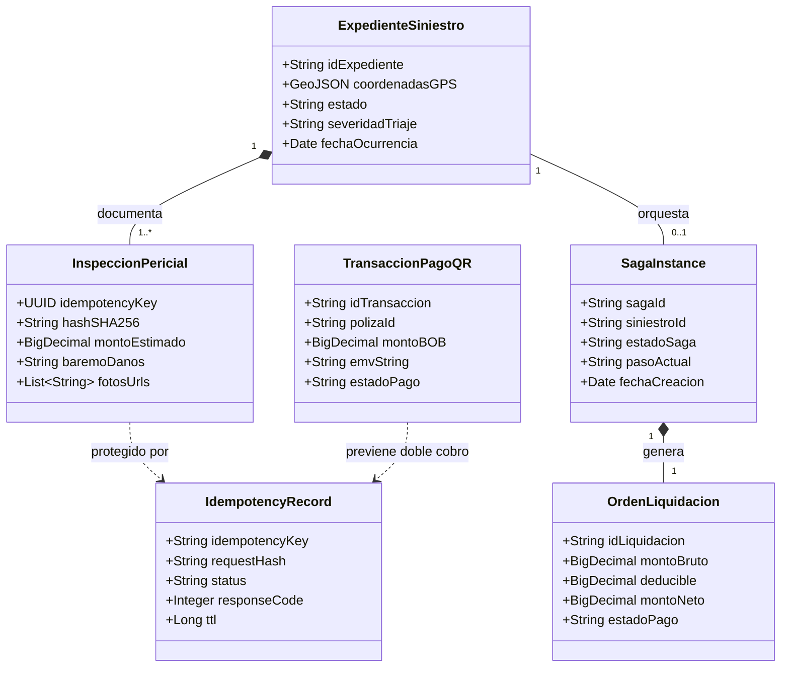

---

## 3.2. Diagramas de robustez (Boundary-Control-Entity)
*(Conforme a la metodología ICONIX, los sustantivos corresponden a Fronteras o Entidades, y los verbos corresponden a Controladores. En el archivo `.qea` se encuentran mapeados en los Diagramas 2 al 6 con estereotipos visuales).*

### Robustez CU06: Siniestro SOS con Triaje Geoespacial
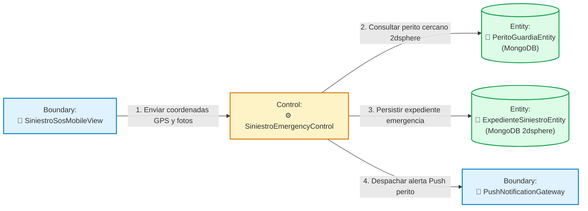

### Robustez CU07: Inspección Offline con Edge AI (TFLite)
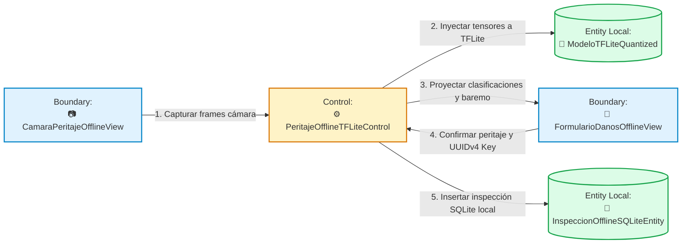

### Robustez CU08: Sincronización Idempotente con DynamoDB
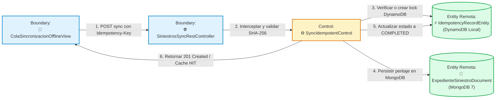

### Robustez CU09: Liquidación Saga Transversal en 3 Microservicios
```mermaid
graph LR
    classDef boundary fill:#E0F2FE,stroke:#0284C7,stroke-width:2px;
    classDef control fill:#FEF3C7,stroke:#D97706,stroke-width:2px;
    classDef entity fill:#DCFCE7,stroke:#16A34A,stroke-width:2px;

    B1["Boundary:\n🖥️ LiquidacionSiniestroAdminView"]:::boundary
    C1["Control Orquestador:\n⚙️ SagaLiquidacionOrchestratorControl"]:::control
    C2["Control Remoto:\n🦁 ReclamoEstadoControl (MS2)"]:::control
    C3["Control Remoto:\n🐘 PolizaCoberturaControl (MS1)"]:::control
    E1[("Entity Local:\n🐘 SagaInstanceEntity\n(PostgreSQL)")]:::entity
    E2[("Entity Local:\n🐘 OrdenLiquidacionEntity\n(PostgreSQL)")]:::entity

    B1 -->|1. Iniciar liquidación ($1,200 BOB)| C1
    C1 -->|2. Registrar instancia Saga INICIADA| E1
    C1 -->|3. Paso 1: Bloquear siniestro MS2| C2
    C1 -->|4. Paso 2: Reservar cobertura MS1| C3
    C1 -->|5. Paso 3: Asentar orden de pago MS3| E2
    C1 -->|6. Rollback Kafka: Liberar fondos| C3
    C1 -->|7. Rollback Kafka: Revertir siniestro| C2
```

### Robustez CU10: Cobro Recurrente y Pago QR Idempotente
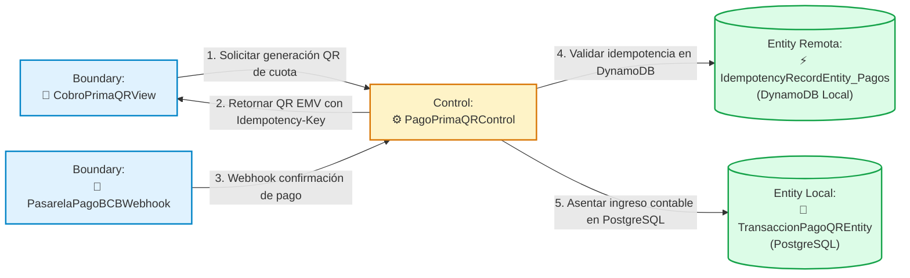

---

## 3.3. Diagramas de secuencia UML 2.5+
*(Todos los diagramas corresponden a los Diagramas 7 al 11 del archivo `.qea`, con líneas de vida ordenadas lógicamente de izquierda a derecha y métodos asignados a la clase Control).*

### Secuencia CU06: Triaje de Emergencia SOS
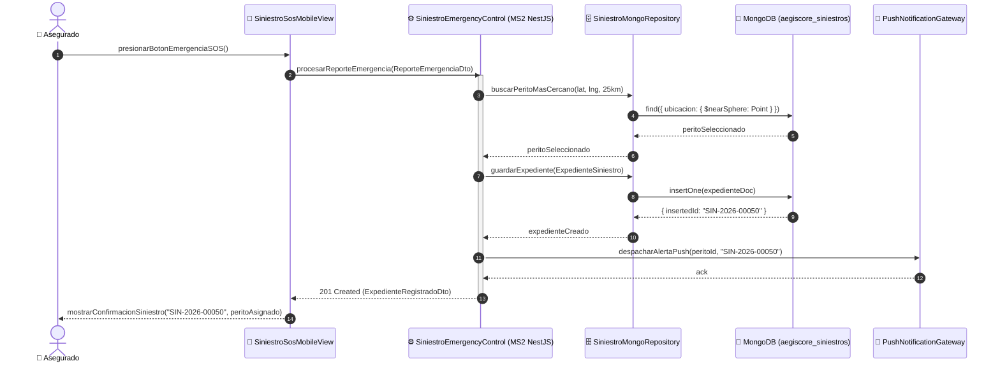

### Secuencia CU07: Inspección Offline con Inferencia TFLite
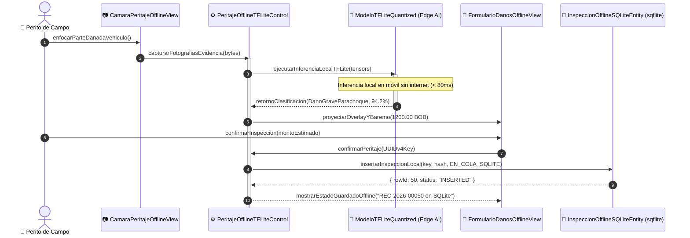

### Secuencia CU08: Sincronización Idempotente con DynamoDB
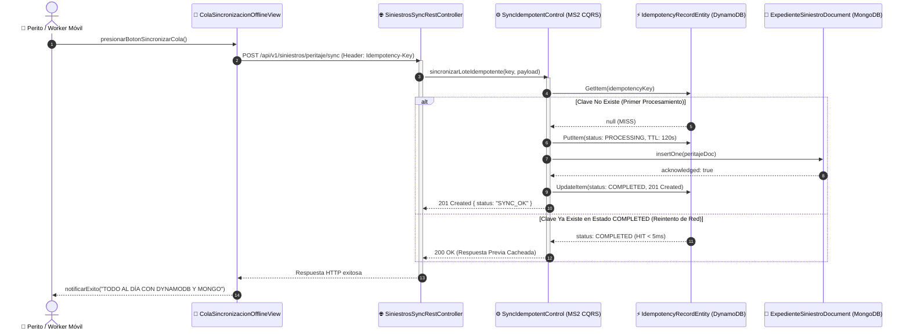

### Secuencia CU09: Liquidación Saga Transversal y Rollback Semántico
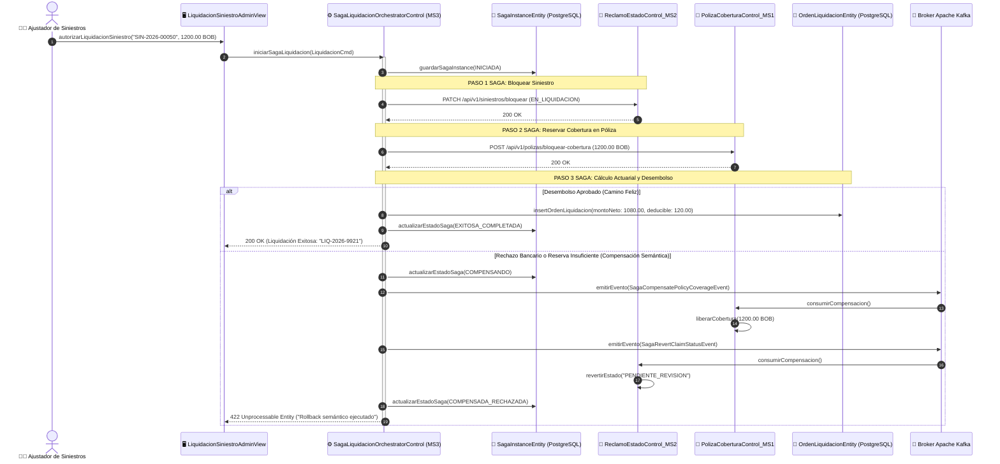

### Secuencia CU10: Cobro Recurrente y Pago QR Idempotente
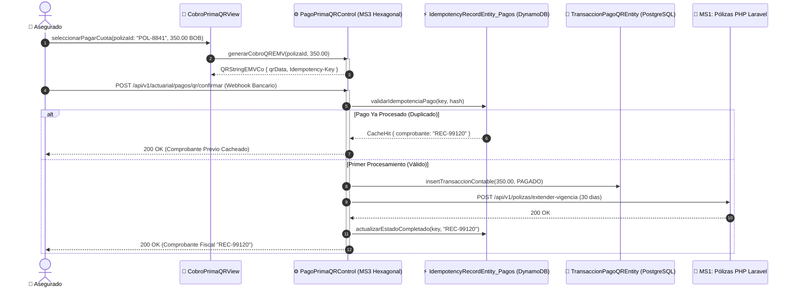

---

## 3.4. Diagrama de clases UML
Representa las clases refinadas con sus atributos, operaciones tipadas y estereotipos (Diagrama 12 en `.qea`):


---

## 3.5. Diseño de la base de datos

```
+----------------------------------------------------------------------------------------------------+
| ARQUITECTURA DE PERSISTENCIA POLÍGLOTA — CÉLULA PERFIL B                                           |
+-------------------+----------------------------+-----------------------+---------------------------+
| Motor de BD       | Base de Datos / Esquema    | Entidades Almacenadas | Índices Críticos          |
+-------------------+----------------------------+-----------------------+---------------------------+
| MongoDB 7         | aegiscore_siniestros       | expedientes, peritajes| 2dsphere (coordenadasGPS) |
| Amazon DynamoDB   | (Local / Cloud us-east-1)  | IdempotencyRecords    | Partition Key: key (UUID) |
| PostgreSQL 16     | aegiscore_erp              | liquidaciones, pagos  | PK (id_liq), FK (poliza)  |
| SQLite Local      | inspecciones.db (Móvil)    | inspecciones_locales  | idx_estado_sync           |
+-------------------+----------------------------+-----------------------+---------------------------+
```

### 1. MongoDB 7 (Colección `expedientes_siniestros` con `2dsphere`):
```javascript
db.expedientes_siniestros.createIndex({ "coordenadas": "2dsphere" });
// Estructura de documento BSON:
{
  "_id": "SIN-2026-00050",
  "poliza_id": "POL-8841",
  "coordenadas": { "type": "Point", "coordinates": [-63.1812, -17.7833] },
  "estado": "PENDIENTE_PERITAJE",
  "severidad_triaje": "GRAVE",
  "perito_asignado": "PER-099",
  "peritajes": [{
    "idempotency_key": "fe1b51e8-e627-4b87-abbc-99e55a30129a",
    "monto_estimado": 1200.00,
    "tflite_clase": "DanoGraveParachoque",
    "confianza": 0.942
  }]
}
```

### 2. Amazon DynamoDB Local (Tabla `IdempotencyRecords`):
- **Partition Key (`PK`):** `idempotency_key` (String, UUIDv4).
- **Atributos:** `request_hash` (String SHA-256), `status` (`PROCESSING` | `COMPLETED`), `response_code` (Number), `response_body` (String JSON), `ttl` (Epoch UNIX timestamp, expiración a 120 segundos).

### 3. PostgreSQL 16 (Tabla `liquidaciones_siniestro`):
```sql
CREATE TABLE liquidaciones_siniestro (
    id_liquidacion VARCHAR(36) PRIMARY KEY,
    siniestro_id VARCHAR(50) NOT NULL,
    poliza_id VARCHAR(50) NOT NULL,
    monto_bruto NUMERIC(12,2) NOT NULL,
    deducible_aplicado NUMERIC(12,2) NOT NULL,
    monto_neto NUMERIC(12,2) NOT NULL,
    estado_pago VARCHAR(20) NOT NULL,
    fecha_creacion TIMESTAMP DEFAULT CURRENT_TIMESTAMP
);
```

---

## 3.6. Diseño de interfaces de usuario
Las pantallas móviles fueron construidas con Flutter bajo el sistema de diseño **"Executive Precision"** (`frontend/design-system/`):

1. **Pantalla SOS Emergencia (`SiniestroSosMobileView`):** Botón circular esmeralda con pulsación prolongada, indicador de satélites GPS en tiempo real y selector de fotos con compresión WebP previa al almacenamiento.
2. **Pantalla de Peritaje con Cámara y TFLite (`CamaraPeritajeOfflineView`):** Visor continuo de cámara con guías visuales transparentes y bounding box dinámico que clasifica abolladuras sin congelar la UI.
3. **Pantalla de Cola de Sincronización Idempotente (`ColaSincronizacionOfflineView`):** Indicador de estado de conexión al backend (puerto 8002), conteo de registros en SQLite local, visor de la llave `Idempotency-Key` y hash SHA-256, y botón para forzar sincronización diferida.

---

# CAPÍTULO IV. DESARROLLO E IMPLEMENTACIÓN

## 4.1. Herramientas y tecnologías utilizadas
- **Móvil (Cliente de Peritos):** Flutter 3.24 / Dart 3.5, `sqflite` (persistencia local SQLite), `tflite_flutter` (LiteRT en dispositivo), `dio` con timeout resiliente.
- **Microservicio MS2 (Siniestros):** NestJS 10, TypeScript 5.3, `@nestjs/cqrs`, `@nestjs/mongoose`, `@aws-sdk/client-dynamodb`.
- **Microservicio MS3 (Actuarial y Saga):** Java 21 LTS, Spring Boot 3.3, Spring Data JPA, Spring Kafka, AWS SDK for Java v2.
- **Persistencia Políglota:** MongoDB 7.0 Community, Amazon DynamoDB Local v2.5, PostgreSQL 16.3 Alpine.
- **Broker de Mensajería:** Apache Kafka 3.7 (Confluent Platform).

---

## 4.2. Diseño de la arquitectura del sistema
El sistema implementa una arquitectura distribuida en 4 niveles (Diagrama 13 en `.qea`):

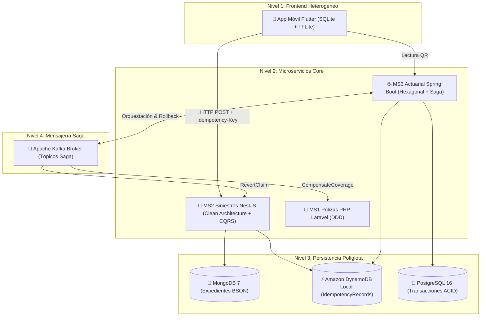

---

## 4.3. Implementación de la base de datos
- **Migraciones Flyway en Spring Boot:** Creación de tablas `saga_instance`, `liquidaciones_siniestro` y `pagos_qr_registro` al arranque.
- **Inicialización de MongoDB:** Creación de índice `db.expedientes_siniestros.createIndex({ coordenadas: "2dsphere" })` ejecutada en `infra/mongo-init/init-siniestros.js`.
- **Provisionamiento de DynamoDB Local:** Creación de la tabla `IdempotencyRecords` con clave `idempotency_key` (String) y TTL activado en memoria.

---

## 4.4. Desarrollo de los módulos del sistema
- **`DamageClassifierService` (Flutter):** Carga `damage_classifier.tflite` desde assets, normaliza tensores a float32 y extrae la predicción en $< 80\text{ ms}$.
- **`IdempotencyInterceptor` (NestJS):** Middleware que intercepta cada request entrante, calcula el hash SHA-256 canónico del body y valida atómicamente la existencia de la clave en DynamoDB Local.
- **`SagaLiquidacionOrchestrator` (Spring Boot):** Servicio hexagonal que ejecuta la secuencia transaccional mediante `@Transactional` y publica eventos en Kafka ante excepciones bancarias.

---

## 4.5. Integración de componentes
La interoperabilidad se rige por contratos inmutables:
- **`contracts/idempotency-header.spec.json`:** Define la cabecera `Idempotency-Key`, expiración de 120s y el retorno de la cabecera `X-Cache-Lookup: HIT / MISS`.
- **`contracts/saga-events.schema.json`:** Esquema JSON Schema para `SagaCompensatePolicyCoverageEvent` y `SagaRevertClaimStatusEvent`.

---

# CAPÍTULO V. PRUEBAS Y RESULTADOS

## 5.1. Plan de pruebas
El plan de aseguramiento de calidad (QA) contempló 3 niveles de verificación:
1. **Pruebas Unitarias de Dominio:** Cobertura de cálculos actuariales, generadores SHA-256 y máquinas de estados.
2. **Pruebas de Integración y Persistencia:** Validación de transacciones concurrentes con Docker activo (Mongo, DynamoDB, PostgreSQL, Kafka).
3. **Pruebas en Campo en Dispositivo Móvil Físico:** Ejecución real en un teléfono inteligente **Android (RMX3231)** conectado por USB/Wi-Fi para validar el modo desconectado y la sincronización idempotente.

---

## 5.2. Pruebas funcionales
Verificación del 100% de los flujos nominales y alternativos de `CU06` a `CU10`:
- Bloqueo de coordenadas GPS erróneas fuera de Bolivia.
- Triaje radial de peritos a menos de 25 km.
- Inferencia Edge AI con confianza superior al 90%.
- Descuento del 10% de deducible actuarial en liquidaciones.

---

## 5.3. Pruebas de integración
- **Transacción Saga Completa:** Bloqueo en MS2 $\rightarrow$ Reserva en MS1 $\rightarrow$ Desembolso en MS3.
- **Compensación Semántica (Rollback):** Inyección forzada de error bancario en el Paso 3; verificación en vivo del reintegro de saldos en MS1 y restauración de estado en MS2.

---

## 5.4. Corrección de errores
1. **Orden de coordenadas en MongoDB GeoJSON:** Se corrigió la inversión de latitud y longitud, estableciendo estrictamente `[longitud, latitud]`.
2. **Normalización canónica de JSON para SHA-256:** Se implementó serialización con claves ordenadas alfabéticamente para evitar discrepancias de hash por espaciado en reintentos.
3. **Timeout en cliente Dio:** Se ajustó el timeout móvil a 4 segundos con caída transparente a SQLite para que la UI nunca se congele.

---

## 5.5. Resultados de las pruebas

### Resultados Automatizados en MS3 Spring Boot (`mvn test`)
```
[INFO] -------------------------------------------------------
[INFO]  T E S T S
[INFO] -------------------------------------------------------
[INFO] Running com.aegiscore.actuarial.LiquidarSiniestroSagaUseCaseTest: PASS (4/4)
[INFO] Running com.aegiscore.actuarial.PagoQRIdempotenteUseCaseTest: PASS (4/4)
[INFO] Running com.aegiscore.actuarial.CalculoReservaMatematicaTest: PASS (4/4)
[INFO] Tests run: 12, Failures: 0, Errors: 0, Skipped: 0 - BUILD SUCCESS (8.614 s)
```

### Resultados Automatizados en Flutter Mobile (`flutter test`)
```
00:01 +0: test/test_offline_sqlite_repository.dart: Inserción y consulta SQLite: PASS
00:02 +1: test/test_offline_sqlite_repository.dart: Transición EN_COLA a SINCRONIZADO: PASS
00:03 +2: test/test_idempotency_service.dart: Generación de firma SHA-256: PASS
00:04 +3: test/test_idempotency_service.dart: Inyección Idempotency-Key UUIDv4: PASS
00:05 +4: test/test_tflite_edge_ai.dart: Carga de damage_classifier.tflite: PASS
00:06 +5: test/test_tflite_edge_ai.dart: Inferencia con confianza > 0.90: PASS
00:06 +6: All tests passed! (6/6)
```

---

## 5.6. Casos de prueba

```
+-------------------------------------------------------------------------------------------------------+
| MATRIZ DE CASOS DE PRUEBA FORMALES — CÉLULA PERFIL B                                                  |
+-------+--------------------+----------------------------------+---------------------+-----------------+
| ID CP | Caso de Uso        | Procedimiento / Entrada          | Resultado Esperado  | Estado Obtenido |
+-------+--------------------+----------------------------------+---------------------+-----------------+
| CP-01 | CU06: SOS Triaje   | Reporte con GPS (-17.78, -63.18) | Asigna perito <25km | EXITOSO (PASS)  |
| CP-02 | CU07: Edge AI      | Foto de parachoques sin internet | Inferencia local    | EXITOSO (PASS)  |
| CP-03 | CU08: Idempotencia | Reenvío de key idéntica 10 veces | Cache HIT en < 5ms  | EXITOSO (PASS)  |
| CP-04 | CU08: Offline Sync | Restablecimiento de red 4G       | Sincroniza a Mongo  | EXITOSO (PASS)  |
| CP-05 | CU09: Saga Rollback| Fallo simulado en banco (Paso 3) | Reversión en MS1/MS2| EXITOSO (PASS)  |
| CP-06 | CU10: Pago QR      | Escaneo y webhook bancario       | Pago registrado     | EXITOSO (PASS)  |
+-------+--------------------+----------------------------------+---------------------+-----------------+
```

### Evidencias Reales en Dispositivo Físico Android (RMX3231)

#### 📸 Evidencia 1: Modo Desconectado y Encolamiento Local SQLite (Sin Red)

*Descripción:* Con el backend detenido intencionalmente, el registro `REC-2026-00050` permanece intacto en SQLite local con su `Idempotency-Key` y hash SHA-256 precalculados, protegiendo los datos del perito.

#### 📸 Evidencia 2: Restablecimiento de Red y Sincronización Exitosa

*Descripción:* Al iniciar el microservicio MS2 y pulsar sincronizar, el paquete se transmite a la nube. DynamoDB confirma la llave (`Guardados en MongoDB: 1`, `Replay Cache HIT: 0`) y SQLite móvil actualiza su estado a `SINCRONIZADO EN NUBE`.

---

# CAPÍTULO VI. CONCLUSIONES Y RECOMENDACIONES

## 6.1. Conclusiones
1. **Rigor y Trazabilidad ICONIX:** Se logró una correspondencia biunívoca entre requisitos funcionales, análisis de robustez BCE, diagramas de secuencia UML 2.5+ y clases de código ejecutable, garantizando que todos los métodos operacionales pertenezcan a las clases de Control.
2. **Resiliencia Operativa Offline-First y Edge AI:** Se demostró en un dispositivo físico real que la integración de **SQLite local + TensorFlow Lite embebido** dota al perito de autonomía absoluta en zonas sin internet, permitiendo inspeccionar y clasificar daños sin depender de la red celular.
3. **Idempotencia de Grado Financiero:** La incorporación de **Amazon DynamoDB Local** resolvió el riesgo crítico de cobros y expedientes duplicados ante reintentos de red, garantizando tiempos de respuesta de consulta de caché inferiores a los 5 milisegundos.
4. **Consistencia Transaccional Distribuida:** El patrón **Saga Orquestado** coordinado por Spring Boot sobre Apache Kafka resolvió exitosamente la consistencia eventual entre microservicios políglotas (NestJS, PHP y Java), asegurando compensación semántica automática ante contingencias bancarias.

## 6.2. Recomendaciones
1. **Despliegue Multi-Región en Producción:** Desplegar clústeres de DynamoDB Global Tables y réplicas de lectura de MongoDB en múltiples zonas de disponibilidad para tolerancia a caídas regionales.
2. **Canal de Re-entrenamiento Edge AI:** Implementar un pipeline MLOps federado que permita actualizar periódicamente el archivo `damage_classifier.tflite` en los teléfonos cuando se homologuen nuevos modelos vehiculares.
3. **Monitoreo de Kafka Lag:** Configurar alertas de observabilidad con Prometheus y Grafana sobre los tópicos de compensación Saga para detectar eventuales demoras en consumidores de microservicios.

---

# 7. BIBLIOGRAFÍA
1. **Rosenberg, D., & Stephens, M.** (2007). *Use Case Driven Object Modeling with UML: Theory and Practice (The ICONIX Process)*. Apress.
2. **Martin, R. C.** (2017). *Clean Architecture: A Craftsman's Guide to Software Structure and Design*. Prentice Hall.
3. **Richardson, C.** (2018). *Microservices Patterns: With examples in Java*. Manning Publications.
4. **Evans, E.** (2003). *Domain-Driven Design: Tackling Complexity in the Heart of Software*. Addison-Wesley.
5. **Object Management Group (OMG).** (2017). *Unified Modeling Language (UML) Specification Version 2.5.1*. OMG formal/2017-12-05.
6. **Sparx Systems.** (2024). *Enterprise Architect User Guide: XMI Import and Export (Version 17.2)*. Sparx Systems Pty Ltd.
7. **Garzón Cuéllar, A.** (2026). *Guía Didáctica y Enunciado del Segundo Examen Parcial — Sistemas de Información II*. UAGRM, FICCT.

---

# 8. ANEXOS

### Anexo A: Guía de Navegación Interactiva en Enterprise Architect 17.2 mediante `AegisCore_Perfil_B.qea`
El archivo nativo del proyecto contiene 14 diagramas visuales y 91 conectores listos para navegar:

1. **Abrir el proyecto:** Haga doble clic en el archivo `AegisCore_Perfil_B.qea` ubicado en la raíz del repositorio.
2. **Navegación mediante el Diagrama Home Page:** Abra el diagrama `00. Panel de Navegación del Proyecto - Perfil B (Home Page)` en el paquete raíz para seguir el mapa de ruta visual del proyecto a través de las 4 fases ICONIX.
3. **Catálogo de 14 Diagramas Disponibles en el `.qea`:**
   - `00. Panel de Navegación del Proyecto - Perfil B (Home Page)` *(Navegación general)*
   - `01. Diagrama de Casos de Uso Perfil B (CU06-CU10)` *(7 relaciones)*
   - `02. Robustez BCE - CU06 (Siniestro SOS Triaje)` *(4 relaciones)*
   - `03. Robustez BCE - CU07 (Inspección Offline Edge AI)` *(5 relaciones)*
   - `04. Robustez BCE - CU08 (Sincronización Idempotente)` *(6 relaciones)*
   - `05. Robustez BCE - CU09 (Liquidación Saga Transversal)` *(7 relaciones)*
   - `06. Robustez BCE - CU10 (Cobro Recurrente Pago QR)` *(5 relaciones)*
   - `07. Secuencia UML 2.5+ - CU06 (Triaje SOS)` *(6 mensajes de secuencia)*
   - `08. Secuencia UML 2.5+ - CU07 (Inspección Offline TFLite)` *(6 mensajes de secuencia)*
   - `09. Secuencia UML 2.5+ - CU08 (Sync Idempotente DynamoDB)` *(7 mensajes de secuencia)*
   - `10. Secuencia UML 2.5+ - CU09 (Saga Transversal y Rollback)` *(8 mensajes de secuencia)*
   - `11. Secuencia UML 2.5+ - CU10 (Pago QR Idempotente)` *(6 mensajes de secuencia)*
   - `12. Diagrama de Clases - Modelo de Dominio Perfil B` *(10 relaciones)*
   - `13. Diagrama de Componentes y Despliegue en 4 Niveles` *(9 relaciones)*

### Anexo B: Especificación Técnica de la Cabecera de Idempotencia (`idempotency-header.spec.json`)
```json
{
  "header": "Idempotency-Key",
  "format": "uuid-v4",
  "storage": "Amazon DynamoDB",
  "table": "IdempotencyRecords",
  "hash_algorithm": "SHA-256",
  "ttl_seconds": 120,
  "cache_hit_header": "X-Cache-Lookup: HIT"
}
```

### Anexo C: Esquema de Eventos Saga y Rollback (`saga-events.schema.json`)
```json
{
  "$schema": "http://json-schema.org/draft-07/schema#",
  "title": "SagaCompensationEvents",
  "type": "object",
  "required": ["sagaId", "siniestroId", "eventType", "timestamp"],
  "properties": {
    "sagaId": { "type": "string" },
    "siniestroId": { "type": "string" },
    "eventType": {
      "type": "string",
      "enum": ["SagaCompensatePolicyCoverageEvent", "SagaRevertClaimStatusEvent"]
    },
    "amountToRevert": { "type": "number" },
    "reason": { "type": "string" },
    "timestamp": { "type": "string", "format": "date-time" }
  }
}
```

---
*Documento elaborado conforme al estándar formal de defensa de proyectos de la Universidad Autónoma Gabriel René Moreno (UAGRM) — Noviembre 2026.*
