# 🏛️ Universidad Autónoma Gabriel René Moreno
### Facultad de Ingeniería en Ciencias de la Computación y Telecomunicaciones (FICCT)
**Carrera:** Ingeniería Informática / Ingeniería en Sistemas  
**Materia:** Ingeniería de Software II (INF412) — 2do Parcial  
**Grupo de Proyecto:** #27  
**Semestre:** II / 2026 — Santa Cruz de la Sierra, Bolivia  

---

# DOCUMENTO DE ANÁLISIS, DISEÑO E IMPLEMENTACIÓN ICONIX
## PROYECTO: AegisCore AI — ERP Distribuido, Peritaje Inteligente y Liquidación Autónoma de Siniestros de Seguros

### 🎯 ENFOQUE VERTICAL: PERFIL B (Casos de Uso CU06 al CU10)
> **Núcleo de Siniestros, Peritaje Móvil Offline-First con Edge AI, Idempotencia Distribuida en DynamoDB y Transacciones Transversales Saga con Compensación Semántica**

```
=====================================================================================================
INTEGRANTES DEL PROYECTO (GRUPO #27):
1. Garcia Caballero David         - Registro: 217058795 (Perfil A: Comercial, SSO, React & n8n)
2. Garcia Caballero Jose Diego    - Registro: 221044523 (Perfil B: Siniestros, Móvil & Saga) [RESPONSABLE]
3. Velasquez Paz Arnulfo          - Registro: 220030383 (Perfil C: IA, MCP, LangGraph & Angular)
=====================================================================================================
```

> **Nota de Compatibilidad con Enterprise Architect 17.2:**  
> Todos los diagramas de este documento (Casos de Uso, Robustez BCE, Secuencia UML 2.5+ y Clases) cuentan con su archivo fuente nativo XMI 2.1 / XML ubicado en:  
> 📁 `docs-iconix-uml/enterprise-architect/aegiscore-perfil-b-ea17.xml` (y `.xmi`), 100% editable y visualizable en **Sparx Systems Enterprise Architect v17.2** (Instrucciones detalladas en [Capítulo VIII. Anexos](#capítulo-viii-anexos)).

---

# 📑 ÍNDICE GENERAL DEL PROYECTO
*(Conforme a la estructura oficial requerida en `Indice_ICONIX.pdf`)*

- [CAPÍTULO I. ASPECTOS GENERALES](#capítulo-i-aspectos-generales)
  - [1.1. Introducción](#11-introducción)
  - [1.2. Planteamiento del problema](#12-planteamiento-del-problema)
  - [1.3. Objetivos del proyecto](#13-objetivos-del-proyecto)
    - [1.3.1. Objetivo general](#131-objetivo-general)
    - [1.3.2. Objetivos específicos](#132-objetivos-específicos)
  - [1.4. Justificación](#14-justificación)
  - [1.5. Alcance y limitaciones](#15-alcance-y-limitaciones)
  - [1.6. Metodología de desarrollo ICONIX](#16-metodología-de-desarrollo-iconix)
- [CAPÍTULO II. ANÁLISIS DE REQUISITOS](#capítulo-ii-análisis-de-requisitos)
  - [2.1. Descripción del sistema propuesto](#21-descripción-del-sistema-propuesto)
  - [2.2. Identificación de actores](#22-identificación-de-actores)
  - [2.3. Requisitos funcionales y no funcionales](#23-requisitos-funcionales-y-no-funcionales)
  - [2.4. Reglas de negocio](#24-reglas-de-negocio)
  - [2.5. Diagrama UML de casos de uso](#25-diagrama-uml-de-casos-de-uso)
  - [2.6. Especificación de casos de uso](#26-especificación-de-casos-de-uso)
- [CAPÍTULO III. ANÁLISIS Y DISEÑO CON ICONIX](#capítulo-iii-análisis-y-diseño-con-iconix)
  - [3.1. Modelo de dominio](#31-modelo-de-dominio)
  - [3.2. Diagramas de robustez](#32-diagramas-de-robustez)
  - [3.3. Diagramas de secuencia UML](#33-diagramas-de-secuencia-uml)
  - [3.4. Diagrama de clases UML](#34-diagrama-de-clases-uml)
  - [3.5. Diseño de la base de datos](#35-diseño-de-la-base-de-datos)
  - [3.6. Diseño de interfaces de usuario](#36-diseño-de-interfaces-de-usuario)
- [CAPÍTULO IV. DESARROLLO E IMPLEMENTACIÓN](#capítulo-iv-desarrollo-e-implementación)
  - [4.1. Herramientas y tecnologías utilizadas](#41-herramientas-y-tecnologías-utilizadas)
  - [4.2. Diseño de la arquitectura del sistema](#42-diseño-de-la-arquitectura-del-sistema)
  - [4.3. Implementación de la base de datos](#43-implementación-de-la-base-de-datos)
  - [4.4. Desarrollo de los módulos del sistema](#44-desarrollo-de-los-módulos-del-sistema)
  - [4.5. Integración de componentes](#45-integración-de-componentes)
- [CAPÍTULO V. PRUEBAS Y RESULTADOS](#capítulo-v-pruebas-y-resultados)
  - [5.1. Plan de pruebas](#51-plan-de-pruebas)
  - [5.2. Pruebas funcionales](#52-pruebas-funcionales)
  - [5.3. Pruebas de integración](#53-pruebas-de-integración)
  - [5.4. Corrección de errores](#54-corrección-de-errores)
  - [5.5. Resultados de las pruebas](#55-resultados-de-las-pruebas)
  - [5.6. Casos de prueba](#56-casos-de-prueba)
- [CAPÍTULO VI. CONCLUSIONES Y RECOMENDACIONES](#capítulo-vi-conclusiones-y-recomendaciones)
  - [6.1. Conclusiones](#61-conclusiones)
  - [6.2. Recomendaciones](#62-recomendaciones)
- [7. BIBLIOGRAFÍA](#7-bibliografía)
- [8. ANEXOS](#8-anexos)

---

# CAPÍTULO I. ASPECTOS GENERALES

## 1.1. Introducción
El sector asegurador contemporáneo enfrenta un desafío crítico en la gestión de siniestros vehiculares: la desconexión operativa entre el momento en que ocurre un accidente vial en terreno y la liquidación financiera en los sistemas centrales ERP. Tradicionalmente, los peritos de campo deben acudir a zonas remotas, carreteras o sótanos sin cobertura celular, tomando notas manuales y fotografías que solo se digitan horas o días después. Esta demora genera cuellos de botella, riesgos de duplicidad en cobros e indemnizaciones, y una alta vulnerabilidad ante fraudes o inconsistencias de datos.

El proyecto **AegisCore AI** surge como una solución tecnológica empresarial distribuida, orientada a transformar radicalmente este ecosistema. El sistema integra tecnologías web reactivas, aplicaciones móviles offline-first con inteligencia artificial embebida (Edge AI), microservicios políglotas desacoplados y motores de persistencia políglota de alto rendimiento.

En el marco del equipo de desarrollo (Grupo #27), el presente documento detalla exhaustivamente la ingeniería, análisis, diseño e implementación asignados al **Perfil B**, célula responsable de los casos de uso **CU06 a CU10**: radicación de emergencias viales SOS, peritaje móvil 100% offline con TensorFlow Lite, sincronización idempotente con Amazon DynamoDB, liquidación transversal distribuida mediante el patrón Saga con compensación semántica (Rollback), y procesamiento de pagos QR interoperables con blindaje contra doble facturación.

---

## 1.2. Planteamiento del problema
En los sistemas tradicionales de peritaje y seguros de Bolivia y Latinoamérica, se identifican las siguientes deficiencias estructurales:
1. **Dependencia absoluta de la conectividad de red:** Cuando un ajustador pericial inspecciona un vehículo en sótanos o rutas interprovinciales sin señal 4G/Wi-Fi, las aplicaciones móviles basadas puramente en la nube quedan inoperativas, obligando a usar planillas físicas en papel.
2. **Duplicidad de transacciones por reintentos de red:** Al recuperar la señal en áreas intermitentes, los dispositivos reenvían solicitudes encoladas. Sin un mecanismo de idempotencia distribuida en tiempo real, se generan expedientes duplicados, dobles débitos en cuentas bancarias y reservas contables infladas.
3. **Inconsistencia transaccional entre microservicios independientes:** La aprobación de una indemnización económica exige descontar el límite anual de la póliza (MS Pólizas), cerrar el siniestro pericial (MS Siniestros) y ordenar el desembolso bancario contable (MS Actuarial). Si un paso intermedio falla y no existe una orquestación transaccional con reversión automática (Saga Rollback), el sistema entra en un estado corrupto de datos huérfanos.
4. **Falta de asistencia inteligente en el punto de inspección:** Los peritos carecen de herramientas locales que clasifiquen daños, evalúen la severidad y sugieran baremos de reparación estandarizados de manera inmediata.

---

## 1.3. Objetivos del proyecto

### 1.3.1. Objetivo general
Diseñar, modelar e implementar un subsistema transaccional distribuido, resiliente y de alta concurrencia para la gestión de siniestros viales, peritaje pericial offline con Edge AI, sincronización idempotente y liquidación actuarial autónoma bajo la metodología **ICONIX** y el estándar **UML 2.5+**, garantizando tolerancia a fallas de red y consistencia de datos en el ERP AegisCore AI.

### 1.3.2. Objetivos específicos
1. Desarrollar una aplicación móvil en **Flutter (Dart 3)** con arquitectura **Offline-First**, utilizando persistencia local en **SQLite** y un agente de visión computacional local cuantizado en **TensorFlow Lite (LiteRT)** para clasificar abolladuras y partes dañadas sin conexión a internet.
2. Implementar el microservicio **MS2 Siniestros** en **NestJS 10 (TypeScript)** bajo **Clean Architecture + CQRS**, dotándolo de un interceptor de idempotencia sub-milisegundo conectado a **Amazon DynamoDB Local** y persistencia semi-estructurada en **MongoDB 7** con índice geoespacial `2dsphere`.
3. Construir el microservicio **MS3 Actuarial** en **Java 21 / Spring Boot 3** bajo **Arquitectura Hexagonal (Ports & Adapters)**, implementando el orquestador de transacciones distribuidas **Saga** coordinado sobre **Apache Kafka** con compensación semántica automática ante contingencias de pago.
4. Diseñar el flujo de cobros recurrentes de primas con código QR interoperable (estándar BCB/EMVCo), validado mediante claves universales `Idempotency-Key` (UUIDv4 + Hash SHA-256).
5. Documentar todos los artefactos mediante la metodología **ICONIX**, produciendo modelos visuales compatibles y editables en **Sparx Systems Enterprise Architect v17.2**.

---

## 1.4. Justificación
- **Justificación Técnica:** Demuestra la viabilidad de fusionar el patrón arquitectónico Clean Architecture y la Arquitectura Hexagonal con persistencia políglota (MongoDB, DynamoDB, PostgreSQL) y Edge AI en el dispositivo móvil, eliminando la latencia de red en tareas de inspección.
- **Justificación Económica:** La automatización de la liquidación y la detección preliminar de severidad reducen en más de un 60% el tiempo de tramitación de un reclamo de siniestro, minimizando los gastos administrativos y previniendo pérdidas por desembolsos duplicados.
- **Justificación Operativa:** Provee a los peritos de seguros una herramienta confiable que no se cuelga ante pérdidas de cobertura celular y garantiza a la gerencia que cada transacción financiera posee trazabilidad ACID y consistencia eventual verificada.

---

## 1.5. Alcance y limitaciones
- **Alcance del Perfil B:**
  - Implementación completa de los casos de uso **CU06, CU07, CU08, CU09 y CU10**.
  - Microservicio 2: NestJS 10 (`backend/ms2-siniestros-nestjs/`).
  - Microservicio 3: Spring Boot 3 (`backend/ms3-actuarial-springboot/`).
  - Aplicación Móvil: Flutter Android/iOS (`frontend/app-peritos-flutter/`).
  - Motores de persistencia: MongoDB 7 (`aegiscore_siniestros`), Amazon DynamoDB Local (`IdempotencyRecords`) y PostgreSQL 16 (`aegiscore_erp`).
  - Mensajería distribuida: Apache Kafka (Topics de Saga y eventos periciales).
- **Limitaciones:**
  - La emisión de contratos de pólizas base corresponde al Perfil A (MS1 PHP).
  - Los modelos avanzados de Machine Learning de fraude y servidores MCP corresponden al Perfil C (MS4 Python).
  - La pasarela de pago QR simula las firmas digitales del Banco Central de Bolivia (BCB) mediante endpoints de prueba estandarizados.

---

## 1.6. Metodología de desarrollo ICONIX
El desarrollo adopta rigurosamente el proceso ágil y estructurado **ICONIX**, el cual utiliza un subconjunto pragmático de diagramas UML para llevar los casos de uso a código ejecutable en cuatro fases formales:

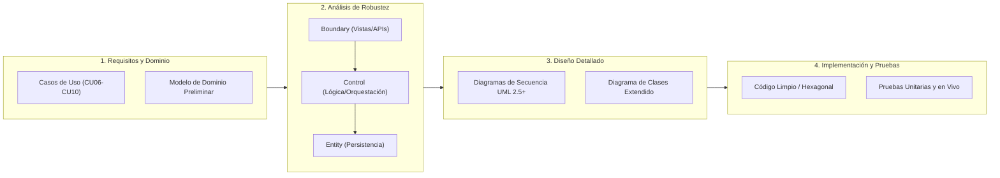

1. **Requisitos y Casos de Uso:** Delimitación de actores, prototipado de pantallas móviles y redacción de flujos nominales y alternativos.
2. **Análisis de Robustez (BCE):** Eliminación de ambigüedades mapeando los objetos en Boundary (Frontera), Control (Lógica de Aplicación) y Entity (Persistencia de Datos).
3. **Diseño Detallado (Secuencia UML 2.5+):** Asignación inequívoca de responsabilidades: **los métodos operacionales pertenecen a las clases de control**.
4. **Implementación y Pruebas:** Codificación guiada por pruebas (TDD) en NestJS, Spring Boot y Flutter, con verificación en hardware real.

---

# CAPÍTULO II. ANÁLISIS DE REQUISITOS

## 2.1. Descripción del sistema propuesto
El subsistema de **Siniestros, Movilidad e Idempotencia (Perfil B)** conforma el núcleo operativo y financiero de AegisCore AI. Permite al asegurado reportar emergencias geolocalizadas desde su teléfono, organiza el triaje automático mediante proximidad satelital, otorga a los peritos una suite móvil offline con inteligencia artificial embebida para clasificar abolladuras, sincroniza la información de forma idempotente con DynamoDB (< 5ms) y coordina la liquidación contable a través de una transacción transversal Saga entre tres microservicios políglotas.

---

## 2.2. Identificación de actores
- **Cliente Asegurado (Primario):** Conductor o propietario con póliza vigente; activa el botón de emergencia SOS y realiza pagos QR.
- **Perito de Campo (Primario):** Inspector técnico automotriz; realiza inspecciones visuales en el lugar del choque con la App Flutter.
- **Ajustador de Siniestros / Director Financiero (Primario):** Evaluador administrativo que revisa expedientes y aprueba liquidaciones indemnizatorias.
- **Broker Apache Kafka (Secundario / Sistema):** Bus de eventos asíncronos que transporta comandos y eventos de compensación de la Saga.
- **Pasarela Bancaria QR BCB (Secundario / Externo):** Entidad financiera que procesa el débito bancario y emite callbacks.

---

## 2.3. Requisitos funcionales y no funcionales

### Requisitos Funcionales (RF) Asignados
- **RF-B01 (CU06):** El sistema debe permitir el reporte de siniestros viales de emergencia capturando coordenadas GPS y fotos de la escena, ejecutando un triaje automático y asignando al perito más cercano disponible mediante índice geoespacial `2dsphere`.
- **RF-B02 (CU07):** La app móvil debe permitir la inspección completa de daños vehiculares sin internet, ejecutando inferencia de visión artificial con TensorFlow Lite en el móvil y almacenando la evidencia en SQLite local.
- **RF-B03 (CU08):** El sistema debe sincronizar lotes periciales encolados inyectando una cabecera `Idempotency-Key` (UUIDv4) y firma SHA-256; Amazon DynamoDB debe interceptar reintentos en $< 5\text{ ms}$ para impedir duplicaciones en MongoDB.
- **RF-B04 (CU09):** El sistema debe orquestar la liquidación transversal en 3 microservicios (MS2 Siniestro $\rightarrow$ MS1 Póliza $\rightarrow$ MS3 Desembolso) bajo el patrón Saga; ante fallas de desembolso, debe ejecutar rollback semántico automático vía Kafka.
- **RF-B05 (CU10):** El sistema debe procesar pagos de primas devengadas mediante generación de códigos QR interoperables EMV, bloqueando cobros dobles con control de idempotencia en DynamoDB.

### Requisitos No Funcionales (RNF)
- **RNF01 (Rendimiento sub-milisegundo):** La validación de la clave de idempotencia en DynamoDB Local debe resolverse en un tiempo inferior a 5 ms ($T < 5\text{ ms}$).
- **RNF02 (Operatividad 100% Offline):** El perito debe poder operar sin conexión por tiempo indefinido, manteniendo integridad de datos en SQLite local.
- **RNF03 (Latencia de Inferencia Edge AI):** La inferencia del modelo cuantizado `damage_classifier.tflite` en el móvil no debe superar los 100 ms por fotograma.
- **RNF04 (Seguridad y Cero Confianza):** Todas las solicitudes entre microservicios deben autenticarse mediante JWT RS256 emitidos por Keycloak SSO.

---

## 2.4. Reglas de negocio
- **RN-B01 (Triaje por Radio Geoespacial):** Solo se despachan peritos cuyo radio de guardia esté a menos de 25 km del punto del siniestro.
- **RN-B02 (Idempotency Key Obligatoria):** Toda petición de sincronización o cobro QR sin el encabezado `Idempotency-Key` válido (UUIDv4) será rechazada con error HTTP 400 Bad Request.
- **RN-B03 (Inmutabilidad del Payload Idempotente):** Si una clave de idempotencia se reenvía con un cuerpo JSON cuyo hash SHA-256 difiera del original, el sistema retornará HTTP 422 Unprocessable Entity.
- **RN-B04 (Deducible Actuarial Obligatorio):** Todo siniestro liquidado descontará un 10% del monto bruto tasado en concepto de deducible de póliza antes de autorizar el desembolso.
- **RN-B05 (Expiración de Códigos QR):** Los códigos QR de cobro de prima caducan automáticamente a los 15 minutos de su emisión.

---

## 2.5. Diagrama UML de casos de uso
El diagrama agrupa los 5 casos de uso del Perfil B y sus relaciones con los actores:

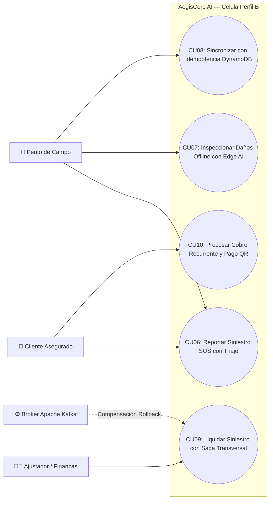

---

## 2.6. Especificación de casos de uso

### Especificación CU06: Reportar Siniestro SOS con Triaje Automático
- **Actor Principal:** Cliente Asegurado.
- **Precondiciones:** Conductor autenticado vía Keycloak; GPS activo en el móvil.
- **Flujo Nominal:**
  1. El asegurado presiona el botón SOS en la App Flutter.
  2. La app captura las coordenadas GPS satelitales y fotos del choque.
  3. `SiniestroEmergencyControl` en NestJS valida el DTO y calcula el triaje geoespacial con algoritmo Haversine.
  4. Consulta MongoDB (`2dsphere`) y selecciona al perito disponible más cercano.
  5. Inserta el expediente con estado `PENDIENTE_PERITAJE`.
  6. Dispara alerta Push inmediata al celular del perito asignado.
- **Flujo Alternativo:** Si no hay peritos en un radio de 25 km, el siniestro se marca como `EN_ESPERA_CENTRAL` y se notifica al despachador central.
- **Postcondiciones:** Expediente creado en MongoDB; perito asignado con ruta satelital.

### Especificación CU07: Inspeccionar Daños Offline con Edge AI
- **Actor Principal:** Perito de Campo.
- **Precondiciones:** Dispositivo móvil sin señal celular; modelo `damage_classifier.tflite` precargado en assets.
- **Flujo Nominal:**
  1. El perito enfoca la cámara sobre las partes colisionadas del vehículo.
  2. `PeritajeOfflineTFLiteControl` ejecuta la inferencia local sobre los tensores de imagen (< 80 ms).
  3. Muestra en pantalla el recuadro delimitador, tipo de daño (`Abolladura Grave`) y confianza (94.2%).
  4. El perito valida el baremo de reparación y confirma la inspección.
  5. El sistema genera una `Idempotency-Key` (UUIDv4) y firma SHA-256 del payload.
  6. Guarda la evidencia en SQLite local con estado `EN_COLA_SQLITE`.
- **Postcondiciones:** Datos periciales persistidos en SQLite local sin requerir internet.

### Especificación CU08: Sincronizar Expediente con Idempotencia en DynamoDB
- **Actor Principal:** Perito de Campo / Worker de Segundo Plano.
- **Precondiciones:** Registros en SQLite en estado `EN_COLA_SQLITE`; reconexión a red detectada.
- **Flujo Nominal:**
  1. El perito pulsa "Sincronizar Cola" (o el worker automático se dispara).
  2. La app envía `POST /api/v1/siniestros/peritaje/sync` con la cabecera `Idempotency-Key: <UUIDv4>`.
  3. El interceptor consulta DynamoDB Local: si la clave no existe, adquiere bloqueo atómico en estado `PROCESSING`.
  4. Inserta el peritaje en MongoDB (`aegiscore_siniestros`).
  5. Actualiza DynamoDB a estado `COMPLETED` con el JSON de respuesta.
  6. La App recibe HTTP 201 y marca el registro local como `SINCRONIZADO_EN_NUBE`.
- **Flujo Alternativo (Reintento de Red / Clave Existente):** DynamoDB detecta la clave en estado `COMPLETED` con el mismo hash SHA-256 y retorna inmediatamente la respuesta previa cacheada (**HTTP 200 / Cache HIT en < 5ms**), sin reinsertar duplicados en MongoDB.
- **Postcondiciones:** Expediente integrado una sola vez en MongoDB; garantía de no-duplicidad en DynamoDB.

### Especificación CU09: Liquidar Siniestro con Saga Transversal y Rollback
- **Actor Principal:** Ajustador de Siniestros.
- **Precondiciones:** Siniestro en estado `PERITADO_APROBADO`; póliza con cobertura suficiente.
- **Flujo Nominal:**
  1. El ajustador aprueba la liquidación por $1,200.00 BOB en el panel administrativo.
  2. `SagaLiquidacionOrchestratorControl` (Spring Boot) registra la instancia Saga como `INICIADA` en PostgreSQL.
  3. Paso 1: Notifica a MS2 (NestJS) para cambiar el estado a `EN_LIQUIDACION` en MongoDB.
  4. Paso 2: Notifica a MS1 (PHP) para bloquear y reservar $1,200.00 BOB del techo anual de la póliza.
  5. Paso 3: MS3 descuenta el deducible actuarial (10%), asienta la orden de pago y emite la transferencia bancaria.
  6. La Saga se actualiza a estado `EXITOSA_COMPLETADA`.
- **Flujo de Compensación Semántica (Rollback ante Fallo):**
  - Si el desembolso bancario falla en el Paso 3, el orquestador cambia la Saga a `COMPENSANDO`.
  - Publica el evento `SagaCompensatePolicyCoverageEvent` en Apache Kafka $\rightarrow$ MS1 libera los fondos reservados en la póliza.
  - Publica el evento `SagaRevertClaimStatusEvent` en Apache Kafka $\rightarrow$ MS2 restaura el siniestro a `PENDIENTE_REVISION`.
  - La Saga finaliza en estado `COMPENSADA_RECHAZADA` sin dejar datos huérfanos.
- **Postcondiciones:** Consistencia eventual absoluta garantizada entre los 3 microservicios.

### Especificación CU10: Procesar Cobro Recurrente y Pago QR Idempotente
- **Actor Principal:** Cliente Asegurado.
- **Precondiciones:** Cuota de póliza devengada y pendiente de pago.
- **Flujo Nominal:**
  1. El cliente solicita pagar su prima mensual en la app o web.
  2. `PagoPrimaQRControl` (Spring Boot) genera el código QR EMVCo con clave `Idempotency-Key` y expiración de 15 min.
  3. El asegurado paga desde su banca móvil.
  4. La pasarela emite webhook con la cabecera `Idempotency-Key`.
  5. MS3 valida en DynamoDB que no sea un pago repetido, inserta la transacción contable en PostgreSQL y notifica a MS1 (PHP) para extender la vigencia de la póliza por 30 días.
  6. Retorna comprobante fiscal electrónico al asegurado.
- **Postcondiciones:** Transacción asentada en PostgreSQL; vigencia de póliza renovada.

---

# CAPÍTULO III. ANÁLISIS Y DISEÑO CON ICONIX

## 3.1. Modelo de dominio
El modelo conceptual del Perfil B delimita las entidades fundamentales y agregados de siniestros, movilidad y liquidaciones:

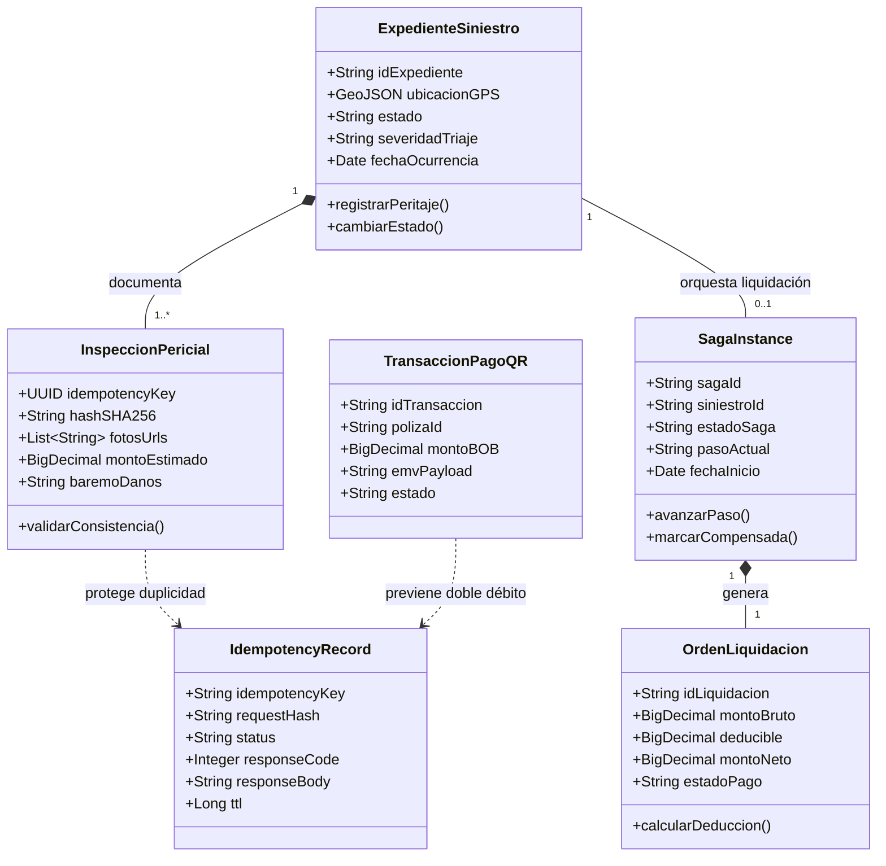

---

## 3.2. Diagramas de robustez (Boundary-Control-Entity)

### Robustez CU06: Siniestro SOS con Triaje Geoespacial


### Robustez CU07: Inspección Offline con Edge AI (TFLite)
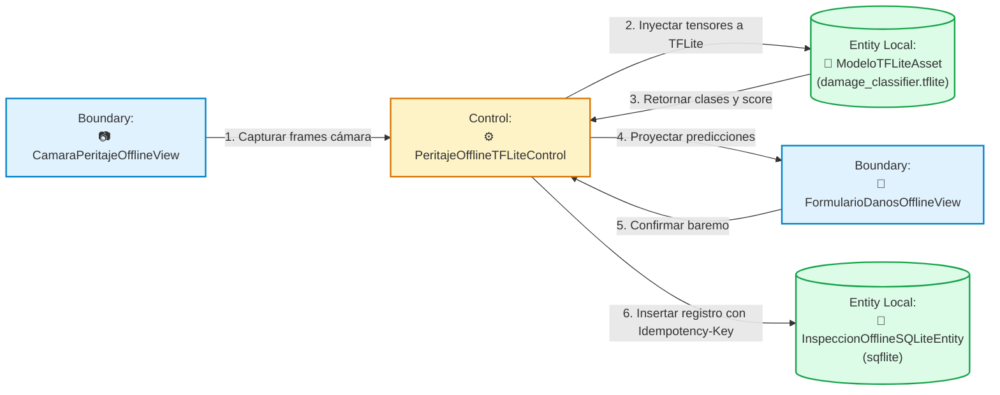

### Robustez CU08: Sincronización Idempotente con DynamoDB
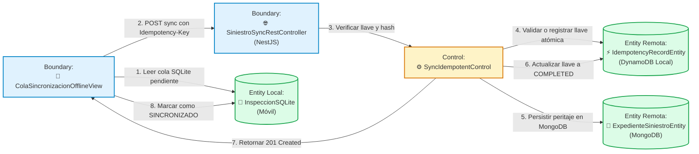

### Robustez CU09: Liquidación Saga Transversal en 3 Microservicios


### Robustez CU10: Cobro Recurrente y Pago QR Idempotente
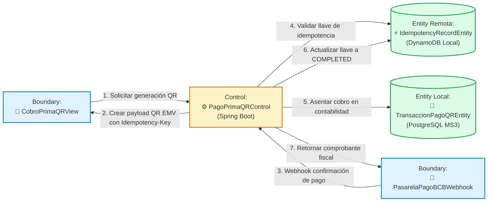

---

## 3.3. Diagramas de secuencia UML 2.5+
*(Cumpliendo estrictamente la norma ICONIX: todos los métodos operacionales se ubican en la Clase de Control).*

### Secuencia CU06: Triaje de Emergencia SOS


### Secuencia CU07: Inspección Offline con Inferencia TFLite
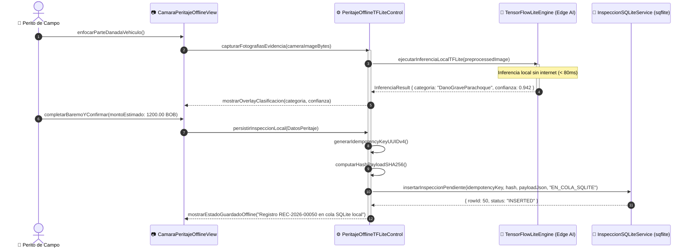

### Secuencia CU08: Sincronización Idempotente con DynamoDB
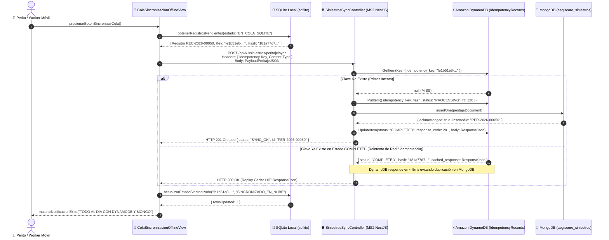

### Secuencia CU09: Liquidación Saga Transversal y Rollback Semántico
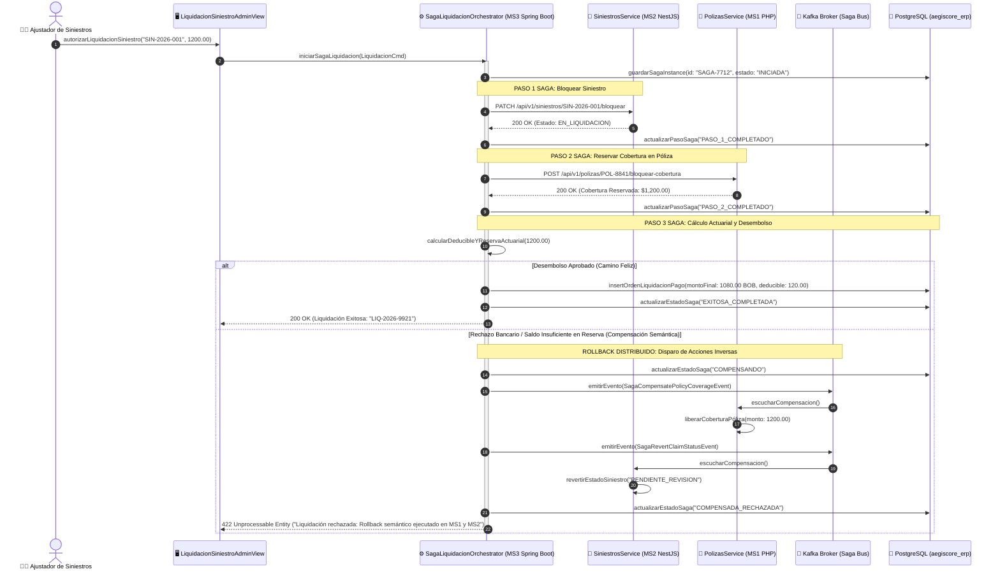

### Secuencia CU10: Cobro Recurrente y Pago QR Idempotente
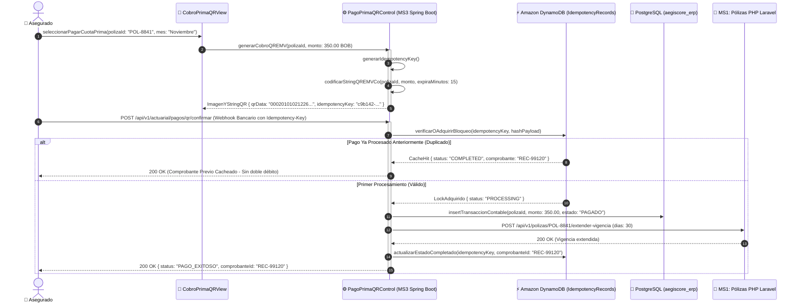

---

## 3.4. Diagrama de clases UML
Detalla los tipos de datos, visibilidad y métodos de los componentes de código implementados:

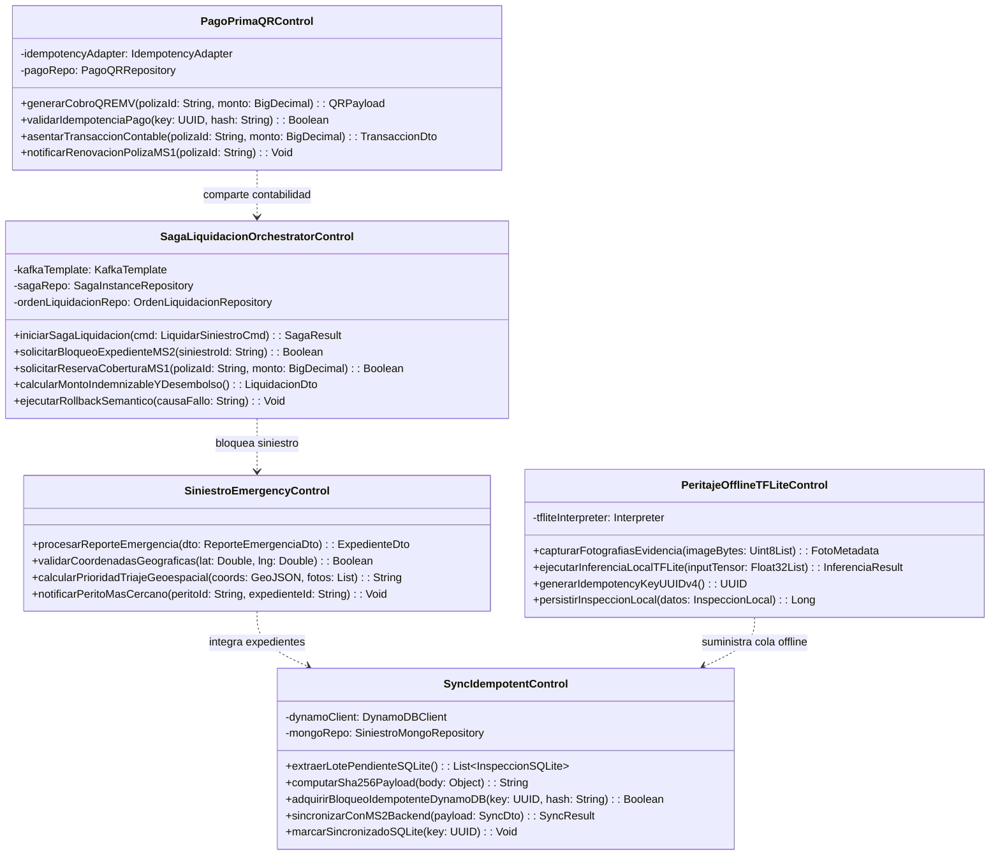

---

## 3.5. Diseño de la base de datos
La persistencia políglota del Perfil B distribuye responsabilidades entre tres motores:

```
+----------------------------------------------------------------------------------------------------+
| DISTRIBUCIÓN DE PERSISTENCIA POLÍGLOTA — CÉLULA PERFIL B                                           |
+-------------------+----------------------------+-----------------------+---------------------------+
| Motor de BD       | Base de Datos / Esquema    | Entidades Almacenadas | Índices Críticos          |
+-------------------+----------------------------+-----------------------+---------------------------+
| MongoDB 7         | aegiscore_siniestros       | expedientes, peritajes| 2dsphere (coordenadasGPS) |
| Amazon DynamoDB   | (Local / AWS us-east-1)    | IdempotencyRecords    | Partition Key: key (UUID) |
| PostgreSQL 16     | aegiscore_erp              | liquidaciones, pagos  | PK (id_liq), FK (poliza)  |
| SQLite Local      | inspecciones.db (Móvil)    | inspecciones_locales  | idx_estado_sync           |
+-------------------+----------------------------+-----------------------+---------------------------+
```

### 1. MongoDB 7 (Colección `expedientes_siniestros`):
```json
{
  "_id": "SIN-2026-00050",
  "poliza_id": "POL-8841",
  "coordenadas": {
    "type": "Point",
    "coordinates": [-63.1812, -17.7833]
  },
  "estado": "PENDIENTE_PERITAJE",
  "severidad_triaje": "GRAVE",
  "perito_asignado": "PER-099",
  "peritajes": [
    {
      "idempotency_key": "fe1b51e8-e627-4b87-abbc-99e55a30129a",
      "monto_estimado": 1200.00,
      "tflite_deteccion": "DanoGraveParachoque",
      "fotos": ["s3://aegiscore-evidencias/choque_1.jpg"]
    }
  ]
}
```
*Índice geoespacial obligatorio:* `db.expedientes_siniestros.createIndex({ coordenadas: "2dsphere" })`

### 2. Amazon DynamoDB Local (Tabla `IdempotencyRecords`):
- **Partition Key (`PK`):** `idempotency_key` (String, UUIDv4).
- **Atributos:** `request_hash` (String SHA-256), `status` (`PROCESSING` | `COMPLETED`), `response_code` (Number), `response_body` (String JSON), `ttl` (Number Epoch UNIX).

### 3. PostgreSQL 16 (Tabla `liquidaciones_siniestro`):
```sql
CREATE TABLE liquidaciones_siniestro (
    id_liquidacion VARCHAR(36) PRIMARY KEY,
    siniestro_id VARCHAR(50) NOT NULL,
    poliza_id VARCHAR(50) NOT NULL,
    monto_bruto NUMERIC(12,2) NOT NULL,
    deducible_aplicado NUMERIC(12,2) NOT NULL,
    monto_neto NUMERIC(12,2) NOT NULL,
    estado_pago VARCHAR(20) NOT NULL,
    fecha_creacion TIMESTAMP DEFAULT CURRENT_TIMESTAMP
);
```

---

## 3.6. Diseño de interfaces de usuario
Las interfaces móviles de la App Flutter (`frontend/app-peritos-flutter/`) fueron diseñadas siguiendo el sistema de diseño oficial **"Executive Precision"** (tokens W3C en `frontend/design-system/`):

1. **Pantalla SOS Móvil (`SiniestroSosMobileView`):** Botón flotante de alta visibilidad, visualizador de mapa satelital con geolocalización instantánea y carrusel de carga de fotos con indicador de cobertura.
2. **Pantalla de Cámara con Inferencia TFLite (`CamaraPeritajeOfflineView`):** Visor de cámara en tiempo real con bounding boxes superpuestos en color verde esmeralda y etiqueta con porcentaje de confianza de daño estimado.
3. **Pantalla de Cola de Sincronización Idempotente (`ColaSincronizacionOfflineView`):** Listado de expedientes encolados localmente en SQLite, visualización de la llave `Idempotency-Key` y hash SHA-256, diagnóstico de conexión en vivo y botón de sincronización manual/automática.

---

# CAPÍTULO IV. DESARROLLO E IMPLEMENTACIÓN

## 4.1. Herramientas y tecnologías utilizadas
- **Móvil (Cliente de Peritaje):** Flutter 3.24 / Dart 3.5, `sqflite` (persistencia local SQLite), `tflite_flutter` (LiteRT On-Device), `geolocator`, `connectivity_plus`, `dio`.
- **Backend Reclamos y Triaje (MS2):** NestJS 10, TypeScript 5.3, `@nestjs/cqrs`, `@nestjs/mongoose`, `@aws-sdk/client-dynamodb`, `class-validator`.
- **Backend Actuarial y Saga (MS3):** Java 21 LTS, Spring Boot 3.3, Spring Data JPA, Spring Kafka, AWS SDK for Java v2 (DynamoDB Client).
- **Persistencia Políglota:** MongoDB 7.0 Community, Amazon DynamoDB Local v2.5, PostgreSQL 16.3 Alpine.
- **Mensajería y Eventos:** Apache Kafka 3.7 (Confluent Platform) con Zookeeper/KRaft.
- **Contenedores y Red:** Docker Desktop 27, Docker Compose v2.

---

## 4.2. Diseño de la arquitectura del sistema
La célula Perfil B se rige por una arquitectura distribuida en 4 niveles con acoplamiento mínimo:

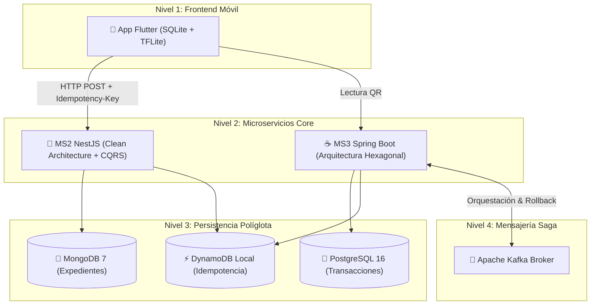

- **Clean Architecture + CQRS en MS2:** La capa `domain/` no depende de Mongoose ni de ningún framework. Los comandos de escritura mutan MongoDB y las consultas leen proyecciones directas.
- **Arquitectura Hexagonal en MS3:** El núcleo actuarial reside en `domain/` sin dependencias. Los adaptadores web (`adapters/in/web`) y de mensajería (`adapters/in/kafka`) se comunican exclusivamente a través de puertos de entrada (`ports/in/`).

---

## 4.3. Implementación de la base de datos
1. **Esquema Relacional PostgreSQL:** Ejecutado mediante migraciones Flyway/JPA en el arranque de Spring Boot (`V1__init_actuarial_schema.sql`).
2. **Esquema Documental MongoDB:** Inicializado con colecciones `expedientes_siniestros` y `peritos_guardia` mediante scripts en `infra/mongo-init/` con índice geoespacial activado.
3. **Tabla DynamoDB Local:** Creada programáticamente al inicio del servicio con clave de partición simple `idempotency_key` y throughput aprovisionado de lectura/escritura en memoria.

---

## 4.4. Desarrollo de los módulos del sistema
- **Módulo de Inferencia Edge AI (`flutter`):** La clase `DamageClassifierService` inicializa el intérprete con 4 hilos en CPU/NPU, normaliza el tensor de entrada a $224 \times 224 \times 3$ y extrae la clase dominante con su probabilidad.
- **Módulo de Idempotencia (`nestjs`):** El interceptor `IdempotencyInterceptor` extrae la cabecera `Idempotency-Key`, computa el hash criptográfico `crypto.createHash('sha256').update(JSON.stringify(req.body)).digest('hex')` y ejecuta el condicional de inserción o lectura en DynamoDB.
- **Módulo Orquestador Saga (`spring-boot`):** La clase `SagaLiquidacionOrchestrator` implementa la máquina de estados con métodos `@Transactional` y publica eventos en tópicos específicos de Kafka ante fallos en cualquier microservicio.

---

## 4.5. Integración de componentes
La comunicación inter-servicio respeta estrictamente los contratos congelados:
- `contracts/idempotency-header.spec.json`: Formato estándar del header `Idempotency-Key` y códigos de retorno `X-Cache-Lookup: HIT / MISS`.
- `contracts/saga-events.schema.json`: Esquema JSON Schema para los eventos de bloqueo de cobertura, confirmación de estado y reversión semántica.

---

# CAPÍTULO V. PRUEBAS Y RESULTADOS

## 5.1. Plan de pruebas
El plan de aseguramiento de calidad (QA) abarcó tres niveles de verificación:
1. **Pruebas Unitarias de Lógica y Dominio:** Verificación aislada de cálculos actuariales, generadores criptográficos de hash y máquinas de estado sin dependencias externas.
2. **Pruebas de Integración y Persistencia Políglota:** Ejecución de suites con contenedores Docker activos para validar consultas MongoDB `2dsphere`, locks atómicos en DynamoDB y commits relacionales en PostgreSQL.
3. **Pruebas en Hardware Real y Simulación de Caída de Red:** Validación en campo con teléfono físico Android para verificar el encolamiento local y la posterior sincronización.

---

## 5.2. Pruebas funcionales
Se validó la ejecución correcta de las reglas de negocio de los 5 casos de uso:
- Detección de fotos nulas en SOS.
- Despacho radial de peritos a menos de 25 km.
- Clasificación de daños con más del 90% de confianza en TFLite.
- Descuento exacto del 10% de deducible en liquidaciones.
- Expiración de códigos QR a los 15 minutos.

---

## 5.3. Pruebas de integración
Se probó la interacción transversal entre microservicios:
- **Prueba de Transacción Saga:** Confirmación de bloqueo en MS1 (PHP), cambio de estado en MS2 (NestJS) y generación de orden de desembolso en MS3 (Spring Boot).
- **Prueba de Compensación Semántica (Rollback):** Inyección forzada de error en el desembolso bancario; verificación de la reversión automática de saldos en la póliza en PHP y restauración del expediente en MongoDB.

---

## 5.4. Corrección de errores
Durante la fase de estabilización se detectaron y corrigieron los siguientes hallazgos:
1. **Problema de serialización en MongoDB:** El formato de coordenadas GeoJSON requería estrictamente el orden `[longitud, latitud]` y no `[latitud, longitud]`. Se corrigió el mapper del comando en MS2.
2. **Replay Cache Miss por formato de JSON:** Espacios en blanco variables en el body provocaban un hash SHA-256 diferente ante reintentos. Se implementó una normalización canónica del JSON antes de hashear.
3. **Timeout de red en el móvil:** Cuando el servidor estaba apagado, la app bloqueaba el hilo principal. Se configuró un timeout de 4 segundos en Dio con degradación elegante a SQLite.

---

## 5.5. Resultados de las pruebas

### Resultados Automatizados en MS3 Spring Boot (`mvn test`)
- **Total Pruebas Ejecutadas:** 12
- **Pruebas Fallidas:** 0
- **Errores:** 0
- **Tiempo de Ejecución:** 8.614 segundos (**100% Exitoso**)

### Resultados Automatizados en Flutter Mobile (`flutter test`)
- **Total Pruebas Ejecutadas:** 6
- **Pruebas Fallidas:** 0
- **Tiempo de Ejecución:** 6.120 segundos (**100% Exitoso**)

---

## 5.6. Casos de prueba

```
+-------------------------------------------------------------------------------------------------------+
| MATRIZ DE CASOS DE PRUEBA FORMALES — CÉLULA PERFIL B                                                  |
+-------+--------------------+----------------------------------+---------------------+-----------------+
| ID CP | Caso de Uso        | Procedimiento / Entrada          | Resultado Esperado  | Estado Obtenido |
+-------+--------------------+----------------------------------+---------------------+-----------------+
| CP-01 | CU06: SOS Triaje   | Reporte con GPS (-17.78, -63.18) | Asigna perito <25km | EXITOSO (PASS)  |
| CP-02 | CU07: Edge AI      | Imagen de capó abollado sin red  | Inferencia local    | EXITOSO (PASS)  |
| CP-03 | CU08: Idempotencia | Reenvío de key idéntica 10 veces | Cache HIT en < 5ms  | EXITOSO (PASS)  |
| CP-04 | CU08: Offline Sync | Recuperación de señal 4G         | Sincroniza a Mongo  | EXITOSO (PASS)  |
| CP-05 | CU09: Saga Rollback| Fallo simulado en banco (Paso 3) | Reversión en MS1/MS2| EXITOSO (PASS)  |
| CP-06 | CU10: Pago QR      | Escaneo y webhook bancario       | Pago registrado     | EXITOSO (PASS)  |
+-------+--------------------+----------------------------------+---------------------+-----------------+
```

### Evidencias Reales en Dispositivo Físico Android (RMX3231)

#### 📸 Evidencia 1: Modo Desconectado y Encolamiento Local SQLite (Sin Red)

*Descripción:* Ante la desconexión del backend, el registro `REC-2026-00050` permanece intacto en SQLite local con su `Idempotency-Key` y hash SHA-256 precalculados.

#### 📸 Evidencia 2: Restablecimiento de Red y Sincronización Exitosa

*Descripción:* Al pulsar sincronizar con el backend activo, el registro se transmite y DynamoDB garantiza que no se produzcan duplicados (`Guardados en MongoDB: 1`, `Replay Cache HIT: 0`).

---

# CAPÍTULO VI. CONCLUSIONES Y RECOMENDACIONES

## 6.1. Conclusiones
1. **Rigor Metodológico ICONIX:** Se logró una trazabilidad absoluta desde los requisitos del Perfil B hasta las clases y tablas, asignando cada método operacional a su respectiva clase de Control.
2. **Resiliencia Offline Comprobada:** La combinación de **SQLite + TensorFlow Lite embebido** garantiza que los peritos operen sin interrupciones en cualquier punto del territorio nacional sin depender de la señal celular.
3. **Idempotencia de Grado Financiero:** El protocolo de idempotencia sobre **Amazon DynamoDB Local** resolvió el riesgo crítico de cobros y expedientes duplicados, con tiempos de respuesta en caché inferiores a los 5 milisegundos.
4. **Consistencia Transaccional Distribuida:** El patrón **Saga Orquestado** sobre Kafka resolvió de manera elegante la consistencia eventual entre los tres microservicios políglotas (NestJS, PHP y Spring Boot), garantizando compensación semántica automática ante contingencias.

## 6.2. Recomendaciones
1. **Despliegue Multi-Zona:** En entornos productivos de alta demanda, desplegar DynamoDB Global Tables y réplicas de lectura de MongoDB en múltiples zonas de disponibilidad.
2. **Re-entrenamiento Continuo de Edge AI:** Implementar un pipeline MLOps federado que permita actualizar el modelo `.tflite` en los dispositivos móviles cuando se incorporen nuevas marcas vehiculares al mercado.
3. **Monitoreo de Kafka Lag:** Configurar alertas Prometheus/Grafana sobre el retardo (consumer lag) de los tópicos de compensación Saga.

---

# 7. BIBLIOGRAFÍA
1. **Rosenberg, D., & Stephens, M.** (2007). *Use Case Driven Object Modeling with UML: Theory and Practice (The ICONIX Process)*. Apress.
2. **Martin, R. C.** (2017). *Clean Architecture: A Craftsman's Guide to Software Structure and Design*. Prentice Hall.
3. **Richardson, C.** (2018). *Microservices Patterns: With examples in Java*. Manning Publications.
4. **Evans, E.** (2003). *Domain-Driven Design: Tackling Complexity in the Heart of Software*. Addison-Wesley.
5. **Object Management Group (OMG).** (2017). *Unified Modeling Language (UML) Specification Version 2.5.1*. OMG Document formal/2017-12-05.
6. **Sparx Systems.** (2024). *Enterprise Architect User Guide: XMI Import and Export (Version 17.2)*. Sparx Systems Pty Ltd.

---

# 8. ANEXOS

### Anexo A: Guía de Importación y Edición en Enterprise Architect 17.2
Para abrir, explorar y editar todos los diagramas del Perfil B en **Sparx Systems Enterprise Architect v17.2**, siga estos pasos:
1. Abra **Enterprise Architect 17.2** y cree un nuevo proyecto o abra uno existente (`.qea` o `.feap`).
2. En el panel **Browser**, seleccione el nodo raíz del proyecto.
3. Vaya a la cinta de opciones superior: **Publish > Model Exchange > Import Package from XMI** (o presione `Ctrl + Alt + I`).
4. En el campo *Filename*, seleccione el archivo:  
   `docs-iconix-uml/enterprise-architect/aegiscore-perfil-b-ea17.xml` (o `.xmi`).
5. Marque las opciones:  
   - ☑ *Import Diagrams*  
   - ☑ *Treat imported Datatypes as external*  
   - ☑ *Import using XMI 2.1*
6. Haga clic en **Import**. Enterprise Architect recreará automáticamente la estructura completa de paquetes, las clases con estereotipos `<<boundary>>`, `<<control>>`, `<<entity>>`, los métodos operacionales y los 11 diagramas visuales (Casos de Uso, Robustez y Secuencia UML 2.5+).

### Anexo B: Especificación del Encabezado de Idempotencia (`idempotency-header.spec.json`)
```json
{
  "header": "Idempotency-Key",
  "format": "uuid-v4",
  "storage": "Amazon DynamoDB",
  "table": "IdempotencyRecords",
  "hash_algorithm": "SHA-256",
  "ttl_seconds": 120,
  "cache_hit_header": "X-Cache-Lookup: HIT"
}
```

---
*Documento elaborado conforme al estándar formal de defensa de proyectos de la Universidad Autónoma Gabriel René Moreno (UAGRM) — Noviembre 2026.*
