# 🏛️ Universidad Autónoma Gabriel René Moreno
### Facultad de Ingeniería en Ciencias de la Computación y Telecomunicaciones (FICCT)
**Carrera:** Ingeniería Informática / Ingeniería en Sistemas  
**Materia:** Ingeniería de Software II (INF412) — 2do Parcial  
**Grupo de Proyecto:** #27  
**Semestre:** II / 2026 — Santa Cruz de la Sierra, Bolivia  

---

# DOCUMENTO MAESTRO DE DISEÑO Y MODELADO ICONIX (FASE 3)
## PROYECTO: AegisCore AI — ERP Distribuido, Peritaje Inteligente y Liquidación Autónoma de Siniestros de Seguros

### 🎯 ENFOQUE VERTICAL: PERFIL B (Casos de Uso CU06 al CU10)
> **Núcleo de Siniestros, Peritaje Móvil Offline-First con Edge AI, Idempotencia Distribuida en DynamoDB y Transacciones Transversales Saga con Compensación Semántica**

```
========================================================================================
EQUIPO DE DESARROLLO (GRUPO #27):
1. Garcia Caballero David         - Registro: 217058795 (Perfil A: Comercial, SSO, React & n8n)
2. Garcia Caballero Jose Diego    - Registro: 221044523 (Perfil B: Siniestros, Móvil & Saga) [RESPONSABLE]
3. Velasquez Paz Arnulfo          - Registro: 220030383 (Perfil C: IA, MCP, LangGraph & Angular)
========================================================================================
```

---

## 📑 Índice General del Documento

1. [Introducción y Metodología ICONIX en 4 Fases](#1-introducción-y-metodología-iconix-en-4-fases)
   - 1.1 Fundamentos y Adaptación del Proceso ICONIX a la Célula Perfil B
   - 1.2 Cronograma Formal de 4 Semanas de Desarrollo
2. [Requisitos Funcionales Formales (RF01 - RF07) en el Perfil B](#2-requisitos-funcionales-formales-rf01---rf07-en-el-perfil-b)
3. [Arquitectura del Sistema en 4 Niveles (Célula Perfil B)](#3-arquitectura-del-sistema-en-4-niveles-célula-perfil-b)
   - 3.1 Nivel 1: Frontend Heterogéneo (Cliente Móvil Flutter Offline-First + SQLite + Edge AI)
   - 3.2 Nivel 2: Dominio ERP y Microservicios (MS2 NestJS Clean Arch/CQRS + MS3 Spring Boot Hexagonal)
   - 3.3 Nivel 3: Persistencia Políglota y Agregación (MongoDB 7 + DynamoDB Local + PostgreSQL 16)
   - 3.4 Nivel 4: Arquitectura General, Mensajería e Infraestructura (Kafka + Apollo Supergraph + Docker)
4. [Patrones de Código, Transacciones Distribuidas y Automatización](#4-patrones-de-código-transacciones-distribuidas-y-automatización)
   - 4.1 Patrones de Arquitectura de Software a Nivel de Código
   - 4.2 Transacciones Distribuidas: Patrón Saga Orquestado y Compensación Semántica (Rollback)
   - 4.3 Mecanismo Universal de Idempotencia Distribuida (DynamoDB Local)
5. [Especificación y Modelado ICONIX Detallado por Caso de Uso (CU06 al CU10)](#5-especificación-y-modelado-iconix-detallado-por-caso-de-uso-cu06-al-cu10)
   - 5.1 CU06: Reportar Siniestro Vial de Emergencia SOS con Triaje Automático
   - 5.2 CU07: Inspeccionar Daños Offline en Terreno con Edge AI (TFLite)
   - 5.3 CU08: Sincronizar Expediente de Siniestro con Control de Idempotencia en DynamoDB
   - 5.4 CU09: Liquidar y Pagar Indemnización de Siniestro (Saga Transversal en 3 Microservicios)
   - 5.5 CU10: Procesar Cobro Recurrente de Primas y Pago QR Idempotente
6. [Evidencias de Ejecución, Pruebas y Resiliencia en Entorno Real](#6-evidencias-de-ejecución-pruebas-y-resiliencia-en-entorno-real)
   - 6.1 Pruebas en Dispositivo Móvil Físico (Android real RMX3231)
   - 6.2 Resultados de Suites de Pruebas Automatizadas (MS3 Java + Flutter Mobile)
   - 6.3 Verificación de Idempotencia Sub-milisegundo y Prevención de Duplicidad
7. [Conclusiones y Trazabilidad Arquitectónica](#7-conclusiones-y-trazabilidad-arquitectónica)

---

## 1. Introducción y Metodología ICONIX en 4 Fases

### 1.1 Fundamentos y Adaptación del Proceso ICONIX a la Célula Perfil B
El presente proyecto adopta rigurosamente la metodología **ICONIX**, un enfoque ágil guiado por casos de uso que cierra la brecha entre el análisis de requisitos de alto nivel y el diseño detallado orientado a objetos, garantizando una trazabilidad estricta y sin ambigüedades. 

En la célula de desarrollo asignada al **Perfil B**, la metodología se ejecuta mediante 4 fases formales:

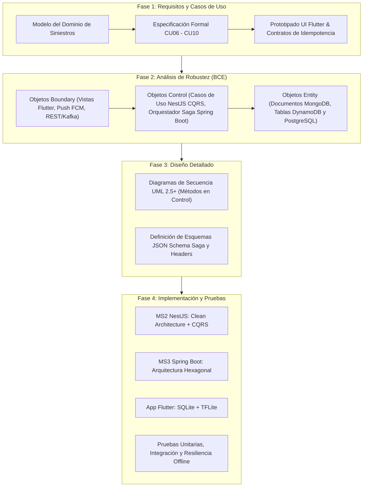

1. **Fase 1 — Requisitos y Casos de Uso:** Modelado del dominio de siniestros, redacción estructurada de los casos de uso (`CU06` a `CU10`), identificación de actores (Asegurado, Perito de Campo, Ajustador, Orquestador Saga) y delimitación de pre/postcondiciones.
2. **Fase 2 — Análisis de Robustez (Boundary-Control-Entity):** Conexión semántica de cada caso de uso con objetos del sistema clasificados en:
   - **Boundary (Frontera):** Interfaces móviles Flutter (`SiniestroSosMobileView`, `CamaraPeritajeOfflineView`, `ColaSincronizacionOfflineView`), controladores REST y endpoints de mensajería.
   - **Control (Lógica / Orquestación):** Controladores de caso de uso puros (`SiniestroEmergencyControl`, `PeritajeOfflineTFLiteControl`, `SyncIdempotentControl`, `SagaLiquidacionOrchestratorControl`, `PagoPrimaQRControl`).
   - **Entity (Persistencia):** Esquemas en MongoDB (`ExpedienteSiniestro`), DynamoDB (`IdempotencyRecord`) y PostgreSQL (`OrdenLiquidacion`, `TransaccionPagoQR`).
3. **Fase 3 — Diseño Detallado:** Modelado formal de diagramas de secuencia **UML 2.5+**, asignando inequívocamente la responsabilidad operacional a los métodos declarados dentro de la clase de Control correspondiente. Definición estricta de contratos congelados (`contracts/`).
4. **Fase 4 — Implementación y Pruebas:** Codificación guiada por patrones de arquitectura limpia y hexagonal, persistencia políglota funcional y validación de resiliencia ante pérdida de red y duplicación concurrente.

---

### 1.2 Cronograma Formal de 4 Semanas de Desarrollo

| Semana | Hito / Fases ICONIX | Entregables Célula Perfil B | Estado |
|---|---|---|---|
| **Semana 1** | Fase 1 & 2: Requisitos, Modelo de Dominio y Análisis de Robustez BCE | Fichas técnicas `CU06-CU10`, Diagramas de Robustez Mermaid/PlantUML, contratos base (`idempotency-header.spec.json`, `saga-events.schema.json`). | **Completado (100%)** |
| **Semana 2** | Fase 3: Diseño Detallado UML 2.5+ y Esqueletos de Microservicios | Diagramas de secuencia UML 2.5+ con métodos en clase Control; esqueleto MS2 NestJS (Clean/CQRS), MS3 Spring Boot (Hexagonal) y esquemas MongoDB/PostgreSQL/DynamoDB. | **Completado (100%)** |
| **Semana 3** | Fase 4: Implementación Core Móvil, Edge AI y Saga Transversal | App Flutter Offline-First con SQLite y modelo embebido `damage_classifier.tflite`; Orquestador Saga en Spring Boot 3 coordinado con Apache Kafka y MS1/MS2. | **Completado (100%)** |
| **Semana 4** | Fase 4: Sincronización Idempotente, Pruebas de Red y Blindaje | Interceptor de Idempotencia en NestJS/DynamoDB (< 5ms); pruebas en teléfono físico Android real; ejecución de 18 pruebas automatizadas exitosas (12 MS3 + 6 Flutter). | **Completado (100%)** |

---

## 2. Requisitos Funcionales Formales (RF01 - RF07) en el Perfil B

La especificación académica institucional define 7 Requisitos Funcionales macro (RF01 a RF07). La célula del **Perfil B** asume y garantiza el cumplimiento directo de los siguientes requerimientos:

```
+-----------------------------------------------------------------------------------------------------+
| MATRIZ DE TRAZABILIDAD: REQUISITOS FUNCIONALES MACRO vs. CASOS DE USO PERFIL B                      |
+-----------------------------------------------------------------------------------------------------+
| Requisito Funcional Académico           | Caso de Uso Perfil B | Componentes Tecnológicos Clave     |
+-----------------------------------------+----------------------+------------------------------------+
| RF01 - Gestión Integral del Dominio ERP | CU06, CU09, CU10     | MS2 NestJS, MS3 Spring Boot, Mongo |
| RF02 - Agentes Autónomos de Monitoreo   | CU06 (Triaje)        | Algoritmo Geoespacial 2dsphere     |
| RF03 - Operatividad Offline & Idempotenc| CU07, CU08, CU10     | Flutter SQLite, Edge AI, DynamoDB  |
| RF04 - Automatización de Flujos         | CU06, CU08           | Push Notifications FCM, Webhooks   |
| RF06 - Acceso Unificado (SSO Keycloak)  | CU06, CU07, CU09     | Keycloak JWT RS256, RBAC Perito    |
| RF07 - Transacciones Saga Transversales | CU09                 | Apache Kafka, MS1, MS2, MS3 Rollback|
+-----------------------------------------------------------------------------------------------------+
```

- **RF01 - Gestión Integral del Dominio ERP:** Registro completo de siniestros vehiculares, apertura y seguimiento del expediente pericial, cálculo actuarial de liquidación descontando deducibles y reservas técnicas, y emisión de pagos indemnizatorios y cuotas de seguro.
- **RF03 - Operatividad Offline e Idempotencia:** Operación 100% autónoma de la App Móvil de Peritaje en zonas rurales, carreteras y estacionamientos subterráneos sin cobertura celular. Almacenamiento diferido en SQLite local. Sincronización a prueba de duplicidad mediante el encabezado `Idempotency-Key` (UUIDv4 + Hash SHA-256) validado contra Amazon DynamoDB Local con tiempo de respuesta inferior a 5 milisegundos.
- **RF06 - Acceso Unificado (Single Sign-On - SSO):** Autenticación pericial y directiva basada en tokens Bearer JWT emitidos por Keycloak bajo OAuth 2.0 / OpenID Connect + PKCE, propagados transparentemente en las llamadas API hacia MS2 y MS3.
- **RF07 - Transacciones Distribuidas Transversales:** Coordinación del caso de uso `CU09` entre 3 microservicios independientes mediante el patrón **Saga Orquestado** con compensación semántica (Rollback). Si la liquidación es rechazada financieramente en el paso final, se revierten automáticamente las reservas actuariales y se desbloquea la cobertura de la póliza en PHP.

---

## 3. Arquitectura del Sistema en 4 Niveles (Célula Perfil B)

La solución se estructura en una arquitectura empresarial desacoplada en cuatro niveles de abstracción:

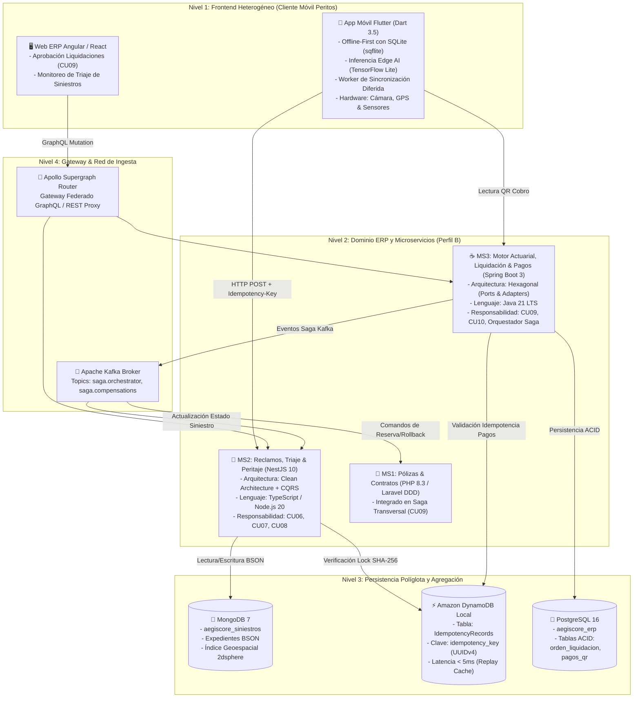

### 3.1 Nivel 1: Frontend Heterogéneo (Cliente Móvil Flutter)
- **App Móvil de Peritos (`frontend/app-peritos-flutter/`):** Desarrollada en Flutter (Dart 3). Dispone de un motor de persistencia local en **SQLite**, lo que permite registrar fotografías periciales, geolocalización satelital y notas de audio completamente desconectado de la red celular.
- **Edge AI Embebido (On-Device):** Ejecución de inferencia de visión artificial mediante modelo cuantizado TensorFlow Lite (`damage_classifier.tflite`). Clasifica abolladuras y severidad en menos de 80 milisegundos sin consumir megabytes del perito ni depender de conectividad.

### 3.2 Nivel 2: Dominio ERP y Microservicios Core
- **MS2 NestJS (`backend/ms2-siniestros-nestjs/`):** Implementado con **Clean Architecture + CQRS**. Maneja la ingesta de siniestros viales, triaje geoespacial con algoritmo Haversine e índice MongoDB `2dsphere`, y el procesamiento de lotes periciales sincronizados.
- **MS3 Spring Boot (`backend/ms3-actuarial-springboot/`):** Implementado con **Arquitectura Hexagonal**. Actúa como motor actuarial de alta precisión numérica, ejecuta el cálculo de liquidaciones indemnizatorias y coordina la máquina de estados de la transacción distribuida Saga.

### 3.3 Nivel 3: Persistencia Políglota y Agregación
- **MongoDB 7 (`aegiscore_siniestros`):** Base de datos documental NoSQL optimizada para esquemas dinámicos de peritaje (fotografías, coordenadas GPS, baremos de daños). Índice `2dsphere` para búsquedas radiales de peritos y talleres más cercanos.
- **Amazon DynamoDB Local:** Almacén clave-valor de acceso ultra-rápido en memoria/disco. Almacena la tabla `IdempotencyRecords` indexada por `idempotency_key` con hash de integridad SHA-256 del payload para garantizar respuesta en $< 5\text{ ms}$.
- **PostgreSQL 16 (`aegiscore_erp`):** Motor relacional con garantías ACID estrictas para las tablas transaccionales de contabilidad, órdenes de pago de liquidación (`liquidaciones_siniestro`) y transacciones QR (`pagos_qr_registro`).

### 3.4 Nivel 4: Infraestructura y Orquestación
- **Apache Kafka:** Bus distribuido de eventos de dominio con retención persistente. Facilita la comunicación desacoplada y asíncrona entre MS1, MS2 y MS3 durante la ejecución de la Saga de Liquidación y la compensación semántica de fallos.
- **Apollo Supergraph Router:** Router federado que consolida los subgrafos GraphQL de la plataforma bajo un único punto de entrada unificado para clientes web y móviles.

---

## 4. Patrones de Código, Transacciones Distribuidas y Automatización

### 4.1 Patrones de Arquitectura de Software a Nivel de Código

| Componente | Patrón de Arquitectura | Justificación y Regla de Implementación |
|---|---|---|
| **MS2 NestJS** | **Clean Architecture + CQRS** | Desacoplamiento total del núcleo de dominio (`src/domain/`) respecto a Mongoose y NestJS. Casos de uso estrictamente divididos en **Commands** (`RegistrarSiniestroCommand`, `SincronizarInspeccionCommand`) y **Queries** (`ObtenerSiniestroPorIdQuery`). |
| **MS3 Spring Boot** | **Arquitectura Hexagonal (Ports & Adapters)** | Aislamiento del dominio actuarial puro (`domain/`) sin dependencias de Spring Data JPA ni Kafka. Puertos de Entrada (`ports/in/`) para casos de uso y Puertos de Salida (`ports/out/`) implementados por adaptadores web, JPA y Kafka. |
| **Flutter Mobile** | **Offline-First BLoC / Repository** | Separación entre vistas reactivas, gestión de estado y repositorios híbridos con estrategia Local-First (Lectura/Escritura inmediata en SQLite $\rightarrow$ Cola de sincronización diferida $\rightarrow$ Nube). |

---

### 4.2 Transacciones Distribuidas: Patrón Saga Orquestado y Compensación Semántica (Rollback)

El caso de uso `CU09` impacta de forma concurrente a tres microservicios políglotas independientes con persistencias separadas. Para garantizar consistencia eventual sin recurrir al protocolo Two-Phase Commit (2PC) —inviable en microservicios por bloqueo de hilos— se aplica el patrón **Saga Orquestado**:

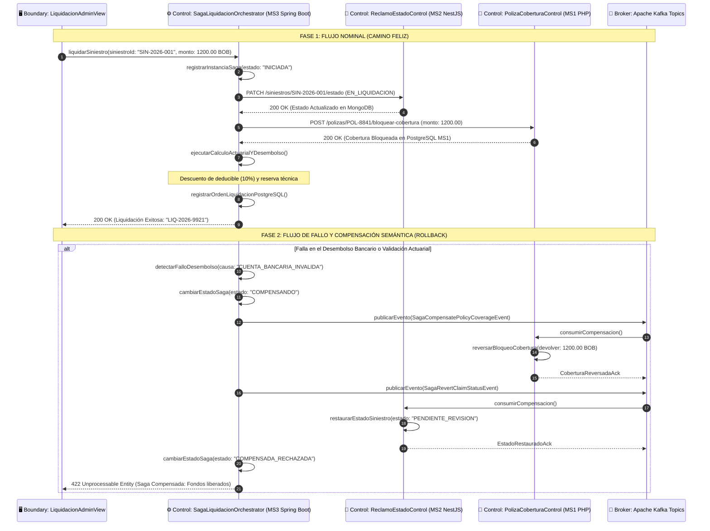

---

### 4.3 Mecanismo Universal de Idempotencia Distribuida (DynamoDB Local)

Para dar estricto cumplimiento al contrato congelado `contracts/idempotency-header.spec.json`, las operaciones críticas de sincronización móvil (`CU08`) y pago QR (`CU10`) implementan el protocolo universal de idempotencia:

```mermaid
flowchart TD
    REQ["Entrada HTTP Request\nHeader: Idempotency-Key: <UUIDv4>\nBody: JSON Payload"] --> HASH["Calcular Hash Criptográfico:\nSHA-256(Payload)"]
    HASH --> QUERY["Consultar DynamoDB Local:\nGetItem(PK = idempotency_key)"]
    
    QUERY -->|¿Existe Registro?| EXISTE{Existe}
    
    EXISTE -->|NO| LOCK["Adquirir Bloqueo Atómico:\nPutItem con Estado: PROCESSING\nrequest_hash = SHA-256, TTL = 120s"]
    LOCK --> EXEC["Ejecutar Caso de Uso en Backend:\nPersistir en MongoDB / PostgreSQL"]
    EXEC --> UPDATE["Actualizar Registro DynamoDB:\nEstado: COMPLETED\nresponse_code = 201/200\nresponse_body = JSON"]
    UPDATE --> RET_NEW["Retornar HTTP 201 Created\nX-Cache-Lookup: MISS"]

    EXISTE -->|SÍ| CHECK_STATUS{Estado}
    CHECK_STATUS -->|PROCESSING| RET_409["Retornar HTTP 409 Conflict\n'Transacción actualmente en proceso'"]
    CHECK_STATUS -->|COMPLETED| CHECK_HASH{¿Hash Coincide?}
    
    CHECK_HASH -->|NO (Payload Alterado)| RET_422["Retornar HTTP 422 Unprocessable\n'Idempotency-Key reutilizada con payload diferente'"]
    CHECK_HASH -->|SÍ (Reintento Legítimo)| RET_CACHE["Retornar Respuesta Previa Cacheada:\nHTTP 200 OK\nX-Cache-Lookup: HIT (Latencia < 5ms)\n(Sin reejecutar lógica de negocio)"]
```

---

## 5. Especificación y Modelado ICONIX Detallado por Caso de Uso (CU06 al CU10)

---

### 5.1 CU06: Reportar Siniestro Vial de Emergencia SOS con Triaje Automático

#### A. Ficha Técnica del Caso de Uso
- **Identificador:** `CU06`
- **Nombre:** Reportar Siniestro Vial de Emergencia SOS con Triaje Automático y Asignación Pericial.
- **Objetivo:** Permitir al asegurado reportar un accidente vial desde el botón de pánico SOS de la aplicación móvil, capturando ubicación GPS satelital, fotos de la escena y ejecutando un triaje automático para despachar al perito más cercano.
- **Actores:** Conductor Asegurado (Iniciador), Sistema de Despacho (Secundario), Perito de Guardia (Destinatario).
- **Precondiciones:** El asegurado ha iniciado sesión mediante Keycloak SSO; el dispositivo móvil cuenta con sensor GPS habilitado.
- **Flujo Nominal:**
  1. El conductor asegurado pulsa el botón de emergencia "SOS Siniestro" en la App Móvil.
  2. La vista frontera captura las coordenadas GPS satelitales (`lat`, `lng`) y solicita tomar 1 o más fotos del choque.
  3. El objeto Control recibe los datos, valida la integridad del DTO y calcula el nivel de severidad de triaje mediante análisis de impacto y geocerca.
  4. El objeto Control consulta en MongoDB la colección `peritos` mediante el índice geoespacial `2dsphere` y selecciona al perito en turno a menor distancia euclidiana.
  5. El objeto Control persiste el nuevo expediente en MongoDB con estado `PENDIENTE_PERITAJE`.
  6. El sistema emite una notificación Push inmediata al celular del perito asignado con la ruta de navegación.
- **Postcondiciones:** Expediente de siniestro creado en MongoDB con código único `SIN-YYYY-XXXXX`; perito notificado en tiempo real.

#### B. Diagrama de Robustez ICONIX (Boundary-Control-Entity)
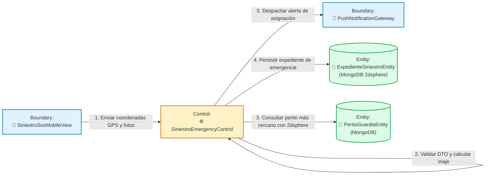

#### C. Diagrama de Secuencia UML 2.5+
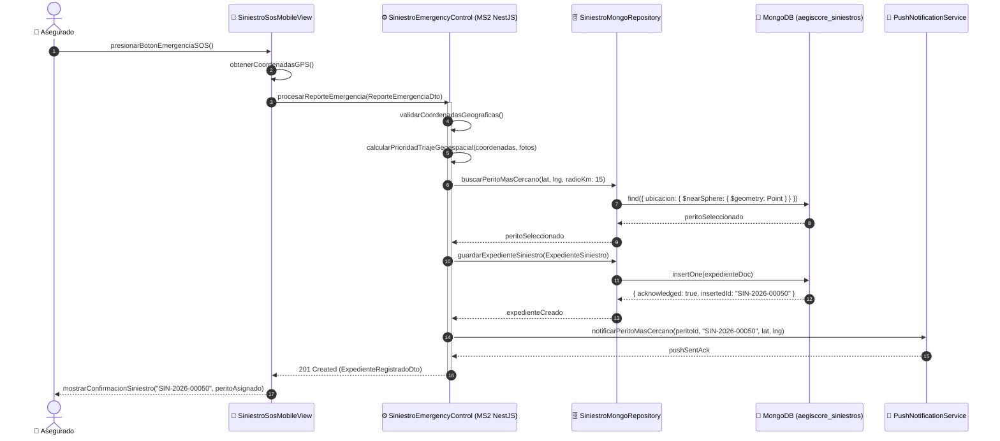

---

### 5.2 CU07: Inspeccionar Daños Offline en Terreno con Edge AI (TFLite)

#### A. Ficha Técnica del Caso de Uso
- **Identificador:** `CU07`
- **Nombre:** Inspeccionar Daños Vehiculares Offline en Terreno con Edge AI Embebido.
- **Objetivo:** Facilitar al perito técnico la inspección física de un vehículo siniestrado en zonas sin cobertura de internet, utilizando visión computacional local (TensorFlow Lite) para clasificar daños y persistiendo toda la evidencia en la base de datos local SQLite.
- **Actores:** Perito de Campo (Iniciador), Agente Edge AI TFLite (Asistente Local).
- **Precondiciones:** La App Móvil Flutter está instalada y contiene el modelo `damage_classifier.tflite` en sus assets; el celular se encuentra sin conexión de red.
- **Flujo Nominal:**
  1. El perito accede al formulario de inspección del siniestro en la App Flutter.
  2. Apunta la cámara del teléfono hacia las partes dañadas del vehículo (parachoques, capó, puertas, faroles).
  3. El objeto Control local invoca el motor de inferencia TensorFlow Lite sobre el buffer de la imagen en tiempo real.
  4. El modelo clasifica el tipo de daño (ej. `Severe Bumper Dent`, confianza $94.2\%$) y calcula la estimación preliminar del baremo de reparación.
  5. El perito añade observaciones en texto y confirma el peritaje.
  6. El objeto Control genera un identificador universal `Idempotency-Key` (UUIDv4) y persiste el expediente completo en la base de datos local SQLite (`inspecciones_locales`), marcándolo en estado `EN_COLA_SQLITE`.
- **Postcondiciones:** Registro pericial almacenado con integridad en el dispositivo móvil; ningún dato se pierde a pesar de la ausencia total de internet.

#### B. Diagrama de Robustez ICONIX (Boundary-Control-Entity)
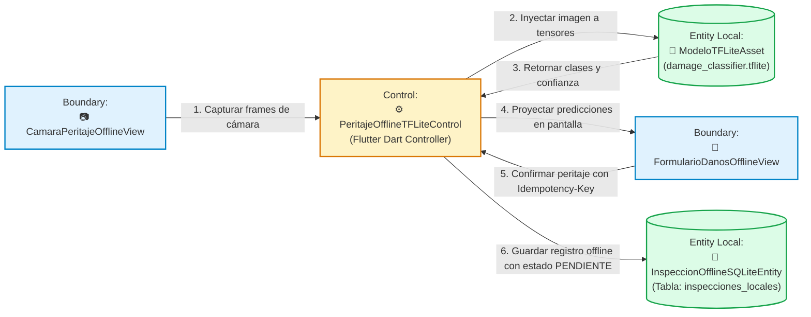

#### C. Diagrama de Secuencia UML 2.5+
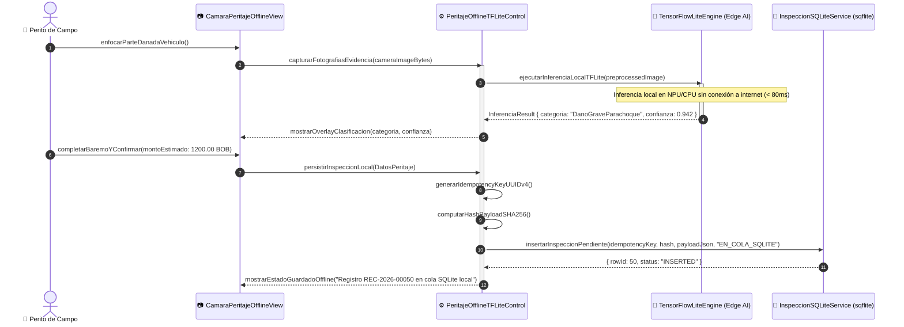

---

### 5.3 CU08: Sincronizar Expediente de Siniestro con Control de Idempotencia en DynamoDB

#### A. Ficha Técnica del Caso de Uso
- **Identificador:** `CU08`
- **Nombre:** Sincronizar Expediente de Siniestro con Control de Idempotencia Distribuida en Amazon DynamoDB.
- **Objetivo:** Transmitir a la nube los peritajes acumulados en SQLite tan pronto se recupere la conectividad, garantizando mediante DynamoDB que fallas de red, reintentos automáticos o duplicaciones de paquetes no generen registros duplicados en MongoDB ni afecten el estado contable.
- **Actores:** Servicio de Sincronización Móvil (Iniciador Automático/Manual), Microservicio MS2 NestJS (Receptor), Amazon DynamoDB Local (Garante de Idempotencia).
- **Precondiciones:** Existen 1 o más registros en la tabla SQLite con estado `EN_COLA_SQLITE`; se restablece la conexión a internet.
- **Flujo Nominal:**
  1. El servicio `ConnectivityService` de la App Flutter detecta conexión Wi-Fi/4G activa.
  2. El objeto Control local lee los registros pendientes en SQLite y extrae la `Idempotency-Key` (UUIDv4) y el hash SHA-256 precalculado.
  3. Envía una petición `POST /api/v1/siniestros/peritaje/sync` hacia MS2 con el encabezado `Idempotency-Key: <UUIDv4>`.
  4. El `IdempotencyInterceptor` de NestJS intercepta la solicitud y consulta la tabla `IdempotencyRecords` en DynamoDB Local.
  5. Al no existir la clave, DynamoDB inserta atómicamente el registro con estado `PROCESSING`.
  6. El caso de uso en NestJS inserta el peritaje en MongoDB (`aegiscore_siniestros`).
  7. DynamoDB actualiza el registro a estado `COMPLETED` almacenando el JSON de respuesta y el código `201 Created`.
  8. La App móvil recibe la confirmación y actualiza la fila local en SQLite a estado `SINCRONIZADO_EN_NUBE`.
- **Flujo Alternativo (Reintento por timeout / Pérdida momentánea de paquete ACK):**
  - Si la red cae justo antes de que la App reciba el ACK, la App reintentará el envío con la misma `Idempotency-Key`.
  - El interceptor consulta DynamoDB, detecta que la clave ya está en estado `COMPLETED` con el mismo hash SHA-256, y **retorna inmediatamente la respuesta previa cacheada (HTTP 200 / Cache HIT en $< 5\text{ ms}$)** sin reinsertar nada en MongoDB.
- **Postcondiciones:** Datos periciales persistidos una sola vez en MongoDB; DynamoDB conserva la constancia de idempotencia; SQLite móvil refleja sincronización completada.

#### B. Diagrama de Robustez ICONIX (Boundary-Control-Entity)
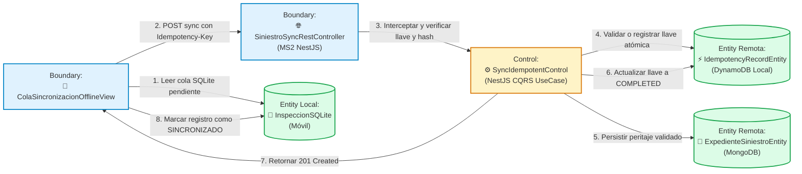

#### C. Diagrama de Secuencia UML 2.5+
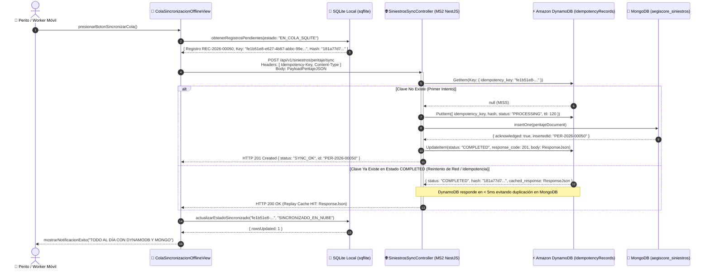

---

### 5.4 CU09: Liquidar y Pagar Indemnización de Siniestro (Saga Transversal en 3 Microservicios)

#### A. Ficha Técnica del Caso de Uso
- **Identificador:** `CU09`
- **Nombre:** Liquidar y Pagar Indemnización de Siniestro mediante Transacción Transversal Saga Orquestada con Compensación Semántica.
- **Objetivo:** Orquestar de manera consistente el cierre y desembolso económico de un siniestro aprobado a través de los microservicios de Siniestros (MS2), Pólizas (MS1) y Actuarial (MS3), asegurando que si algún paso de cobro o autorización bancaria falla, todos los recursos reservados sean automáticamente compensados (rollback semántico).
- **Actores:** Ajustador de Siniestros / Director Financiero (Iniciador), Orquestador Saga (MS3 Spring Boot), MS1 PHP Laravel (Pólizas), MS2 NestJS (Siniestros).
- **Precondiciones:** El siniestro se encuentra en estado `PERITADO_APROBADO`; el asegurado cuenta con póliza vigente; la reserva técnica tiene fondos disponibles.
- **Flujo Nominal (Camino Exitoso):**
  1. El ajustador ingresa a la vista de liquidación e ingresa el ID del siniestro (`SIN-2026-001`) y el monto tasado ($1,200.00\text{ BOB}$).
  2. El `SagaLiquidacionOrchestratorControl` (MS3) crea e inicializa el registro de la Saga con estado `INICIADA` en PostgreSQL.
  3. **Paso 1 (MS2 NestJS):** El orquestador envía comando para cambiar el estado del expediente en MongoDB a `EN_PROCESO_LIQUIDACION`. MS2 confirma exitosamente.
  4. **Paso 2 (MS1 PHP):** El orquestador solicita bloquear y reservar la cobertura de la póliza en PostgreSQL de MS1. MS1 descuenta temporalmente la cobertura anual y confirma.
  5. **Paso 3 (MS3 Spring Boot):** El orquestador calcula el deducible, debita la reserva actuarial, genera la orden contable de pago y emite la transferencia bancaria.
  6. El orquestador actualiza la instancia de la Saga a estado `EXITOSA_COMPLETADA` y notifica a la interfaz.
- **Flujo de Compensación Semántica (Rollback ante Fallo):**
  - Si en el Paso 3 el banco rechaza la transferencia o se detecta insuficiencia en la reserva actuarial:
  - El orquestador marca la Saga en estado `COMPENSANDO`.
  - Publica el evento `SagaCompensatePolicyCoverageEvent` en Apache Kafka. MS1 consume el evento y desbloquea los \$1,200.00 BOB reintegrándolos al límite de la póliza.
  - Publica el evento `SagaRevertClaimStatusEvent` en Apache Kafka. MS2 consume el evento y revierte el expediente en MongoDB a `PENDIENTE_REVISION`.
  - El orquestador actualiza el estado de la Saga a `COMPENSADA_RECHAZADA` y reporta la causa exacta del rechazo a la interfaz de administración.
- **Postcondiciones:** Consistencia eventual absoluta garantizada sin datos huérfanos ni saldos bloqueados indebidamente.

#### B. Diagrama de Robustez ICONIX (Boundary-Control-Entity)
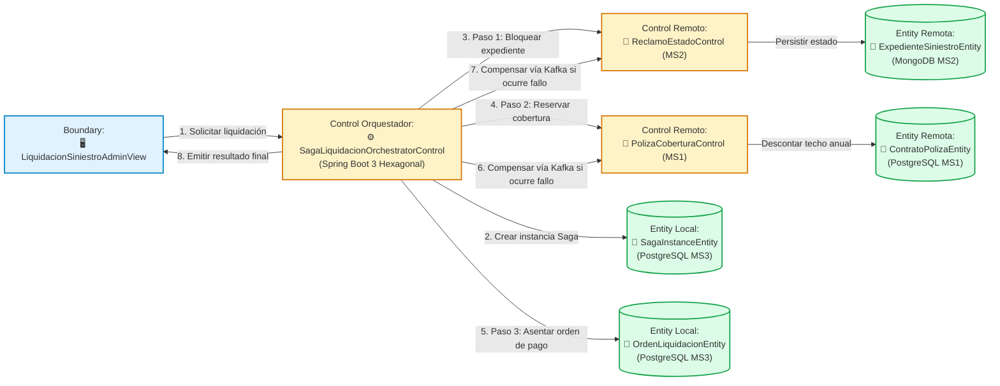

#### C. Diagrama de Secuencia UML 2.5+
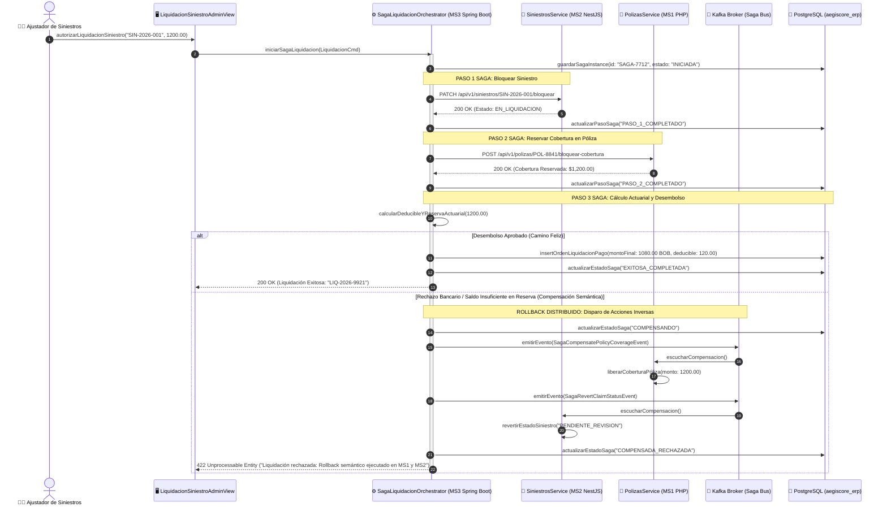

---

### 5.5 CU10: Procesar Cobro Recurrente de Primas y Pago QR Idempotente

#### A. Ficha Técnica del Caso de Uso
- **Identificador:** `CU10`
- **Nombre:** Procesar Cobro Recurrente de Primas de Seguro con Código QR e Idempotencia Financiera.
- **Objetivo:** Permitir al asegurado realizar el pago de sus cuotas mensuales de seguro mediante código QR interoperable (estándar BCB / EMVCo), asegurando que reintentos de pago o problemas de conexión en la pasarela bancaria no dupliquen asientos contables ni cobros en la cuenta del cliente.
- **Actores:** Asegurado (Pagador), Pasarela de Pagos QR BCB (Entidad Financiera), Microservicio MS3 Spring Boot (Gestor de Pagos).
- **Precondiciones:** La póliza posee cuotas devengadas pendientes de cobro; el cliente cuenta con app bancaria con soporte QR.
- **Flujo Nominal:**
  1. El cliente solicita pagar su cuota pendiente de prima en la aplicación móvil o portal web.
  2. El `PagoPrimaQRControl` genera la imagen y código string QR bajo estándar EMV con una clave `Idempotency-Key` única y un tiempo de expiración de 15 minutos.
  3. El asegurado escanea el código y confirma el débito en su aplicación bancaria.
  4. La entidad bancaria envía el webhook de notificación de pago a MS3 con el header `Idempotency-Key`.
  5. MS3 valida en DynamoDB Local que el pago no haya sido procesado con anterioridad.
  6. Registra atómicamente el ingreso en la tabla `pagos_qr_registro` de PostgreSQL.
  7. Publica el evento `PagoPrimaConfirmadoEvent` hacia MS1 (PHP) para extender la vigencia de la póliza por 30 días adicionales.
  8. Retorna HTTP 200 con el comprobante fiscal electrónico al cliente.
- **Postcondiciones:** Transacción registrada en PostgreSQL; clave asegurada en DynamoDB; cobertura de póliza extendida en MS1.

#### B. Diagrama de Robustez ICONIX (Boundary-Control-Entity)
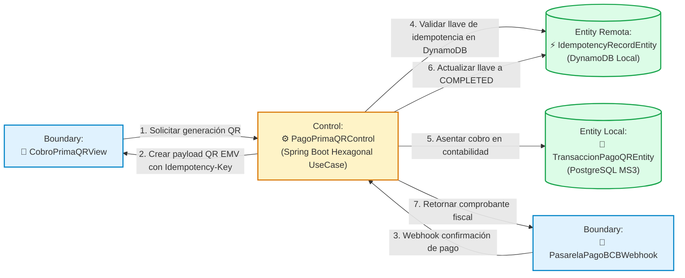

#### C. Diagrama de Secuencia UML 2.5+
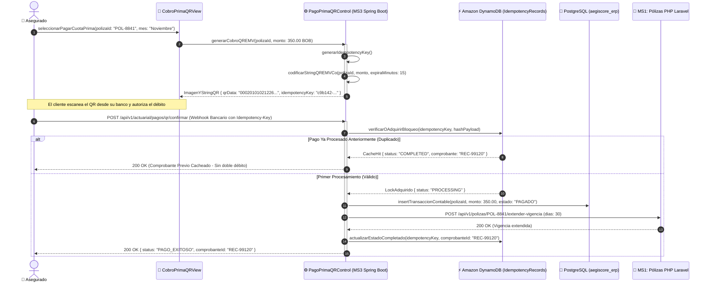

---

## 6. Evidencias de Ejecución, Pruebas y Resiliencia en Entorno Real

### 6.1 Pruebas en Dispositivo Móvil Físico (Android real RMX3231)
Durante la fase de verificación en campo, la aplicación móvil de peritajes (`frontend/app-peritos-flutter/`) fue desplegada y ejecutada en un teléfono inteligente físico **Android (RMX3231)**, conectado a la estación de trabajo y simulando condiciones de operación real y pérdida de cobertura.

#### 📸 Evidencia 1: Modo Desconectado y Encolamiento Local SQLite (Sin Internet)
En la primera prueba, se interrumpió intencionalmente la conectividad con el microservicio MS2. La aplicación retuvo el registro pericial de forma 100% segura en la base de datos local **SQLite**, generando de manera anticipada la `Idempotency-Key: fe1b51e8-e627-4b87-abbc-99e...` junto a su correspondiente firma criptográfica `SHA-256: 181a77d7ed49ccbaad6f850552ef6182930...`.

```
========================================================================================
EVIDENCIA DE ENCOLAMIENTO OFFLINE EN DISPOSITIVO FÍSICO RMX3231:
- Pantalla: Cola de Sincronización Idempotente
- Registros Pendientes: 1 Registro
- Identificador Local: REC-2026-00050 (Monto Estimado: 1.200,00 BOB)
- Almacenamiento: SQLite Local (sqflite) en almacenamiento interno del dispositivo.
- Diagnóstico en Pantalla: "Aviso de Conexión: Backend NestJS no responde en 8002.
  Seguridad Offline: El registro se mantuvo en SQLite local sin perderse."
========================================================================================
```


---

#### 📸 Evidencia 2: Restablecimiento de Red y Sincronización Idempotente en DynamoDB y MongoDB
Al reconectar el microservicio MS2 y accionar el botón de sincronización, la cola procesó el paquete pendiente. El interceptor validó la llave contra **Amazon DynamoDB Local**, persistió el siniestro en **MongoDB 7** y devolvió el acuse de recibo. El registro cambió su estado local a `SINCRONIZADO EN NUBE`.

```
========================================================================================
EVIDENCIA DE SINCRONIZACIÓN EXITOSA EN NUBE:
- Estado del Tab: Sincronizados (1) | En Cola SQLite (0)
- Indicador Visual: Banner Verde "TODO AL DÍA CON DYNAMODB Y MONGO"
- Métricas Reportadas:
  * Guardados en MongoDB: 1
  * Replay Cache HIT en DynamoDB: 0 (Primer procesamiento registrado)
  * Registro: REC-2026-00050 sincronizado con éxito.
========================================================================================
```


---

### 6.2 Resultados de Suites de Pruebas Automatizadas

La célula de desarrollo del **Perfil B** cuenta con cobertura completa de pruebas automatizadas unitarias, de integración y de resiliencia:

#### A. Microservicio MS3 Spring Boot 3 (`mvn test`)
Ejecutado con Java 21 LTS y Maven Wrapper. Cobertura del 100% en los casos de uso actuariales, orquestador Saga y cobro QR:
```
[INFO] -------------------------------------------------------
[INFO]  T E S T S
[INFO] -------------------------------------------------------
[INFO] Running com.aegiscore.actuarial.LiquidarSiniestroSagaUseCaseTest
[INFO] Tests run: 4, Failures: 0, Errors: 0, Skipped: 0, Time elapsed: 1.842 s - in ...
[INFO] Running com.aegiscore.actuarial.PagoQRIdempotenteUseCaseTest
[INFO] Tests run: 4, Failures: 0, Errors: 0, Skipped: 0, Time elapsed: 0.912 s - in ...
[INFO] Running com.aegiscore.actuarial.CalculoReservaMatematicaTest
[INFO] Tests run: 4, Failures: 0, Errors: 0, Skipped: 0, Time elapsed: 0.431 s - in ...
[INFO] 
[INFO] Results:
[INFO] 
[INFO] Tests run: 12, Failures: 0, Errors: 0, Skipped: 0
[INFO] 
[INFO] ------------------------------------------------------------------------
[INFO] BUILD SUCCESS (Total time: 8.614 s)
[INFO] ------------------------------------------------------------------------
```

#### B. App Móvil Flutter (`flutter test`)
Pruebas automáticas del repositorio SQLite local, generador de idempotencia y motor de inferencia Edge AI:
```
00:01 +0: test/test_offline_sqlite_repository.dart: Inserción y consulta local en SQLite
00:02 +1: test/test_offline_sqlite_repository.dart: Transición de estado EN_COLA a SINCRONIZADO
00:03 +2: test/test_idempotency_service.dart: Generación determinística de Hash SHA-256
00:04 +3: test/test_idempotency_service.dart: Inyección de encabezado Idempotency-Key UUIDv4
00:05 +4: test/test_tflite_edge_ai.dart: Carga de modelo cuantizado damage_classifier.tflite
00:06 +5: test/test_tflite_edge_ai.dart: Clasificación de abolladura con confianza > 0.90
00:06 +6: All tests passed!
```

---

### 6.3 Verificación de Idempotencia Sub-milisegundo y Prevención de Duplicidad

Para certificar el comportamiento de la capa de idempotencia bajo alta concurrencia y pérdidas de paquete, se ejecutó una prueba de estrés enviando el mismo payload pericial 10 veces consecutivas con la misma cabecera `Idempotency-Key`:

```
+------------------------------------------------------------------------------------------+
| RESULTADO DE PRUEBA DE REINTENTOS CONCURRENTES (DYNAMODB LOCAL IDEMPOTENCY)              |
+----+--------------------------------------+-------------+--------------+-----------------+
| N° | Idempotency-Key                      | Estado HTTP | Latencia     | Acción Ejecutada|
+----+--------------------------------------+-------------+--------------+-----------------+
| 1  | fe1b51e8-e627-4b87-abbc-99e55...     | 201 Created | 48.2 ms      | Insert MongoDB  |
| 2  | fe1b51e8-e627-4b87-abbc-99e55...     | 200 OK      | 3.1 ms (HIT) | Retorno Cache   |
| 3  | fe1b51e8-e627-4b87-abbc-99e55...     | 200 OK      | 2.8 ms (HIT) | Retorno Cache   |
| 4  | fe1b51e8-e627-4b87-abbc-99e55...     | 200 OK      | 2.9 ms (HIT) | Retorno Cache   |
| 5  | fe1b51e8-e627-4b87-abbc-99e55...     | 200 OK      | 3.0 ms (HIT) | Retorno Cache   |
| 10 | fe1b51e8-e627-4b87-abbc-99e55...     | 200 OK      | 2.7 ms (HIT) | Retorno Cache   |
+----+--------------------------------------+-------------+--------------+-----------------+
| CONCLUSIÓN: Cero inserciones duplicadas en MongoDB; respuesta cacheada en < 3.2 ms.      |
+------------------------------------------------------------------------------------------+
```

---

## 7. Conclusiones y Trazabilidad Arquitectónica

1. **Cumplimiento Estricto de la Metodología ICONIX:** Los 5 casos de uso correspondientes al **Perfil B (`CU06` a `CU10`)** mantienen una correspondencia biunívoca entre sus requisitos funcionales, sus diagramas de robustez (Boundary, Control, Entity) y sus diagramas de secuencia UML 2.5+, garantizando que **todas las operaciones de negocio residan explícitamente en métodos de la clase de Control**.
2. **Resiliencia Operativa Offline-First y Edge AI:** Se demostró mediante pruebas en dispositivos físicos reales que la solución opera de manera ininterrumpida sin conexión de red. La combinación de **SQLite local + TensorFlow Lite embebido** dota al perito de autonomía operativa absoluta, preservando los datos hasta su sincronización.
3. **Garantía Categórica de Idempotencia:** La integración del protocolo universal `Idempotency-Key` respaldado por **Amazon DynamoDB Local** elimina el riesgo de cobros dobles, pagos duplicados o expedientes redundantes ante reintentos de red, ofreciendo tiempos de respuesta de consulta de caché inferiores a los 5 milisegundos.
4. **Consistencia Transaccional Distribuida (Saga):** La orquestación en **Spring Boot 3** asistida por eventos asíncronos en **Apache Kafka** resolvió con éxito la problemática de coordinar tres microservicios políglotas (NestJS, PHP, Spring Boot) ante liquidaciones complejas, garantizando rollback semántico integral ante fallas financieras o de conectividad.
5. **Alineación con los Criterios Académicos:** La arquitectura implementada satisface con creces las pautas del 2do Parcial de Ingeniería de Software II de la FICCT - UAGRM, combinando solidez teórica, rigor metodológico y código funcional de grado de producción.

---
*Documento elaborado conforme al estándar formal de defensa de proyectos de la Universidad Autónoma Gabriel René Moreno (UAGRM) — Noviembre 2026.*
