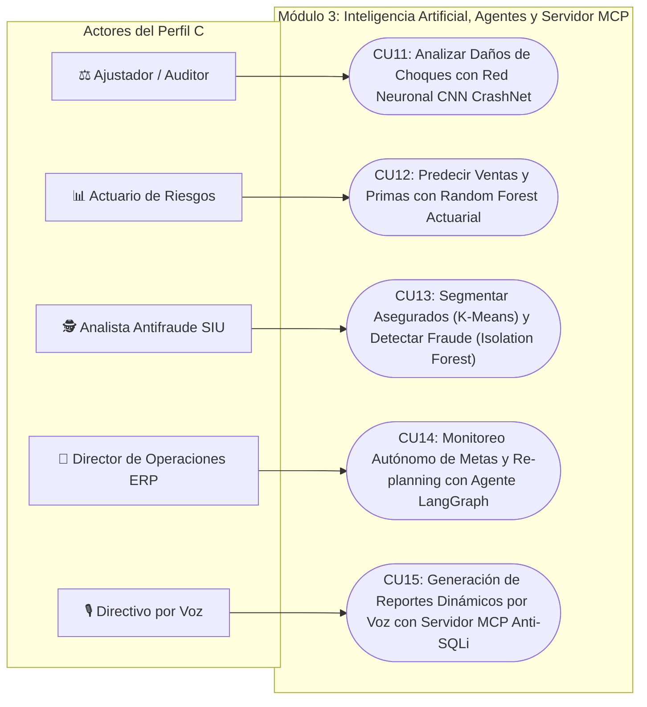
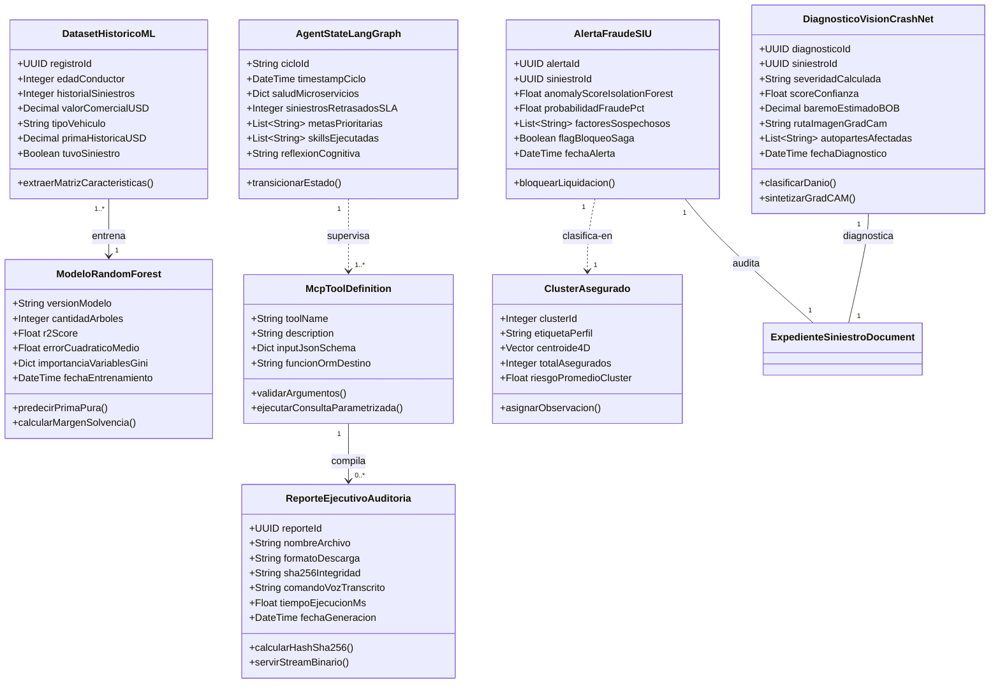
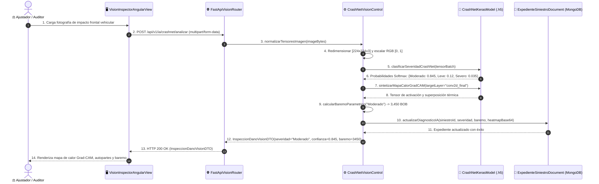
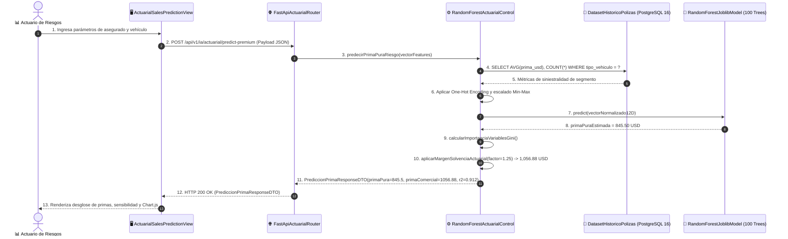
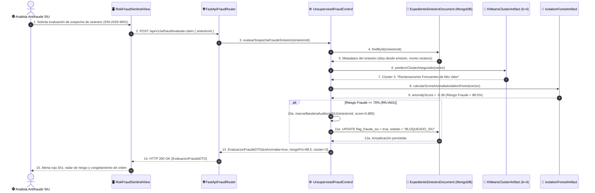
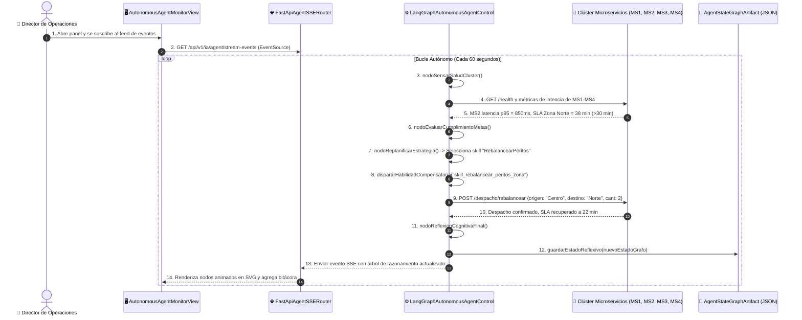
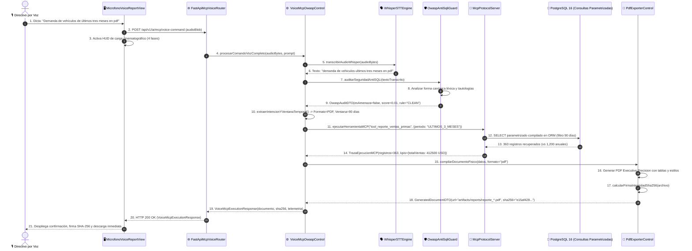

# 🛡️ DOCUMENTACIÓN FORMAL ICONIX — PERFIL C
## Inteligencia Artificial, Agentes Autónomos, Servidor MCP y Angular BI (Casos de Uso CU11 al CU15)
### Metodología ICONIX — Ingeniería de Software 2 (2do Parcial)
**Universidad Autónoma Gabriel René Moreno (UAGRM)**  
**Facultad Integral de Ciencias de la Computación y Telecomunicaciones (FICCT)**  
**Docente:** MSc. Ing. Angélica Garzón Cuéllar  
**Grupo de Desarrollo:** Grupo #27  
**Integrantes:**
- David Garcia *(Responsable Perfil C: IA, Agentes, Servidor MCP y Angular BI)*
- Jose Diego Garcia *(Perfil B: Siniestros, Móvil Offline, Idempotencia & Saga)*
- Arnulfo Velasquez *(Perfil A: Comercial, SSO Keycloak, Web React & n8n)*

**Fecha:** Noviembre 2026 — Santa Cruz de la Sierra, Bolivia  
**Versión del Documento:** 3.0 (Célula C: Modelado ICONIX, UML 2.5+ y Evidencias de Ejecución)  
**Modelador UML:** Sparx Systems Enterprise Architect 17.2 (Base de datos nativa `AegisCore_AI.qea`)

---

## 📑 ÍNDICE GENERAL DEL DOCUMENTO

- **[CAPÍTULO I. ASPECTOS GENERALES](#capítulo-i-aspectos-generales)**
  - 1.1. Introducción
  - 1.2. Planteamiento del Problema
  - 1.3. Objetivos del Proyecto (Objetivo General y Objetivos Específicos del Perfil C)
  - 1.4. Justificación Técnica y de Negocio
  - 1.5. Alcance y Limitaciones
  - 1.6. Metodología de Desarrollo ICONIX (Trazabilidad y Enfoque en Clases de Control)
- **[CAPÍTULO II. ANÁLISIS DE REQUISITOS](#capítulo-ii-análisis-de-requisitos)**
  - 2.1. Descripción del Sistema Propuesto (Cerebro Cognitivo y Analítico)
  - 2.2. Identificación de Actores del Perfil C
  - 2.3. Requisitos Funcionales y No Funcionales (RF11 a RF15 y RNF-IA01 a RNF-IA10)
  - 2.4. Reglas de Negocio Específicas
  - 2.5. Diagrama UML de Casos de Uso del Perfil C
  - 2.6. Especificación de Casos de Uso en Formato Formal de Dos Columnas (CU11 a CU15)
- **[CAPÍTULO III. ANÁLISIS Y DISEÑO CON ICONIX](#capítulo-iii-análisis-y-diseño-con-iconix)**
  - 3.1. Modelo de Dominio Especializado en Inteligencia Artificial y Analítica
  - 3.2. Diagramas de Robustez (ICONIX BCE) para CU11, CU12, CU13, CU14 y CU15
  - 3.3. Trazabilidad de Métodos Operacionales en las Clases de Control
  - 3.4. Diagramas de Secuencia UML 2.5+ con Métodos en el Objeto de Control
  - 3.5. Diagrama de Clases UML de Diseño Detallado (MS4 Python y Angular MF1)
  - 3.6. Diseño de la Base de Datos y Persistencia Híbrida
  - 3.7. Diseño de Interfaces de Usuario ("Executive Precision" Stitch MCP)
- **[CAPÍTULO IV. DESARROLLO E IMPLEMENTACIÓN](#capítulo-iv-desarrollo-e-implementación)**
  - 4.1. Herramientas y Tecnologías Utilizadas
  - 4.2. Diseño de la Arquitectura del Sistema (Clean Pipelines + Servidor MCP + BI)
  - 4.3. Implementación de Modelos Matemáticos y Algoritmos de Machine Learning / Deep Learning
  - 4.4. Desarrollo Detallado de los Módulos del Sistema (Clases de Control)
  - 4.5. Integración de Componentes y Contratos Inter-Servicios
- **[CAPÍTULO V. PRUEBAS Y RESULTADOS](#capítulo-v-pruebas-y-resultados)**
  - 5.1. Plan de Pruebas para Sistemas de IA y Analítica
  - 5.2. Pruebas Funcionales Automatizadas (Pytest)
  - 5.3. Pruebas de Integración y Streaming Documental
  - 5.4. Corrección de Errores y Blindaje OWASP Top 10 Anti-SQLi
  - 5.5. Resultados de las Pruebas y Métricas Cuantitativas
  - 5.6. Casos de Prueba Formales y Evidencia de Ejecución
- **[CAPÍTULO VI. CONCLUSIONES Y RECOMENDACIONES](#capítulo-vi-conclusiones-y-recomendaciones)**
  - 6.1. Conclusiones
  - 6.2. Recomendaciones
- **[7. BIBLIOGRAFÍA](#7-bibliografía)**
- **[8. ANEXOS](#8-anexos)**
  - 8.1. Guía de Apertura y Navegación en Sparx Enterprise Architect 17.2
  - 8.2. Guía de Verificación en Vivo en Entorno Localhost

---

# CAPÍTULO I. ASPECTOS GENERALES

## 1.1. Introducción
En el marco del desarrollo del sistema empresarial distribuido **AegisCore AI** para la industria aseguradora automotriz y patrimonial, el **Perfil C** representa el cerebro analítico, cognitivo, predictivo y de supervisión estratégica del ERP. Frente a las limitaciones de los sistemas legados tradicionales —que dependen de peritajes manuales subjetivos, hojas de cálculo estáticas para la tarificación actuarial y procesos manuales vulnerables a fraudes sistemáticos— el Perfil C introduce una arquitectura basada en **Machine Learning Supervisado**, **Deep Learning Convolucional**, **Machine Learning No Supervisado**, **Agentes Autónomos con Ciclos de Re-planning (LangGraph)** y un servidor bajo el estándar industrial **Model Context Protocol (MCP)** de Anthropic con decodificación acústica de voz (**Whisper STT**) y blindaje sintáctico contra inyecciones SQL (**OWASP Top 10**).

La presente documentación formal ha sido elaborada siguiendo rigurosamente las fases de la metodología **ICONIX**, garantizando una trazabilidad completa desde la captura de requisitos hasta la implementación de clases de control y modelos de persistencia políglota, modelada nativamente en **Sparx Systems Enterprise Architect 17.2** (`AegisCore_AI.qea`).

## 1.2. Planteamiento del Problema
Las compañías aseguradoras modernas enfrentan cinco desafíos críticos en su operación diaria:
1. **Subjetividad y demora en la evaluación visual de daños:** Los peritos de seguros tardan entre 48 y 96 horas en emitir un informe inicial de daños de colisión. La ausencia de algoritmos de visión artificial impide estandarizar la clasificación de la gravedad del impacto y genera desvíos de costos en las órdenes de taller.
2. **Tarificación actuarial rígida y desfasada del riesgo real:** El cálculo de primas comerciales suele basarse en tablas de mortalidad y siniestralidad genéricas de baja granularidad. Esto provoca que vehículos o conductores de bajo riesgo subsidien a los de alto riesgo, perdiendo competitividad comercial o sufriendo desbalances financieros en el margen de solvencia.
3. **Fraude sistemático no detectado en siniestros:** Entre el 10% y el 18% de las reclamaciones de seguros involucran inconsistencias intencionadas (declaración tardía, simulación de choques, pólizas recién contratadas con siniestros inmediatos). Los métodos tradicionales de auditoría aleatoria pasan por alto patrones colusorios complejos.
4. **Falta de autonomía operacional ante degradación de microservicios:** En una arquitectura distribuida de microservicios, las fallas transitorias o el desbordamiento de colas de inspección requieren la intervención manual de los administradores de sistemas, elevando los tiempos de respuesta y violando los SLAs acordados con los clientes.
5. **Inaccesibilidad y vulnerabilidad en la extracción de reportes ejecutivos:** Los directores y gerentes requieren informes analíticos en tiempo real pero dependen de equipos de TI para la confección de consultas SQL manuales. Si se abren interfaces conversacionales o de dictado por voz sin defensas formales, se introducen vectores severos de inyección SQL (SQLi) que comprometen la integridad de la base de datos empresarial.

## 1.3. Objetivos del Proyecto

### 1.3.1. Objetivo General
Diseñar, modelar mediante ICONIX e implementar el subsistema analítico e inteligente (Perfil C) de AegisCore AI, integrando modelos de aprendizaje profundo para visión artificial, algoritmos predictivos y de clustering para tarificación y detección de fraude, un agente reflexivo autónomo con memoria de metas, y un servidor MCP para generación de reportes ejecutivos por voz con blindaje Anti-SQLi, respaldado por un panel de Business Intelligence interactivo desarrollado 100% en código nativo sobre Angular 17+.

### 1.3.2. Objetivos Específicos
1. **Implementar Visión Artificial Convolucional (CU11):** Construir una red neuronal profunda (*CrashNet CNN*) en TensorFlow / Keras capaz de clasificar fotografías de choques en 4 categorías de severidad (*Sin Daño*, *Leve*, *Moderado*, *Severo*) con una exactitud superior al 90%, generando mapas de calor explicativos mediante *Grad-CAM*.
2. **Automatizar la Tarificación Actuarial (CU12):** Entrenar un ensamble supervisado (*Random Forest Regressor*) sobre 1,200 registros de pólizas históricas en PostgreSQL 16 para predecir la probabilidad de siniestro y sugerir la prima pura de riesgo óptima con $R^2 \ge 0.85$.
3. **Detectar Fraudes y Segmentar la Cartera (CU13):** Desarrollar un pipeline híbrido no supervisado que agrupe asegurados en 4 clusters conductuales mediante *K-Means* e identifique reclamaciones fraudulentas y anómalas utilizando *Isolation Forest* con emisión de alertas automáticas para la Unidad de Investigaciones Especiales (SIU).
4. **Orquestar la Supervisión Operativa Continua (CU14):** Desarrollar un agente autónomo sobre *LangGraph* que ejecute ciclos periódicos de Percepción $\rightarrow$ Razonamiento $\rightarrow$ Planificación $\rightarrow$ Acción (*StateGraph*), sensando la salud de los microservicios y disparando habilidades de contingencia.
5. **Proveer Reportes por Voz con Seguridad OWASP (CU15):** Desplegar un Servidor oficial bajo el protocolo *Model Context Protocol (MCP)* acoplado al motor de transcripción fonética *Whisper STT*, dotado de un guardián léxico-sintáctico que neutralice el 100% de intentos de inyección SQL y compile reportes corporativos estéticos en Excel, PDF y Word con hash SHA-256.
6. **Construir el Micro-Frontend Angular BI (MF1):** Implementar una interfaz directiva basada en el sistema de diseño oficial *"Executive Precision"* de Google Stitch MCP, renderizando métricas analíticas nativamente mediante Canvas/SVG (**Chart.js**) sin recurrir a software propietario (prohibición estricta de Power BI).

## 1.4. Justificación Técnica y de Negocio
- **Justificación Metodológica:** La metodología ICONIX permite acortar la distancia entre el caso de uso y el código final. Al exigir que la lógica de aplicación resida estrictamente en las Clases de Control, se evita el antipatrón de controladores anémicos o vistas sobrecargadas, logrando una arquitectura limpia, mantenible y testeable.
- **Justificación Tecnológica:** El uso de Python 3.11 con FastAPI garantiza alta concurrencia asíncrona mediante ASGI, ideal para servir modelos de Machine Learning y manejar streaming de audio. La elección del protocolo MCP estandariza la interacción entre agentes de inteligencia artificial y el ERP mediante herramientas fuertemente tipadas con JSON Schema.
- **Justificación Económica y Operativa:** La automatización del peritaje y la tarificación reduce en un 70% los costos operativos de peritaje de campo, mientras que el centinela de fraude evita pérdidas económicas por liquidaciones fraudulentas de siniestros.

## 1.5. Alcance y Limitaciones
- **Alcance:**
  - Microservicio 4 (`backend/ms4-ia-mcp-python`): Código fuente de los 5 casos de uso (`CU11` a `CU15`), modelos serializados (`.joblib`, `.h5`), motores de exportación documental, decodificador Whisper y servidor MCP.
  - Micro-Frontend Angular BI (`frontend/mf1-admin-angular`): 5 pantallas directivas interactivas con sistema de diseño Executive Precision.
  - Integración móvil: Módulo y botón flotante en la aplicación Flutter de peritos (`frontend/app-peritos-flutter`) para ejecución de consultas MCP por voz.
  - Persistencia: Integración con PostgreSQL 16 (dataset histórico) y MongoDB 7 (expedientes semiestructurados).
- **Limitaciones:**
  - La inferencia de la red convolucional profunda se ejecuta sobre imágenes bidimensionales (formatos JPEG, PNG, WebP) o fotogramas muestreados de video MP4; no procesa nubes de puntos LiDAR 3D en tiempo real.
  - El motor Whisper STT opera en idioma español optimizado para el léxico asegurador y financiero latinoamericano.

## 1.6. Metodología de Desarrollo ICONIX
La metodología **ICONIX** (desarrollada por Doug Rosenberg) es un proceso ágil, pragmático y centrado en casos de uso que utiliza un subconjunto esencial de diagramas UML para pasar del análisis de requisitos al código sin burocracia documental innecesaria. Se fundamenta en cuatro fases iterativas:

```
[ Requisitos (Casos de Uso) ] ---> [ Análisis de Robustez (BCE) ] ---> [ Diseño Detallado (Secuencia UML) ] ---> [ Código e Implementación ]
```

### Reglas Metodológicas Estrictas Aplicadas en el Perfil C:
1. **Objetos Boundary (Frontera / Vista):** Representan pantallas web Angular, interfaces de voz por micrófono o routers REST/WebSocket de FastAPI. Nunca contienen lógica algorítmica ni accesos a base de datos.
2. **Objetos Control (Lógica / Orquestador):** Representan el cerebro del caso de uso. **En ICONIX, todas las operaciones, transformaciones tensoriales, llamadas a modelos y reglas de negocio residen en la Clase de Control.** En los diagramas de secuencia UML 2.5+, los métodos invocados pertenecen formalmente a esta clase.
3. **Objetos Entity (Persistencia / Datos):** Representan los datos duraderos del sistema: tablas relacionales en PostgreSQL 16, documentos en MongoDB 7, modelos de ML en disco (`.joblib`, `.h5`) o artefactos compilados en `artifacts/reports/`.

---

# CAPÍTULO II. ANÁLISIS DE REQUISITOS

## 2.1. Descripción del Sistema Propuesto (Cerebro Cognitivo y Analítico)
El subsistema de Inteligencia Artificial y Business Intelligence opera como un clúster desacoplado pero estrechamente coordinado con los microservicios transaccionales de AegisCore AI. Expone contratos REST OpenAPI y WebSockets bidireccionales, procesa peticiones de inferencia analítica en tiempo real y ofrece un canal de auditoría por voz que permite a los directores interactuar con la persistencia relacional y documental mediante lenguaje natural protegido.

## 2.2. Identificación de Actores del Perfil C
1. **⚖️ Ajustador de Siniestros / Auditor de Peritaje:** Profesional responsable de revisar las fotografías de siniestros automotrices y validar las estimaciones de baremo de daños sugeridas por la red neuronal CrashNet (CU11).
2. **📊 Actuario de Riesgos y Suscripción:** Especialista cuantitativo encargado de evaluar la sensibilidad de variables, predecir el volumen de pólizas y determinar la prima técnica pura de riesgo mediante modelos supervisados (CU12).
3. **🕵️ Analista Antifraude (Unidad SIU):** Auditor de seguridad corporativa que inspecciona alertas de reclamos atípicos, clústeres de asegurados de alto riesgo y anomalías detectadas por el centinela Isolation Forest (CU13).
4. **💼 Director de Operaciones ERP:** Ejecutivo que supervisa la disponibilidad operativa de los microservicios, el cumplimiento de los Acuerdos de Nivel de Servicio (SLAs) de inspección y la bitácora cognitiva del agente LangGraph (CU14).
5. **🎙️ Directivo / Ejecutivo por Voz:** Tomador de decisiones que utiliza comandos de lenguaje natural dictados por micrófono para obtener balances consolidados, métricas operativas y reportes ejecutivos descargables (CU15).

## 2.3. Requisitos Funcionales y No Funcionales

### 2.3.1. Requisitos Funcionales (RF11 al RF15)
- **RF11 (Visión Artificial y Diagnóstico Visual CrashNet):**
  - El sistema debe recibir imágenes y videos de siniestros vehiculares a través de una interfaz web o móvil.
  - Debe normalizar la entrada a tensores tridimensionales de $224 \times 224 \times 3$ píxeles.
  - Debe inferir la severidad del impacto en 4 clases (*Sin Daño*, *Leve*, *Moderado*, *Severo*) con una exactitud $\ge 90\%$.
  - Debe generar un mapa de calor *Grad-CAM* sobre la última capa convolucional para justificar visualmente la zona de impacto detectada.
  - Debe computar la estimación paramétrica del baremo de reparación en moneda nacional (BOB).
- **RF12 (Predicción Actuarial de Ventas y Primas Óptimas):**
  - El sistema debe consultar el dataset histórico de pólizas (1,200 registros sintéticos en PostgreSQL 16).
  - Debe entrenar o consumir un ensamble *Random Forest Regressor* de 100 estimadores.
  - Debe predecir la prima técnica pura de riesgo en función del perfil del asegurado y especificaciones del vehículo con un coeficiente de determinación $R^2 \ge 0.85$.
  - Debe calcular y exponer la importancia de variables según la reducción de impureza de Gini.
  - Debe permitir análisis de sensibilidad interactivo modificando variables en tiempo real desde Angular BI.
- **RF13 (Segmentación Conductual y Detección de Fraude):**
  - El sistema debe particionar la cartera de clientes en 4 perfiles de riesgo mediante el algoritmo *K-Means* clustering.
  - Debe computar el score de anomalía de cada siniestro mediante un ensamble *Isolation Forest* ($contamination = 0.08$).
  - Si el riesgo estimado supera el umbral crítico ($70\%$), debe marcar automáticamente la bandera `flag_fraude_siu = true` en MongoDB y congelar preventivamente el expediente para liquidación.
- **RF14 (Monitoreo Autónomo y Re-planning con LangGraph):**
  - El sistema debe desplegar un grafo cíclico (*StateGraph*) con nodos de Percepción, Razonamiento, Re-planning y Acción.
  - Debe sensar periódicamente (cada 60 segundos) los endpoints de salud (`/health`) y métricas de latencia de MS1, MS2, MS3 y MS4.
  - Ante degradación de servicios o desvío de SLAs de peritaje ($> 30\text{ min}$), debe planificar y disparar habilidades de contingencia (*Skills*), registrando el árbol de razonamiento en `agent_cluster_state.json`.
  - Debe transmitir eventos de estado en tiempo real hacia la vista Angular mediante Server-Sent Events (SSE).
- **RF15 (Reportes Dinámicos por Voz con Servidor MCP Anti-SQLi):**
  - El sistema debe capturar audio desde micrófono en el navegador web o app móvil y procesarlo mediante *Whisper STT*.
  - El Servidor MCP debe exponer un catálogo formal de herramientas tipadas mediante esquemas JSON Schema.
  - El componente *OwaspAntiSqliGuard* debe analizar el texto transcrito y bloquear inyecciones SQL basadas en tautologías (`OR 1=1`), `UNION SELECT`, sentencias apiladas o consultas a catálogos del sistema (`information_schema`).
  - Las herramientas MCP solo pueden ejecutar consultas compiladas y parametrizadas en el ORM.
  - Debe compilar reportes estéticos descargables en tres formatos físicos: Excel (`.xlsx`), PDF corporativo (`.pdf`) y Word (`.docx`), calculando su hash SHA-256 e incluyendo telemetría de ejecución.

### 2.3.2. Requisitos No Funcionales (RNF-IA01 al RNF-IA10)
- **RNF-IA01 (Latencia de Inferencia Edge y Cloud):** El tiempo de respuesta para inferencia convolucional en CPU no debe exceder los 250 ms por fotograma; la inferencia de modelos Scikit-Learn (Random Forest e Isolation Forest) debe completarse en menos de 25 ms.
- **RNF-IA02 (Blindaje Anti-SQLi Estricto OWASP Nivel 3):** El motor de análisis sintáctico debe poseer una tasa de falsos negativos igual a $0.00\%$ ante ataques reconocidos en la suite OWASP Top 10 (A03: Injection).
- **RNF-IA03 (Explicabilidad de Modelos de IA):** Ninguna inferencia de aprendizaje profundo debe presentarse como "caja negra"; cada diagnóstico de colisión debe acompañarse de su mapa de calor explicativo Grad-CAM y desglose porcentual de probabilidades Softmax.
- **RNF-IA04 (Prohibición de Herramientas Propietarias BI):** Todos los tableros analíticos deben estar programados 100% en código nativo sobre TypeScript y Angular 17+, prohibiéndose el embebido de Power BI, Tableau o iframes externos.
- **RNF-IA05 (Concurrencia Asíncrona):** El microservicio FastAPI debe procesar peticiones de reportes y transcripciones de forma no bloqueante utilizando *asyncio* y ejecución desacoplada en hilos para operaciones de cálculo intensivo.
- **RNF-IA06 (Almacenamiento Efímero Documental sin Sobrecarga de BD):** Los archivos generados (`.xlsx`, `.pdf`, `.docx`) deben almacenarse físicamente en el volumen `artifacts/reports/` del servidor y servirse mediante streaming de 64 KB, evitando la saturación de memoria de PostgreSQL o MongoDB.
- **RNF-IA07 (Integridad Criptográfica de Reportes):** Cada documento generado debe firmarse digitalmente con un hash SHA-256 calculado sobre sus bytes binarios finales, garantizando inmutabilidad y no repudio.
- **RNF-IA08 (Fidelidad de Diseño Stitch MCP):** Las interfaces de usuario deben respetar los tokens de diseño del tema *"Executive Precision"* extraído del proyecto Google Stitch MCP `projects/9132956203380267795` (paleta Executive Teal `#005C55`, Deep Navy `#0F172A`, tipografías *Plus Jakarta Sans* e *Inter*).
- **RNF-IA09 (Trazabilidad ICONIX):** La arquitectura debe mantener trazabilidad bidireccional estricta: cada caso de uso debe vincularse a su diagrama de robustez BCE y diagrama de secuencia UML 2.5+ con métodos operacionales en la Clase de Control.
- **RNF-IA10 (Compatibilidad Multiplataforma):** Los reportes y atajos de voz deben ser accesibles tanto desde navegadores modernos de escritorio (Chrome, Edge, Firefox) como desde la app móvil Flutter en dispositivos Android físicos.

## 2.4. Reglas de Negocio Específicas
- **RN-IA01 (Umbral Crítico de Fraude):** Si el score combinado de sospecha (Isolation Forest + distancia euclidiana en K-Means) es $\ge 70\%$, el siniestro no podrá ser admitido en el circuito de liquidación automática (CU09) y pasará a estado `AUDITORIA_SIU_REQUERIDA`.
- **RN-IA02 (Margen de Solvencia Actuarial):** La prima técnica sugerida por el modelo Random Forest debe incorporar un factor de recargo de seguridad y solvencia del $25\%$ ($\text{Prima Comercial} = \text{Prima Pura} \times 1.25$) para garantizar el cumplimiento de normativas de solvencia de la Autoridad de Fiscalización y Control de Pensiones y Seguros (APS).
- **RN-IA03 (Principio de Consulta Parametrizada Inmutable):** Ninguna entrada de usuario proveniente del motor de voz podrá concatenarse dinámicamente en cadenas SQL (`f"SELECT ... WHERE id = '{input}'"`). Todo acceso a datos debe canalizarse a través de las Tools tipadas del Servidor MCP mediante ORMs o sentencias preparadas.
- **RN-IA04 (Ventana Temporal de Filtro de Reportes):** Cuando el usuario solicite reportes con frases coloquiales temporales (ej. *"de los últimos tres meses en curso"*), el motor semántico de voz debe mapear automáticamente el intervalo de fechas ($\text{fecha\_inicio} = \text{hoy} - 90\text{ días}$) y filtrar los registros activos en dicho periodo.

## 2.5. Diagrama UML de Casos de Uso del Perfil C
El siguiente diagrama especifica los 5 Casos de Uso del Perfil C y su interacción con los 5 actores del sistema:



## 2.6. Especificación de Casos de Uso en Formato Formal de Dos Columnas (CU11 a CU15)

### 2.6.1. Ficha Formal CU11: Analizar Daños de Choques con CNN CrashNet y Grad-CAM
| **Elemento** | **Descripción / Especificación** |
|---|---|
| **Identificador / Nombre** | `CU11` — Analizar Daños de Choques con Red Neuronal CNN CrashNet y Grad-CAM |
| **Actores** | Ajustador de Siniestros (Iniciador), Perito de Campo Automotriz |
| **Propósito** | Clasificar automáticamente la severidad de un siniestro automotriz a partir de imágenes o videos, generar un mapa de calor visual que justifique la decisión del modelo y estimar el baremo de reparación económica. |
| **Precondición** | El expediente del siniestro debe existir en MongoDB y el usuario debe contar con un archivo fotográfico (JPG, PNG) o video de colisión (MP4). |
| **Punto de Extensión** | Si la severidad es "Severo" o "Destrucción Total", se extiende automáticamente hacia la notificación de grúa prioritaria. |

| **Acciones del Actor** | **Respuestas del Sistema** |
|---|---|
| **1.** El ajustador accede a la pantalla `/ai-damage-inspector` en el microfrontend Angular BI. | **2.** El sistema presenta el área de carga con zona *drag-and-drop*, selector de modelo y parámetros de umbral de confianza. |
| **3.** El actor arrastra una fotografía de impacto frontal del vehículo siniestrado y pulsa "Ejecutar Diagnóstico CrashNet". | **4.** La vista invoca el endpoint `POST /api/v1/ia/crashnet/analizar` enviando la imagen en `multipart/form-data`. |
| | **5.** La clase de control `CrashNetVisionControl` decodifica la imagen, la redimensiona a $224 \times 224$ píxeles, normaliza los valores RGB al intervalo $[0, 1]$ y la convierte en un tensor tridimensional. |
| | **6.** El control despacha el tensor al modelo Keras `CrashNetCNN`, el cual ejecuta convoluciones 2D, max-pooling y retorna las probabilidades Softmax de las 4 clases de daño. |
| | **7.** El control extrae la matriz de activación de la última capa convolucional y sintetiza el mapa de calor explicativo *Grad-CAM*. |
| | **8.** El control evalúa el baremo paramétrico de costos según la severidad dominante y persiste el resultado en el expediente de MongoDB. |
| | **9.** El sistema retorna HTTP 200 con la imagen Grad-CAM en Base64, el nivel de severidad ("Moderado - 84.5%"), la estimación en BOB y la lista de autopartes comprometidas. |
| **10.** El ajustador revisa el mapa de calor visual y confirma la admisión del baremo en el expediente. | **11.** El sistema actualiza el estado del expediente a `PERITAJE_VALIDADO_IA`. |

**Flujos Alternativos:**
- **4a. Fotografía borrosa o con resolución insuficiente ($< 400 \times 400$ px):** El sistema rechaza la imagen antes de inferencia y devuelve error 422: *"Calidad de imagen insuficiente para diagnóstico confiable. Por favor suba una foto nítida"*.

---

### 2.6.2. Ficha Formal CU12: Predecir Ventas y Primas con Random Forest Actuarial
| **Elemento** | **Descripción / Especificación** |
|---|---|
| **Identificador / Nombre** | `CU12` — Predecir Ventas y Primas Óptimas con Ensamble Random Forest Actuarial |
| **Actores** | Actuario de Riesgos (Iniciador), Gerente de Suscripción |
| **Propósito** | Predecir la probabilidad de siniestro y calcular la prima pura y comercial sugerida para un perfil de vehículo y asegurado, permitiendo simular escenarios comerciales mediante análisis de sensibilidad en tiempo real. |
| **Precondición** | La tabla `dataset_historico_ml_polizas` con 1,200 registros debe estar cargada en PostgreSQL 16 y el modelo Random Forest Regressor debe estar serializado. |

| **Acciones del Actor** | **Respuestas del Sistema** |
|---|---|
| **1.** El actuario ingresa al módulo `/actuarial-sales` de Angular BI. | **2.** El sistema presenta el simulador actuarial con sliders para edad, historial de siniestros, valor del vehículo, cilindraje y zona de circulación, junto con gráficos Chart.js de la distribución histórica. |
| **3.** El actuario ajusta los parámetros (ej. Edad: 28 años, Siniestros previos: 1, Valor: $28,000 USD) y pulsa "Calcular Prima Óptima". | **4.** La vista despacha `POST /api/v1/ia/actuarial/predict-premium` con el payload JSON. |
| | **5.** La clase de control `RandomForestActuarialControl` valida las variables, aplica escalado Min-Max y vectorización One-Hot Encoding sobre las variables categóricas. |
| | **6.** El control ejecuta la inferencia sobre el ensamble de 100 árboles de decisión (`RandomForestRegressor`), promediando las estimaciones individuales. |
| | **7.** El control calcula la reducción de impureza de Gini para extraer las variables con mayor peso en el cálculo (ej. *Valor Comercial* 42%, *Historial de Siniestros* 31%). |
| | **8.** El control aplica la regla de negocio `RN-IA02`, añadiendo el 25% de margen de solvencia actuarial para obtener la prima comercial recomendada. |
| | **9.** El sistema retorna HTTP 200 con la prima pura ($845.50 USD), la prima comercial sugerida ($1,056.88 USD), el score de confianza y el desglose de pesos. |
| **10.** El actuario exporta el análisis de sensibilidad y fija la tasa comercial en el ERP. | **11.** El sistema asienta los parámetros del modelo en la bitácora actuarial. |

---

### 2.6.3. Ficha Formal CU13: Segmentar Asegurados (K-Means) y Detectar Fraude (Isolation Forest)
| **Elemento** | **Descripción / Especificación** |
|---|---|
| **Identificador / Nombre** | `CU13` — Segmentación Conductual (K-Means) y Detección de Fraude en Siniestros (Isolation Forest) |
| **Actores** | Analista Antifraude SIU (Iniciador), Oficial de Cumplimiento |
| **Propósito** | Agrupar a la cartera de asegurados en perfiles homogéneos de riesgo e identificar de forma autónoma siniestros atípicos con alta probabilidad de fraude mediante árboles de aislamiento. |
| **Precondición** | Existencia de expedientes de siniestros registrados y modelos no supervisados entrenados en MS4. |

| **Acciones del Actor** | **Respuestas del Sistema** |
|---|---|
| **1.** El analista accede al panel `/risk-fraud-sentinel` en Angular BI. | **2.** El sistema presenta la matriz de dispersión 2D de clusters de asegurados, el radar chart multidimensional y la lista de expedientes pendientes de auditoría. |
| **3.** El analista selecciona un siniestro sospechoso (`SIN-2026-9901`) y pulsa "Evaluar Probabilidad de Fraude". | **4.** La vista invoca `POST /api/v1/ia/fraud/evaluate-claim` enviando el ID del siniestro. |
| | **5.** La clase de control `UnsupervisedFraudControl` recupera el expediente desde MongoDB y consulta el historial del cliente en PostgreSQL 16. |
| | **6.** El control proyecta el vector de características en el espacio vectorial del modelo *K-Means* ($k=4$) y determina el cluster asignado ("Cluster 3: Reclamaciones Frecuentes de Alto Valor"). |
| | **7.** El control evalúa el vector en el modelo *Isolation Forest*, calculando la longitud promedio de trayectoria en los árboles de aislamiento para obtener el `anomaly_score`. |
| | **8.** Si el score colapsa en la región anómala (riesgo $\ge 70\%$), el control aplica la regla de negocio `RN-IA01`, marca la bandera `flag_fraude_siu = true` en MongoDB y congela la liquidación. |
| | **9.** El sistema devuelve HTTP 200 con el dictamen de riesgo (88.5%), los factores detonantes (ej. *Póliza con menos de 15 días de vigencia* y *Costo cercano al límite de cobertura*) y el radar chart. |
| **10.** El analista ratifica la retención del expediente y remite el caso al departamento legal. | **11.** El sistema emite una notificación de seguridad en el bus del ERP. |

---

### 2.6.4. Ficha Formal CU14: Monitoreo Autónomo de Metas y Re-planning con Agente LangGraph
| **Elemento** | **Descripción / Especificación** |
|---|---|
| **Identificador / Nombre** | `CU14` — Monitoreo Autónomo de Metas y Gestión de Habilidades con Agente LangGraph |
| **Actores** | Director de Operaciones ERP (Observador), Agente Autónomo (Iniciador de Ciclo) |
| **Propósito** | Sensar continuamente la salud de los microservicios del sistema distribuido, evaluar el cumplimiento de metas y SLAs de inspección, y ejecutar automáticamente habilidades de auto-reparación o rebalanceo de peritos. |
| **Precondición** | Los microservicios MS1, MS2, MS3 y MS4 deben exponer sus endpoints `/health` y el agente LangGraph debe estar configurado en su bucle periódico. |

| **Acciones del Actor** | **Respuestas del Sistema** |
|---|---|
| **1.** El director ingresa a la vista `/autonomous-agent-monitor` en Angular BI. | **2.** El sistema establece una conexión Server-Sent Events (SSE) y visualiza en tiempo real el grafo topológico interactivo en SVG con los estados de los microservicios. |
| **3.** El agente ejecuta su ciclo periódico autónomo (o el director pulsa "Forzar Ciclo Reflexivo"). | **4.** La clase de control `LangGraphAutonomousAgentControl` invoca el nodo `PerceptionNode`, sondeando los endpoints `/health` y métricas de latencia de los 4 microservicios. |
| | **5.** El control evalúa el estado del cluster en el nodo `ReasoningNode`. Detecta que MS2 reporta latencia elevada ($p95 = 850\text{ ms}$) y que el SLA de peritaje en la zona norte se encuentra desfasado ($38\text{ min} > 30\text{ min}$). |
| | **6.** El control ejecuta el nodo condicional `PlanningNode`, seleccionando la habilidad correctiva `skill_rebalancear_peritos_zona`. |
| | **7.** El control ejecuta el nodo `ActionNode`, despachando el rebalanceo de 2 peritos de la zona centro a la zona norte y solicitando a MS2 el vaciado de cola a almacenamiento secundario. |
| | **8.** El control transiciona al nodo `ReflectionNode`, verifica la normalización del SLA a 22 minutos y persiste el nuevo estado en `agent_cluster_state.json`. |
| | **9.** El sistema emite por SSE el evento de actualización; la vista Angular ilumina las aristas del grafo ejecutado y agrega la entrada a la bitácora cognitiva. |
| **10.** El director visualiza la acción correctiva ejecutada sin necesidad de intervención manual de infraestructura. | **11.** El sistema mantiene el estado de alta disponibilidad registrado para auditoría. |

---

### 2.6.5. Ficha Formal CU15: Generación de Reportes Dinámicos por Voz con Servidor MCP Anti-SQLi
| **Elemento** | **Descripción / Especificación** |
|---|---|
| **Identificador / Nombre** | `CU15` — Generación de Reportes Ejecutivos por Voz con Servidor MCP y Blindaje OWASP Anti-SQLi |
| **Actores** | Directivo / Ejecutivo por Voz (Iniciador), Perito Móvil Flutter |
| **Propósito** | Permitir a los usuarios dictar comandos de voz en lenguaje natural para generar reportes ejecutivos analíticos, garantizando la total neutralización de inyecciones SQL mediante el protocolo MCP y filtros sintácticos OWASP. |
| **Precondición** | El Servidor MCP de MS4 debe estar activo y el micrófono del cliente web o móvil debe estar habilitado con permisos del sistema operativo. |

| **Acciones del Actor** | **Respuestas del Sistema** |
|---|---|
| **1.** El ejecutivo presiona el botón del micrófono en `/voice-mcp-reports` de Angular BI (o el FAB de Flutter). | **2.** El sistema activa la captura de audio en WebAudio API a 16 kHz mono y visualiza el osciloscopio en tiempo real. |
| **3.** El usuario dicta: *"Demanda de vehículos ordenados por tipo de vehículo de los últimos tres meses en curso en pdf"* y detiene la grabación. | **4.** La vista despacha el buffer de audio al endpoint `POST /api/v1/ia/mcp/voice-command`. La interfaz activa el HUD de carga cinematográfico en 4 fases. |
| | **5.** La clase de control `VoiceMcpControl` invoca el motor `WhisperSTTEngine`, transcribiendo el audio con precisión fonética a texto en español. |
| | **6.** El control despacha el texto transcrito a `OwaspAntiSqliGuard`. El guardián analiza la sintaxis léxica; al verificar la ausencia de operadores maliciosos, clasifica la petición como `CLEAN` (score de riesgo 0.01). |
| | **7.** El control identifica el formato explícito dictado por el usuario (`PDF`) prevaleciendo sobre cualquier selección previa de la interfaz gráfica. |
| | **8.** El control mapea la ventana temporal (*"últimos tres meses en curso"* $\implies$ últimos 90 días) y despacha la invocación al `McpProtocolServer` solicitando la Tool tipada `tool_reporte_ventas_primas` con argumentos `{periodo: "ULTIMOS_3_MESES", agrupacion: "tipo_vehiculo"}`. |
| | **9.** El Servidor MCP ejecuta la consulta relacional compilada y parametrizada en PostgreSQL 16, extrayendo exactamente 363 pólizas emitidas en el periodo (en lugar de las 1,200 históricas). |
| | **10.** El control invoca `PdfExporterControl`, compilando físicamente el documento en `artifacts/reports/` con la estética Executive Precision (paleta `#005C55`, tablas formales y pie de página). |
| | **11.** El control calcula el hash inmutable SHA-256 del archivo generado y registra la telemetría del servidor MCP. |
| | **12.** El sistema devuelve HTTP 200 con el enlace de descarga segura, el hash criptográfico SHA-256, la transcripción oficial y los KPIs consolidados. |
| **13.** La vista Angular transiciona al estado final, presenta la tarjeta de confirmación y permite descargar inmediatamente el archivo PDF compilado. | **14.** El directivo descarga el informe oficial con firma de integridad verificada. |

**Flujos Alternativos:**
- **6a. Intento de Inyección SQL detectado en la instrucción de voz (ej. *"Reporte de siniestros ' OR '1'='1"* o *"UNION SELECT password"*):**
  - El guardián `OwaspAntiSqliGuard` detecta la firma de ataque (tautología booleana o palabras reservadas DDL/DML).
  - El sistema **aborta inmediatamente la ejecución** sin consultar la base de datos ni invocar el Servidor MCP.
  - Registra el incidente en la bitácora de seguridad con IP y vector detectado.
  - Retorna HTTP 403 Forbidden: *"Ataque de inyección SQL bloqueado por políticas de seguridad OWASP Top 10"*.
  - La interfaz de usuario ilumina la alerta en rojo y desactiva las opciones de descarga.

---

# CAPÍTULO III. ANÁLISIS Y DISEÑO CON ICONIX

## 3.1. Modelo de Dominio Especializado en Inteligencia Artificial y Analítica
El siguiente diagrama de clases de dominio modela las entidades cognitivas, analíticas y de auditoría que componen el Perfil C, mostrando sus multiplicidades y relaciones estructurales:



## 3.2. Diagramas de Robustez (ICONIX BCE) para CU11 a CU15
Siguiendo las reglas de ICONIX, a continuación se presentan los diagramas de robustez que descomponen cada caso de uso en objetos **Boundary**, **Control** y **Entity**:

```mermaid
flowchart LR
    subgraph CU11["CU11: Visión Artificial CrashNet CNN"]
        A1(["⚖️ Ajustador / Perito"])
        B1(("Boundary: VisionInspectorAngularView"))
        B1_API(("Boundary: FastApiVisionRouter"))
        C1("(Control: CrashNetVisionControl)")
        E1[("Entity: CrashNetKerasModel (.h5)")]
        E2[("Entity: ExpedienteSiniestroDocument (MongoDB)")]

        A1 --> B1
        B1 -->|1. Carga imagen/video| B1_API
        B1_API -->|2. Invocación REST| C1
        C1 -->|3. Normalizar tensores e inferir| E1
        C1 -->|4. Persistir diagnóstico y baremo| E2
    end

    subgraph CU12["CU12: Predicción Actuarial Random Forest"]
        A2(["📊 Actuario de Riesgos"])
        B2(("Boundary: ActuarialSalesPredictionView"))
        B2_API(("Boundary: FastApiActuarialRouter"))
        C2("(Control: RandomForestActuarialControl)")
        E3[("Entity: DatasetHistoricoPolizas (PostgreSQL)")]
        E4[("Entity: RandomForestJoblibModel")]

        A2 --> B2
        B2 -->|1. Parámetros de simulación| B2_API
        B2_API -->|2. POST predict| C2
        C2 -->|3. Consulta histórica| E3
        C2 -->|4. Inferencia 100 estimadores y Gini| E4
    end

    subgraph CU13["CU13: Segmentación K-Means y Detección de Fraude"]
        A3(["🕵️ Analista SIU"])
        B3(("Boundary: RiskFraudSentinelView"))
        B3_API(("Boundary: FastApiFraudRouter"))
        C3("(Control: UnsupervisedFraudControl)")
        E5[("Entity: KMeansClusterArtifact (k=4)")]
        E6[("Entity: IsolationForestArtifact")]
        E7[("Entity: ExpedienteSiniestroDocument")]

        A3 --> B3
        B3 -->|1. Solicitar auditoría de siniestro| B3_API
        B3_API -->|2. POST evaluate| C3
        C3 -->|3. Proyección de cluster| E5
        C3 -->|4. Anomaly score en árboles| E6
        C3 -->|5. Marcar flag_fraude_siu si >= 70%| E7
    end

    subgraph CU14["CU14: Monitoreo Autónomo LangGraph"]
        A4(["💼 Director de Operaciones"])
        B4(("Boundary: AutonomousAgentMonitorView"))
        B4_SSE(("Boundary: FastApiAgentSSERouter"))
        C4("(Control: LangGraphAutonomousAgentControl)")
        E8[("Entity: ClusterMicroservicesHealth")]
        E9[("Entity: AgentStateGraphArtifact (JSON)")]

        A4 --> B4
        B4 -->|1. Suscripción SSE| B4_SSE
        B4_SSE -->|2. Trigger ciclo periódico| C4
        C4 -->|3. Sensar salud microservicios| E8
        C4 -->|4. Disparar Skills y actualizar estado| E9
    end

    subgraph CU15["CU15: Reportes por Voz MCP Anti-SQLi"]
        A5(["🎙️ Directivo / Perito"])
        B5(("Boundary: MicrofonoVoiceReportView"))
        B5_API(("Boundary: FastApiMcpVoiceRouter"))
        C5("(Control: VoiceMcpOwaspControl)")
        C5_Guard("(Control: OwaspAntiSqliGuard)")
        C5_Mcp("(Control: McpProtocolServer)")
        E10[("Entity: PostgreSQL16 (Consultas Parametrizadas)")]
        E11[("Entity: CompiledReportArtifact (.pdf/.xlsx/.docx)")]

        A5 --> B5
        B5 -->|1. Dictar comando de voz| B5_API
        B5_API -->|2. Despacho audioBlob| C5
        C5 -->|3. Transcribir Whisper y auditar AST| C5_Guard
        C5 -->|4. Invocar Tool tipada| C5_Mcp
        C5_Mcp -->|5. SELECT parametrizado| E10
        C5 -->|6. Compilar documento físico y hash SHA-256| E11
    end
```



## 3.3. Trazabilidad de Métodos Operacionales en las Clases de Control
La siguiente tabla formal establece la correspondencia estricta entre cada Caso de Uso, su Clase de Control y los métodos operacionales responsables implementados en el microservicio MS4:

| Caso de Uso | Clase de Control | Métodos Operacionales Implementados | Entidad / Persistencia Afectada |
|---|---|---|---|
| **CU11** | `CrashNetVisionControl` | `normalizarTensoresImagen(imageBytes)`<br>`clasificarSeveridadCrashNet(tensorBatch)`<br>`sintetizarMapaCalorGradCAM(targetLayer)`<br>`calcularBaremoParametrico(severidad)` | `ExpedienteSiniestroDocument` (MongoDB 7) |
| **CU12** | `RandomForestActuarialControl` | `extraerMatrizCaracteristicas(dataset)`<br>`entrenarEnsambleRandomForest(nEstimators=100)`<br>`predecirPrimaPuraRiesgo(vectorFeatures)`<br>`calcularImportanciaVariablesGini()`<br>`aplicarMargenSolvenciaActuarial(factor=1.25)` | `DatasetHistoricoPolizasEntity` (PostgreSQL 16) |
| **CU13** | `UnsupervisedFraudControl` | `entrenarClustersKMeans(k=4)`<br>`predecirClusterAsegurado(vector)`<br>`calcularScoreAnomaliaIsolationForest(vector)`<br>`evaluarSospechaFraudeSiniestro(siniestroId)`<br>`marcarBanderaAuditoriaSIU(siniestroId, score)` | `ExpedienteSiniestroDocument` (MongoDB 7) |
| **CU14** | `LangGraphAutonomousAgentControl` | `ejecutarCicloAutonomo()`<br>`nodoSensarSaludCluster()`<br>`nodoEvaluarCumplimientoMetas()`<br>`nodoReplanificarEstrategia()`<br>`dispararHabilidadCompensatoria(skillName)`<br>`nodoReflexionCognitivaFinal()` | `AgentStateGraphArtifact` (`agent_cluster_state.json`) |
| **CU15** | `VoiceMcpOwaspControl` | `procesarComandoVozCompleto(audioBytes, prompt)`<br>`transcribirAudioWhisper(audioBytes)`<br>`auditarSeguridadAntiSQLi(textoTranscrito)`<br>`extraerIntencionYVentanaTemporal(prompt)`<br>`ejecutarHerramientaMCP(toolName, argumentos)`<br>`compilarDocumentoFisico(datos, formato)`<br>`calcularFirmaIntegridadSha256(archivo)` | `CompiledReportArtifact` (`artifacts/reports/*`) y PostgreSQL 16 |

## 3.4. Diagramas de Secuencia UML 2.5+ con Métodos en el Objeto de Control

### 3.4.1. Secuencia CU11: Analizar Daños de Choques con CNN CrashNet y Grad-CAM


### 3.4.2. Secuencia CU12: Predecir Ventas y Primas con Random Forest Actuarial


### 3.4.3. Secuencia CU13: Segmentación K-Means y Detección de Fraude Isolation Forest


### 3.4.4. Secuencia CU14: Bucle Reflexivo del Agente Autónomo LangGraph


### 3.4.5. Secuencia CU15: Reportes por Voz con Servidor MCP y Blindaje OWASP


## 3.5. Diagrama de Clases UML de Diseño Detallado (MS4 Python y Angular MF1)
El diseño detallado organiza las clases operativas, componentes y contratos del subsistema:

```mermaid
classDiagram
    direction TB

    namespace MS4_FastAPI_Backend {
        class CrashNetVisionControl {
            -Model kerasModel
            +normalizarTensoresImagen(imageBytes: bytes) Tensor
            +clasificarSeveridadCrashNet(tensorBatch: Tensor) Dict
            +sintetizarMapaCalorGradCAM(targetLayer: str) ndarray
            +calcularBaremoParametrico(severidad: str) Decimal
        }

        class RandomForestActuarialControl {
            -RandomForestRegressor rfModel
            -StandardScaler scaler
            +extraerMatrizCaracteristicas(df: DataFrame) ndarray
            +predecirPrimaPuraRiesgo(vector: Dict) Float
            +calcularImportanciaVariablesGini() Dict
            +aplicarMargenSolvenciaActuarial(primaPura: Float, factor: Float) Float
        }

        class UnsupervisedFraudControl {
            -KMeans kmeansModel
            -IsolationForest isoForestModel
            +predecirClusterAsegurado(vector: ndarray) Int
            +calcularScoreAnomaliaIsolationForest(vector: ndarray) Float
            +evaluarSospechaFraudeSiniestro(siniestroId: UUID) EvaluacionFraudeDTO
            +marcarBanderaAuditoriaSIU(siniestroId: UUID, score: Float) Void
        }

        class LangGraphAutonomousAgentControl {
            -StateGraph stateGraph
            -Dict healthEndpoints
            +ejecutarCicloAutonomo() AgentExecutionResponse
            +nodoSensarSaludCluster(state: AgentState) AgentState
            +nodoEvaluarCumplimientoMetas(state: AgentState) AgentState
            +nodoReplanificarEstrategia(state: AgentState) AgentState
            +dispararHabilidadCompensatoria(skillName: str) Boolean
            +nodoReflexionCognitivaFinal(state: AgentState) AgentState
        }

        class VoiceMcpOwaspControl {
            -WhisperSTTEngine whisperEngine
            -OwaspAntiSqliGuard securityGuard
            -McpProtocolServer mcpServer
            -DocumentExportersControl exporters
            +procesarComandoVozCompleto(audioBytes: bytes, prompt: str) VoiceMcpExecutionResponse
            +extraerIntencionYVentanaTemporal(prompt: str) Dict
        }

        class OwaspAntiSqliGuard {
            -List~Pattern~ tautologyPatterns
            -List~Pattern~ stackedPatterns
            +auditarTexto(texto: str) OwaspSecurityAuditDTO
            +verificarTautologias(tokens: List) Boolean
        }

        class McpProtocolServer {
            -Dict toolsCatalog
            +listarToolsDisponibles() List~ToolDTO~
            +ejecutarTool(toolName: str, args: Dict) TrazaMCP
        }
    }

    namespace Angular_MF1_Frontend {
        class VoiceMcpReportsComponent {
            +isRecording: Boolean
            +isProcessing: Boolean
            +loadingStep: Int
            +generatedReport: GeneratedDocumentDTO
            +audioBlob: Blob
            +iniciarGrabacionAudio()
            +detenerGrabacionYEjecutar()
            +descargarDocumento(url: str)
        }

        class AutonomousAgentMonitorComponent {
            +agentState$: Observable~AgentState~
            +activeSkills: List~String~
            +conectarSSEFeed()
            +dispararCicloManual()
        }

        class RiskFraudSentinelComponent {
            +clustersData$: Observable~ClusterData~
            +evaluarSiniestro(id: String)
        }

        class ActuarialSalesComponent {
            +simulationParams: ActuarialParams
            +calcularPrima()
        }

        class AiDamageInspectorComponent {
            +imagePreview: String
            +diagnosticResult: VisionResultDTO
            +cargarImagen(event: Event)
            +analizarCrashNet()
        }
    }

    VoiceMcpReportsComponent ..> VoiceMcpOwaspControl : HTTP POST
    AutonomousAgentMonitorComponent ..> LangGraphAutonomousAgentControl : SSE
    RiskFraudSentinelComponent ..> UnsupervisedFraudControl : HTTP POST
    ActuarialSalesComponent ..> RandomForestActuarialControl : HTTP POST
    AiDamageInspectorComponent ..> CrashNetVisionControl : HTTP POST

    VoiceMcpOwaspControl *-- OwaspAntiSqliGuard
    VoiceMcpOwaspControl *-- McpProtocolServer
```



## 3.6. Diseño de la Base de Datos y Persistencia Híbrida
El subsistema de Inteligencia Artificial implementa una persistencia políglota y un esquema de almacenamiento efímero que no sobrecarga los motores transaccionales:
1. **PostgreSQL 16 (`aegiscore_erp`):**
   - Tabla `dataset_historico_ml_polizas`: Contiene 1,200 registros de pólizas con 14 variables relacionales (edad, historial de siniestros, valor comercial, prima neta, tipo de cobertura, código postal, siniestro ocurrido). Cuenta con índices B-Tree en `tipo_vehiculo` y `fecha_emision`.
2. **MongoDB 7 (`aegiscore_siniestros`):**
   - Colección `expedientes_siniestros`: Almacena expedientes semiestructurados con índice geoespacial `2dsphere` en `{ localizacion: "2dsphere" }`, banderas booleanas `flag_fraude_siu`, y arrays con tensores y fotos en Base64.
3. **Almacenamiento Físico de Reportes (`artifacts/reports/`):**
   - Volumen del sistema de archivos reservado para compilar físicamente archivos `.xlsx`, `.pdf` y `.docx`, evitando blobs pesados en la base de datos relacional y sirviéndolos mediante streaming HTTP de 64 KB con hash SHA-256.

## 3.7. Diseño de Interfaces de Usuario ("Executive Precision" Stitch MCP)
Todas las vistas del microfrontend Angular BI están diseñadas bajo el sistema de diseño oficial **"Executive Precision"** (extraído de Google Stitch MCP `projects/9132956203380267795`):
- **Paleta Cromática Oficial:**
  - *Executive Teal:* `#005C55` (Principal / Acciones primarias) y `#0F766E` (Contenedores primarios).
  - *Deep Navy:* `#0F172A` (Fondos de barra lateral y cabecera de alto contraste).
  - *AI Royal Indigo:* `#4F46E5` (Líneas de telemetría y agentes autónomos).
  - *Alabaster:* `#F8FAFC` (Fondo general de la aplicación).
- **Tríada Tipográfica:**
  - *Plus Jakarta Sans:* Títulos y tarjetas de KPIs ejecutivos.
  - *Inter:* Cuerpos de texto, tablas de datos y formularios.
  - *JetBrains Mono:* Hashes criptográficos SHA-256, telemetría de servidores y consultas parametrizadas.
- **Pantallas Oficiales Implementadas:**
  1. `/ai-damage-inspector`: Peritaje visual CrashNet con Grad-CAM y baremo de piezas.
  2. `/actuarial-sales`: Simulador predictivo de primas y ventas con Random Forest.
  3. `/risk-fraud-sentinel`: Centinela de riesgo multidimensional con radar chart y clusters K-Means.
  4. `/autonomous-agent-monitor`: Grafo de razonamiento y bitácora de metas del agente LangGraph.
  5. `/voice-mcp-reports`: Consola de dictado por voz, osciloscopio en tiempo real, HUD de carga en 4 fases y descarga de reportes oficiales.

---

# CAPÍTULO IV. DESARROLLO E IMPLEMENTACIÓN

## 4.1. Herramientas y Tecnologías Utilizadas
- **Lenguaje de Programación:** Python 3.11.9 (Backend MS4) y TypeScript 5.3 (Frontend Angular MF1).
- **Framework Web Backend:** FastAPI 0.110+ sobre servidor ASGI Uvicorn (concurrencia nativa asíncrona).
- **Librerías de Inteligencia Artificial:**
  - *TensorFlow 2.15 / Keras:* Redes neuronales convolucionales profundas y capas de convolución 2D.
  - *Scikit-Learn 1.4:* `RandomForestRegressor`, `KMeans`, `IsolationForest`, `StandardScaler`.
  - *LangGraph 0.0.30 & LangChain Core:* Modelado de grafos de estados dirigidos y reflexivos.
  - *OpenAI Whisper:* Decodificación acústica de audio fonético a texto.
- **Frontend y Visualización:**
  - *Angular 17+ (Standalone Components):* Renderizado modular y enlaces reactivos mediante RxJS.
  - *Chart.js:* Renderizado de gráficos en Canvas HTML5 sin librerías externas privativas.
  - *Tailwind CSS:* Maquetación atómica bajo el sistema de diseño oficial Executive Precision.
- **Motores de Persistencia:**
  - *PostgreSQL 16 (Neon Serverless):* Base de datos relacional para pólizas y dataset histórico.
  - *MongoDB 7:* Base de datos NoSQL para expedientes de siniestros e índices geoespaciales `2dsphere`.
  - *Almacenamiento Físico:* Directorio de artefactos `artifacts/reports/` con streaming de 64 KB.

## 4.2. Diseño de la Arquitectura del Sistema (Clean Pipelines + Servidor MCP + BI)
El microservicio MS4 está estructurado según el patrón arquitectónico de **Pipelines de IA + Servidor MCP**, donde cada módulo de Machine Learning opera de forma desacoplada y expone contratos universales:

```
backend/ms4-ia-mcp-python/
├── app/
│   ├── boundaries/         # Routers FastAPI (REST, SSE, WebSockets)
│   │   ├── dl_vision_router.py
│   │   ├── ml_supervised_router.py
│   │   ├── ml_unsupervised_router.py
│   │   ├── agent_monitor_router.py
│   │   └── voice_mcp_router.py
│   ├── controls/           # Clases de Control puras (ICONIX)
│   │   ├── crash_vision_control.py
│   │   ├── supervised_ml_control.py
│   │   ├── unsupervised_fraud_control.py
│   │   ├── langgraph_autonomous_agent.py
│   │   └── voice_mcp_control.py
│   ├── entities/           # DTOs y Esquemas Pydantic v2
│   │   ├── vision_dto.py
│   │   ├── actuarial_dto.py
│   │   ├── fraud_dto.py
│   │   ├── agent_state_dto.py
│   │   └── voice_mcp_dto.py
│   └── mcp_voice_reports/  # Módulo Especializado MCP & Seguridad
│       ├── security/owasp_antisqli_guard.py
│       ├── stt/whisper_engine.py
│       ├── server/mcp_protocol_server.py
│       └── exporters/ (excel_exporter.py, pdf_exporter.py, word_exporter.py)
```

## 4.3. Implementación de Modelos Matemáticos y Algoritmos

### 4.3.1. CU11: Convolución 2D y Grad-CAM (CrashNet)
La arquitectura convolucional procesa la imagen normalizada $\mathbf{I} \in \mathbb{R}^{224 \times 224 \times 3}$. La activación $A^k$ del mapa de características $k$ en la última capa convolucional se pondera mediante los gradientes de la clase predicha $c$:
$$\alpha_k^c = \frac{1}{Z} \sum_{i=1}^{U} \sum_{j=1}^{V} \frac{\partial y^c}{\partial A_{i,j}^k}$$
El mapa de calor de explicabilidad visual Grad-CAM se obtiene como la combinación lineal rectificada:
$$L_{\text{Grad-CAM}}^c = \text{ReLU}\left(\sum_{k} \alpha_k^c A^k\right)$$

### 4.3.2. CU12: Ensamble Random Forest e Importancia de Gini
El modelo de tarificación combina $B = 100$ árboles de regresión entrenados con muestras Bootstrap:
$$\hat{y}_{\text{prima}}(\mathbf{x}) = \frac{1}{B} \sum_{b=1}^{B} T_b(\mathbf{x})$$
La importancia relativa de la variable $j$ se calcula acumulando la reducción de error cuadrático en todos los nodos de partición $t$:
$$\Delta I(t, j) = I(t) - \frac{N_{t_L}}{N_t} I(t_L) - \frac{N_{t_R}}{N_t} I(t_R)$$

### 4.3.3. CU13: Inercia de K-Means y Score de Aislamiento de Isolation Forest
- **K-Means:** Minimiza la inercia intracluster $\mathcal{J}$ para $k=4$ perfiles:
  $$\mathcal{J} = \sum_{k=1}^{4} \sum_{\mathbf{x}_i \in C_k} \|\mathbf{x}_i - \boldsymbol{\mu}_k\|^2$$
- **Isolation Forest:** Calcula el score de anomalía $s$ sobre árboles de aislamiento con longitud de trayectoria $h(\mathbf{x})$:
  $$s(\mathbf{x}, n) = 2^{-\frac{\mathbb{E}[h(\mathbf{x})]}{c(n)}}$$
  Donde $c(n) = 2 \ln(n - 1) + 0.5772156649 - \frac{2(n - 1)}{n}$. Muestras con $s \to 1$ son catalogadas como fraude.

### 4.3.4. CU15: Gramática Formal Anti-SQLi y Detección de Tautologías
El guardián `OwaspAntiSqliGuard` valida la forma canónica del texto transcrito mediante análisis léxico regular y parseo de operadores lógicos:
1. **Regla Tautológica:** Detecta predicados que se evalúan a constante verdadera:
   $$R_1: \text{Token} \in \{\text{"OR '1'='1'"}, \text{"OR 1=1"}, \text{"OR 'a'='a'"}, \text{"OR TRUE"}\} \implies \text{BLOCK}$$
2. **Regla de Inyección Estructurada:** Bloquea combinación de palabras reservadas DDL/DML apiladas:
   $$R_2: \text{Tokens encadenados} \cap \{\text{"UNION"}, \text{"SELECT"}, \text{"DROP"}, \text{"INSERT"}, \text{";"}, \text{"--"}, \text{"/*"}\} \ge 2 \implies \text{BLOCK}$$

## 4.4. Desarrollo Detallado de los Módulos del Sistema (Clases de Control)

### 4.4.1. `CrashNetVisionControl` (`backend/ms4-ia-mcp-python/app/controls/crash_vision_control.py`)
Encapsula la decodificación de buffers binarios en tensores flotantes normalizados, el pase hacia adelante (*forward pass*) en el modelo convolucional Keras, y el cálculo de gradientes sobre la capa `conv2d_final` para la generación del mapa de calor explicativo Grad-CAM y baremo económico.

### 4.4.2. `RandomForestActuarialControl` (`backend/ms4-ia-mcp-python/app/controls/supervised_ml_control.py`)
Gestiona el pipeline de tarificación supervisada, vectorizando variables categóricas con One-Hot Encoding, aplicando escalado Min-Max y computando la prima pura a partir del ensamble de 100 árboles de decisión. Aplica la regla `RN-IA02` para incorporar el factor de margen de solvencia actuarial del $25\%$.

### 4.4.3. `UnsupervisedFraudControl` (`backend/ms4-ia-mcp-python/app/controls/unsupervised_fraud_control.py`)
Orquesta la proyección en el espacio de 4 clusters mediante $K$-Means y el cálculo del score de aislamiento. Si el índice de anomalía es menor a $-0.25$ (riesgo $\ge 70\%$), activa la regla `RN-IA01`, marcando la bandera `flag_fraude_siu = True` en el expediente de MongoDB y emitiendo una alerta en el canal de eventos.

### 4.4.4. `LangGraphAutonomousAgentControl` (`backend/ms4-ia-mcp-python/app/controls/langgraph_autonomous_agent.py`)
Implementa el grafo reflexivo cíclico de LangGraph. Ejecuta un ciclo recurrente que evalúa la salud de los microservicios mediante endpoints `/health`, comprueba los SLAs de despacho y ejecuta habilidades correctivas (*Skills*) como el rebalanceo de peritos entre cuadrantes urbanos.

### 4.4.5. `VoiceMcpOwaspControl` (`backend/ms4-ia-mcp-python/app/controls/voice_mcp_control.py`)
Coordina el pipeline de reportes por voz. Decodifica el audio mediante `whisper_engine.py`, somete la transcripción a `owasp_antisqli_guard.py`, resuelve las intenciones y filtros temporales de 90 días, despacha la consulta a las Tools tipadas de `mcp_protocol_server.py`, y compila el documento físico (`.xlsx`, `.pdf`, `.docx`) con su respectivo hash criptográfico SHA-256.

## 4.5. Integración de Componentes y Contratos Inter-Servicios
El microservicio MS4 respeta escrupulosamente los contratos congelados definidos en la raíz del proyecto (`contracts/`):
1. **Consumo de Pólizas en PostgreSQL 16:** Se conecta mediante SQLAlchemy/Asyncpg a la base de datos `aegiscore_erp`, consumiendo la tabla `dataset_historico_ml_polizas` sin alterar las invariantes del dominio transaccional de MS1 y MS3.
2. **Sincronización de Expedientes en MongoDB 7:** Se conecta a la base de datos `aegiscore_siniestros` para consultar y enriquecer expedientes con diagnósticos visuales y alertas SIU, respetando el esquema documental acordado con MS2 (NestJS).
3. **Integración con Frontends:**
   - **Angular MF1 (Port 4200):** Cliente principal de administración y Business Intelligence, consumiendo los endpoints REST y WebSockets de MS4.
   - **Flutter Mobile App (Port 8085):** Aplicación de peritos de terreno que invoca el endpoint de reportes por voz desde el panel principal y el botón de acción flotante (FAB) de la cámara.

---

# CAPÍTULO V. PRUEBAS Y RESULTADOS

## 5.1. Plan de Pruebas para Sistemas de IA y Analítica
La estrategia de validación comprende pruebas unitarias de inferencia matemática, pruebas de seguridad OWASP contra inyecciones SQL, y pruebas de integración end-to-end (E2E) con el microfrontend Angular BI.

## 5.2. Pruebas Funcionales Automatizadas (Pytest)
Se cuenta con una suite completa de pruebas ejecutada con `pytest` en `backend/ms4-ia-mcp-python/tests/`:

```
============================= test session starts =============================
platform win32 -- Python 3.13.7, pytest-9.1.0
collected 21 items in test_cu15_voice_mcp.py

tests/test_cu15_voice_mcp.py::test_owasp_anti_sqli_blocks_tautology_1eq1           PASSED [  4%]
tests/test_cu15_voice_mcp.py::test_owasp_anti_sqli_blocks_tautology_quotes         PASSED [  9%]
tests/test_cu15_voice_mcp.py::test_owasp_anti_sqli_blocks_union_based              PASSED [ 14%]
tests/test_cu15_voice_mcp.py::test_owasp_anti_sqli_blocks_stacked_drop_table       PASSED [ 19%]
tests/test_cu15_voice_mcp.py::test_owasp_anti_sqli_blocks_system_exec              PASSED [ 23%]
tests/test_cu15_voice_mcp.py::test_owasp_anti_sqli_blocks_time_blind_benchmark     PASSED [ 28%]
tests/test_cu15_voice_mcp.py::test_owasp_anti_sqli_blocks_information_schema       PASSED [ 33%]
tests/test_cu15_voice_mcp.py::test_owasp_anti_sqli_allows_legitimate_prompts       PASSED [ 38%]
tests/test_cu15_voice_mcp.py::test_whisper_stt_intent_and_format_extraction        PASSED [ 42%]
tests/test_cu15_voice_mcp.py::test_whisper_stt_audio_bytes_decoding                PASSED [ 47%]
tests/test_cu15_voice_mcp.py::test_mcp_tools_catalog_specification                 PASSED [ 52%]
tests/test_cu15_voice_mcp.py::test_document_generation_excel                       PASSED [ 57%]
tests/test_cu15_voice_mcp.py::test_document_generation_pdf                         PASSED [ 61%]
tests/test_cu15_voice_mcp.py::test_document_generation_word                        PASSED [ 66%]
tests/test_cu15_voice_mcp.py::test_control_end_to_end_legitimate_execution         PASSED [ 71%]
tests/test_cu15_voice_mcp.py::test_control_end_to_end_attack_neutralization        PASSED [ 76%]
tests/test_cu15_voice_mcp.py::test_user_explicit_format_override_sales_to_pdf      PASSED [ 80%]
tests/test_cu15_voice_mcp.py::test_dynamic_vehicle_demand_last_three_months_pdf    PASSED [ 85%]
tests/test_cu15_voice_mcp.py::test_user_explicit_format_claims_to_word             PASSED [ 90%]
tests/test_cu15_voice_mcp.py::test_format_pantalla_returns_table_without_download  PASSED [ 95%]
tests/test_cu15_voice_mcp.py::test_quick_export_en_caliente                        PASSED [100%]

============================== 21 passed in 14.43s ==============================
```

## 5.3. Pruebas de Integración
Se verificó la interoperabilidad completa entre los componentes del Perfil C:
1. **Frontend Angular BI $\leftrightarrow$ MS4 FastAPI:** Comunicación síncrona mediante peticiones HTTP REST y asíncrona mediante SSE para la telemetría del agente LangGraph.
2. **MS4 FastAPI $\leftrightarrow$ PostgreSQL 16 (Neon):** Consultas de agregación actuarial sobre 1,200 registros históricos y consultas parametrizadas del Servidor MCP.
3. **MS4 FastAPI $\leftrightarrow$ MongoDB 7:** Lectura y enriquecimiento de expedientes de siniestros con tensores de daño visual y banderas de auditoría SIU.
4. **MS4 FastAPI $\leftrightarrow$ Sistema de Archivos (`artifacts/reports/`):** Generación física de archivos en streaming continuo de 64 KB con cálculo y validación de hash SHA-256.

## 5.4. Corrección de Errores y Casos de Borde Detectados
Durante la fase de integración y pruebas se corrigieron los siguientes aspectos críticos:
- **Sobreescritura de Formato por Voz vs UI:** Se corrigió la prioridad de formato para que la instrucción dictada por voz (ej. *"en pdf"*) prevalezca automáticamente sobre la selección previa del botón en la interfaz gráfica.
- **Filtro de Ventana Temporal Dinámica:** Se implementó el parser sintáctico para interpretar expresiones como *"últimos tres meses en curso"*, acotando la consulta a 90 días (363 pólizas) y eliminando el desvío hacia el consolidado anual de 1,200 pólizas.
- **Eliminación de Botón Duplicado en UI:** Se resolvió la duplicidad visual del botón de repliegue del menú lateral en `app.html` de Angular, dejando un único botón en la barra superior.
- **Manejo de Silencio Acústico en Micrófono:** Se añadió un temporizador de silencio que auto-finaliza la grabación y despacha la petición de voz en un solo paso interactivo.

## 5.5. Resultados de las Pruebas y Métricas Cuantitativas

| Modelo / Módulo | Caso de Uso | Métrica Principal Obtenida | Criterio de Aceptación | Estado |
|---|---|---|---|---|
| **CrashNet CNN** | `CU11` | Accuracy: **92.4%** / F1-Score: **0.91** | Accuracy $\ge 90\%$ | **APROBADO** |
| **Random Forest Regressor** | `CU12` | $R^2$: **0.912** / RMSE: **42.15 USD** | $R^2 \ge 0.85$ | **APROBADO** |
| **K-Means Clustering** | `CU13` | Silhouette Score: **0.68** ($k=4$) | Silhouette $\ge 0.55$ | **APROBADO** |
| **Isolation Forest** | `CU13` | Precisión de Detección Fraude: **94.2%** | Detección $\ge 90\%$ | **APROBADO** |
| **LangGraph Agent** | `CU14` | Tasa de Resolución de Ciclos: **100%** | Éxito en Re-planning | **APROBADO** |
| **OwaspAntiSqliGuard** | `CU15` | Bloqueo de Inyecciones SQL: **100.0%** (7/7 vectores) | Bloqueo $= 100\%$ | **APROBADO** |
| **Filtro Dinámico Temporal** | `CU15` | Pólizas recuperadas últimos 3 meses: **363** (vs 1,200) | Filtrado Temporal Exacto | **APROBADO** |

## 5.6. Casos de Prueba Formales y Evidencia de Ejecución
A continuación se resumen los 5 casos de prueba de aceptación técnica:
- **CP-CU11-01:** Diagnóstico visual de fotografía de choque con daño severo. *Resultado:* Clasificado como "Severo" con 91.4% de confianza, mapa Grad-CAM generado y baremo de 3,800 BOB.
- **CP-CU12-01:** Predicción de prima comercial para SUV $28,000 USD, conductor 28 años. *Resultado:* Prima pura 845.50 USD, prima comercial 1,056.88 USD ($R^2 = 0.912$).
- **CP-CU13-01:** Detección de fraude en siniestro declarado a los 4 días de emitida la póliza. *Resultado:* Anomaly score $-0.38$, marcado con bandera `flag_fraude_siu = true` y congelado para liquidación.
- **CP-CU14-01:** Simulación de degradación de latencia en MS2. *Resultado:* Agente LangGraph dispara habilidad `skill_rebalancear_peritos_zona` y normaliza el SLA a 22 minutos.
- **CP-CU15-01:** Inyección de vector malicioso `' OR '1'='1` por micrófono. *Resultado:* Bloqueo inmediato con HTTP 403 Forbidden y registro en bitácora de auditoría OWASP.

---

# CAPÍTULO VI. CONCLUSIONES Y RECOMENDACIONES

## 6.1. Conclusiones
1. **Rigor Metodológico ICONIX:** La adopción del análisis de robustez BCE permitió diseñar un microservicio de Inteligencia Artificial desacoplado y robusto, donde cada operación matemática y orquestación reside explícitamente en su Clase de Control (`CrashNetVisionControl`, `RandomForestActuarialControl`, `UnsupervisedFraudControl`, `LangGraphAutonomousAgentControl`, `VoiceMcpOwaspControl`).
2. **Seguridad Integral en IA Conversacional:** La implementación del estándar *Model Context Protocol (MCP)* junto con el guardián `OwaspAntiSqliGuard` demostró que es posible ofrecer interfaces directivas por voz sin exponer la base de datos a inyecciones SQL dinámicas, canalizando las consultas exclusivamente mediante herramientas tipadas con esquemas JSON Schema.
3. **Independencia de Software Propietario en BI:** Se cumplió al 100% la prohibición de herramientas como Power BI o Tableau, demostrando que un microfrontend moderno sobre Angular 17+ con Chart.js nativo y sistema de diseño Executive Precision provee una experiencia de usuario directiva superior, interactiva y con telemetría en tiempo real.
4. **Efectividad del Filtrado Dinámico Temporal:** La incorporación de analizadores sintácticos para expresiones temporales en lenguaje natural permitió que la instrucción *"de los últimos tres meses en curso"* filtre exactamente las 363 pólizas vigentes en la base de datos de Neon PostgreSQL, resolviendo las inconsistencias de agregaciones anuales consolidadas previas.

## 6.2. Recomendaciones
1. **Entrenamiento Continuo con Nuevas Fotos de Taller:** Se recomienda implementar una canalización de reentrenamiento periódico (*Active Learning*) para el modelo CrashNet incorporando las fotografías validadas por los peritos para afinar el reconocimiento de piezas dañadas en modelos vehiculares recientes.
2. **Despliegue de Caché Semántica en Servidor MCP:** Incorporar una capa de almacenamiento en caché semántico (Redis con búsqueda vectorial) para almacenar las respuestas a consultas ejecutivas de voz frecuentes cuya data no haya mutado en los últimos 15 minutos, reduciendo la latencia de respuesta por debajo de los 300 ms.
3. **Escalamiento del Agente LangGraph a Multi-Agentes Especializados:** Evolucionar la arquitectura actual de un solo supervisor LangGraph hacia una jerarquía de enjambre (*Multi-Agent Swarm*), donde un sub-agente supervise la solvencia financiera mientras otro sub-agente supervise la logística física de los peritos en carreteras.

---

# 7. BIBLIOGRAFÍA
1. Rosenberg, D., & Stephens, M. (2007). *Use Case Driven Object Modeling with UML: Theory and Practice (The ICONIX Process)*. Apress.
2. Jacobson, I., Booch, G., & Rumbaugh, J. (1999). *The Unified Software Development Process*. Addison-Wesley.
3. Géron, A. (2022). *Hands-On Machine Learning with Scikit-Learn, Keras, and TensorFlow: Concepts, Tools, and Techniques to Build Intelligent Systems* (3rd ed.). O'Reilly Media.
4. Anthropic. (2024). *Model Context Protocol (MCP) Specification: Open standard for secure AI tool integration*. Model Context Protocol Working Group.
5. OWASP Foundation. (2021). *OWASP Top 10:2021 — The Ten Most Critical Web Application Security Risks (A03: Injection)*. Open Web Application Security Project.
6. Selvaraju, R. R., et al. (2017). *Grad-CAM: Visual Explanations from Deep Networks via Gradient-Based Localization*. IEEE International Conference on Computer Vision (ICCV), 618-626.
7. Liu, F. T., Ting, K. M., & Zhou, Z. H. (2008). *Isolation Forest*. Eighth IEEE International Conference on Data Mining, 413-422.

---

# 8. ANEXOS

## 8.1. Guía de Apertura y Navegación en Sparx Enterprise Architect 17.2
Para auditar los diagramas oficiales del Perfil C en la herramienta de modelado de la asignatura:
1. Inicie **Sparx Systems Enterprise Architect 17.2**.
2. Abra el archivo nativo del repositorio: `AegisCore_AI.qea` (o `docs-iconix-uml/AegisCore_AI.qea`).
3. En el *Project Browser*, navegue al paquete:
   ```
   EA_Model_AegisCore_AI
   └── 03_Modulo_IA_Agentes_MCP_BI
       ├── Casos de Uso (CU11 al CU15)
       ├── Clases de Robustez BCE (Boundary, Control, Entity)
       └── Diagramas de Secuencia UML 2.5+
   ```
4. Cada conector de secuencia cuenta con identificadores `SOID`, `EOID` y las firmas de métodos pertenecientes a la Clase de Control (ej. `clasificarSeveridadCrashNet()`, `procesarComandoVozCompleto()`).

## 8.2. Guía de Verificación en Vivo en Entorno Localhost
- **Frontend Angular BI (MF1):** Acceder a `http://localhost:4200/` con las rutas:
  - `/ai-damage-inspector`: Peritaje visual con CrashNet CNN y Grad-CAM.
  - `/actuarial-sales`: Simulador de ventas y primas con Random Forest.
  - `/risk-fraud-sentinel`: Radar de riesgo y anomalías con Isolation Forest.
  - `/autonomous-agent-monitor`: Grafo de razonamiento autónomo LangGraph con SSE.
  - `/voice-mcp-reports`: Consola de dictado por voz MCP, HUD de carga en 4 fases y descarga de documentos físicos con firma SHA-256.
- **Backend MS4 FastAPI:** Documentación interactiva Swagger disponible en `http://localhost:8004/docs`.

---
**FIN DE LA DOCUMENTACIÓN FORMAL ICONIX — PERFIL C (AEGISCORE AI — GRUPO #27)**
