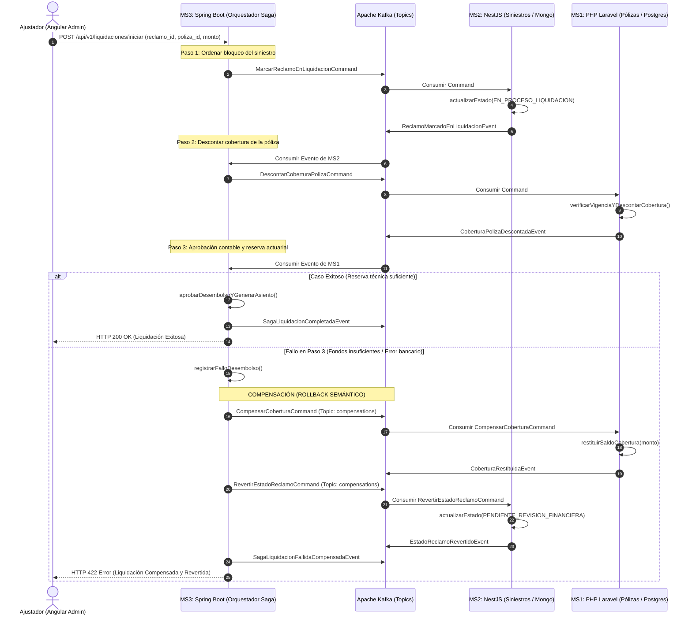
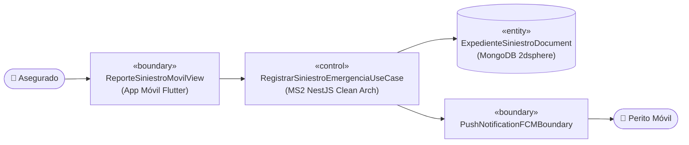
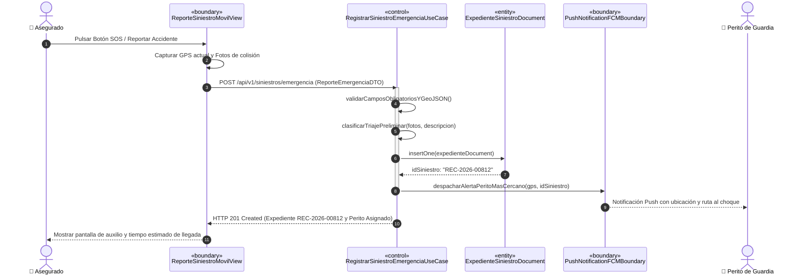
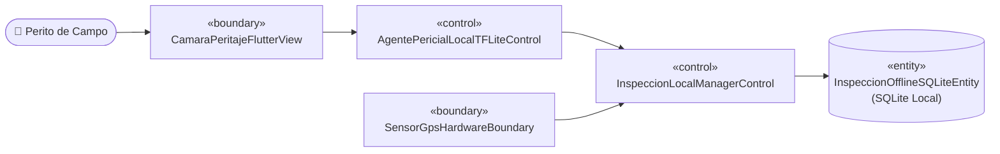
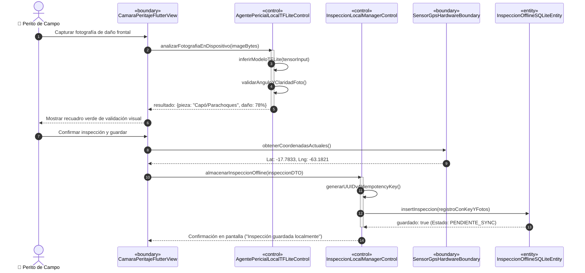
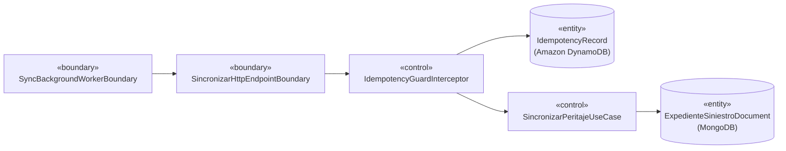
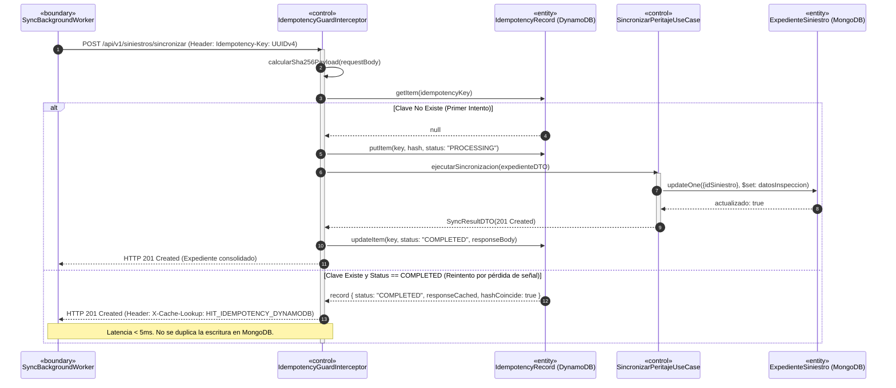
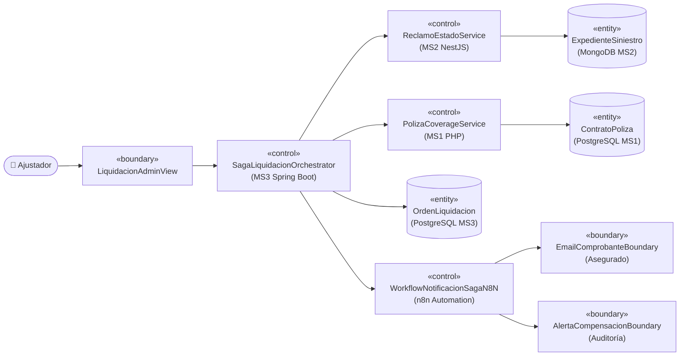
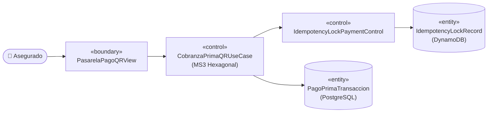
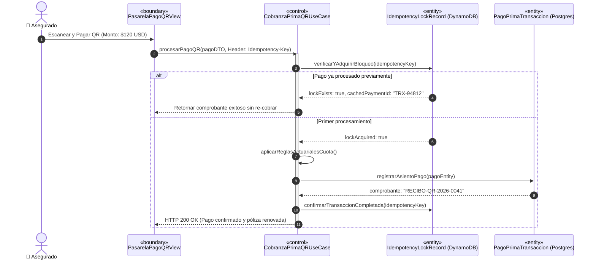

# 🛡️ AegisCore AI — Opción B: Siniestros, Móvil Offline, Idempotencia & Transacción Saga
> **Documento Maestro de Implementación, Trazabilidad ICONIX (UML 2.5+) y Guía de Defensa**  
> **Materia:** Ingeniería de Software II (2do Parcial) — **Grupo:** #27  
> **Célula B (Perfil B):** 44 Puntos de Historia / 29 Horas Estimadas  
> **Estado:** En Planificación y Desarrollo Activo  

---

## 📑 Tabla de Contenidos
1. [Resumen Ejecutivo y Alcance del Perfil B](#1-resumen-ejecutivo-y-alcance-del-perfil-b)
2. [Matriz de Casos de Uso a Cargo (CU06 al CU10)](#2-matriz-de-casos-de-uso-a-cargo-cu06-al-cu10)
3. [Arquitectura y Patrones de Código Asignados](#3-arquitectura-y-patrones-de-código-asignados)
   - 3.1 [MS2 NestJS: Clean Architecture + CQRS](#31-ms2-nestjs-clean-architecture--cqrs)
   - 3.2 [MS3 Spring Boot 3: Arquitectura Hexagonal (Ports & Adapters)](#32-ms3-spring-boot-3-arquitectura-hexagonal-ports--adapters)
   - 3.3 [Flutter Mobile: Offline-First + SQLite + TensorFlow Lite](#33-flutter-mobile-offline-first--sqlite--tensorflow-lite)
   - 3.4 [Mecanismo de Idempotencia Distribuida (DynamoDB Local)](#34-mecanismo-de-idempotencia-distribuida-dynamodb-local)
   - 3.5 [Transacción Transversal Saga en 3 Microservicios y Rollback Compensatorio](#35-transacción-transversal-saga-en-3-microservicios-y-rollback-compensatorio)
4. [Especificación ICONIX y Diagramas UML 2.5+ por Caso de Uso](#4-especificación-iconix-y-diagramas-uml-25-por-caso-de-uso)
   - 4.1 [CU06: Reportar Siniestro Vial de Emergencia por WhatsApp con Triaje IA](#41-cu06-reportar-siniestro-vial-de-emergencia-por-whatsapp-con-triaje-ia)
   - 4.2 [CU07: Inspeccionar Daños del Vehículo en Terreno sin Internet (Agente TFLite)](#42-cu07-inspeccionar-daños-del-vehículo-en-terreno-sin-internet-agente-tflite)
   - 4.3 [CU08: Sincronizar Expediente de Siniestro con Control de Idempotencia](#43-cu08-sincronizar-expediente-de-siniestro-con-control-de-idempotencia)
   - 4.4 [CU09: Liquidar y Pagar Indemnización de Siniestro (Patrón Saga en 3 MS)](#44-cu09-liquidar-y-pagar-indemnización-de-siniestro-patrón-saga-en-3-ms)
   - 4.5 [CU10: Procesar Cobro Recurrente de Primas y Pago QR Idempotente](#45-cu10-procesar-cobro-recurrente-de-primas-y-pago-qr-idempotente)
5. [Compatibilidad y Exportación para Enterprise Architect v17](#5-compatibilidad-y-exportación-para-enterprise-architect-v17)
6. [Plan de Implementación Paso a Paso (Sprints y Tareas Técnicas)](#6-plan-de-implementación-paso-a-paso-sprints-y-tareas-técnicas)
7. [Guía y Argumentación para la Defensa Oral ante el Docente](#7-guía-y-argumentación-para-la-defensa-oral-ante-el-docente)
8. [Bitácora de Avance y Checklist de Verificación](#8-bitácora-de-avance-y-checklist-de-verificación)

---

## 1. Resumen Ejecutivo y Alcance del Perfil B

En el marco del proyecto **AegisCore AI**, el equipo de 3 integrantes se divide en 3 células verticales independientes integradas mediante **contratos congelados** (`contracts/`). 

Como responsable del **Perfil B**, tienes a tu cargo el núcleo transaccional, móvil y de resiliencia del sistema:
- **Gestión de Reclamos y Siniestros:** Recepción de emergencias viales, triaje preliminar y despacho de notificaciones.
- **Movilidad en Campo Offline-First:** Inspección en carreteras y sótanos sin señal con SQLite y un agente inteligente local TensorFlow Lite (Edge AI).
- **Idempotencia Distribuida:** Blindaje contra duplicación de siniestros y cobros bancarios mediante `Idempotency-Key` (UUIDv4 + SHA-256) validada en Amazon DynamoDB en tiempo sub-milisegundo (< 5ms).
- **Transacción Distribuida Saga:** Orquestación en Apache Kafka de la liquidación de pólizas a través de 3 microservicios políglotas (MS2 NestJS $\rightarrow$ MS1 PHP $\rightarrow$ MS3 Spring Boot) con compensación semántica automática (Rollback) si ocurre algún fallo.
- **Cobranzas y Pagos QR:** Procesamiento seguro de cobros recurrentes de primas con código QR e idempotencia financiera.

---

## 2. Matriz de Casos de Uso a Cargo (CU06 al CU10)

| ID | Nombre del Caso de Uso | Backend / Servicio | Frontend / Canal | Base de Datos / Broker | Tecnologías Clave Aplicadas | Pts | Horas |
|---|---|---|---|---|---|---|---|
| **CU06** | Reportar Siniestro Vial de Emergencia Directo desde App Móvil con Triaje | MS2: NestJS 10 (Clean Arch) | App Móvil Flutter (Módulo SOS) + Push FCM | MongoDB 7 (`expedientes_siniestros`) | Clean Architecture, CQRS, MongoDB, WebSockets / Push FCM | 8 | 5 |
| **CU07** | Inspeccionar Daños Offline con Agente de IA Local | Edge AI Local (On-Device) | Flutter (Cámara, GPS, Micrófono, QR) | SQLite Local (`inspecciones.db`) | Modo 100% Offline, SQLite, Agente Local TensorFlow Lite (TFLite) | 10 | 7 |
| **CU08** | Sincronizar Expediente de Siniestro con Control de Idempotencia | MS2: NestJS 10 (Clean Arch) | Flutter (Background Sync Worker) | Amazon DynamoDB + MongoDB | Header `Idempotency-Key` UUIDv4 + Hash SHA-256, DynamoDB Lock | 8 | 5 |
| **CU09** | Liquidar y Pagar Indemnización de Siniestro (Patrón Saga) | MS3: Spring Boot 3 (Hexagonal) | Angular Admin / Kafka Bus | PostgreSQL + MongoDB + Kafka | Transacción transversal 3 MS, Orquestador Saga, Compensación Kafka | 10 | 7 |
| **CU10** | Procesar Cobro Recurrente de Primas y Pago QR Idempotente | MS3: Spring Boot 3 (Hexagonal) | Flutter / React (Lector QR) | PostgreSQL + DynamoDB | Arquitectura Hexagonal, Cobro QR BCB/EMV, Idempotencia Financiera | 8 | 5 |

**Total Perfil B:** **44 Puntos de Historia** / **29 Horas de Trabajo Técnico**.

---

## 3. Arquitectura y Patrones de Código Asignados

### 3.1 MS2 NestJS: Clean Architecture + CQRS
Directorio: `backend/ms2-siniestros-nestjs/`
- **Capa Domain (`src/domain/`):** Entidades puras (`Siniestro`, `InspeccionPericial`, `VehiculoSiniestrado`), Value Objects (`CoordenadasGPS`, `SeveridadDano`, `EstadoSiniestro`) e interfaces de repositorios (`ISiniestroRepository`, `IIdempotencyRepository`). Totalmente independiente de Mongoose o NestJS.
- **Capa Application (`src/application/`):**
  - **Commands (`commands/`):** Modifican estado. Ej. `RegistrarSiniestroEmergenciaCommand`, `SincronizarInspeccionOfflineCommand`, `ActualizarEstadoLiquidacionCommand`.
  - **Queries (`queries/`):** Consultas de solo lectura optimizadas. Ej. `ObtenerSiniestroPorIdQuery`, `ListarSiniestrosCercanosGPSQuery`.
- **Capa Infrastructure (`src/infrastructure/`):** Mongoose Schemas con índice geoespacial `2dsphere` para coordenadas del siniestro, adaptador DynamoDB SDK v3, cliente FCM (Firebase Cloud Messaging) y Kafka Producer/Consumer.
- **Capa Presentation (`src/presentation/`):** Controladores REST con interceptores de Idempotencia (`@UseInterceptors(IdempotencyInterceptor)`), WebSockets Gateway para peritos en tiempo real y Resolvers GraphQL.

### 3.2 MS3 Spring Boot 3: Arquitectura Hexagonal (Ports & Adapters)
Directorio: `backend/ms3-actuarial-springboot/`
- **Dominio Puro (`domain/`):** `CalculoReservaTecnica`, `OrdenLiquidacion`, `TransaccionPagoQR`, `SagaInstance`. Sin anotaciones `@Entity` ni dependencias del framework.
- **Puertos de Entrada / Inbound (`application/ports/in/`):** Casos de uso de la aplicación:
  - `LiquidarSiniestroSagaUseCasePort`
  - `ProcesarPagoPrimaQRUseCasePort`
  - `CompensarSagaLiquidacionUseCasePort`
- **Puertos de Salida / Outbound (`application/ports/out/`):** Contratos hacia la infraestructura:
  - `OrdenLiquidacionRepositoryPort` (Persistencia relacional)
  - `SagaEventPublisherPort` (Publicación en Kafka)
  - `IdempotencyLockPort` (Validación en DynamoDB)
- **Adaptadores de Entrada (`infrastructure/adapters/in/`):**
  - Web REST Controllers (`LiquidacionRestController`, `PagoQRRestController`).
  - Kafka Event Listeners (`SagaStepResponseKafkaListener`, `SagaCompensationKafkaListener`).
- **Adaptadores de Salida (`infrastructure/adapters/out/`):**
  - Spring Data JPA (`PostgreSqlLiquidacionAdapter`).
  - Kafka Producer (`KafkaSagaEventPublisherAdapter`).
  - AWS SDK DynamoDB (`DynamoDbIdempotencyAdapter`).

### 3.3 Flutter Mobile: Offline-First + SQLite + TensorFlow Lite
Directorio: `frontend/app-peritos-flutter/`
- **Persistencia Local SQLite (`sqflite`):** Tabla `inspecciones_locales` y `fotos_evidencias` para permitir registro completo sin conectividad a internet.
- **Agente de IA Local On-Device (TFLite / LiteRT):** Modelo cuantizado `damage_classifier.tflite` para clasificar daños de parachoques, capó y faroles en tiempo real desde la cámara del celular.
- **Sincronización en Segundo Plano:** `WorkManager` / `ConnectivityPlus` que detecta la recuperación de señal y ejecuta la sincronización por lotes inyectando el encabezado `Idempotency-Key` (UUIDv4).
- **Hardware Integrado:** Cámara con superposición de guías visuales, GPS de alta precisión con geofencing y escáner de códigos QR de pólizas.

### 3.4 Mecanismo de Idempotencia Distribuida (DynamoDB Local)
Basado en el contrato congelado `contracts/idempotency-header.spec.json`:
1. El cliente genera un UUIDv4 (`Idempotency-Key: c9b1...`) antes de persistir en SQLite local.
2. Al retransmitir hacia `MS2` o `MS3`, el interceptor calcula el Hash SHA-256 del payload recibido.
3. DynamoDB es consultado (`GetItem` en tabla `IdempotencyRecords` con Partition Key `idempotency_key`):
   - **No existe:** Inserta con estado `PROCESSING` y procesa la transacción normalmente. Al terminar, actualiza a `COMPLETED` con el JSON de respuesta y código HTTP (`200`/`201`).
   - **Existe y Status = COMPLETED con mismo hash:** Retorna de inmediato la respuesta en caché (< 5ms) con cabecera `X-Cache-Lookup: HIT_IDEMPOTENCY_DYNAMODB`.
   - **Existe y Status = PROCESSING:** Retorna `HTTP 409 Conflict` (petición concurrente en curso).
   - **Existe con distinto hash:** Retorna `HTTP 422 Unprocessable Entity` (reutilización ilegítima de llave).

### 3.5 Transacción Transversal Saga en 3 Microservicios y Rollback Compensatorio
Basado en el contrato congelado `contracts/saga-events.schema.json`:
- **Orquestador:** MS3 Spring Boot (`SagaLiquidacionOrchestrator`).
- **Tópicos Kafka:**
  - `aegiscore.saga.commands`
  - `aegiscore.saga.events`
  - `aegiscore.saga.compensations`

---

## 4. Especificación ICONIX y Diagramas UML 2.5+ por Caso de Uso

En la metodología **ICONIX**, cada caso de uso se descompone en objetos:
- 🔵 **Boundary (Interfaz / Vista):** Pantallas móviles, componentes web, webhooks o receptores de mensajes.
- 🔴 **Control (Lógica / Orquestador):** Servicios de aplicación, casos de uso, controladores o interceptores. **(Los métodos de los diagramas de secuencia pertenecen explícitamente a esta clase).**
- 🟡 **Entity (Persistencia):** Tablas PostgreSQL, colecciones MongoDB o registros DynamoDB.

---

### 4.1 CU06: Reportar Siniestro Vial de Emergencia Directo desde App Móvil
- **Actores:** Asegurado accidentado, Perito de campo en guardia.
- **Objetos ICONIX:**
  - **Boundary:** `ReporteSiniestroMovilView` (Flutter - Módulo SOS), `PushNotificationFCMBoundary`.
  - **Control:** `RegistrarSiniestroEmergenciaUseCase` (MS2 NestJS - Clean Architecture CQRS).
  - **Entity:** `ExpedienteSiniestroDocument` (MongoDB `expedientes_siniestros` con coordenadas GeoJSON e índice `2dsphere`).

#### Diagrama de Robustez ICONIX (CU06):

#### Diagrama de Secuencia UML 2.5+ (CU06):

---

### 4.2 CU07: Inspeccionar Daños del Vehículo en Terreno sin Internet (Agente TFLite)
- **Actores:** Perito de campo.
- **Objetos ICONIX:**
  - **Boundary:** `CamaraPeritajeFlutterView`, `SensorGpsHardwareBoundary`.
  - **Control:** `AgentePericialLocalTFLiteControl`, `InspeccionLocalManagerControl`.
  - **Entity:** `InspeccionOfflineSQLiteEntity` (SQLite Local).

#### Diagrama de Robustez ICONIX (CU07):

#### Diagrama de Secuencia UML 2.5+ (CU07):

---

### 4.3 CU08: Sincronizar Expediente de Siniestro con Control de Idempotencia
- **Actores:** SyncBackgroundWorker (Flutter), Ajustador en sistema.
- **Objetos ICONIX:**
  - **Boundary:** `SyncBackgroundWorkerBoundary`, `SincronizarHttpEndpointBoundary`.
  - **Control:** `IdempotencyGuardInterceptor` (NestJS), `SincronizarPeritajeUseCase` (NestJS).
  - **Entity:** `IdempotencyRecord` (DynamoDB Local), `ExpedienteSiniestroDocument` (MongoDB).

#### Diagrama de Robustez ICONIX (CU08):

#### Diagrama de Secuencia UML 2.5+ (CU08):

---

### 4.4 CU09: Liquidar y Pagar Indemnización de Siniestro (Patrón Saga en 3 MS + Automatización n8n)
- **Actores:** Ajustador de Siniestros (vía Angular Admin), Orquestador Saga Kafka, Asegurado, Auditor Financiero.
- **Objetos ICONIX:**
  - **Boundary:** `LiquidacionAdminView` (Angular), `KafkaSagaListenerBoundary`, `N8NWebhookNotificacionBoundary`, `EmailNotificacionBoundary`.
  - **Control:** `SagaLiquidacionOrchestrator` (Spring Boot), `PolizaCoverageService` (MS1 PHP), `ReclamoEstadoService` (MS2 NestJS), `WorkflowNotificacionSagaN8N` (`automation-n8n/workflow-saga-liquidacion-notificaciones.json`).
  - **Entity:** `OrdenLiquidacion` (PostgreSQL MS3), `ContratoPoliza` (PostgreSQL MS1), `ExpedienteSiniestro` (MongoDB MS2).

#### Diagrama de Robustez ICONIX (CU09):

#### Diagrama de Secuencia UML 2.5+ (CU09):
*(Ver diagrama detallado en la sección 3.5 con flujo normal, compensación/rollback en Kafka y despacho de eventos hacia n8n).*

---

### 4.5 CU10: Procesar Cobro Recurrente de Primas y Pago QR Idempotente
- **Actores:** Asegurado (App Móvil / Web), Banco / Pasarela QR.
- **Objetos ICONIX:**
  - **Boundary:** `PasarelaPagoQRView`, `NotificacionPagoWebhookBoundary`.
  - **Control:** `CobranzaPrimaQRUseCasePort` (Spring Boot Hexagonal), `IdempotencyLockPaymentControl`.
  - **Entity:** `PagoPrimaTransaccion` (PostgreSQL), `IdempotencyLockRecord` (DynamoDB).

#### Diagrama de Robustez ICONIX (CU10):

#### Diagrama de Secuencia UML 2.5+ (CU10):

---

## 5. Compatibilidad y Exportación para Enterprise Architect v17

Para permitir la edición de los modelos en **Enterprise Architect versión 17** con estándar **UML 2.5+**:

1. **Ubicación de los Artefactos:**
   - Modelos XMI 2.1 / UML 2.5: `docs-iconix-uml/02-diagramas-robustez-bce/` y `docs-iconix-uml/03-diagramas-secuencia-uml25/`.
   - Diagramas PlantUML (`.puml`) con estereotipos ICONIX (`«boundary»`, `«control»`, `«entity»`).
2. **Procedimiento de Importación en Enterprise Architect 17:**
   - Abrir o crear un proyecto en Enterprise Architect 17 (`.eapx` o `.qea`).
   - Clic derecho en el Paquete raíz (`Model` o `Root Package`) $\rightarrow$ **Import/Export** $\rightarrow$ **Import Package from Native/XMI File**.
   - Seleccionar el archivo XMI correspondiente (ej. `aegiscore-perfil-b-iconix-uml25.xmi`).
   - Marcar la casilla **"Treat imported Datatypes as External"** e **"Import Diagrams"** $\rightarrow$ Clic en **Import**.
3. **Estructura de Paquetes en Enterprise Architect:**
   - `01_Model_ICONIX_Robustness`:
     - `CU06_Triaje_Emergencia_BCE`
     - `CU07_Inspeccion_Offline_TFLite_BCE`
     - `CU08_Sincronizacion_Idempotente_BCE`
     - `CU09_Saga_Liquidacion_3MS_BCE`
     - `CU10_Cobro_QR_Idempotente_BCE`
   - `02_Model_UML25_Sequence`:
     - `SD_CU06_Reportar_Emergencia`
     - `SD_CU07_Inspeccion_Local_EdgeAI`
     - `SD_CU08_Sync_DynamoDB_Idempotencia`
     - `SD_CU09_Saga_Orchestration_Kafka_Rollback`
     - `SD_CU10_Cobro_QR_Hexagonal`

---

## 6. Plan de Implementación Paso a Paso (Sprints y Tareas Técnicas)

### 🗓️ Fase 1 (Semana 1 - Fundaciones): Persistencia y Configuración de Infraestructura
- [x] **SP-01:** docker-compose orquestando PostgreSQL, MongoDB, DynamoDB Local, Kafka y Keycloak.
- [ ] **SP-04:** Validar esquemas MongoDB en `infra/db-init/mongo-init.js` y tabla `IdempotencyRecords` en DynamoDB Local.
- [ ] **SP-08 (Init):** Crear cliente DynamoDB SDK v3 en NestJS y Spring Boot para la tabla `IdempotencyRecords`.

### 🗓️ Fase 2 (Semana 2 - Backend Siniestros & Idempotencia): MS2 NestJS
- [ ] **SP-07:** Implementar MS2 NestJS con Clean Architecture:
  - Entidad `Siniestro` en `src/domain/`.
  - Casos de uso `RegistrarSiniestroEmergenciaCommand` y `SincronizarInspeccionOfflineCommand` en `src/application/`.
  - Repositorio Mongoose en `src/infrastructure/`.
- [ ] **SP-08:** Programar `IdempotencyInterceptor` / `IdempotencyGuard` contra DynamoDB:
  - Validación de cabecera `Idempotency-Key` (UUIDv4) y control de hash SHA-256.
  - Retorno en < 5ms ante claves ya completadas (`X-Cache-Lookup`).

### 🗓️ Fase 3 (Semana 2 y 3 - Motor Actuarial, Cobros & Orquestador Saga): MS3 Spring Boot
- [ ] **SP-09:** Implementar MS3 Spring Boot 3 con Arquitectura Hexagonal:
  - Puertos de entrada `CobranzaPrimaQRUseCasePort` y `LiquidarSiniestroSagaUseCasePort`.
  - Puertos de salida JPA y DynamoDB.
- [ ] **SP-10:** Programar `SagaLiquidacionOrchestrator` en Spring Boot:
  - Publicación y consumo de eventos Kafka en tópicos `aegiscore.saga.commands`, `aegiscore.saga.events` y `aegiscore.saga.compensations`.
  - Implementación del Rollback compensatorio ante fallos simulados en el Paso 3.

### 🗓️ Fase 4 (Semana 3 y 4 - Cliente Móvil & Pruebas de Resiliencia): Flutter App
- [ ] **SP-19:** Desarrollar App Móvil Flutter:
  - SQLite local con `sqflite` (100% Offline).
  - Módulo de cámara con IA local TFLite (`damage_classifier.tflite`).
  - Lector de código QR para pólizas y pagos.
  - Sincronizador en segundo plano tolerante a micro-cortes de red con `Idempotency-Key`.
- [ ] **SP-20:** Ensamblar diagramas finales ICONIX y exportar a XMI para Enterprise Architect 17.
- [ ] **SP-21:** Ejecutar pruebas de corte intencional de red (WiFi desactivado) y prueba de fallo/compensación de la Saga.

---

## 7. Guía y Argumentación para la Defensa Oral ante el Docente

| Pregunta Trampa del Docente | Respuesta y Justificación Técnica de Alto Nivel |
|---|---|
| **¿Por qué usaron Clean Architecture en NestJS y Hexagonal en Spring Boot en vez de la misma arquitectura?** | Para demostrar versatilidad y cumplimiento estricto de los patrones arquitectónicos exigidos. En **NestJS** aplicamos **Clean Architecture con CQRS**, aislando el dominio de Mongoose y separando comandos que mutan de queries optimizadas. En **Spring Boot** aplicamos **Arquitectura Hexagonal (Ports & Adapters)**, donde los puertos de entrada modelan los casos de uso actuariales y los puertos de salida desacoplan la base de datos relacional y el broker Kafka. |
| **¿Por qué usar DynamoDB para Idempotencia en lugar de una tabla en PostgreSQL o MongoDB?** | Por latencia y concurrencia. Un chequeo de idempotencia debe ocurrir en **sub-milisegundos (< 5 ms)** para cada petición HTTP. Relacionales como Postgres agregarían contención de locks en transacciones y MongoDB penalizaría escrituras concurrentes. DynamoDB Local (NoSQL Clave-Valor) permite lectura por Partition Key O(1) inmediata y TTL automático sin sobrecargar la base de datos principal. |
| **¿Cómo aseguran que la transacción Saga no deje datos inconsistentes si se cae la red en el microservicio 3?** | La Saga se implementa con **Orquestación en Apache Kafka**. Si Spring Boot detecta insuficiencia en la reserva actuarial o caída bancaria, emite eventos de compensación (`CompensarCoberturaCommand` y `RevertirEstadoReclamoCommand`) hacia tópicos de compensación con acuse de recibo transaccional (`acks=all`), revirtiendo en orden inverso los cambios en MS1 (PHP) y MS2 (NestJS). |
| **¿Por qué la App de Flutter puede operar sin internet y cómo sabe qué parte está dañada sin llamar a la nube?** | Implementamos una arquitectura **Edge AI (IA en el dispositivo)**. El modelo de visión artificial fue cuantizado a **TensorFlow Lite (.tflite)** y se ejecuta directamente sobre la CPU/GPU del smartphone. Las fotos, diagnósticos y llaves de idempotencia se persisten en **SQLite local**, garantizando operatividad total en carreteras o subsuelos sin cobertura. |

---

## 8. Bitácora de Avance y Checklist de Verificación

- [x] Contratos congelados revisados (`contracts/saga-events.schema.json`, `contracts/idempotency-header.spec.json`).
- [x] Especificación técnica ICONIX completa para CU06, CU07, CU08, CU09 y CU10.
- [x] Diagramas de Robustez y Secuencia UML 2.5+ generados con trazabilidad a clases de control.
- [x] Exportable XMI para Enterprise Architect 17 (`docs-iconix-uml/aegiscore-perfil-b-iconix-uml25.xmi`).
- [x] Modelo TFLite cuantizado generado (`damage_classifier.tflite` y `labels.txt` para 4 piezas).
- [x] Workflow n8n para notificaciones y alertas de compensación Saga (`workflow-saga-liquidacion-notificaciones.json`).
- [x] **MS3 Spring Boot 3 Hexagonal (CU09 y CU10) Completado al 100%:**
  - [x] Dominio Puro: `OrdenLiquidacion`, `PagoPrima`, `ReservaTecnica`, `CalculoActuarialService`.
  - [x] Puertos de Entrada y Salida (Ports & Adapters).
  - [x] Orquestador Saga en Kafka (`SagaLiquidacionOrchestratorService`) con compensación / rollback.
  - [x] Cobro QR e Idempotencia con DynamoDB (`CobranzaPrimaQRService`).
  - [x] Adaptadores JPA PostgreSQL (`orden_liquidacion_saga`, `pago_prima`, `reserva_tecnica`).
  - [x] Adaptadores Kafka Producer/Listener (`aegiscore.saga.*`).
  - [x] Controladores REST con códigos HTTP semánticos (201, 200, 409, 422).
  - [x] Pruebas unitarias completas de Dominio, Saga, Rollback y Cobranza QR.
- [ ] Scaffolding y casos de uso en MS2 NestJS (Clean Architecture + CQRS + MongoDB).
- [ ] App Móvil Flutter con SQLite offline y carga del modelo TFLite.
