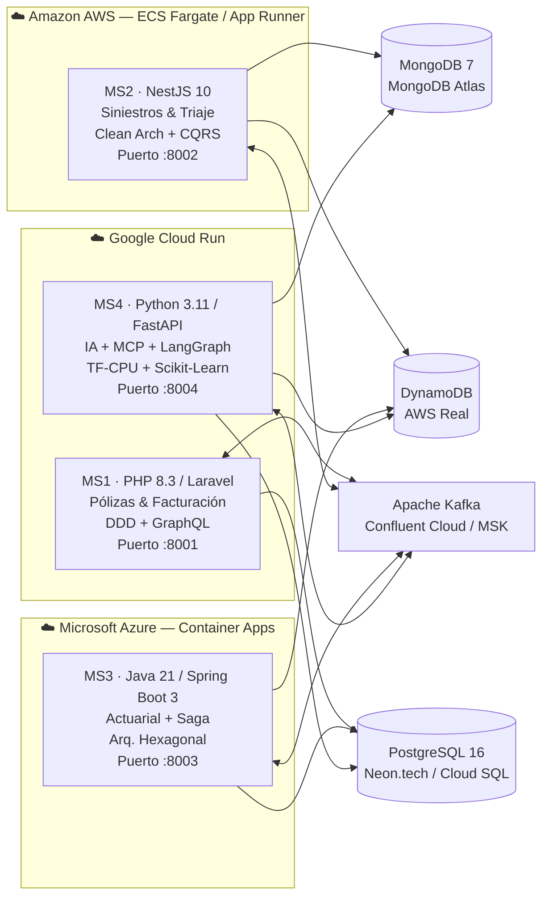
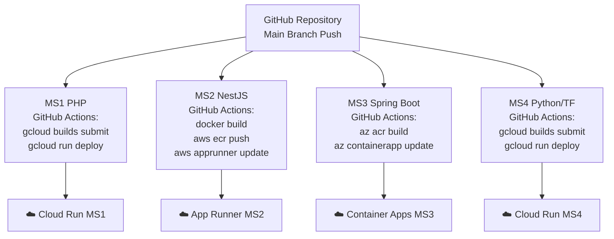

# 🌐 Plan de Despliegue Multi-Cloud — AegisCore AI

> Distribución de los 4 microservicios backend en 3 proveedores cloud: **AWS**, **Google Cloud (Cloud Run)** y **Microsoft Azure (Container Apps)**.

---

## Descripción del Objetivo

Desplegar los 4 microservicios de AegisCore AI en entornos cloud reales, aprovechando los servicios equivalentes a "Cloud Run" de cada proveedor para contenerización serverless. Se asigna un proveedor óptimo a cada microservicio según sus características técnicas (lenguaje, carga de trabajo, dependencias de BD, necesidad de GPU/memoria).

> [!IMPORTANT]
> Como el proyecto tiene **4 microservicios** y solo **3 proveedores**, uno de los clouds alojará **2 microservicios**. Se elige **Google Cloud Run** como el doble anfitrión por su mejor integración con Kafka Managed y su soporte nativo para imágenes Docker multi-stage.

---

## Revisión Requerida por el Usuario

> [!WARNING]
> **Decisión de asignación**: MS1 y MS4 se colocan en Google Cloud Run. Si prefieres distribuir diferente (p.ej. MS1 en Azure y MS4 en AWS), indica la combinación antes de proceder.

> [!CAUTION]
> **Costos**: Los servicios cloud gestionados (RDS, Atlas MongoDB, MSK Kafka) tienen costo real. Esta guía usa **tiers gratuitos y estimados mínimos** para ambiente universitario/demo. Verifica los límites de créditos de cada proveedor.

---

## Preguntas Abiertas

> [!IMPORTANT]
> 1. ¿Se quiere un **API Gateway / Load Balancer** unificado frente a los 3 clouds? (p.ej. Cloudflare, AWS API Gateway, o NGINX en VM)
> 2. ¿Las bases de datos también se migran a cloud managed, o permanecen en Docker local?  
> 3. ¿Se necesita CI/CD automatizado (GitHub Actions) por microservicio?
> 4. ¿Kafka se mantiene local (docker-compose) o migra a un servicio managed (AWS MSK, Confluent Cloud)?

---

## Mapa de Asignación



---

## Propuesta de Despliegue por Microservicio

---

### 🅱️ MS2 — NestJS 10 · Siniestros & Triaje → **Amazon AWS (App Runner / ECS Fargate)**

**Razón**: MS2 depende directamente de **DynamoDB** (AWS nativo) y de MongoDB Atlas. AWS App Runner es el equivalente directo a Cloud Run para contenedores Node.js, con autoescalado y sin gestión de servidores.

#### Servicio AWS Recomendado
| Componente | Servicio AWS | Especificación |
|---|---|---|
| **Contenedor** | AWS App Runner | 1 vCPU / 2 GB RAM (mínimo), port 8002 |
| **Registro de imagen** | Amazon ECR | Repositorio: `aegiscore/ms2-siniestros` |
| **Base de datos docs** | MongoDB Atlas (externo) | M0 Free / M10 Dedicated |
| **Idempotencia** | Amazon DynamoDB (real) | Tabla `AegisCore_IdempotencyRecords` PAY_PER_REQUEST |
| **Event Bus** | Amazon MSK / Confluent Cloud | Kafka topic `siniestros.eventos` |
| **Secretos** | AWS Secrets Manager | MONGODB_URI, KAFKA_BROKER, etc. |
| **Variables de entorno** | App Runner env vars | PORT=8002 |

#### Dockerfile (ya existe, optimizado)
```dockerfile
# backend/ms2-siniestros-nestjs/Dockerfile — multi-stage OK
FROM node:20-alpine AS builder   # Build stage
FROM node:20-alpine AS runner    # Runtime stage (solo dist/)
EXPOSE 8002
CMD ["node", "dist/main.js"]
```

#### Pasos de despliegue en AWS
```bash
# 1. Autenticar con ECR
aws ecr get-login-password --region us-east-1 | \
  docker login --username AWS --password-stdin <ACCOUNT_ID>.dkr.ecr.us-east-1.amazonaws.com

# 2. Build y Push de imagen
docker build -t aegiscore-ms2 ./backend/ms2-siniestros-nestjs
docker tag aegiscore-ms2:latest <ACCOUNT_ID>.dkr.ecr.us-east-1.amazonaws.com/aegiscore/ms2:latest
docker push <ACCOUNT_ID>.dkr.ecr.us-east-1.amazonaws.com/aegiscore/ms2:latest

# 3. Crear servicio App Runner (via CLI o consola)
aws apprunner create-service \
  --service-name aegiscore-ms2-siniestros \
  --source-configuration '{
    "ImageRepository": {
      "ImageIdentifier": "<ACCOUNT_ID>.dkr.ecr.us-east-1.amazonaws.com/aegiscore/ms2:latest",
      "ImageRepositoryType": "ECR",
      "ImageConfiguration": {
        "Port": "8002",
        "RuntimeEnvironmentVariables": {
          "PORT": "8002",
          "MONGODB_URI": "<SECRET_ARN>",
          "AWS_REGION": "us-east-1"
        }
      }
    }
  }' \
  --instance-configuration '{"Cpu":"1024","Memory":"2048"}'
```

#### Especificaciones técnicas MS2
| Parámetro | Valor |
|---|---|
| **Runtime** | Node.js 20 LTS |
| **RAM recomendada** | 2 GB (NestJS + CQRS en frío) |
| **vCPU** | 1 vCPU (escala a 2 en pico) |
| **Almacenamiento efímero** | 20 GB |
| **Concurrencia máxima** | 100 req/instancia |
| **Timeout** | 30 s por request |
| **Health check** | `GET /health` → HTTP 200 |
| **Autoescalado** | Min 1 instancia, Max 5 instancias |

---

### 🅰️ MS1 — PHP 8.3 / Laravel · Pólizas & Facturación → **Google Cloud Run**

**Razón**: PHP/Laravel es ligero en memoria y Cloud Run es ideal para microservicios HTTP sin estado con tráfico variable. Cloud SQL for PostgreSQL ofrece la mejor integración serverless con Cloud Run mediante socket de Unix.

#### Servicio GCP Recomendado
| Componente | Servicio GCP | Especificación |
|---|---|---|
| **Contenedor** | Cloud Run (Fully Managed) | 1 vCPU / 512 MB RAM, port 8001 |
| **Registro de imagen** | Artifact Registry | `gcr.io/<PROJECT>/aegiscore/ms1-polizas` |
| **Base de datos** | Cloud SQL for PostgreSQL 16 | db-f1-micro (demo) / db-custom-1-3840 (prod) |
| **Secretos** | Secret Manager | DB_PASSWORD, JWT_SECRET, KAFKA_BROKERS |
| **Event Bus** | Confluent Cloud (externo) | Kafka topic `polizas.eventos` |
| **GraphQL** | Cloud Run (puerto 8001) | Integrado en la app Laravel |

#### Dockerfile mejorado para Cloud Run
```dockerfile
# [MODIFY] backend/ms1-polizas-php/Dockerfile
# Agregar Composer para dependencias de producción
FROM php:8.3-cli-alpine

RUN apk add --no-cache postgresql-dev libzip-dev git bash curl \
    && docker-php-ext-install pdo pdo_pgsql bcmath zip sockets \
    && curl -sS https://getcomposer.org/installer | php -- --install-dir=/usr/local/bin --filename=composer

WORKDIR /var/www/html
COPY . .

# Instalar dependencias de producción (sin dev)
RUN composer install --no-dev --optimize-autoloader --no-interaction 2>/dev/null || true

EXPOSE 8001
CMD ["php", "-S", "0.0.0.0:8001", "-t", "public"]
```

#### Pasos de despliegue en GCP
```bash
# 1. Autenticar y configurar proyecto
gcloud auth login
gcloud config set project <GCP_PROJECT_ID>

# 2. Build y Push con Cloud Build (sin Docker local)
gcloud builds submit ./backend/ms1-polizas-php \
  --tag gcr.io/<GCP_PROJECT_ID>/aegiscore-ms1:latest

# 3. Deploy en Cloud Run
gcloud run deploy aegiscore-ms1-polizas \
  --image gcr.io/<GCP_PROJECT_ID>/aegiscore-ms1:latest \
  --platform managed \
  --region us-central1 \
  --port 8001 \
  --memory 512Mi \
  --cpu 1 \
  --min-instances 0 \
  --max-instances 10 \
  --set-env-vars="DB_HOST=/cloudsql/<CONNECTION_NAME>,DB_PORT=5432" \
  --set-secrets="DB_PASSWORD=aegiscore-db-password:latest" \
  --add-cloudsql-instances <PROJECT>:<REGION>:<INSTANCE> \
  --allow-unauthenticated
```

#### Especificaciones técnicas MS1
| Parámetro | Valor |
|---|---|
| **Runtime** | PHP 8.3 CLI + PDO_PGSQL |
| **RAM recomendada** | 512 MB (PHP es liviano) |
| **vCPU** | 1 vCPU (0.5 en idle) |
| **Concurrencia** | 80 req/instancia (Cloud Run default) |
| **Cold start** | ~2–3 s (PHP Alpine es rápido) |
| **Timeout** | 60 s (PDF/GraphQL pesado) |
| **Health check** | `GET /api/health` → HTTP 200 |
| **Autoescalado** | Min 0 (scale-to-zero), Max 10 |

---

### 🅲 MS4 — Python 3.11 / FastAPI · IA + MCP + LangGraph → **Google Cloud Run**

**Razón**: MS4 tiene las cargas de trabajo más pesadas (TensorFlow-CPU, Scikit-Learn, LangGraph). Google Cloud Run soporta contenedores de hasta 32 GB RAM y tiene integración con Vertex AI para modelos ML. Se despliega en la **misma región** que MS1 para reutilizar la conexión a Cloud SQL.

#### Servicio GCP Recomendado
| Componente | Servicio GCP | Especificación |
|---|---|---|
| **Contenedor** | Cloud Run (Fully Managed) | 2–4 vCPU / 4–8 GB RAM, port 8004 |
| **Modelos ML** | Cloud Storage (GCS) | Bucket `aegiscore-ml-models` para .pkl / .h5 |
| **Registro de imagen** | Artifact Registry | `gcr.io/<PROJECT>/aegiscore/ms4-ia` |
| **BD relacional** | Cloud SQL PostgreSQL 16 | Compartida con MS1 (mismo socket) |
| **BD documental** | MongoDB Atlas | M10+ (MS4 lee expedientes de fotos) |
| **Secretos** | Secret Manager | DATABASE_URL, MONGODB_URI, etc. |
| **STT (Whisper)** | Cloud Speech-to-Text API | Alternativa managed a Whisper local |

#### Dockerfile mejorado para Cloud Run (MS4 pesado)
```dockerfile
# [MODIFY] backend/ms4-ia-mcp-python/Dockerfile
FROM python:3.11-slim

WORKDIR /app

RUN apt-get update && apt-get install -y --no-install-recommends \
    build-essential libpq-dev curl \
    && rm -rf /var/lib/apt/lists/*

COPY requirements.txt .
# Instalar en capas para mejor cache de Docker
RUN pip install --no-cache-dir \
    fastapi>=0.110.0 uvicorn[standard]>=0.28.0 \
    pydantic>=2.6.0 pydantic-settings>=2.2.0

RUN pip install --no-cache-dir \
    numpy>=1.26.0 pandas>=2.2.0 scikit-learn>=1.4.0

RUN pip install --no-cache-dir \
    tensorflow-cpu>=2.15.0 keras>=3.0.0

RUN pip install --no-cache-dir \
    psycopg2-binary>=2.9.9 pymongo>=4.6.1 \
    confluent-kafka>=2.3.0 mcp>=1.0.0 \
    langgraph>=1.2.0 boto3>=1.34.0 \
    reportlab>=4.1.0 python-docx>=1.1.0 \
    python-multipart>=0.0.9 openpyxl>=3.1.2

COPY . .

EXPOSE 8004
CMD ["uvicorn", "app.main:app", "--host", "0.0.0.0", "--port", "8004", "--workers", "2"]
```

#### Pasos de despliegue en GCP (MS4)
```bash
# Build (imagen grande ~3 GB por TF-CPU, usar Cloud Build)
gcloud builds submit ./backend/ms4-ia-mcp-python \
  --tag gcr.io/<GCP_PROJECT_ID>/aegiscore-ms4:latest \
  --timeout 1200s  # 20 min por TF-CPU

# Deploy con más recursos
gcloud run deploy aegiscore-ms4-ia \
  --image gcr.io/<GCP_PROJECT_ID>/aegiscore-ms4:latest \
  --platform managed \
  --region us-central1 \
  --port 8004 \
  --memory 8Gi \
  --cpu 4 \
  --min-instances 1 \
  --max-instances 5 \
  --timeout 300s \
  --concurrency 10 \
  --set-secrets="DATABASE_URL=aegiscore-pg-url:latest,MONGODB_URI=aegiscore-mongo-uri:latest" \
  --no-allow-unauthenticated  # Solo acceso autenticado (IA interna)
```

#### Especificaciones técnicas MS4
| Parámetro | Valor |
|---|---|
| **Runtime** | Python 3.11 + uvicorn (2 workers) |
| **RAM recomendada** | **8 GB** (TF-CPU carga modelos en RAM) |
| **vCPU** | **4 vCPU** (inferencia ML paralela) |
| **Almacenamiento** | 20 GB efímero (modelos .pkl, .h5) |
| **Concurrencia** | 10 req/instancia (pesado) |
| **Cold start** | ~30–60 s (TF + Scikit carga modelos) |
| **Timeout** | 300 s (CNN en imágenes puede tardar) |
| **Health check** | `GET /health` → HTTP 200 |
| **Autoescalado** | Min 1 (evitar cold start), Max 5 |
| **Min instances** | **1** (siempre activo, costo mayor) |

---

### 🅱️ MS3 — Java 21 / Spring Boot 3 · Actuarial + Saga → **Microsoft Azure (Container Apps)**

**Razón**: Spring Boot / JVM requiere más RAM de arranque (mínimo 512 MB – 1 GB). Azure Container Apps es el equivalente a Cloud Run en Azure, con soporte nativo para Java/JVM, autoescalado KEDA y reglas basadas en longitud de colas Kafka (ideal para el patrón Saga).

#### Servicio Azure Recomendado
| Componente | Servicio Azure | Especificación |
|---|---|---|
| **Contenedor** | Azure Container Apps | 0.5–2 vCPU / 1–4 GB RAM, port 8003 |
| **Registro de imagen** | Azure Container Registry (ACR) | SKU Basic |
| **Base de datos** | Azure Database for PostgreSQL Flexible | Burstable B1ms (demo) / D2s_v3 (prod) |
| **Event Bus** | Azure Event Hubs (compatible Kafka API) | Standard, 10 TU |
| **Secretos** | Azure Key Vault | Integrado con Container Apps |
| **Monitor** | Azure Application Insights | Métricas JVM, latencia Saga |
| **Autoescalado** | KEDA (Kafka-based trigger) | Escala según longitud de topic Saga |

#### Dockerfile ajustado para Azure Container Apps
```dockerfile
# [MODIFY] backend/ms3-actuarial-springboot/Dockerfile
# Fase build más robusta con Maven wrapper
FROM eclipse-temurin:21-jdk-alpine AS builder

RUN apk add --no-cache maven
WORKDIR /app
COPY pom.xml .
# Descargar dependencias primero (cache layer)
RUN mvn dependency:go-offline -B

COPY src ./src
RUN mvn clean package -DskipTests -B

FROM eclipse-temurin:21-jre-alpine AS runner
WORKDIR /app

# Usuario no-root (buena práctica Azure)
RUN addgroup -S aegis && adduser -S aegis -G aegis
USER aegis

COPY --from=builder /app/target/ms3-actuarial-springboot-*.jar app.jar

EXPOSE 8003

# JVM tuning para contenedores (evitar OOM)
ENTRYPOINT ["java", \
  "-XX:+UseContainerSupport", \
  "-XX:MaxRAMPercentage=75.0", \
  "-XX:+UseG1GC", \
  "-jar", "app.jar"]
```

#### Pasos de despliegue en Azure
```bash
# 1. Login y crear Resource Group
az login
az group create --name aegiscore-rg --location eastus

# 2. Crear Azure Container Registry
az acr create \
  --resource-group aegiscore-rg \
  --name aegiscorecr \
  --sku Basic

# 3. Build y Push con ACR Tasks (sin Docker local)
az acr build \
  --registry aegiscorecr \
  --image aegiscore/ms3-actuarial:latest \
  ./backend/ms3-actuarial-springboot

# 4. Crear entorno de Container Apps
az containerapp env create \
  --name aegiscore-env \
  --resource-group aegiscore-rg \
  --location eastus

# 5. Deploy MS3 en Container Apps
az containerapp create \
  --name aegiscore-ms3-actuarial \
  --resource-group aegiscore-rg \
  --environment aegiscore-env \
  --image aegiscorecr.azurecr.io/aegiscore/ms3-actuarial:latest \
  --target-port 8003 \
  --ingress external \
  --cpu 1.0 \
  --memory 2.0Gi \
  --min-replicas 1 \
  --max-replicas 5 \
  --env-vars \
    SPRING_DATASOURCE_URL=secretref:pg-url \
    KAFKA_BOOTSTRAP_SERVERS=secretref:kafka-brokers \
  --secrets \
    pg-url=<POSTGRES_CONNECTION_STRING> \
    kafka-brokers=<KAFKA_BROKERS>
```

#### Especificaciones técnicas MS3
| Parámetro | Valor |
|---|---|
| **Runtime** | JRE 21 (eclipse-temurin alpine) |
| **RAM recomendada** | **2 GB** (JVM heap + Saga overhead) |
| **vCPU** | 1 vCPU (burst a 2 en Saga compensaciones) |
| **JVM flags** | `UseContainerSupport`, `MaxRAMPercentage=75` |
| **Cold start** | ~15–25 s (Spring Boot con JIT) |
| **Timeout** | 60 s por request REST |
| **Saga timeout** | 120 s para transacción completa 3-MS |
| **Health check** | `GET /actuator/health` → HTTP 200 |
| **Autoescalado** | KEDA: escala por longitud topic `liquidacion.saga` |
| **Min replicas** | 1 (Saga necesita estar siempre disponible) |

---

## Resumen Comparativo de Especificaciones

| Microservicio | Cloud | Servicio | vCPU | RAM | Min Inst | Max Inst | BD | Puerto |
|---|---|---|---|---|---|---|---|---|
| **MS1** PHP/Laravel | Google Cloud | Cloud Run | 1 | 512 MB | 0 | 10 | Cloud SQL PG | 8001 |
| **MS2** NestJS/CQRS | Amazon AWS | App Runner | 1 | 2 GB | 1 | 5 | DynamoDB + Atlas | 8002 |
| **MS3** Spring/Saga | Microsoft Azure | Container Apps | 1 | 2 GB | 1 | 5 | Azure DB PG | 8003 |
| **MS4** Python/IA | Google Cloud | Cloud Run | 4 | 8 GB | 1 | 5 | Cloud SQL + Atlas | 8004 |

---

## Componentes Compartidos (Infraestructura Transversal)

| Componente | Servicio Recomendado | Proveedor |
|---|---|---|
| **Kafka (Bus de Eventos)** | Confluent Cloud (multi-cloud) | Externo (cualquier cloud) |
| **MongoDB Atlas** | Cluster M0 (demo) / M10 (prod) | MongoDB Inc. |
| **Keycloak SSO** | Mantener en Docker / VM (Azure VM B1s) | Azure o self-hosted |
| **n8n Automation** | n8n Cloud o VM Docker | Azure VM / Railway |
| **API Gateway** | Kong / NGINX / Cloudflare Tunnel | Externo |

---

## Estrategia de CI/CD por Microservicio



---

## Archivos a Crear / Modificar

### Dockerfiles
#### [MODIFY] `backend/ms1-polizas-php/Dockerfile`
Agregar instalación de Composer para dependencias Laravel.

#### [MODIFY] `backend/ms3-actuarial-springboot/Dockerfile`
Agregar Maven wrapper robusto + usuario no-root + JVM flags de contenedor.

#### [MODIFY] `backend/ms4-ia-mcp-python/Dockerfile`
Separar `pip install` en capas por grupo de dependencias para mejor cache.

### GitHub Actions (CI/CD)
#### [NEW] `.github/workflows/deploy-ms1-cloudrun.yml`
Build + push + deploy automático a Cloud Run al hacer push en `main`.

#### [NEW] `.github/workflows/deploy-ms2-aws.yml`
Build + ECR push + App Runner update.

#### [NEW] `.github/workflows/deploy-ms3-azure.yml`
ACR build + Container Apps update.

#### [NEW] `.github/workflows/deploy-ms4-cloudrun.yml`
Build pesado (TF-CPU) + Cloud Run deploy con 4 vCPU / 8 GB.

### Variables de entorno Cloud
#### [NEW] `.env.cloud` (plantilla, sin secrets reales)
Variables de entorno para cada entorno cloud con placeholders.

---

## Plan de Verificación

### Pruebas Automatizadas
```bash
# Verificar health check de cada MS desplegado
curl https://<MS1_URL>/api/health           # GCP Cloud Run
curl https://<MS2_URL>/health               # AWS App Runner
curl https://<MS3_URL>/actuator/health      # Azure Container Apps
curl https://<MS4_URL>/health               # GCP Cloud Run

# Verificar que los endpoints GraphQL de MS1 responden
curl -X POST https://<MS1_URL>/graphql \
  -H "Content-Type: application/json" \
  -d '{"query":"{ __typename }"}'

# Verificar endpoint IA de MS4
curl -X POST https://<MS4_URL>/api/v1/predict/riesgo \
  -H "Content-Type: application/json" \
  -d '{"datos_poliza": {}}'
```

### Verificación Manual
1. ✅ Acceder a la URL pública de cada Cloud Run / App Runner / Container Apps
2. ✅ Confirmar que Keycloak SSO puede redirigir tokens JWT a cada MS
3. ✅ Enviar un evento Kafka de prueba y verificar que MS2/MS3 lo consumen
4. ✅ Ejecutar una predicción de ML desde MS4 y verificar respuesta en < 5 s
5. ✅ Revisar logs en cada consola cloud (Cloud Logging, CloudWatch, Azure Monitor)

---

> [!TIP]
> **Costo aproximado mensual** (uso mínimo universitario):
> - **GCP (MS1 + MS4)**: ~\$30–80/mes con Cloud SQL Basic + Cloud Run (escala a 0 MS1)
> - **AWS (MS2)**: ~\$15–30/mes con App Runner + DynamoDB PAY_PER_REQUEST
> - **Azure (MS3)**: ~\$20–40/mes con Container Apps B1ms + Azure DB PG Burstable
> - **Confluent Cloud Kafka**: \$0 (Free tier 100 GB/mes)
> - **MongoDB Atlas**: \$0 (M0 Free) o ~\$57/mes (M10)
> - **Total estimado**: \$65–150/mes (con créditos universitarios puede ser \$0)
